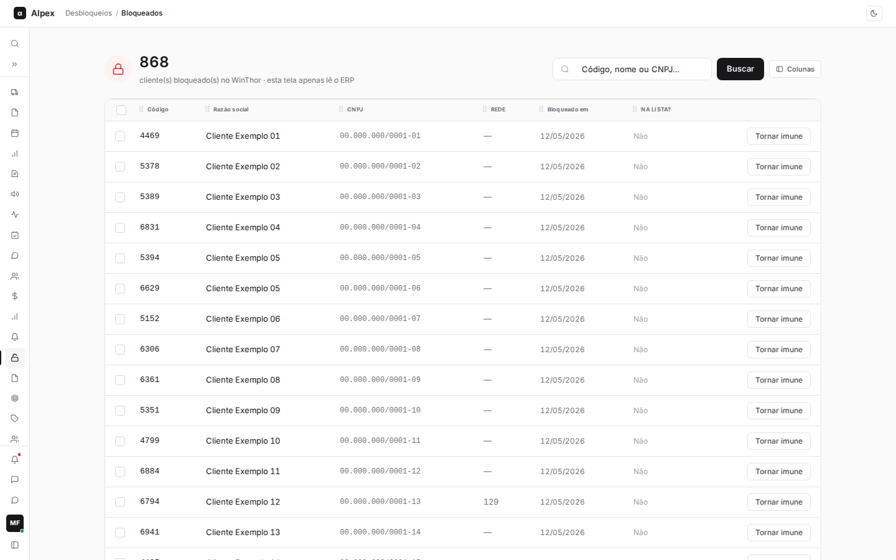
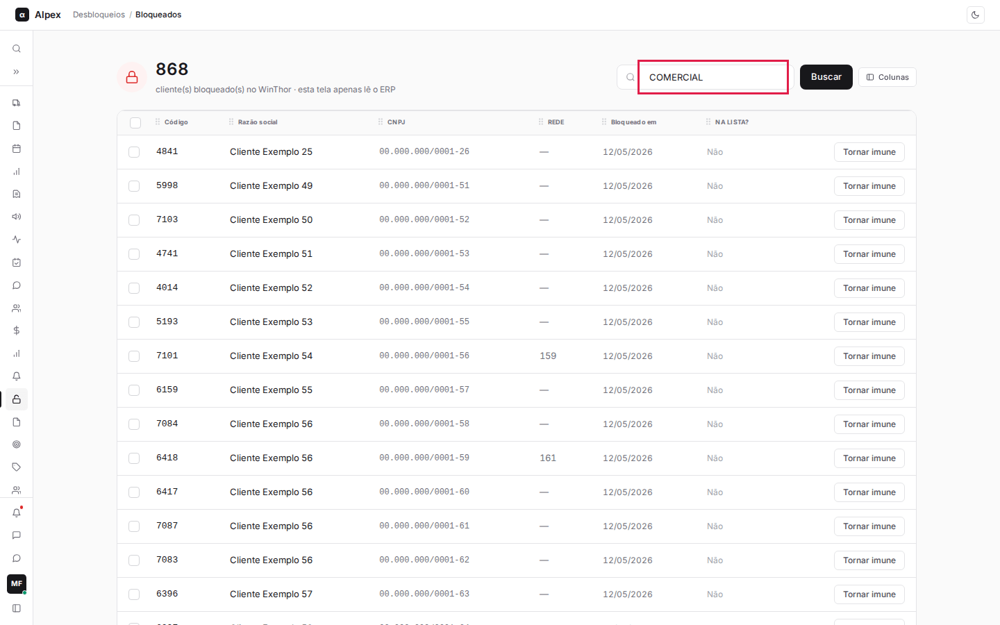
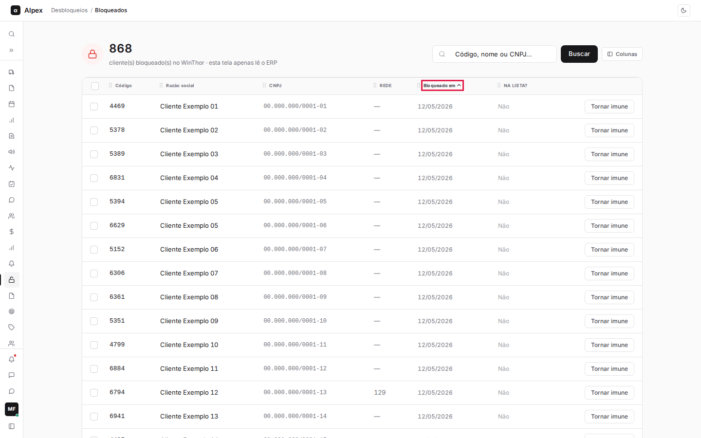
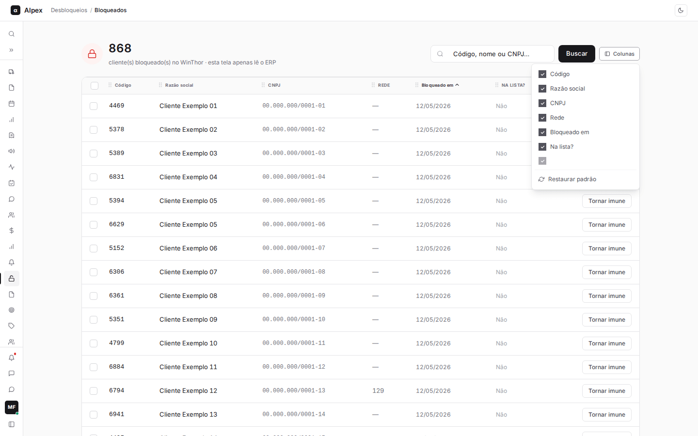
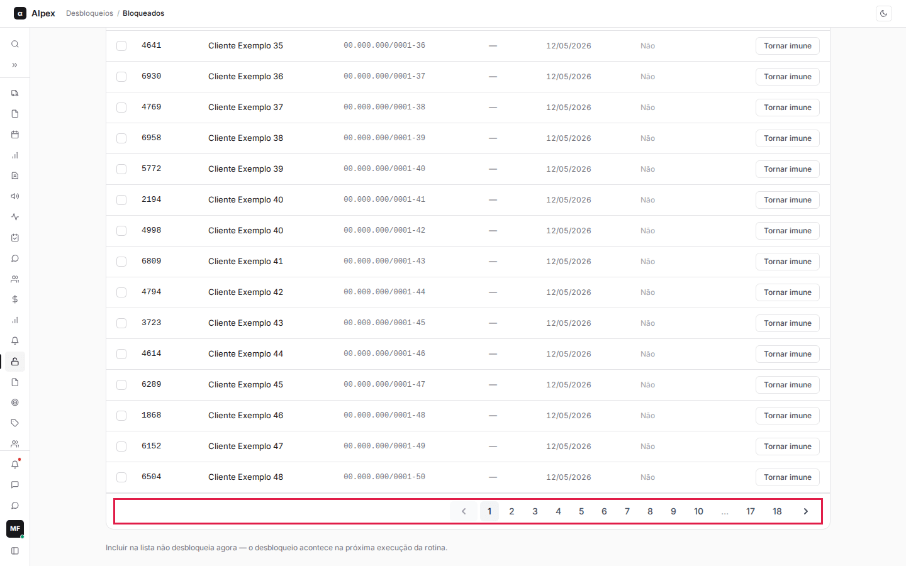
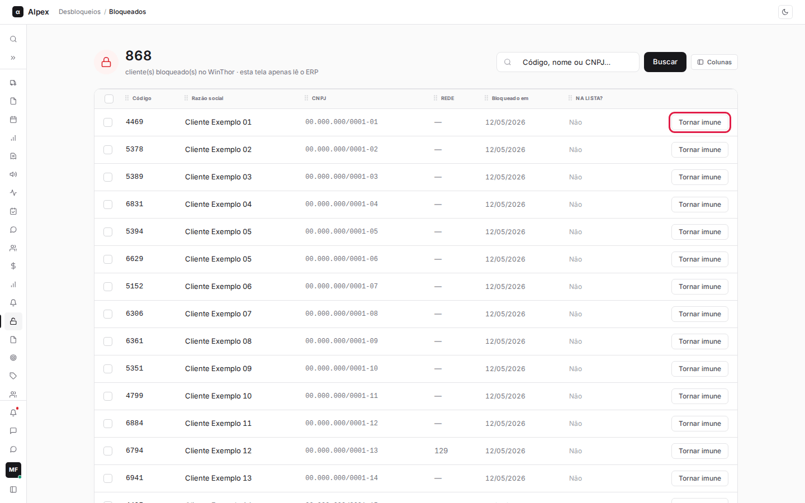
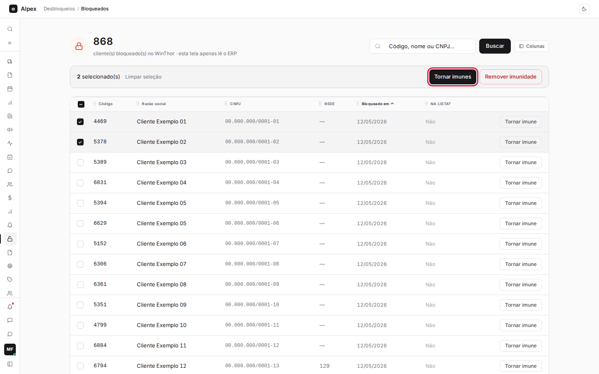
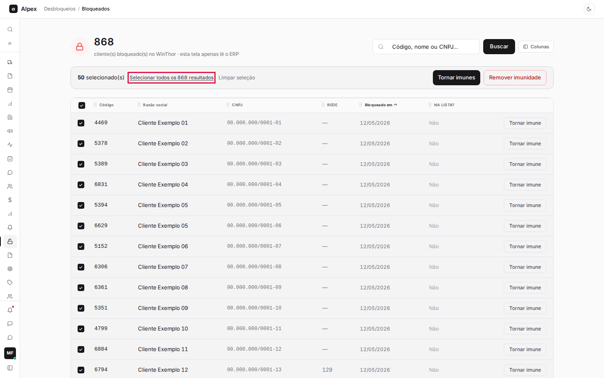
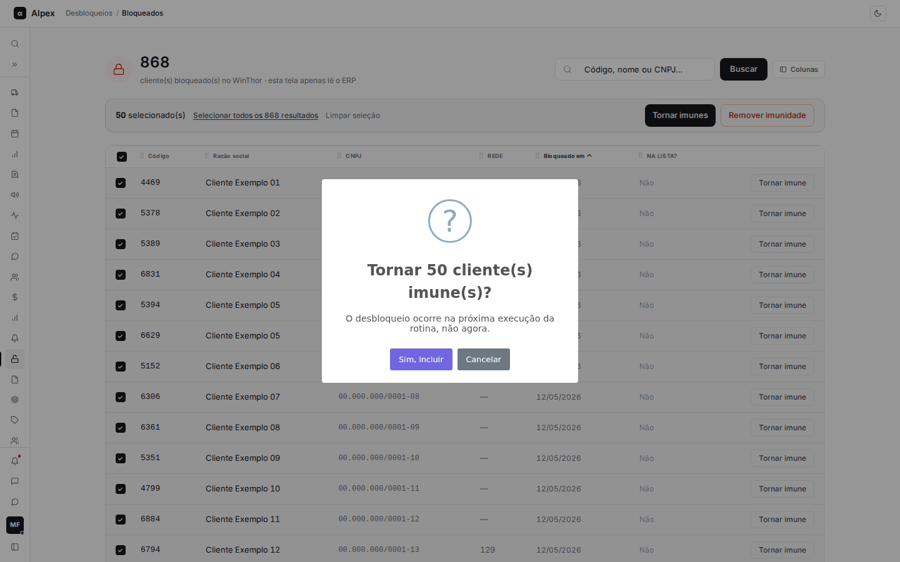

**Menu:** 1403 - Bloqueados

A tela Bloqueados mostra os clientes que estão bloqueados agora no WinThor e permite colocá-los na lista de imunes. Ela é usada por crédito e cadastro para decidir quem deve ser protegido do bloqueio.

**Como ler a tela.** O número grande no alto é o total de clientes bloqueados no WinThor. A tela só lê o ERP: abrir, buscar e filtrar não altera nada. A lista traz **Código**, **Razão social**, **CNPJ**, **Rede**, **Bloqueado em** (data em que o bloqueio foi ligado) e **Na lista?**, que diz se o cliente já é imune (**Imune**) ou não (**Não**).

**Que bloqueio aparece aqui.** A tela lista clientes com o bloqueio geral do WinThor ligado (o bloqueio por inadimplência). Ela não mostra os outros tipos de bloqueio (definitivo, inatividade, fiscal da SEFAZ, data de cheque, remessa de cobrança e venda para pessoa física) e o sistema também nunca os desbloqueia; veja a explicação completa em Clientes Imunes. Um cliente com bloqueio fiscal que não aparece aqui continua sem poder comprar, e isso não se resolve por esta tela.

**Importante: esta tela não desbloqueia ninguém na hora.** Não existe botão de desbloquear. O que se faz aqui é **Tornar imune**, isto é, colocar o cliente na lista. O desbloqueio no WinThor é feito pela rotina automática, na próxima execução, e só para clientes da lista.

## Buscar, ordenar, paginar e escolher colunas

<Steps>
  <Step title="Buscar">
    No campo **Código, nome ou CNPJ…** digite o que procura. A lista é filtrada enquanto você digita; o botão **Buscar** também aplica a busca. Para ver todos de novo, apague o campo.

    
  </Step>
  <Step title="Ordenar">
    Clique no título de **Código**, **Razão social** ou **Bloqueado em**. Um clique ordena em ordem crescente, outro inverte. A ordenação vale para a página que você está vendo.

    
  </Step>
  <Step title="Escolher colunas">
    Clique em **Colunas** para mostrar ou esconder colunas, ou em **Restaurar padrão**. Arrastar o ícone de pontinhos no título muda a posição da coluna.

    
  </Step>
  <Step title="Trocar de página">
    A lista tem 50 clientes por página. Use os números no rodapé da tabela para mudar de página.

    
  </Step>
</Steps>

<Note>
O número grande no alto continua sendo o total de bloqueados no WinThor mesmo quando há busca. Esta tela não tem exportação.
</Note>

## Tornar um cliente imune

<Steps>
  <Step title="Localizar o cliente">
    Procure o cliente na lista (use a busca se precisar). Na coluna **Na lista?**, **Não** indica que ele ainda não é imune.
  </Step>
  <Step title="Clicar em Tornar imune">
    Na linha do cliente, clique em **Tornar imune**.

    
  </Step>
</Steps>

<Warning>
Neste caminho não há janela de confirmação: ao clicar, o cliente entra na lista na hora, com origem **Manual** e o seu nome como responsável. Confira o cliente antes de clicar.
</Warning>

<Note>
Aparece um aviso de que o cliente foi incluído e que o desbloqueio ocorre na próxima execução da rotina, não agora. Depois da inclusão, a coluna **Na lista?** mostra **Imune** e o botão da linha vira **Remover imunidade**. Cliente pessoa física não pode ser incluído.
</Note>

## Tornar vários clientes imunes (seleção múltipla e selecionar todos)

<Steps>
  <Step title="Marcar os clientes">
    Marque a caixa no começo de cada linha. Uma barra aparece no alto com a contagem de **selecionado(s)**, os botões **Tornar imunes** e **Remover imunidade** e o link **Limpar seleção**.

    
  </Step>
  <Step title="Marcar a página inteira">
    A caixa no cabeçalho da tabela (**Selecionar todos da página**) marca os 50 clientes da página. Marcar de novo desmarca.
  </Step>
  <Step title="Marcar todos os resultados">
    Com a página inteira marcada e mais resultados nas outras páginas, aparece o link **Selecionar todos os N resultados**. Ele seleciona todos os clientes da busca atual, de todas as páginas.

    
  </Step>
  <Step title="Pedir a inclusão">
    Clique em **Tornar imunes**. O sistema pergunta **Tornar N cliente(s) imune(s)?** e avisa que o desbloqueio ocorre na próxima execução da rotina.

    
  </Step>
  <Step title="Confirmar ou cancelar">
    **Sim, incluir** inclui os clientes que ainda não estão na lista. **Cancelar** não muda nada.
  </Step>
</Steps>

<Warning>
Selecionar todos os resultados de uma busca ampla pode incluir centenas de clientes de uma vez. Confira o número na pergunta de confirmação antes de aceitar.
</Warning>

<Note>
Quem já é imune é ignorado na inclusão (a pergunta conta só os que ainda não estão na lista). Se algum cliente for recusado, por exemplo por ser pessoa física, o aviso final diz quantos não foram incluídos e mostra o motivo dos primeiros. A seleção é limpa ao final.
</Note>

## Remover a imunidade de um ou vários clientes

<Steps>
  <Step title="Encontrar o cliente imune">
    Na lista, o cliente que já está na lista de imunes mostra **Imune** em **Na lista?** e o botão **Remover imunidade** no lugar de **Tornar imune**.
  </Step>
  <Step title="Remover um cliente">
    Clique em **Remover imunidade** na linha. O sistema pergunta **Remover da lista de imunes?**; confirme com **Sim, remover** ou desista com **Cancelar**.
  </Step>
  <Step title="Remover vários">
    Marque os clientes e clique em **Remover imunidade** na barra do alto. O sistema pergunta **Remover N cliente(s) da lista de imunes?** e conta só os que realmente estão na lista. Confirme com **Sim, remover** ou desista com **Cancelar**.
  </Step>
</Steps>

<Warning>
Ao confirmar, o cliente sai da lista e deixa de ser desbloqueado pela rotina; ele volta a ser bloqueado normalmente pelo WinThor quando a regra de crédito dele disparar. Esse caminho não foi demonstrado com print porque nenhum cliente bloqueado estava na lista de imunes no momento da captura.
</Warning>
