**Menu:** 1401 - Clientes Imunes

A lista de clientes imunes reúne os clientes que não podem ficar bloqueados no WinThor (grandes redes e contas-chave). Crédito, cadastro e comercial usam esta tela para incluir e retirar clientes da lista.

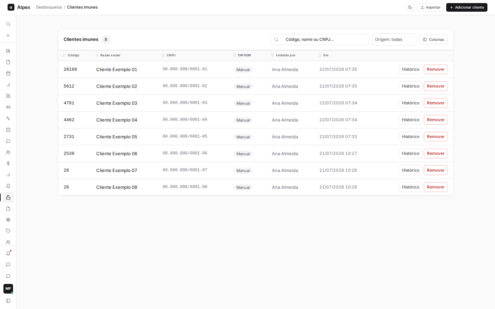

**O que é um cliente imune.** O WinThor bloqueia automaticamente o cliente que atrasa pagamentos, e o bloqueio impede novos pedidos. Para alguns clientes estratégicos esse bloqueio não é desejado. Quem está na lista de imunes é desbloqueado pela rotina automática de desbloqueio, que roda de madrugada, antes do faturamento do dia. A imunidade vale até alguém remover o cliente da lista: não tem data de validade.

**O que a rotina remove e o que ela nunca remove.** No cadastro do cliente no WinThor existem vários bloqueios independentes. A rotina mexe em um só: o bloqueio geral, o mesmo que o WinThor liga quando o cliente fica inadimplente. Ela não olha o motivo do bloqueio: se o cliente da lista está com o bloqueio geral ligado, ele é desbloqueado.

Os outros bloqueios nunca são alterados pelo sistema, mesmo que o cliente esteja na lista:
- bloqueio definitivo;
- bloqueio por inatividade (cliente sem compras no período);
- bloqueio fiscal da SEFAZ e bloqueio fiscal de pedido;
- bloqueio por data de cheque;
- bloqueio de remessa de cobrança;
- bloqueio de venda para pessoa física.

O motivo é de segurança: reverter um bloqueio fiscal ou definitivo não é decisão do crédito, e errar nisso traz custo financeiro e problema com o fisco. Por isso o sistema escreve só no bloqueio geral. Se um cliente continuar sem poder comprar depois da rotina, o bloqueio que sobrou é de outro tipo e precisa ser tratado por quem cuida dele.

A lista também não impede que o WinThor bloqueie o cliente de novo: a rotina desfaz o efeito a cada rodada, não a causa. Só entram na lista clientes pessoa jurídica (com CNPJ); cliente pessoa física é recusado.

## Buscar, filtrar, ordenar e escolher colunas da lista

<Steps>
  <Step title="Buscar na lista">
    No campo **Código, nome ou CNPJ…** digite parte do nome, o código ou o CNPJ. A lista é filtrada enquanto você digita.

    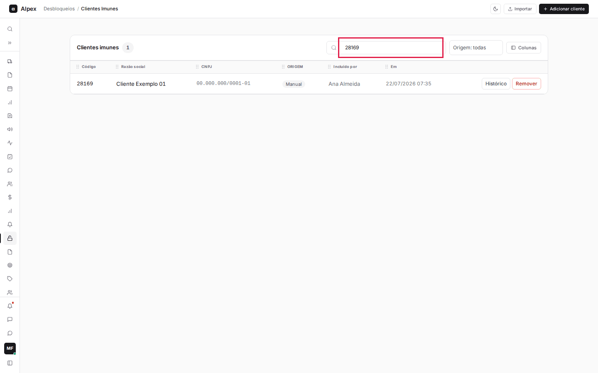
  </Step>
  <Step title="Filtrar por origem">
    No seletor **Origem: todas** escolha **Manual** (cliente incluído um a um nesta tela) ou **Importação** (cliente que veio de planilha). Para voltar a ver todos, escolha **Origem: todas**.

    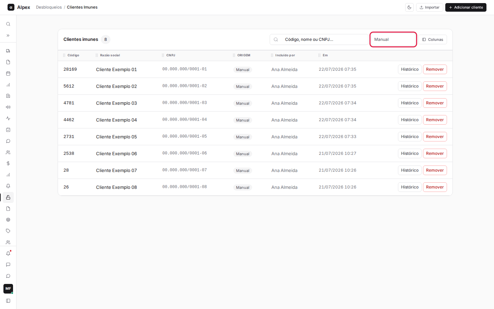
  </Step>
  <Step title="Ordenar">
    Clique no título de uma coluna ordenável (**Código**, **Razão social**, **CNPJ**, **Incluído por** ou **Em**). Um clique ordena em ordem crescente, outro clique inverte. A seta no título mostra a ordem atual.

    
  </Step>
  <Step title="Escolher e reordenar colunas">
    Clique em **Colunas** e marque ou desmarque as colunas que quer ver. **Restaurar padrão** volta ao desenho original. Também dá para arrastar o ícone de pontinhos no título de uma coluna para mudar a posição dela. Sua escolha fica salva para o seu usuário.

    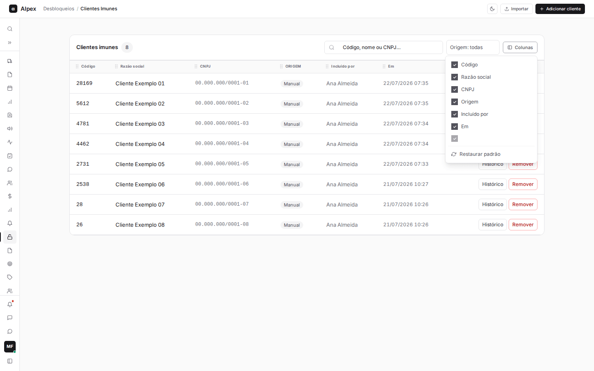
  </Step>
</Steps>

<Note>
A lista mostra os 200 cadastros mais recentes. O número ao lado de **Clientes imunes** é a quantidade de cadastros que aparece com o filtro atual. Esta tela não tem exportação.
</Note>

## Ver o histórico de um cliente imune

<Steps>
  <Step title="Abrir o histórico">
    Na linha do cliente, clique em **Histórico**.
  </Step>
  <Step title="Ler as duas seções">
    A janela mostra **Bloqueio no ERP (WinThor)**, com os bloqueios e desbloqueios do cliente (data, quem fez e por qual programa), e **Cadastro na lista de imunes**, com quem incluiu, importou ou alterou o cadastro do cliente e quando. Para fechar, clique no **X** ou aperte **Esc**.

    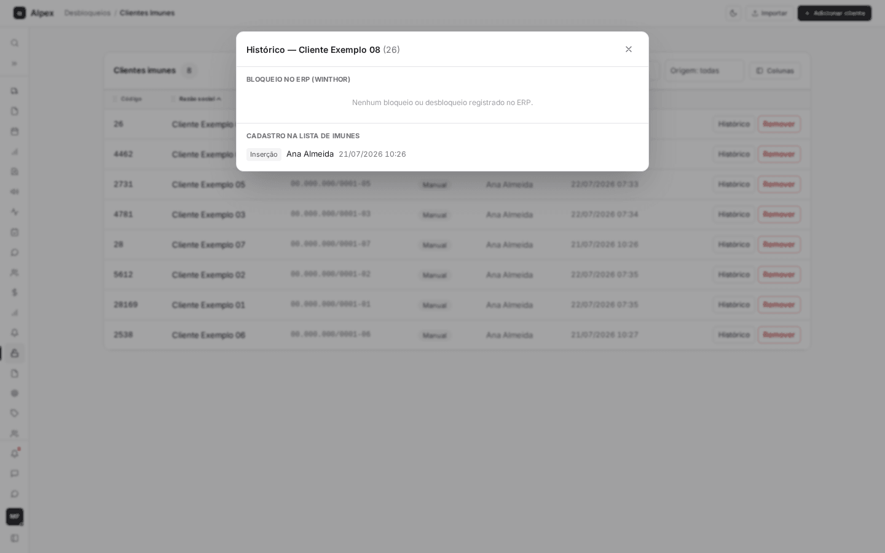
  </Step>
</Steps>

<Note>
Use o histórico para responder "quando esse cliente foi bloqueado e desbloqueado" e "quem colocou esse cliente na lista".
</Note>

## Adicionar um cliente à lista

<Steps>
  <Step title="Abrir a janela de busca">
    No alto da tela, clique em **Adicionar cliente**.

    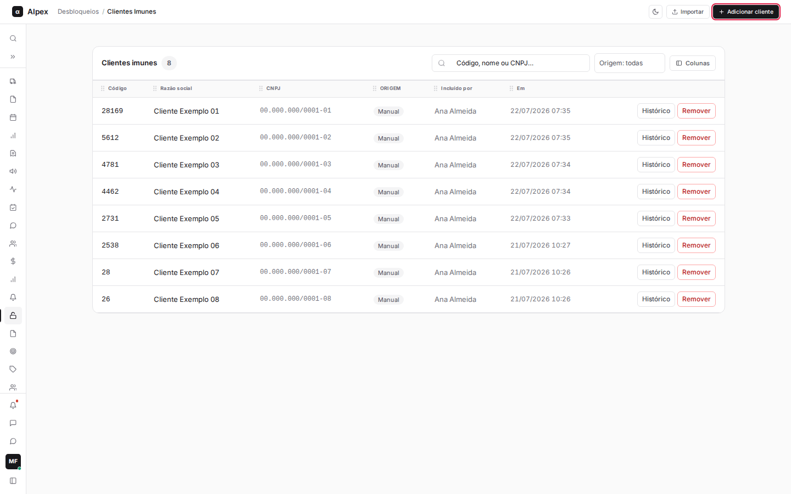
  </Step>
  <Step title="Escolher como buscar">
    Em **Buscar por** escolha **Código do cliente**, **Razão social**, **CNPJ**, **Código da rede** ou **Nome da rede**. A busca é feita direto no WinThor.

    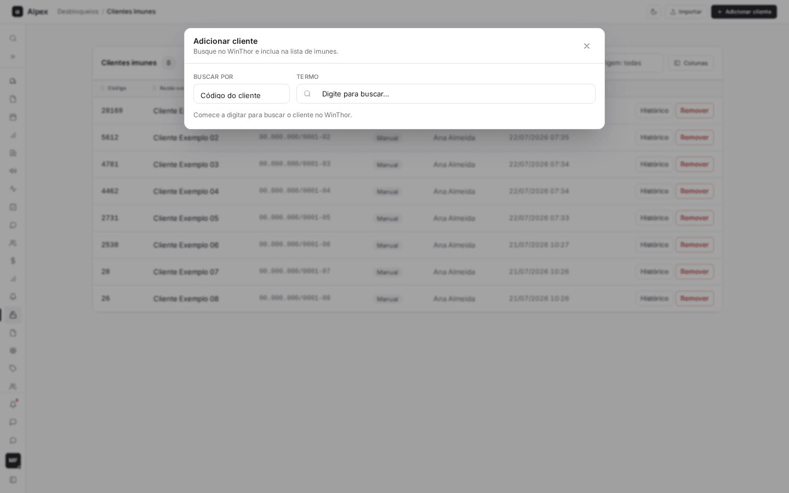
  </Step>
  <Step title="Digitar o termo">
    Em **Termo** digite o que procura. Na busca por razão social, CNPJ ou nome da rede são necessários pelo menos 2 caracteres. Os resultados aparecem na tabela, com **Código**, **Razão social**, **CNPJ**, **Rede** e **Situação**. Cliente que já está na lista aparece com a marca **Na lista** e não tem o botão **Incluir**.

    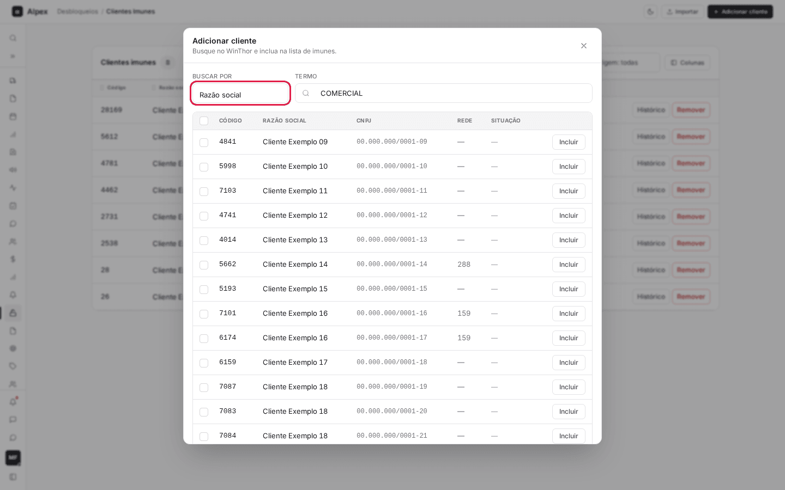
  </Step>
  <Step title="Incluir o cliente">
    Na linha do cliente certo, clique em **Incluir**. O sistema mostra os dados lidos do WinThor (código, razão social, CNPJ e rede) para você conferir.

    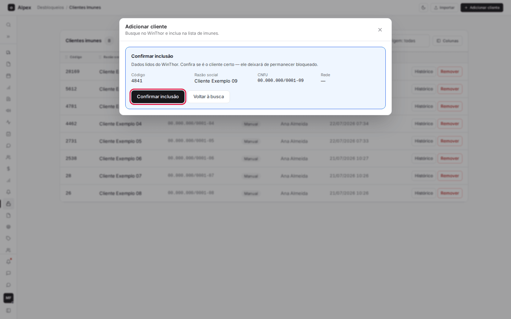
  </Step>
  <Step title="Confirmar">
    Clique em **Confirmar inclusão**. Para desistir, clique em **Voltar à busca**.
  </Step>
</Steps>

<Note>
Ao confirmar, o cliente entra na lista e aparece na tela com origem **Manual** e o seu nome em **Incluído por**. Ele não é desbloqueado na hora: o desbloqueio acontece na próxima execução da rotina. Cliente pessoa física (CPF) não pode ser incluído, e o mesmo cliente não entra duas vezes.
</Note>

## Adicionar vários clientes de uma vez (seleção múltipla e selecionar todos)

<Steps>
  <Step title="Buscar os clientes">
    Abra **Adicionar cliente** e faça a busca como no passo a passo anterior.
  </Step>
  <Step title="Marcar os clientes">
    Marque a caixa no começo de cada linha que quer incluir. Clientes que já estão na lista não têm caixa. No rodapé da janela aparece a contagem **selecionado(s)**; **Limpar seleção** desmarca tudo.

    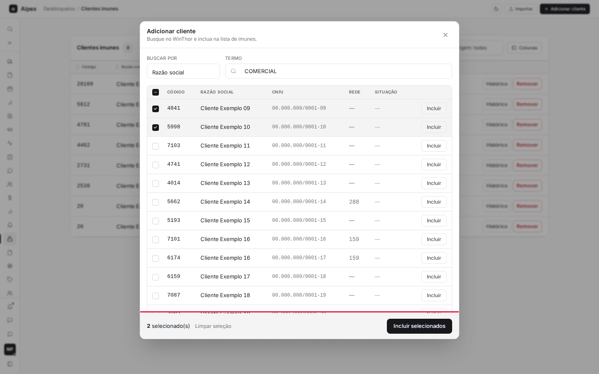
  </Step>
  <Step title="Selecionar todos os resultados">
    Para marcar de uma vez todos os clientes que a busca trouxe, marque a caixa do cabeçalho da tabela (**Selecionar todos os resultados**). Marcar de novo desmarca todos.

    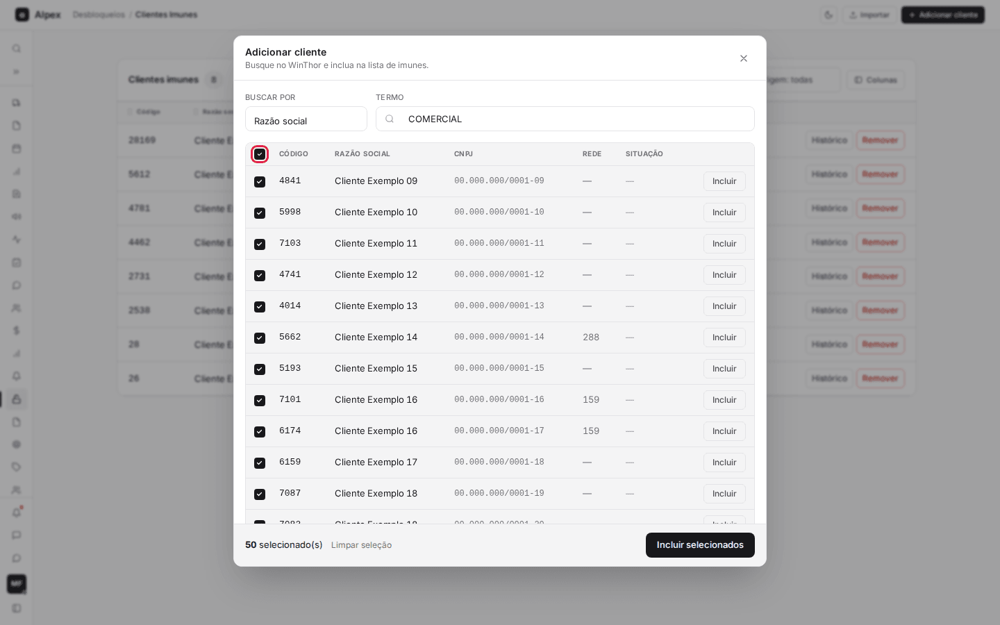
  </Step>
  <Step title="Revisar a inclusão">
    No rodapé, clique em **Incluir selecionados**. A janela lista todos os clientes lidos do WinThor para conferência. Quem já está na lista aparece como **Já na lista**, e cliente pessoa física aparece como **Pessoa física · não entra**: esses dois não são incluídos.

    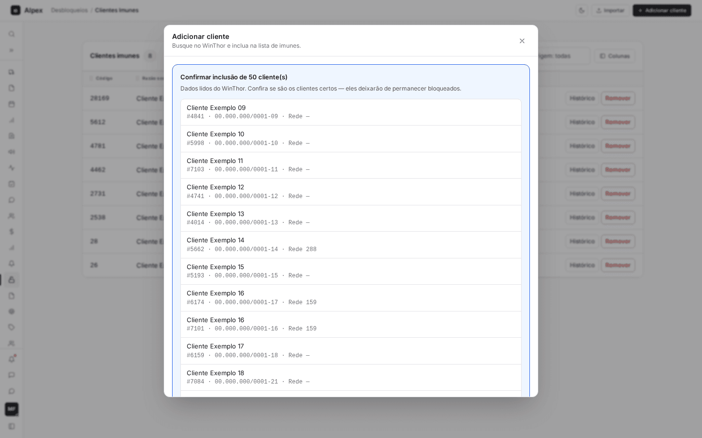
  </Step>
  <Step title="Confirmar ou voltar">
    **Confirmar inclusão de N** inclui os clientes elegíveis; **Voltar à busca** retorna sem incluir nada.
  </Step>
</Steps>

<Note>
A seleção continua marcada quando você troca o termo de busca, então dá para juntar resultados de buscas diferentes. Ao confirmar, aparece um aviso com quantos clientes foram incluídos e, se algum foi recusado, o motivo dos primeiros. Como na inclusão individual, o desbloqueio acontece só na próxima execução da rotina.
</Note>

## Remover um cliente da lista

<Steps>
  <Step title="Pedir a remoção">
    Na linha do cliente, clique em **Remover** (botão vermelho).
  </Step>
  <Step title="Conferir a pergunta">
    O sistema pergunta **Remover da lista de imunes?** e mostra o nome do cliente.

    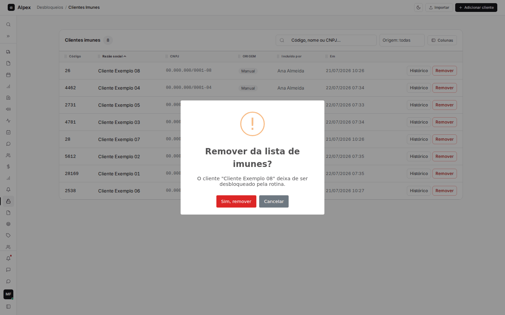
  </Step>
  <Step title="Confirmar ou cancelar">
    **Sim, remover** tira o cliente da lista. **Cancelar** não muda nada.
  </Step>
</Steps>

<Warning>
Depois de removido, o cliente deixa de ser desbloqueado pela rotina e volta a ser bloqueado normalmente pelo WinThor quando a regra de crédito dele disparar. O cadastro some da lista, e a remoção fica registrada na auditoria, com o nome de quem removeu. Para incluir o cliente de novo, é preciso adicioná-lo outra vez.
</Warning>

## Importar clientes por planilha

<Steps>
  <Step title="Abrir a importação">
    No alto da tela, clique em **Importar**. A janela **Importar planilha** mostra as colunas aceitas e o histórico de **Importações anteriores**.

    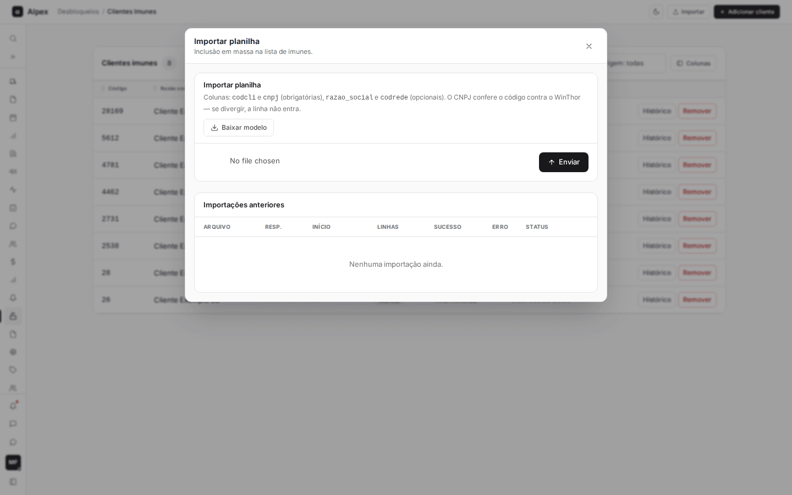
  </Step>
  <Step title="Baixar o modelo">
    Clique em **Baixar modelo** para receber uma planilha de exemplo. As colunas são **codcli** e **cnpj** (obrigatórias) e **razao_social** e **codrede** (opcionais).
  </Step>
  <Step title="Escolher o arquivo">
    Preencha a planilha e escolha o arquivo no campo de arquivo. São aceitos .xlsx, .xls e .csv, de até 10 MB. O nome do arquivo escolhido aparece ao lado do botão.

    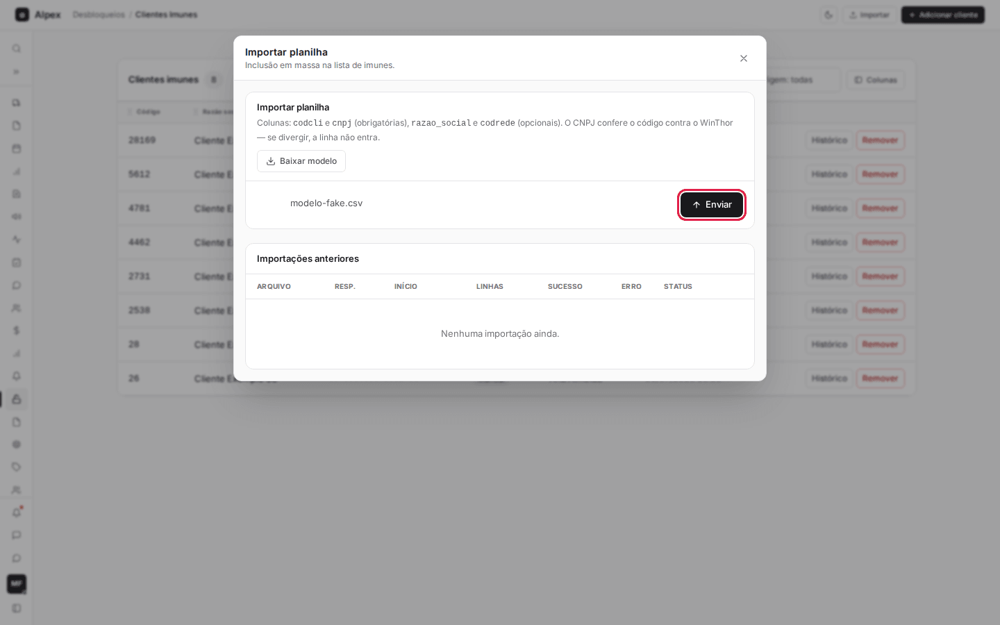
  </Step>
  <Step title="Enviar">
    Clique em **Enviar**. É aqui que a importação começa: não existe uma tela intermediária de conferência antes de gravar.
  </Step>
</Steps>

<Warning>
Ao clicar em **Enviar** o sistema processa o arquivo e inclui na lista as linhas válidas. Confira a planilha antes de enviar.
</Warning>

<Note>
O CNPJ de cada linha é conferido contra o código no WinThor: se não bater, a linha não entra. As linhas com problema não impedem as demais: as boas entram e as ruins ficam num relatório do lote, com o motivo de cada uma (**Código inexistente no WinThor**, **Cliente já está na lista**, **Formato inválido** ou **CNPJ não confere com o código**). Cliente pessoa física (CPF) também é recusado como formato inválido. Enquanto o lote processa, a janela mostra o andamento; ao terminar, mostra o total de **Linhas**, **Sucesso** e **Erro**. Importações anteriores ficam na lista da janela, e o botão **Ver** de cada uma abre o resultado.
</Note>
