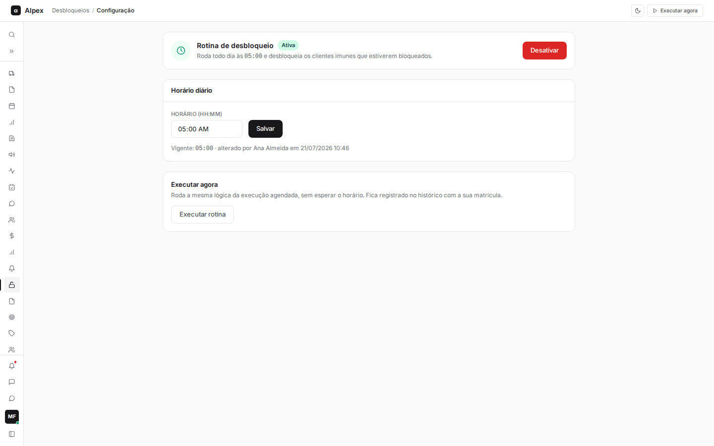
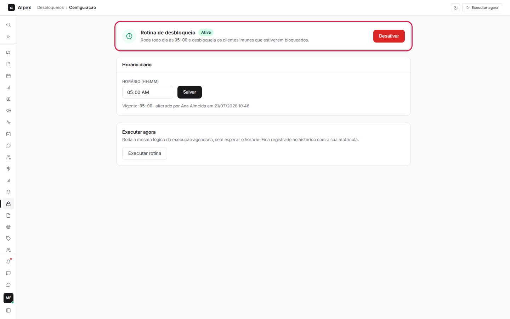
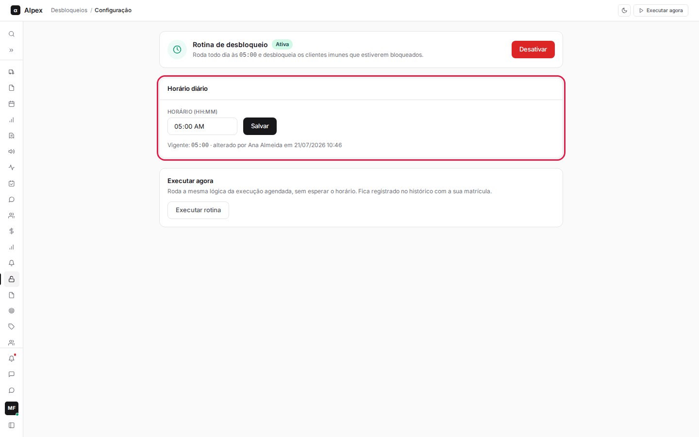
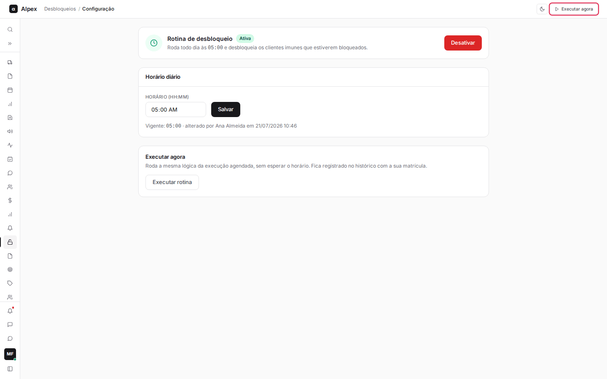
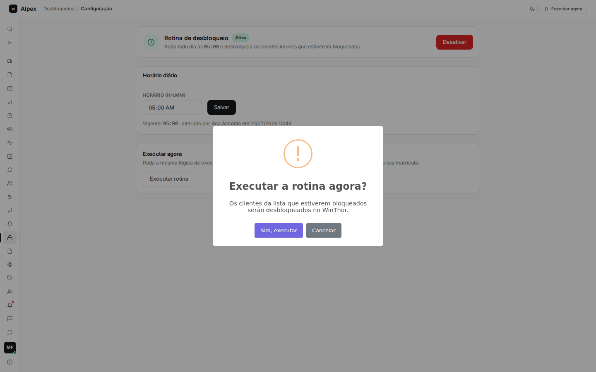

**Menu:** 1410 - Configuração

Nesta tela se define em que horário a rotina de desbloqueio roda todo dia, liga-se ou desliga-se a rotina e é possível executá-la na hora. Costuma ser usada por quem administra o módulo, na equipe de crédito ou na TI.

**Quem acessa:** administradores do sistema ou quem tem o acesso específico de configuração dos Desbloqueios (código 501110). Sem isso, a opção **1410 - Configuração** não aparece no menu.

## Ativar ou desativar a rotina

<Steps>
  <Step title="Ver o estado atual">
    O quadro **Rotina de desbloqueio** mostra a etiqueta **Ativa** ou **Desativada**. Quando ativa, ele informa o horário em que roda todo dia. Quando desativada, informa que nenhum cliente é desbloqueado automaticamente.

    
  </Step>
  <Step title="Alternar">
    Clique em **Desativar** (botão vermelho) ou em **Ativar rotina** (botão verde). A mudança vale na hora, aparece um aviso ("Rotina ativada." ou "Rotina desativada — nenhum cliente será desbloqueado automaticamente.") e fica registrada no Histórico.
  </Step>
</Steps>

<Warning>
Com a rotina **Desativada**, nenhum cliente é desbloqueado automaticamente, e os clientes imunes bloqueados pelo ERP continuam bloqueados até alguém agir. A rotina nasce desligada de propósito: antes de ativar, confirme o horário. Se ela rodar antes da régua de crédito do ERP, o cliente é bloqueado de novo depois e o desbloqueio não tem efeito.
</Warning>

## Alterar o horário diário

<Steps>
  <Step title="Conferir o horário vigente">
    No quadro **Horário diário**, abaixo do campo, a linha **Vigente** mostra o horário atual, quem o alterou e quando (ou "nunca alterado desde a instalação").

    
  </Step>
  <Step title="Informar o novo horário">
    No campo **Horário (HH:MM)**, digite o novo horário, por exemplo 05:00.
  </Step>
  <Step title="Salvar">
    Clique em **Salvar**. Aparece o aviso "Horário da rotina atualizado." e a rotina passa a rodar no novo horário, sem nenhuma intervenção da TI. A alteração fica registrada no Histórico com o horário anterior e o novo.
  </Step>
</Steps>

<Note>
Se outra pessoa alterou o horário depois que você abriu a tela, o sistema recusa a sua alteração, mostra o horário atual e recarrega a tela: confira e tente de novo. Um horário vazio ou inválido também é recusado, e o horário anterior continua valendo. A rotina roda uma vez por dia; mudar o horário não dispara nada na hora.
</Note>

## Executar a rotina agora (disparo manual)

<Steps>
  <Step title="Abrir a confirmação">
    Clique em **Executar rotina** (no quadro **Executar agora**) ou em **Executar agora**, no canto superior direito da tela. Os dois fazem a mesma coisa.

    
  </Step>
  <Step title="Ler a confirmação">
    Abre a pergunta **Executar a rotina agora?** avisando que os clientes da lista que estiverem bloqueados serão desbloqueados no WinThor. Para desistir, clique em **Cancelar**: nada é feito.

    
  </Step>
  <Step title="Confirmar">
    Clique em **Sim, executar**. A rotina roda na hora, com as mesmas regras da execução agendada, e ao terminar aparece um resumo com elegíveis, desbloqueados, falhas e não elegíveis. A rodada fica registrada na tela **Execuções** como **Manual**, com o seu nome.
  </Step>
</Steps>

<Warning>
Confirmar altera o cadastro de clientes no ERP: todo cliente da lista que estiver bloqueado é desbloqueado de verdade, e não há botão para desfazer. Se já houver uma rodada em andamento, o sistema recusa o novo disparo e avisa.
</Warning>
