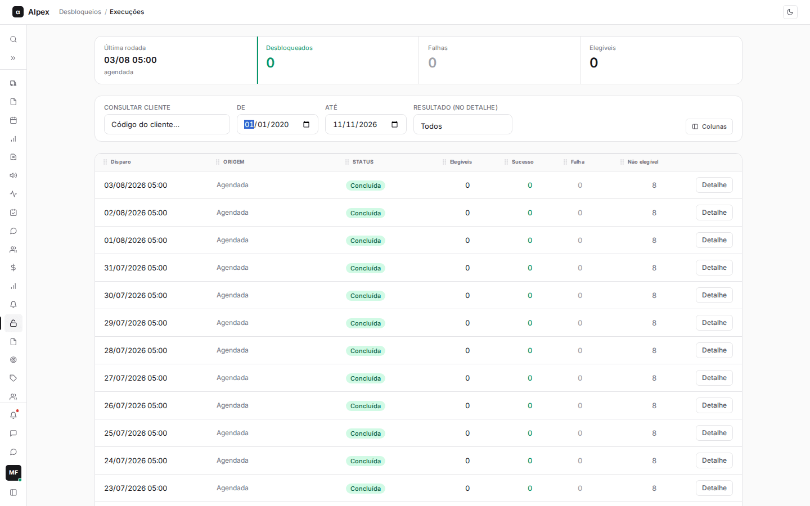
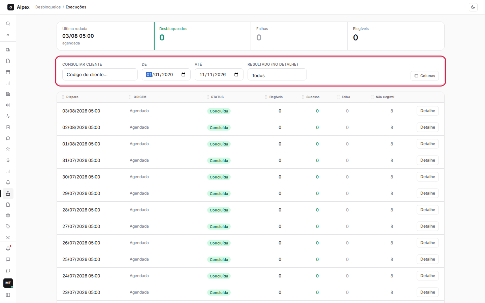
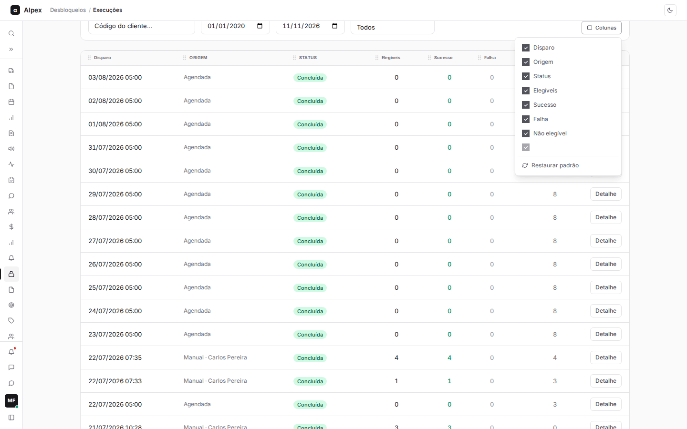
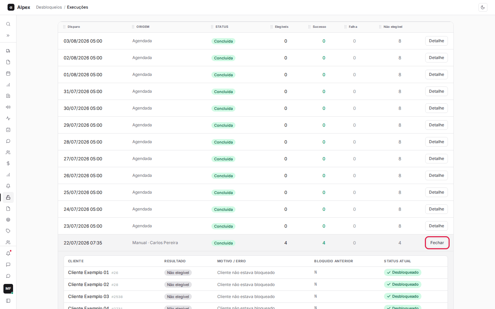
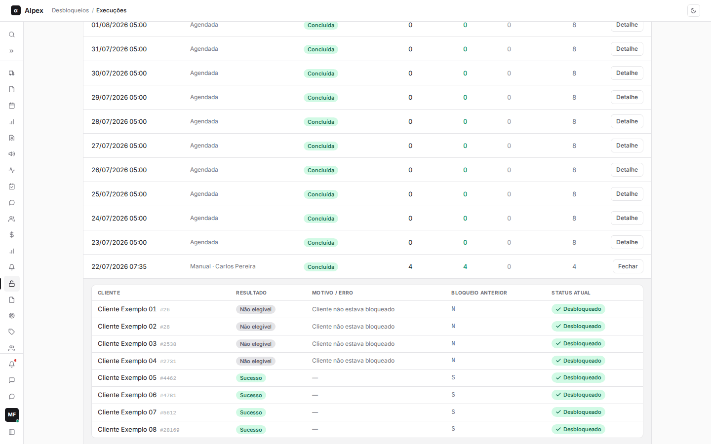
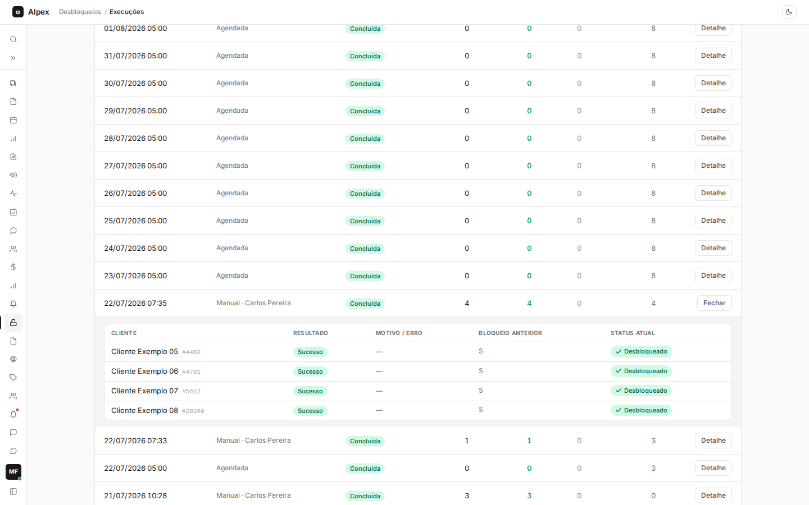
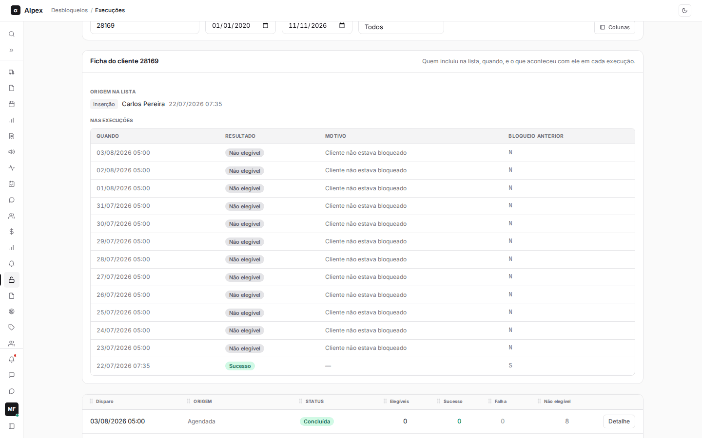

**Menu:** 1404 - Execuções

Esta tela mostra o resultado de cada rodada da rotina de desbloqueio: quando rodou, se foi automática ou manual e quantos clientes foram desbloqueados. É usada pela equipe de crédito e pelo cadastro para conferir se a rotina fez o esperado. Quem tem o acesso ao módulo Desbloqueios (código 501109) pode abrir esta tela.

**Como a rotina funciona, em resumo**

- **O que é:** alguns clientes estratégicos ficam numa lista de **clientes imunes** (tela Clientes Imunes). Quando o ERP (WinThor) bloqueia um deles por inadimplência, a rotina tira esse bloqueio, para o pedido não travar.
- **Quando roda:** todo dia, no horário definido na tela **Configuração** (hoje 05:00), desde que a rotina esteja **Ativa**. Também pode ser disparada na hora por alguém com acesso à Configuração. Duas rodadas nunca acontecem ao mesmo tempo.
- **O que faz com cada cliente da lista:** consulta o ERP e, se o cliente está bloqueado, desfaz o bloqueio. Cada cliente é tratado separadamente: se um falhar, os outros continuam.
- **O que ignora:** clientes que não estavam bloqueados (nada a fazer) e clientes cujo código não existe no ERP. Os dois aparecem como **Não elegível**, cada um com seu motivo. Clientes removidos da lista (inativos) nem são consultados. Quem entra na lista depois do horário do dia só é tratado na rodada do dia seguinte.
- **O que nunca é desbloqueado:** a rotina mexe somente no bloqueio de crédito do cliente. Outros tipos de bloqueio do ERP (por exemplo, bloqueio fiscal da SEFAZ, bloqueio definitivo ou por inatividade) não são alterados. Se o cliente tiver um deles, continua bloqueado.
- **Quem é avisado:** se uma rodada terminar com erro, o sistema envia um aviso por WhatsApp para o número definido pela equipe de TI (se não houver número, nenhum aviso é enviado). O aviso traz os totais e manda abrir esta tela para ver quais clientes falharam. Não há tela para cadastrar esse número: pedir à TI.

## Ler a lista de execuções e filtrar por período

<Steps>
  <Step title="Ver o resumo da última rodada">
    No alto da tela, o quadro mostra a **Última rodada** (data, hora e se foi agendada ou manual), quantos clientes foram **Desbloqueados**, quantas **Falhas** houve e quantos eram **Elegíveis** (clientes que estavam bloqueados e que a rotina tentou desbloquear). Se a lista abaixo estiver filtrada por período, o resumo acompanha o filtro.
  </Step>
  <Step title="Ler a tabela">
    Cada linha é uma rodada, da mais recente para a mais antiga. As colunas são **Disparo** (data e hora), **Origem** (**Agendada** ou **Manual** com o nome de quem disparou), **Status**, **Elegíveis**, **Sucesso**, **Falha** e **Não elegível**.

    O **Status** pode ser **Concluída** (nenhuma falha), **Com erro** (houve falha em algum cliente ou na consulta ao ERP) ou **Em andamento** (a rodada ainda está rodando).
  </Step>
  <Step title="Escolher o período">
    Nos campos **De** e **Até**, informe as datas. A tela abre mostrando os últimos 30 dias; para ver rodadas mais antigas, volte a data do campo **De**. A tela exibe, no máximo, as 100 rodadas mais recentes do período.

    
  </Step>
  <Step title="Ordenar e escolher colunas">
    Clique no título de **Disparo**, **Elegíveis**, **Sucesso**, **Falha** ou **Não elegível** para ordenar. Clique em **Colunas** para esconder, mostrar ou reordenar colunas; **Restaurar padrão** volta ao original.

    
  </Step>
</Steps>

<Note>
Se aparecer "Nenhuma execução no período", amplie o intervalo de datas ou espere a próxima rodada agendada. Numa rodada em que a lista de imunes está vazia, os totais ficam zerados e nenhum cliente é processado.
</Note>

## Abrir o detalhe de uma execução e ler os clientes processados

<Steps>
  <Step title="Abrir o detalhe">
    Na linha da rodada, clique em **Detalhe**. O botão passa a se chamar **Fechar**; clique nele para recolher.

    
  </Step>
  <Step title="Ler os clientes">
    Abaixo da linha aparece uma tabela com um registro por cliente da lista: **Cliente** (nome e código), **Resultado**, **Motivo / erro**, **Bloqueio anterior** e **Status atual**.

    - **Sucesso**: o cliente estava bloqueado e foi desbloqueado. **Bloqueio anterior** mostra S (estava bloqueado) e **Status atual** mostra **Desbloqueado**.
    - **Não elegível**: nada foi alterado. O **Motivo / erro** diz o porquê: **Cliente não estava bloqueado** ou **Código não existe no WinThor**.
    - **Falha**: o ERP recusou ou deu erro ao desbloquear aquele cliente. A mensagem de erro aparece em **Motivo / erro** e o **Status atual** fica **Bloqueado**. Os outros clientes da rodada não são afetados.

    
  </Step>
  <Step title="Filtrar o detalhe por resultado">
    No campo **Resultado (no detalhe)**, escolha **Sucesso**, **Falha** ou **Não elegível** para ver só esses clientes. **Todos** remove o filtro. O filtro vale para o detalhe aberto.

    
  </Step>
</Steps>

<Note>
Esta tela é só de consulta: não há botão para reprocessar nem exportar. Para tentar de novo um cliente que falhou, resolva o motivo no ERP e execute a rotina pela tela Configuração (ou espere a rodada do dia seguinte). Para o motivo de uma falha, use a mensagem de **Motivo / erro**.
</Note>

## Consultar a ficha de um cliente

<Steps>
  <Step title="Digitar o código do cliente">
    No campo **Consultar cliente**, digite o código do cliente (somente números). A busca é automática, sem botão: ao parar de digitar, a ficha aparece. Apague o campo para escondê-la.
  </Step>
  <Step title="Ler a ficha">
    A ficha mostra **Origem na lista** (quem incluiu o cliente, como **Inserção** ou **Importação**, e quando, com o nome da planilha se veio de importação) e **Nas execuções** (cada passagem do cliente pela rotina: **Quando**, **Resultado**, **Motivo** e **Bloqueio anterior**).

    
  </Step>
</Steps>

<Note>
Se o cliente nunca esteve na lista de imunes, a ficha avisa que ele nunca foi processado pela rotina. Se foi incluído mas ainda não passou por nenhuma rodada, a ficha informa a data de inclusão: ele entra na próxima rodada a partir dela.
</Note>
