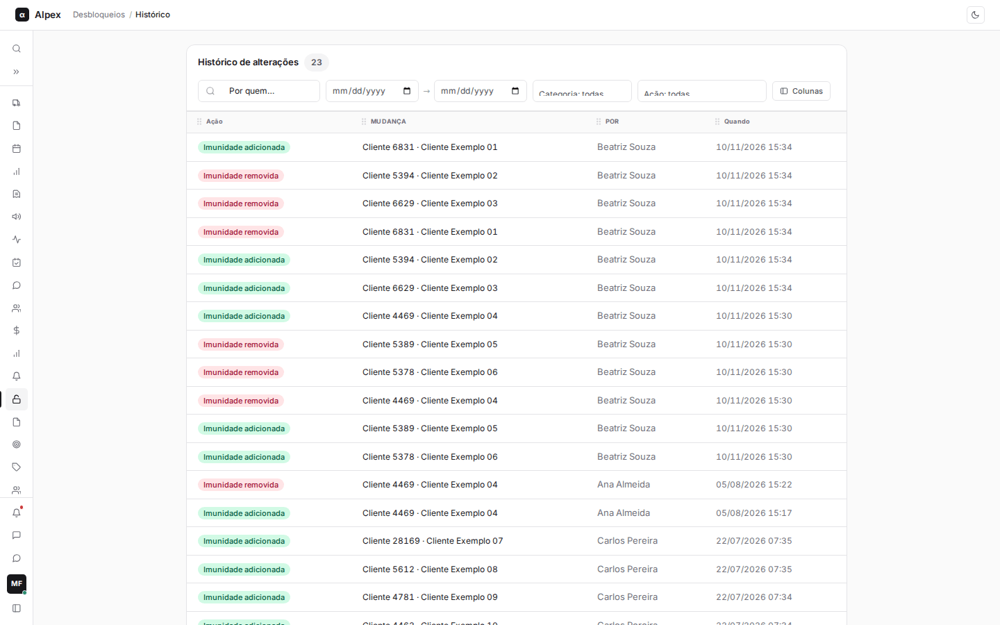
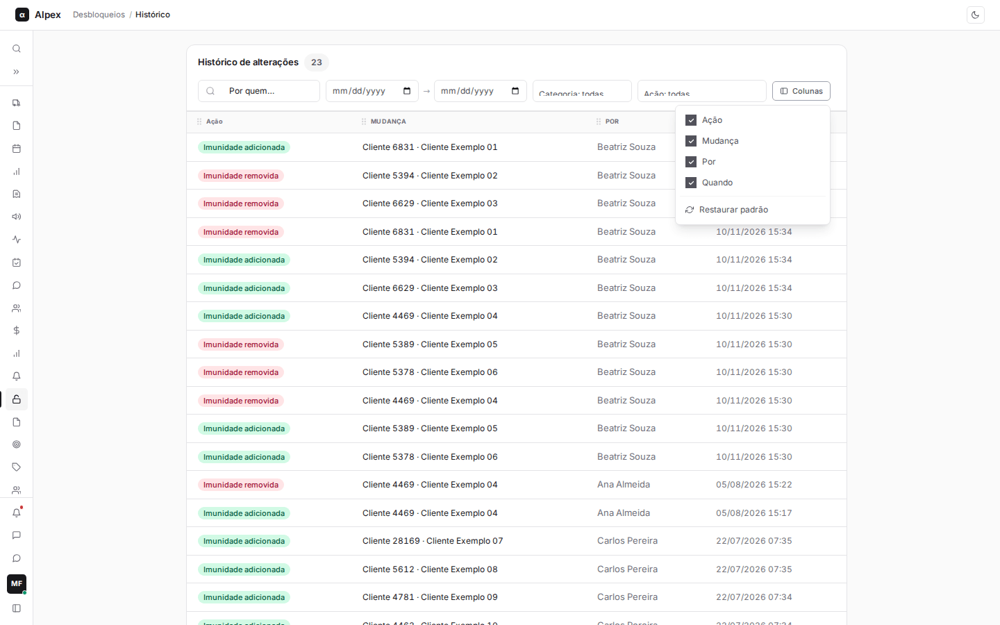
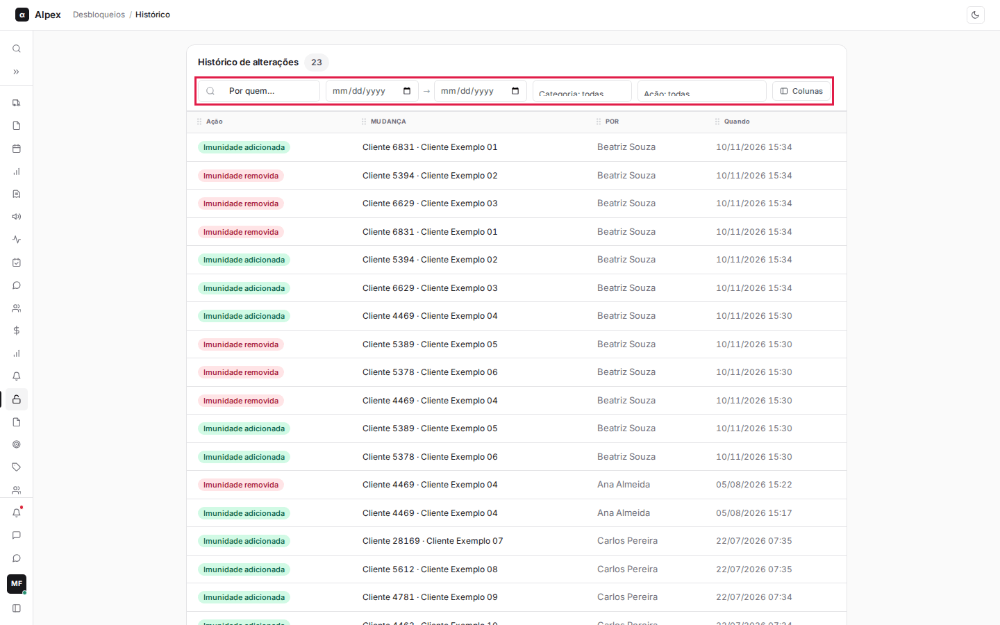
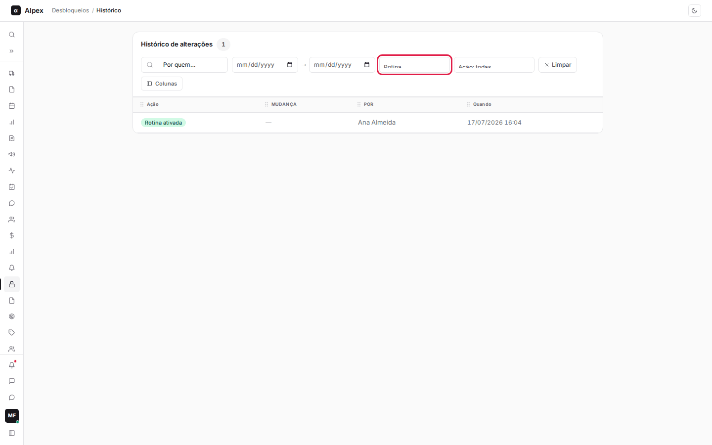
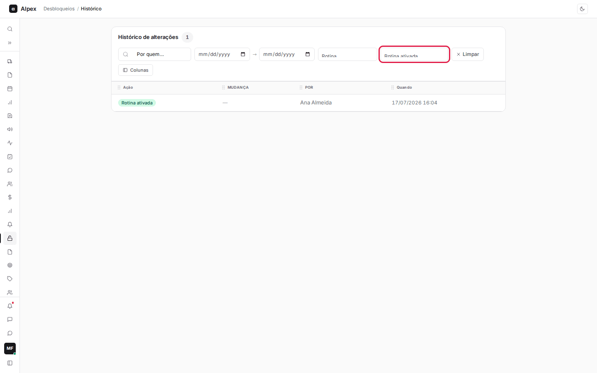

**Menu:** 1411 - Histórico

O Histórico é o registro de auditoria do módulo: mostra quem ligou, desligou ou mudou o horário da rotina e quem adicionou, importou ou removeu clientes da lista de imunes. É usado por gestores para saber quem mudou o quê e quando. A tela é só de consulta.

**Quem acessa:** é preciso ter o acesso específico ao Histórico (código 501111) e também o acesso ao módulo Desbloqueios (501109). Sem os dois, a opção não aparece no menu.

## Ler o histórico de alterações

<Steps>
  <Step title="Entender as colunas">
    Cada linha é uma alteração, da mais recente para a mais antiga. As colunas são **Ação** (por exemplo **Imunidade adicionada**, **Imunidade removida**, **Imunidade importada**, **Horário alterado**, **Rotina ativada**, **Rotina desativada**), **Mudança** (o cliente afetado, ou o horário anterior e o novo), **Por** (quem fez) e **Quando**. O número ao lado do título é o total de alterações exibidas.
  </Step>
  <Step title="Ordenar e escolher colunas">
    Clique no título de **Ação** ou **Quando** para ordenar. Clique em **Colunas** para esconder, mostrar ou reordenar colunas; **Restaurar padrão** volta ao original.

    
  </Step>
</Steps>

## Filtrar o histórico

<Steps>
  <Step title="Ver os filtros">
    Acima da tabela ficam os filtros: **Por quem…** (busca pelo nome de quem fez a alteração), o período (dois campos de data, de e até), **Categoria** e **Ação**.

    
  </Step>
  <Step title="Filtrar por categoria">
    Em **Categoria**, escolha **Rotina** (horário, ativar e desativar) ou **Imunidade** (entradas e saídas da lista de clientes imunes). **Categoria: todas** mostra os dois tipos. Ao trocar a categoria, o filtro de ação é limpo.

    
  </Step>
  <Step title="Filtrar por ação">
    Em **Ação**, escolha uma ação específica. A lista mostra só as ações da categoria escolhida.

    
  </Step>
  <Step title="Limpar">
    Quando há algum filtro aplicado, aparece o botão **Limpar**, que remove todos de uma vez.
  </Step>
</Steps>

<Note>
Se nada combinar com os filtros, a tela mostra "Nenhuma alteração para esses filtros". O histórico não pode ser editado nem apagado por esta tela.
</Note>
