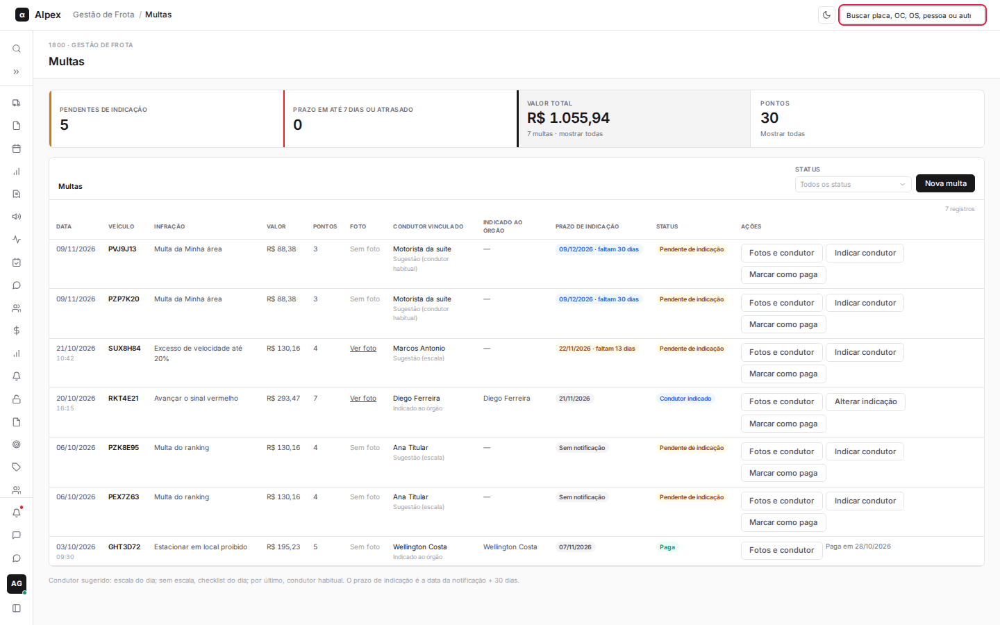
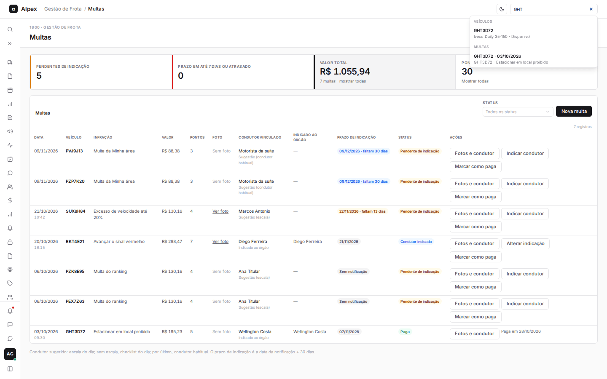
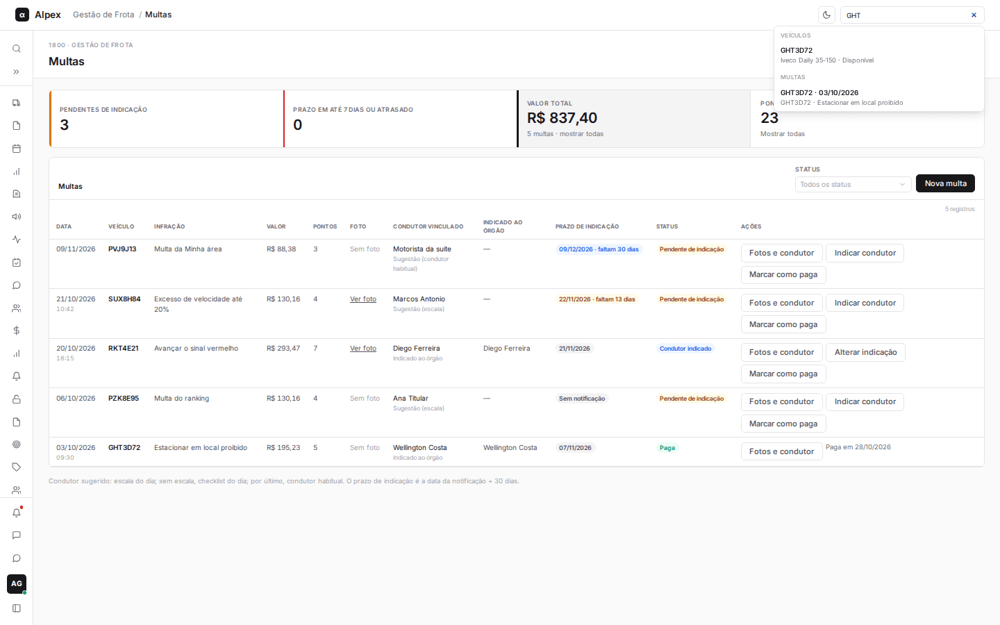
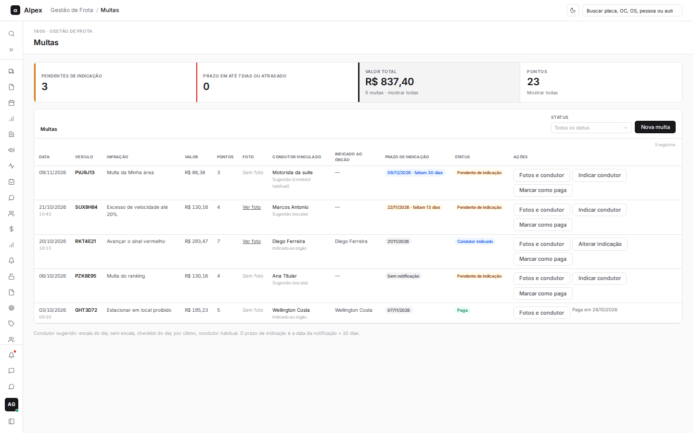
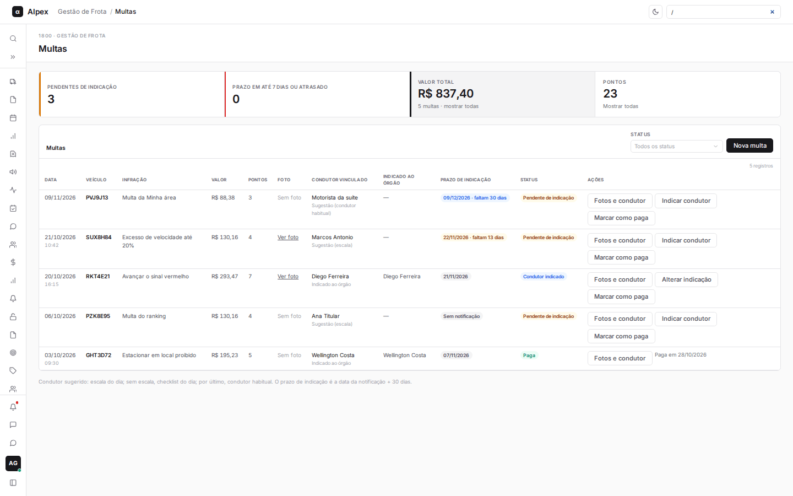
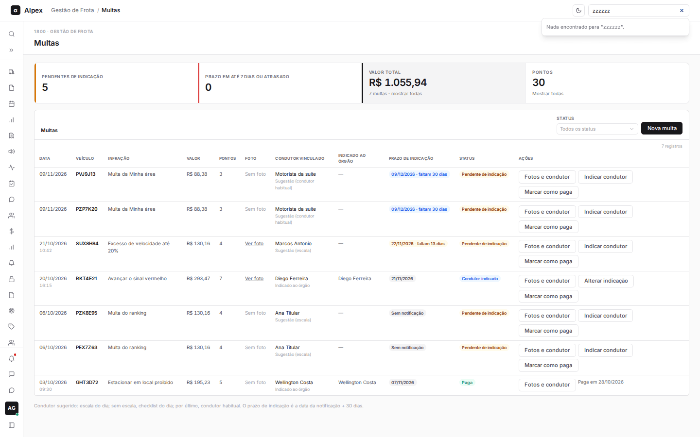

**Menu:** Campo de busca no topo de todas as telas da frota

No topo das telas da frota há um campo para achar rapidamente uma placa, ordem de compra, OS, pessoa ou auto de infração. Os tipos de resultado dependem do seu perfil: por exemplo, multas e grupos de checklist aparecem só para o Gestor, e colaboradores só para Líder e Gestor.

## Buscar na frota

<Steps>
  <Step title="Chegar ao campo">
    Clique no campo **Buscar placa, OC, OS, pessoa ou auto** no topo da tela.
  </Step>
  <Step title="Digitar">
    Digite pelo menos 2 caracteres, por exemplo parte da placa. Os resultados aparecem em grupos (Veículos, Multas, Colaboradores etc.).

    

    
  </Step>
  <Step title="Abrir o resultado">
    Clique no resultado, ou use as setas do teclado e **Enter** (o Enter sozinho abre o primeiro).
  </Step>
  <Step title="Fechar a busca">
    Aperte **Esc** para fechar a lista de resultados. No Chrome, o **Esc** também limpa o texto do campo.

    

    
  </Step>
  <Step title="Atalho do teclado">
    Com o foco fora de qualquer campo, aperte `/` para ir direto ao campo de busca.

    
  </Step>
</Steps>

<Note>
Quando não há nada, aparece "Nada encontrado".

O perfil Motorista não tem o campo de busca, porque as telas dele são só as do próprio dia. Ordens de serviço aparecem só para Manutenção e Gestor.
</Note>
