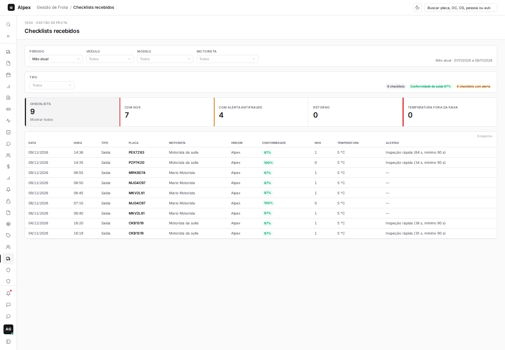
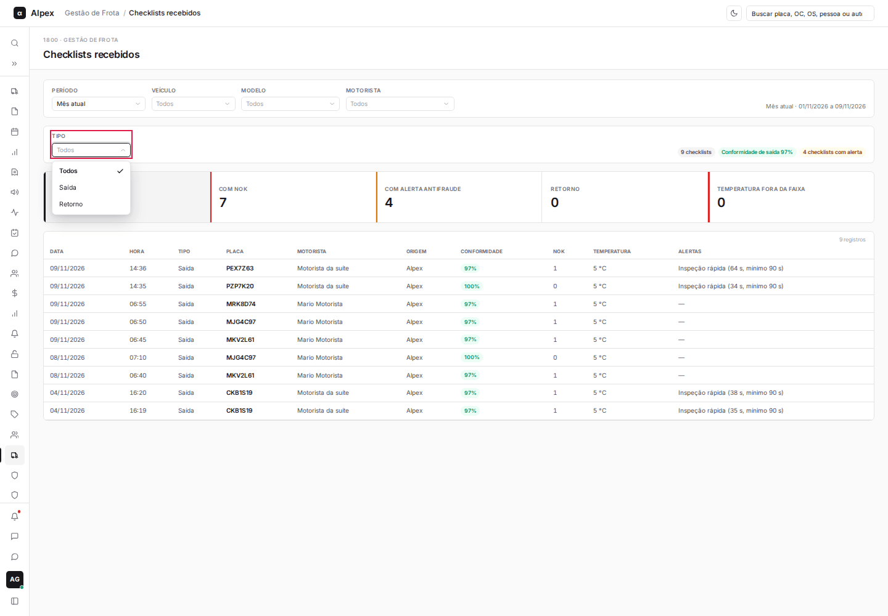
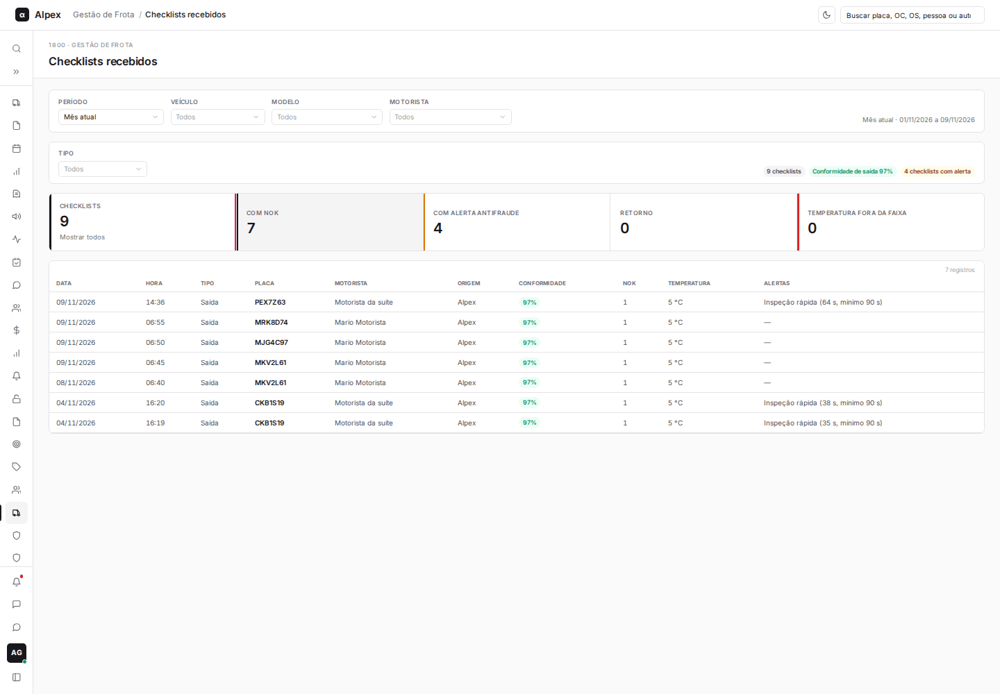
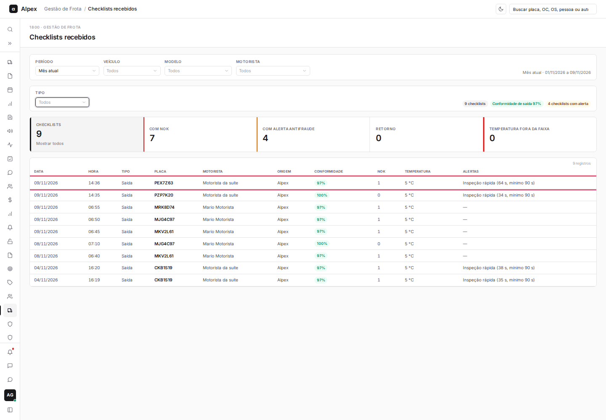
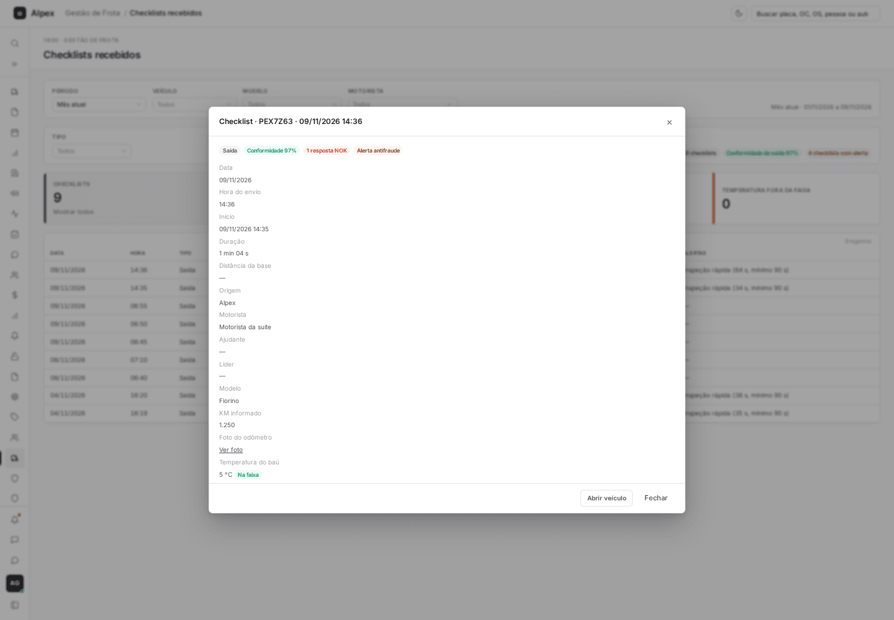
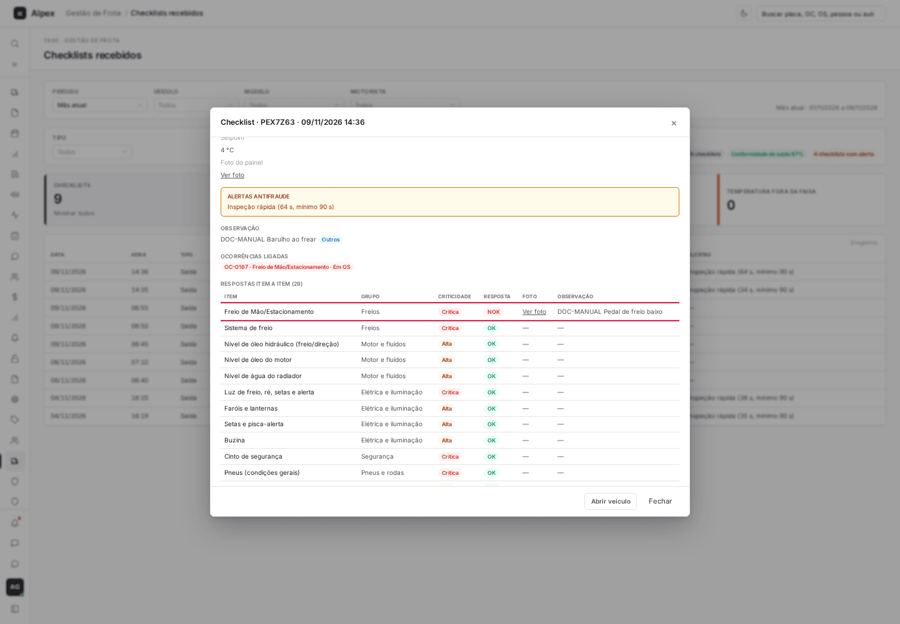
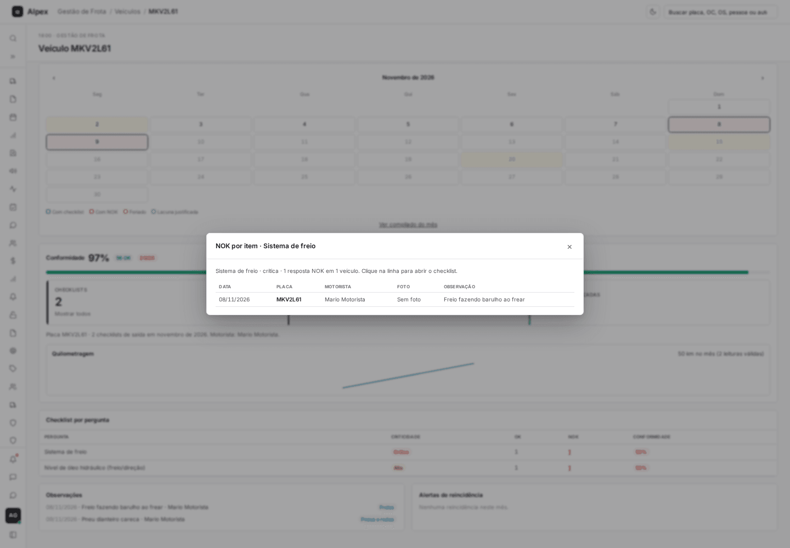

**Menu:** 1911 - Checklists recebidos

Reúne todos os checklists enviados pelos motoristas no período, com conformidade, itens NOK, temperatura e alertas antifraude.

## Filtrar a lista de checklists

<Steps>
  <Step title="Escolher período, veículo, modelo e motorista">
    Use a primeira barra de filtros. As opções são as mesmas das outras telas da frota.
  </Step>
  <Step title="Escolher o tipo">
    No campo **Tipo**, escolha **Saída** ou **Retorno**.

    
  </Step>
  <Step title="Usar os cartões">
    Clique em **Com NOK**, **Com alerta antifraude**, **Retorno** ou **Temperatura fora da faixa** para listar só esses checklists. Clique em **Checklists** (ou no mesmo cartão) para mostrar todos.

    
  </Step>
</Steps>

<Note>
As etiquetas acima dos cartões resumem o filtro: total de checklists, **Conformidade de saída** e checklists com alerta.
</Note>

## Abrir o detalhe de um checklist

<Steps>
  <Step title="Clicar na linha">
    Clique na linha do checklist na tabela.

    
  </Step>
  <Step title="Ler o resumo">
    A janela mostra data, hora, duração, distância da base, motorista, ajudante, líder, KM informado, temperatura do baú, faixa e setpoint, além das fotos do odômetro e do painel (**Ver foto**). Os alertas antifraude, as observações e as ocorrências geradas aparecem em seções próprias.

    
  </Step>
  <Step title="Ver as respostas item a item">
    Role até **Respostas item a item**. Cada linha mostra o grupo, a criticidade, a resposta (**OK** ou **NOK**), a foto e a observação.

    
  </Step>
  <Step title="Ir para o veículo ou fechar">
    Clique em **Abrir veículo** para ver o detalhe do veículo ou em **Fechar** para voltar à lista.
  </Step>
</Steps>

<Note>
A janela abre sobre a lista e mantém os filtros. O mesmo detalhe pode ser aberto a partir do Painel da frota e do detalhe do veículo.
</Note>

## Ver os NOK de um item

<Steps>
  <Step title="Abrir pela tela do veículo ou pelo Painel">
    No detalhe do veículo, em **Checklist por pergunta**, ou no gráfico **NOK por item** do Painel da frota, clique no item que tem NOK.

    
  </Step>
  <Step title="Abrir o checklist">
    A janela lista data, placa, motorista, foto e observação de cada NOK. Clique na linha para abrir o checklist completo.
  </Step>
</Steps>
