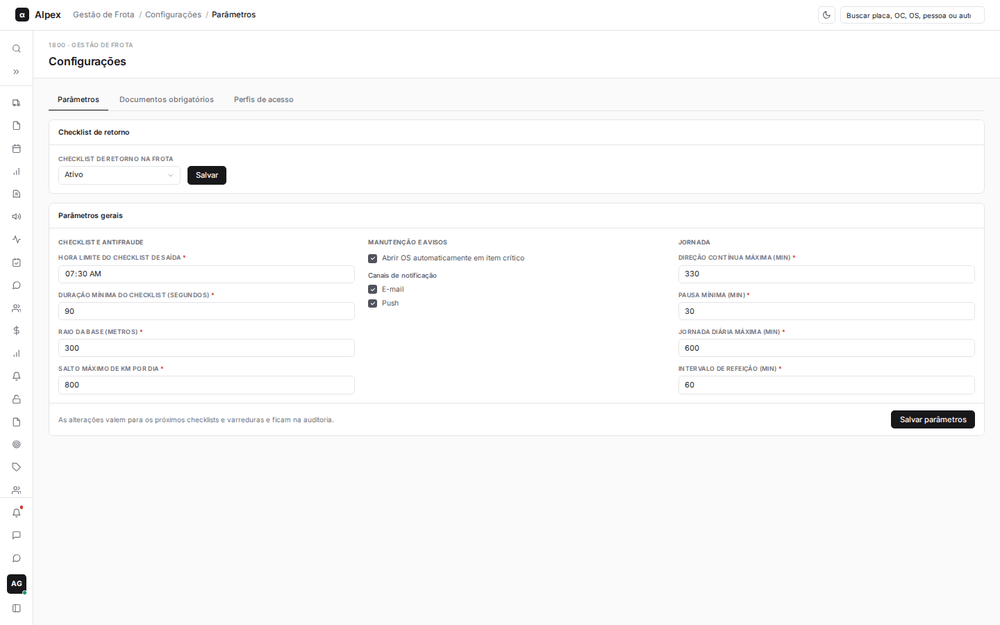
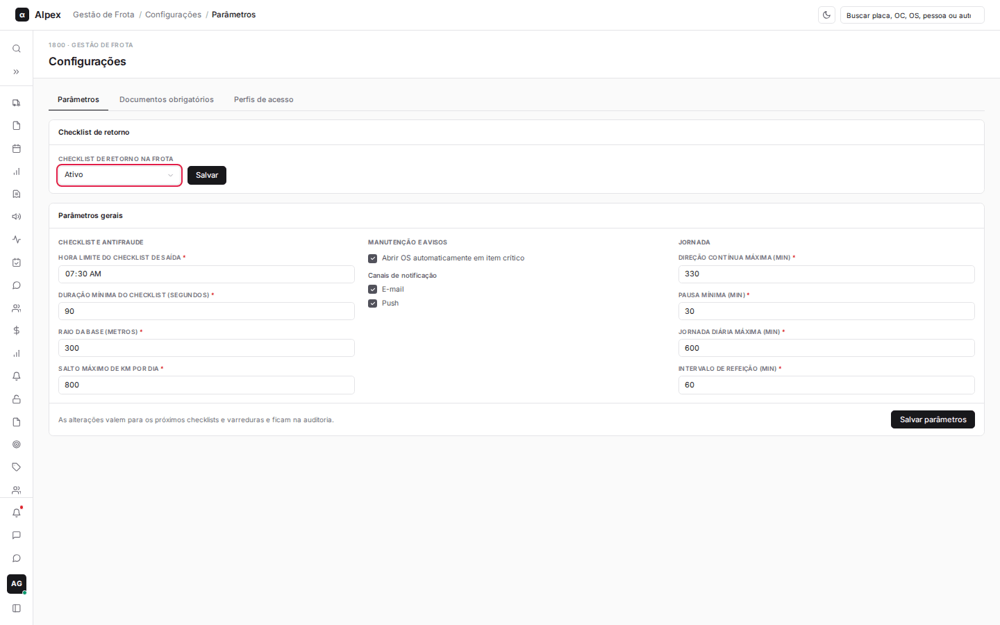
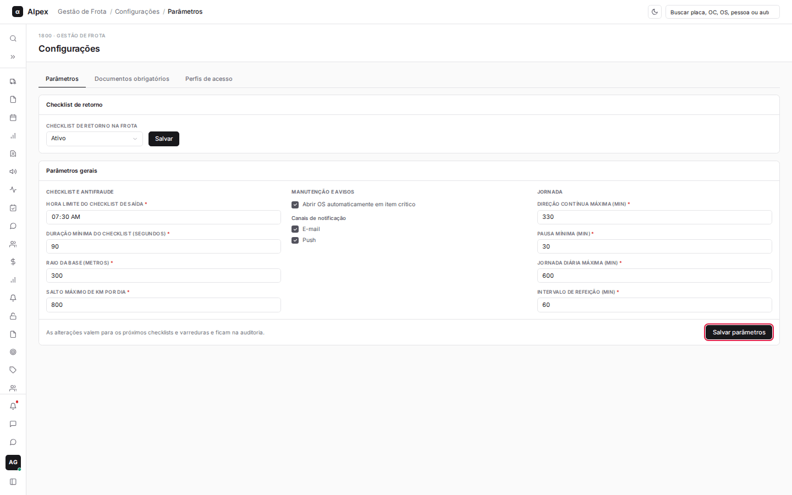
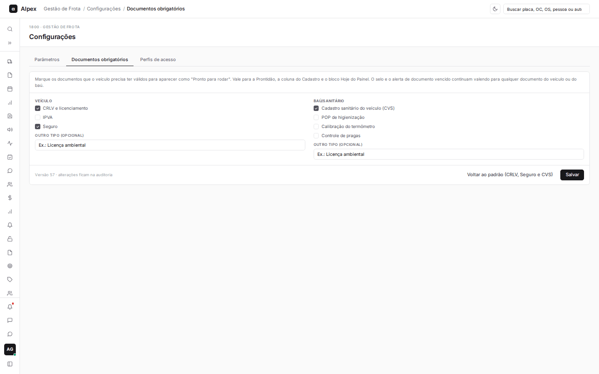
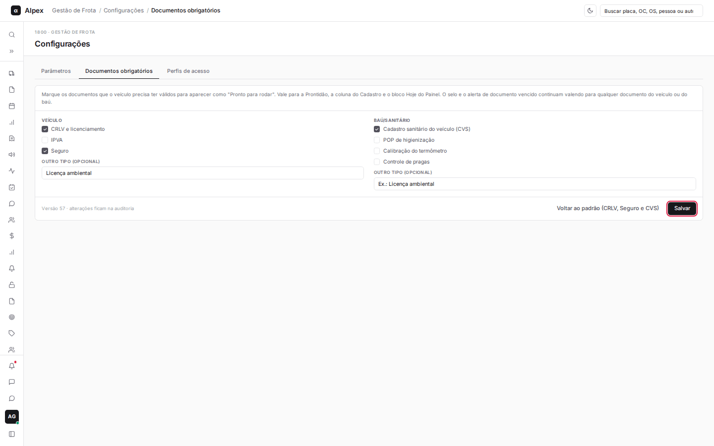
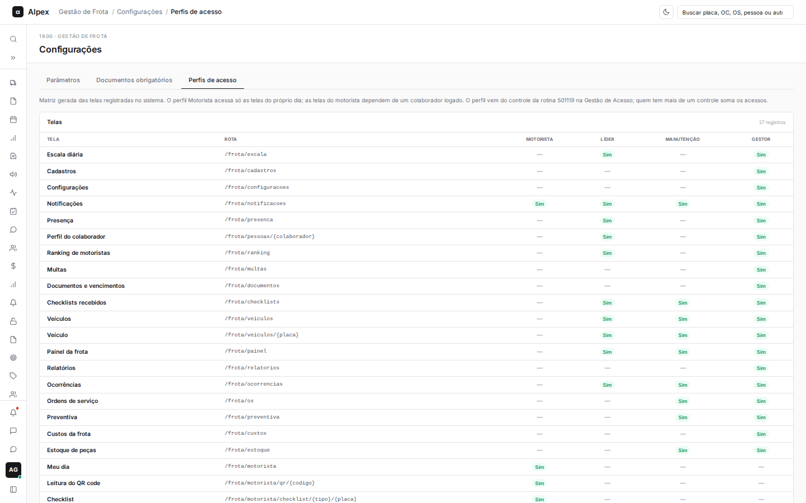
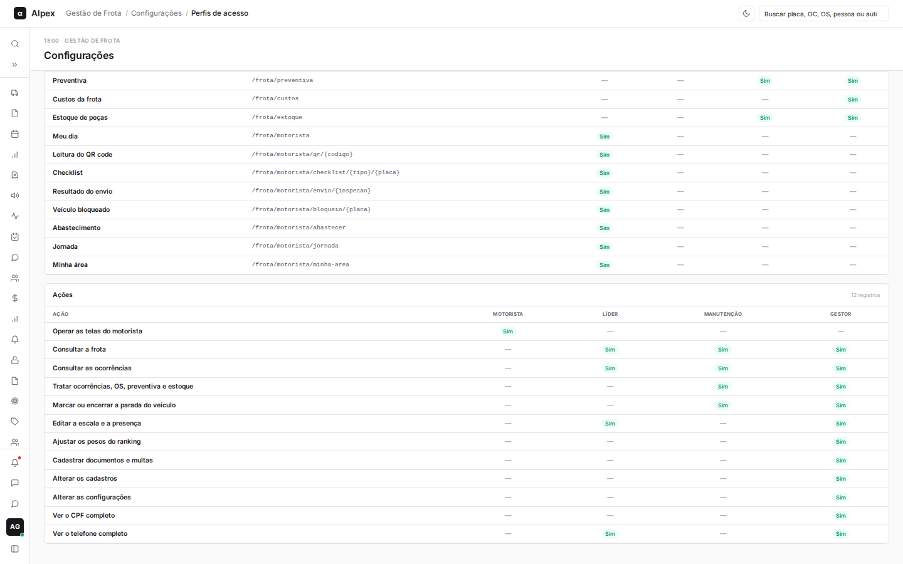

**Menu:** 1903 - Configurações

Aqui o Gestor ajusta as regras da frota (parâmetros do checklist, jornada e avisos), define quais documentos o veículo precisa ter válidos e consulta o que cada perfil de acesso enxerga. A tela tem três abas.

## Alterar os parâmetros da frota

<Steps>
  <Step title="Ajustar o checklist de retorno">
    Na aba **Parâmetros**, no bloco **Checklist de retorno**, escolha **Ativo** ou **Inativo** em **Checklist de retorno na frota** e clique em **Salvar**.

    
  </Step>
  <Step title="Ajustar os parâmetros gerais">
    No bloco **Parâmetros gerais**, altere o que precisar: em Checklist e antifraude, a **Hora limite do checklist de saída**, a **Duração mínima do checklist (segundos)**, o **Raio da base (metros)** e o **Salto máximo de km por dia**; em Manutenção e avisos, **Abrir OS automaticamente em item crítico** e os **Canais de notificação**; em Jornada, a direção contínua máxima, a pausa mínima, a jornada diária máxima e o intervalo de refeição (todos em minutos).
  </Step>
  <Step title="Salvar">
    Clique em **Salvar parâmetros**.

    
  </Step>
</Steps>

<Note>
As alterações valem para os próximos checklists e varreduras e ficam registradas na auditoria. Cada campo numérico aceita só valores dentro do limite permitido; se um valor for recusado, a mensagem aparece em vermelho abaixo do botão.
</Note>

## Definir os documentos obrigatórios

<Steps>
  <Step title="Abrir a aba">
    Clique na aba **Documentos obrigatórios**.

    
  </Step>
  <Step title="Marcar os documentos">
    Em **Veículo** e **Baú/sanitário**, marque os documentos que precisam estar válidos para o veículo aparecer como "Pronto para rodar". Se o documento não estiver na lista, escreva-o em **Outro tipo (opcional)**.
  </Step>
  <Step title="Salvar">
    Clique em **Salvar**. Para voltar à configuração original, clique em **Voltar ao padrão (CRLV, Seguro e CVS)** e confirme.

    
  </Step>
</Steps>

<Note>
A escolha vale para a Prontidão, para a coluna "Pronto para rodar" do cadastro de veículos e para o bloco Hoje do Painel. O selo e o alerta de documento vencido continuam valendo para qualquer documento do veículo ou do baú. Cada gravação cria uma nova versão e fica na auditoria.
</Note>

## Entender e liberar os perfis de acesso

<Steps>
  <Step title="Consultar a matriz de perfis">
    Clique na aba **Perfis de acesso**. A primeira tabela, **Telas**, mostra quais telas cada perfil (Motorista, Líder, Manutenção e Gestor) enxerga. A segunda, **Ações**, mostra o que cada perfil pode fazer dentro das telas.

    

    
  </Step>
  <Step title="Dar acesso a uma pessoa">
    Esta aba só consulta. Quem dá o acesso é a Gestão de Acesso do Alpex: peça à gestão de acesso para liberar, para a matrícula da pessoa, a rotina **501119** (Gestão de Frota) com o **controle** do perfil desejado:

    - Controle **1**: perfil **Motorista**
    - Controle **2**: perfil **Líder**
    - Controle **3**: perfil **Manutenção**
    - Controle **4**: perfil **Gestor**
  </Step>
  <Step title="Conferir">
    Depois de liberado, a pessoa precisa sair e entrar de novo no Alpex. As telas do perfil passam a aparecer no menu **1900 - Gestão de Frota**.
  </Step>
</Steps>

<Note>
Quem recebe mais de um controle soma os acessos (por exemplo, controles 2 e 3 dão as telas de Líder e de Manutenção). Quem não tem nenhum controle da rotina 501119 não vê o menu da frota e, ao abrir um link direto, recebe a mensagem de que não tem perfil na Gestão de Frota. As telas do Motorista também dependem de a matrícula da pessoa estar vinculada a um colaborador ativo, na aba **Colaboradores** de Cadastros. Esta matriz é montada automaticamente a partir das telas do sistema, então sempre reflete as regras em vigor.
</Note>
