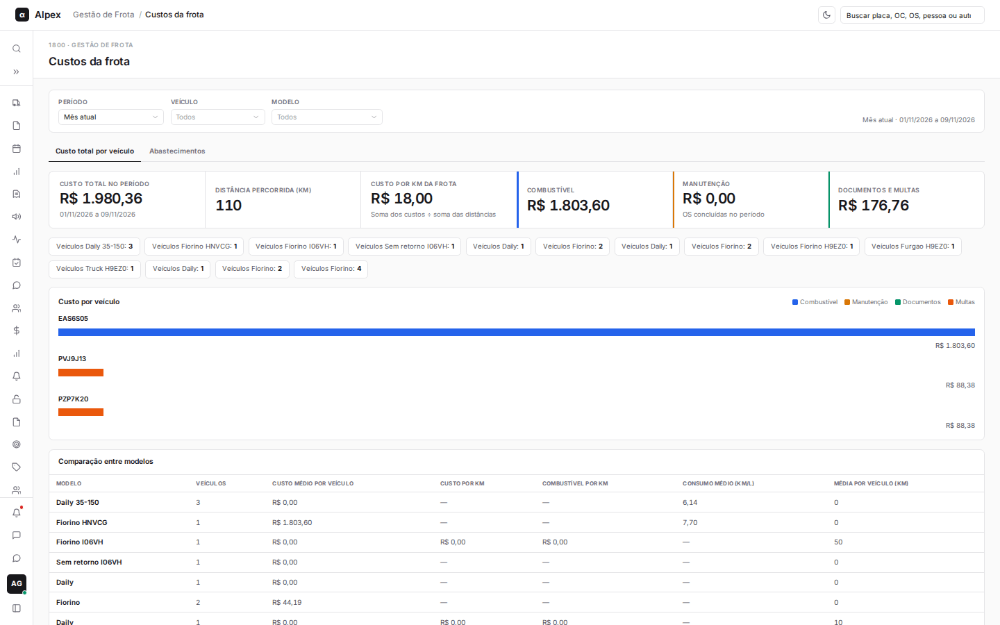
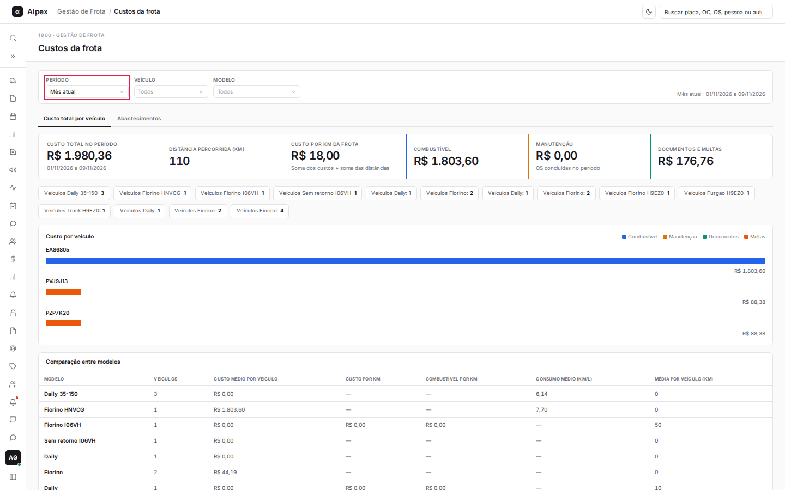
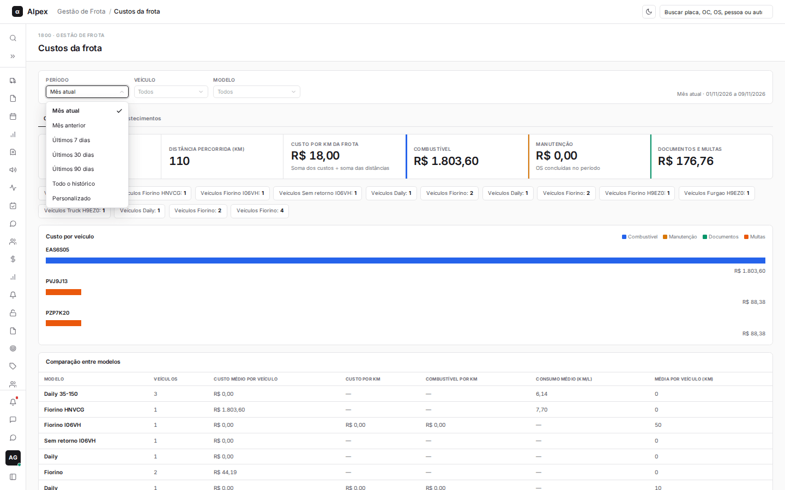
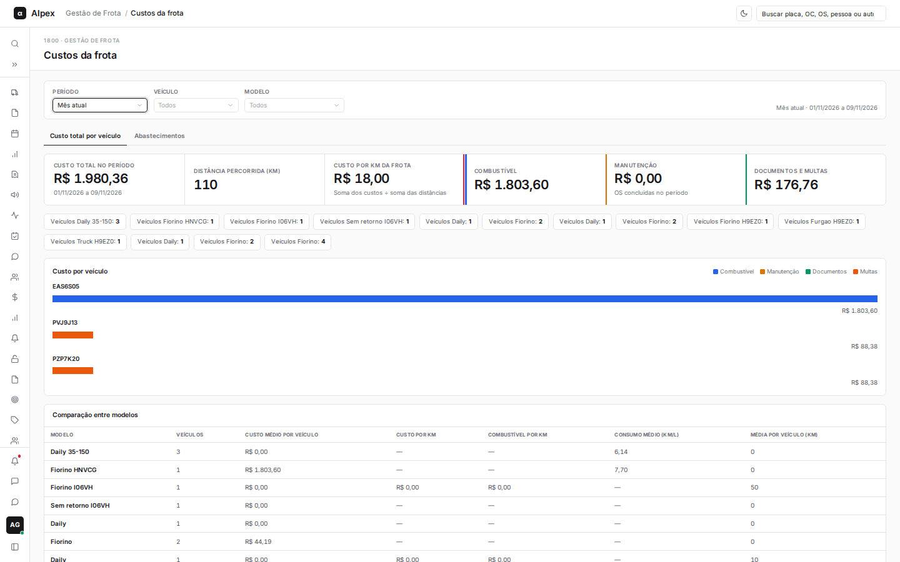
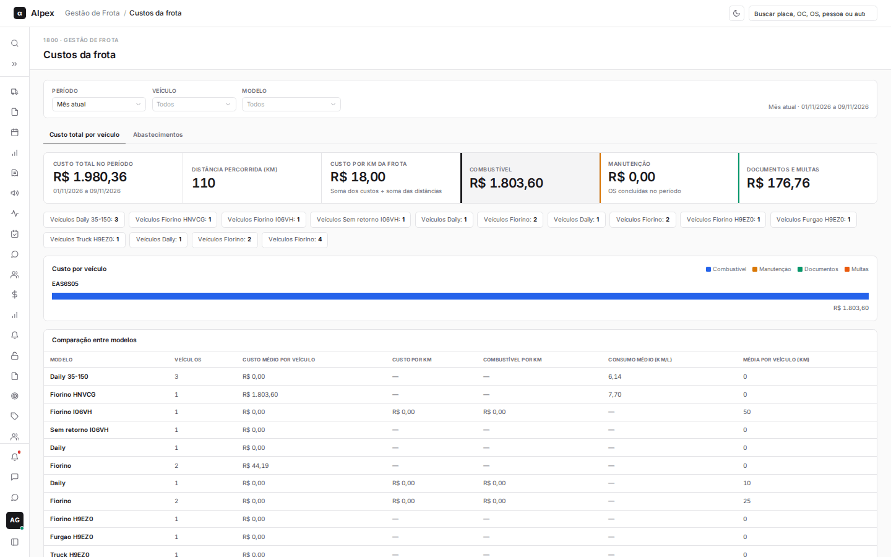
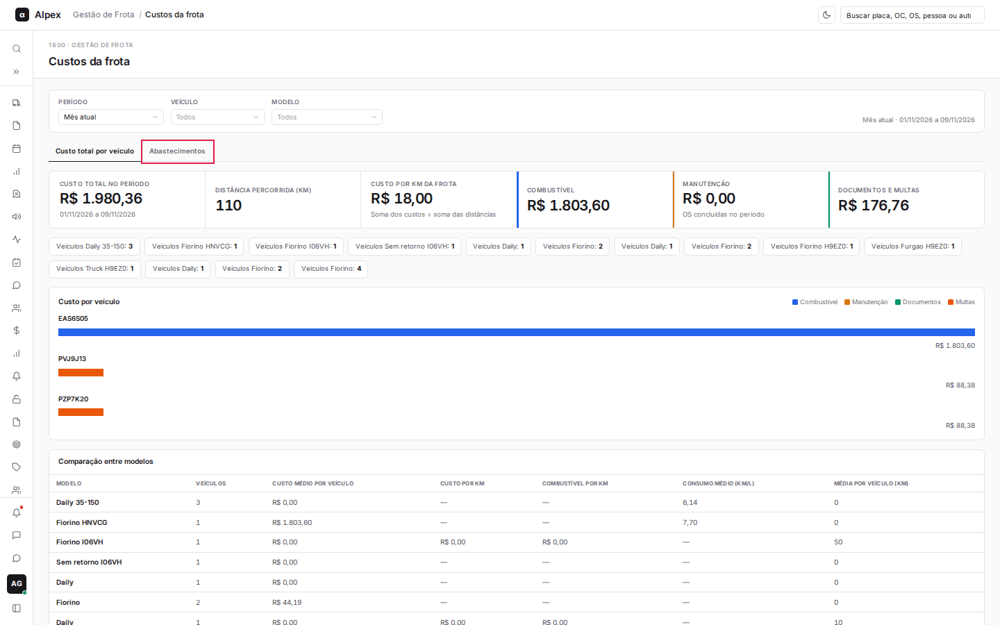
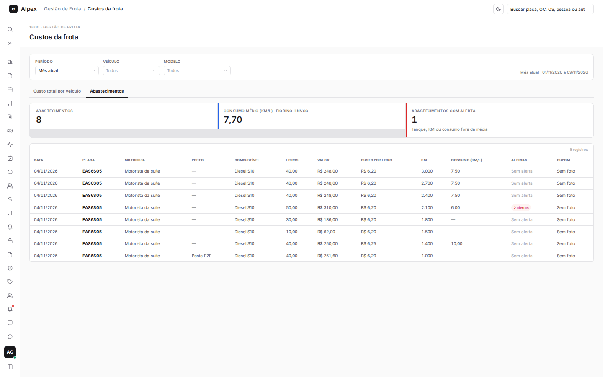
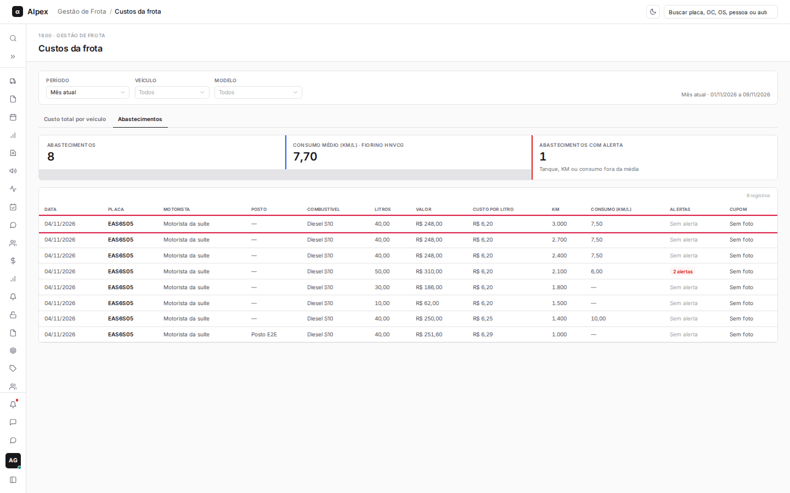
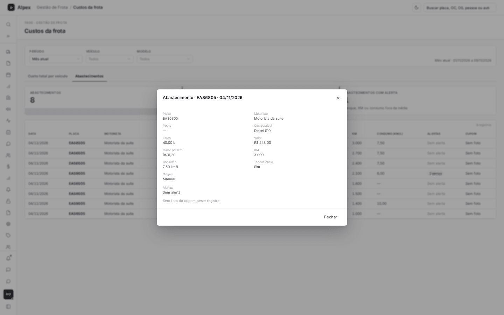

**Menu:** 1919 - Custos da frota

Aqui o Gestor acompanha quanto a frota custa: custo total por veículo (combustível, manutenção, documentos e multas), custo por km, comparação entre modelos e a lista de abastecimentos.

## Filtrar por período, veículo e modelo

<Steps>
  <Step title="Escolher o período">
    No filtro do topo, abra **Período** e escolha Mês atual, Mês anterior, Últimos 7 dias, Últimos 30 dias, Últimos 90 dias, Todo o histórico ou Personalizado. Em Personalizado, informe **De** e **Até**.

    

    
  </Step>
  <Step title="Limitar por veículo ou modelo">
    Em **Veículo** e **Modelo**, escolha um item (você pode digitar para buscar). A descrição à direita mostra o recorte aplicado. Clique em **Limpar filtros** para voltar ao padrão.
  </Step>
</Steps>

## Ler os custos por veículo e comparar modelos

<Steps>
  <Step title="Conferir os quadros">
    Na aba **Custo total por veículo**, os quadros mostram o custo total, a distância percorrida, o custo por km da frota e os custos de **Combustível**, **Manutenção** e **Documentos e multas**. Clique em **Combustível**, **Manutenção** ou **Documentos e multas** para ver só os veículos que tiveram aquele tipo de custo; clique de novo no mesmo quadro, ou em **Custo total no período**, para limpar.

    

    
  </Step>
  <Step title="Filtrar por modelo">
    Clique em um dos botões "Veículos (modelo): N" para olhar só aquele modelo.
  </Step>
  <Step title="Abrir o detalhe de um veículo">
    No gráfico **Custo por veículo** ou na tabela **TCO por veículo no período**, clique na placa para abrir os custos daquele veículo.
  </Step>
</Steps>

<Note>
O custo de manutenção considera as ordens de serviço concluídas no período. O custo por km da frota é a soma dos custos dividida pela soma das distâncias.
</Note>

## Ver os abastecimentos

<Steps>
  <Step title="Abrir a aba">
    Clique na aba **Abastecimentos**.

    
  </Step>
  <Step title="Ler a lista">
    Os quadros mostram o total de abastecimentos, o consumo médio (km/l) por modelo e quantos têm alerta (tanque, KM ou consumo fora da média). Clique em **Abastecimentos com alerta** para ver só esses, ou em um modelo para filtrar por ele.

    
  </Step>
  <Step title="Abrir o detalhe">
    Clique na linha do abastecimento. O painel mostra placa, motorista, posto, combustível, litros, valor, custo por litro, KM, consumo, os alertas e a foto do cupom, quando houver. Para sair, clique em **Fechar**.

    

    
  </Step>
</Steps>

<Note>
O consumo só é calculado quando o tanque foi completado e já existe um registro anterior do veículo.
</Note>
