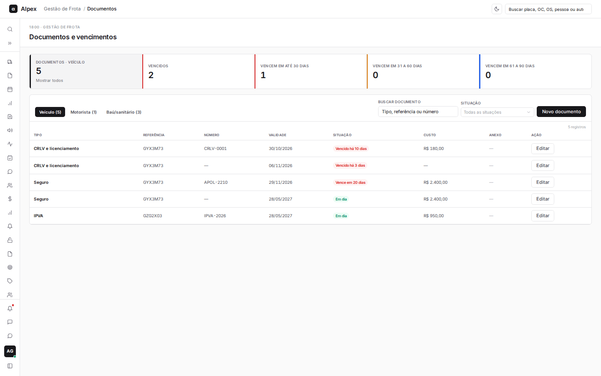
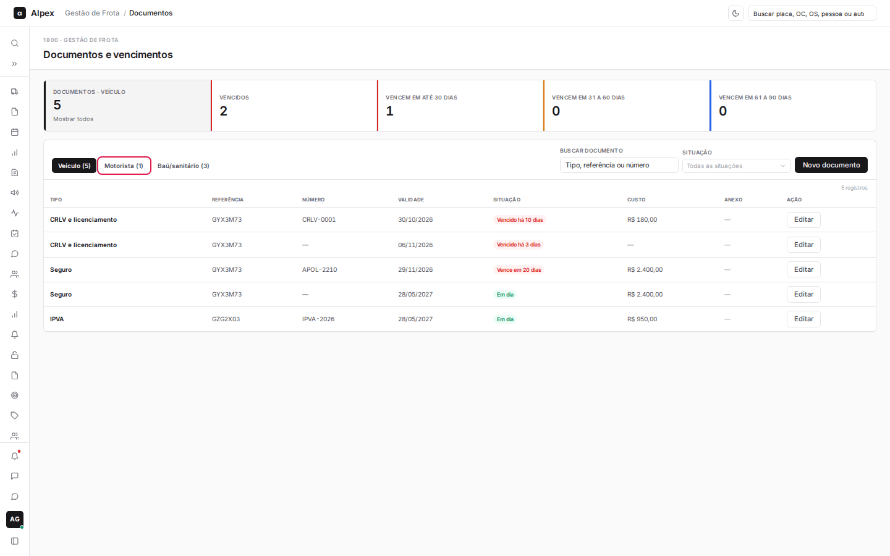
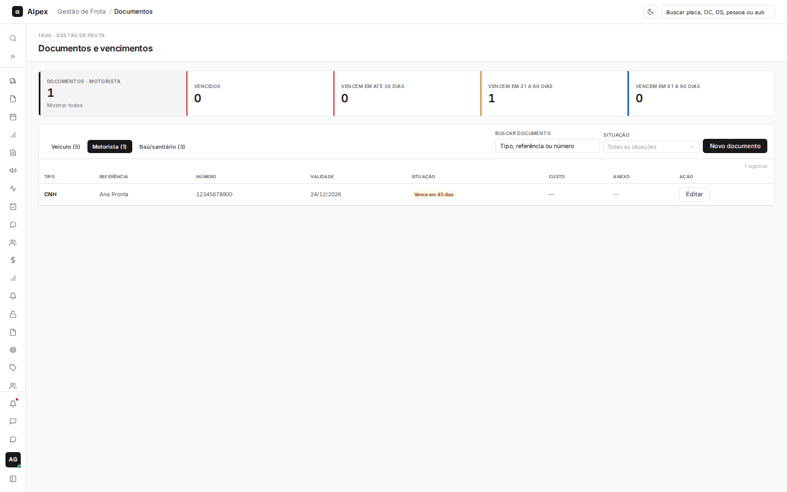
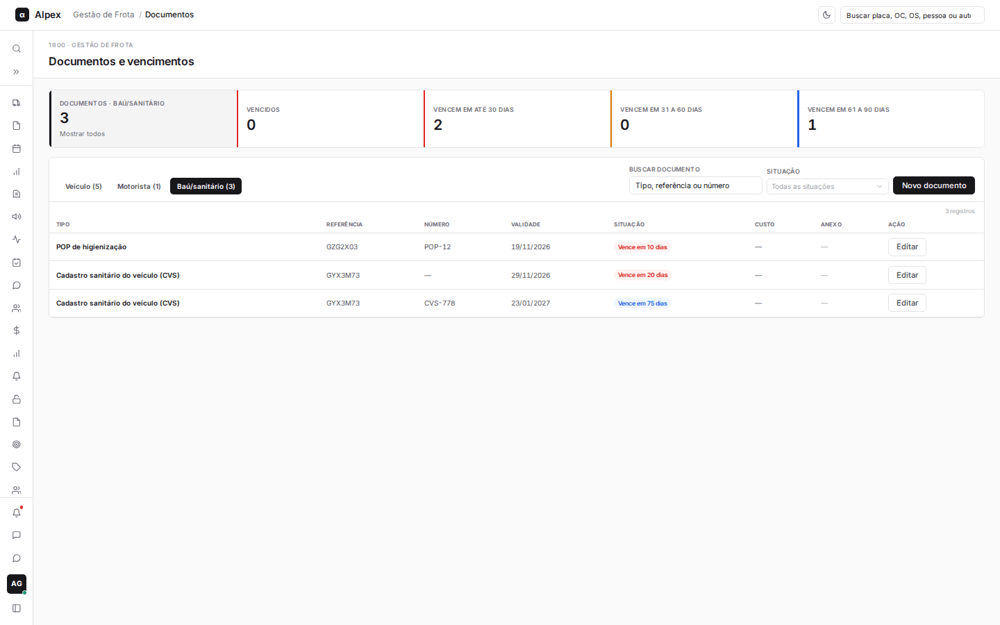
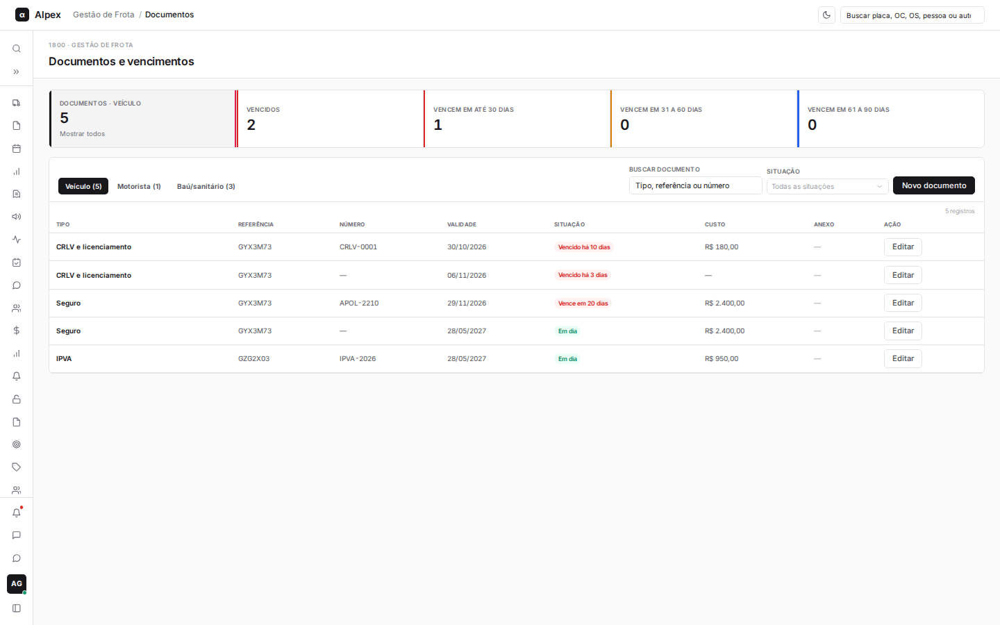
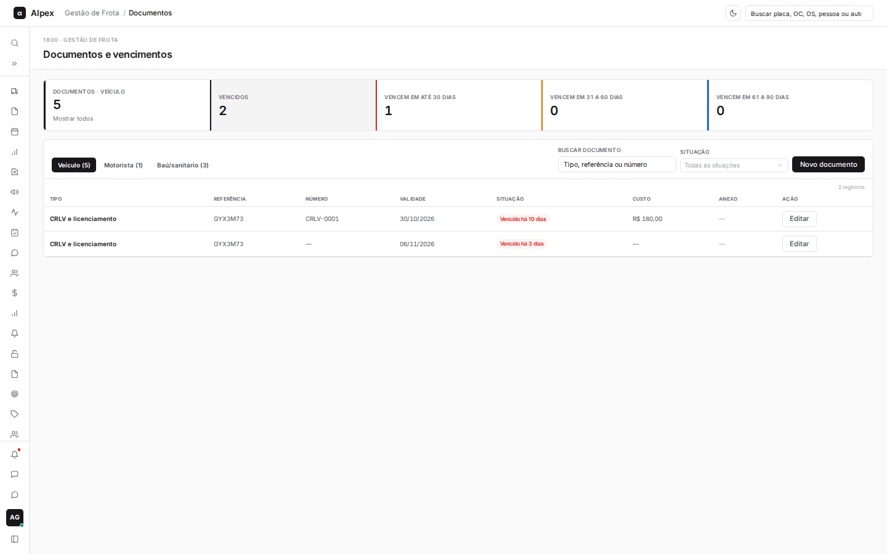
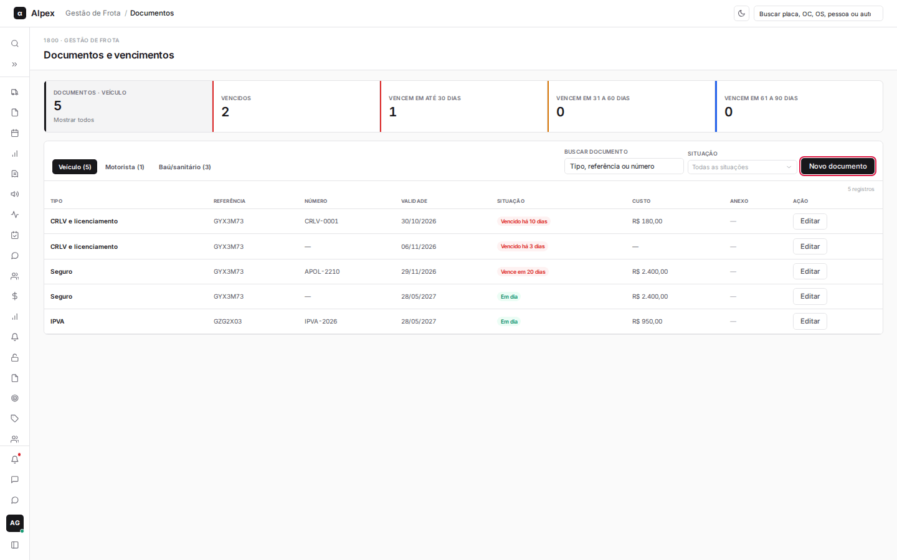
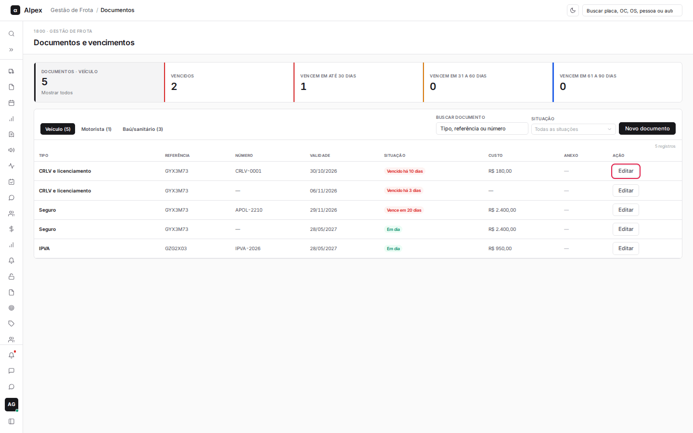
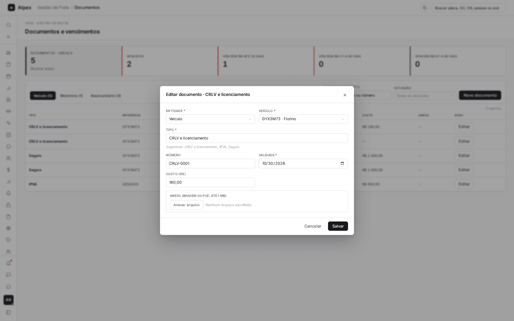
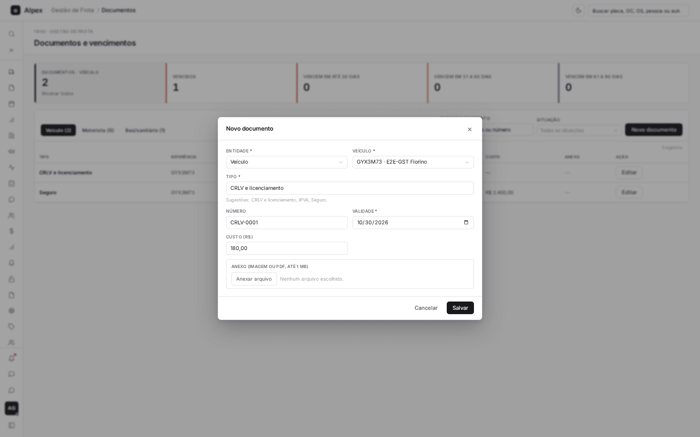

**Menu:** 1910 - Documentos e vencimentos

Aqui o Gestor cadastra os documentos de veículos, motoristas e baú/sanitário e acompanha o que está vencido ou perto de vencer.

## Acompanhar vencimentos e buscar documentos

<Steps>
  <Step title="Escolher o tipo de documento">
    Clique em uma das abas: **Veículo**, **Motorista** ou **Baú/sanitário**. O número entre parênteses é o total de documentos da aba.

    

    

    
  </Step>
  <Step title="Filtrar pelo vencimento">
    Clique em um quadro: **Vencidos**, **Vencem em até 30 dias**, **Vencem em 31 a 60 dias** ou **Vencem em 61 a 90 dias**. Clique de novo no mesmo quadro (ou no primeiro, **Mostrar todos**) para limpar. Também dá para escolher em **Situação**.

    

    
  </Step>
  <Step title="Buscar">
    Em **Buscar documento**, digite o tipo, a referência (placa ou nome) ou o número e saia do campo para aplicar a busca.
  </Step>
</Steps>

## Cadastrar ou editar um documento

<Steps>
  <Step title="Abrir o formulário">
    Clique em **Novo documento**. Para editar um documento existente, clique em **Editar** na linha dele.

    

    

    
  </Step>
  <Step title="Preencher">
    Escolha a **Entidade** (Veículo, Motorista ou Baú/sanitário) e a referência (o veículo ou o motorista). Informe o **Tipo** (o campo sugere os tipos mais comuns), o **Número**, a **Validade** e o **Custo (R$)**, se houver. Em **Anexo**, clique em **Anexar arquivo** para incluir uma imagem ou PDF de até 1 MB.

    
  </Step>
  <Step title="Salvar">
    Clique em **Salvar**.
  </Step>
</Steps>

<Note>
Tipo e validade são obrigatórios. O exame toxicológico só se aplica a motorista com CNH categoria C, D ou E. O custo informado entra nos custos do veículo. Ao editar, a opção **Remover anexo** apaga o arquivo anexado. Na lista, **Ver PDF** ou **Ver imagem** abre o anexo.
</Note>
