**Menu:** 1901 - Escala diária

Mostra a escala da semana (de segunda a sábado) de todos os veículos ativos: quem dirige e quem ajuda em cada dia. É aqui que você monta a escala, copia dias ou semanas e troca o motorista de um veículo.

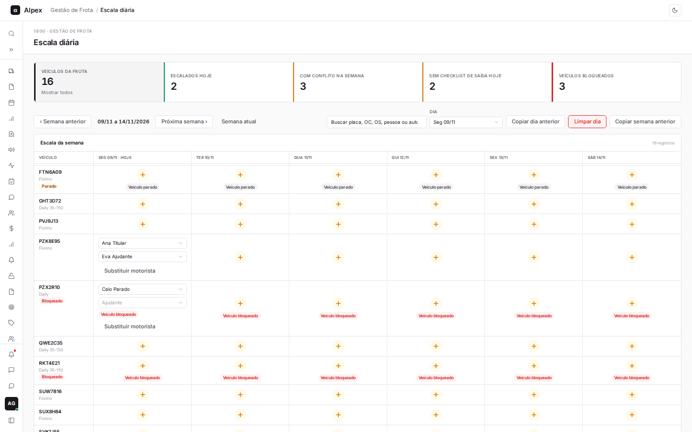

## Ler os indicadores e filtrar os veículos

<Steps>
  <Step title="Veja os indicadores no topo">
    Os cartões mostram **Veículos da frota**, **Escalados hoje**, **Com conflito na semana**, **Sem checklist de saída hoje** e **Veículos bloqueados**.

    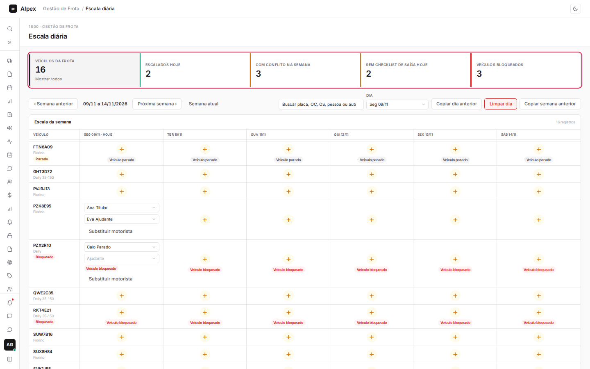
  </Step>
  <Step title="Clique em um cartão para filtrar a grade">
    A grade passa a mostrar só os veículos daquele grupo (por exemplo, só os **Escalados hoje**). Clique de novo no mesmo cartão, ou em **Veículos da frota**, para voltar a ver todos.

    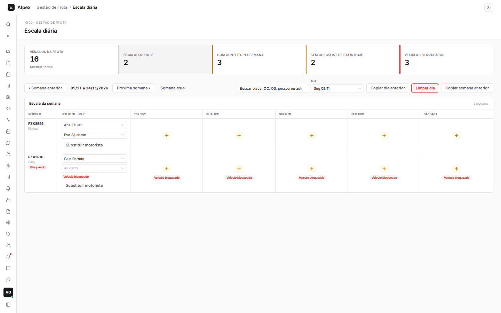
  </Step>
  <Step title="Procure um veículo ou uma pessoa">
    Use o campo de busca do topo da tela para achar uma placa, uma pessoa ou outro cadastro da frota.
  </Step>
</Steps>

<Note>
O dia de hoje fica marcado com "Hoje" no cabeçalho da coluna. Feriados aparecem com "Feriado" no cabeçalho e em laranja. Cada célula mostra avisos, como "Sem motorista", "Motorista em dois veículos", CNH insuficiente para o modelo ou "Checklist feito".
</Note>

## Navegar entre as semanas

<Steps>
  <Step title="Use os botões de semana">
    Clique em **‹ Semana anterior** ou **Próxima semana ›** para andar de semana em semana. O período exibido fica entre os dois botões. **Semana atual** volta para a semana de hoje.

    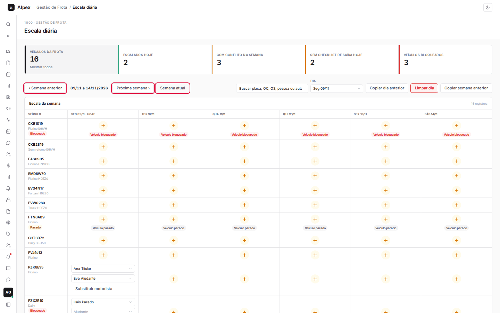
  </Step>
  <Step title="Confira a nova semana">
    A grade e os indicadores são atualizados para o período escolhido.

    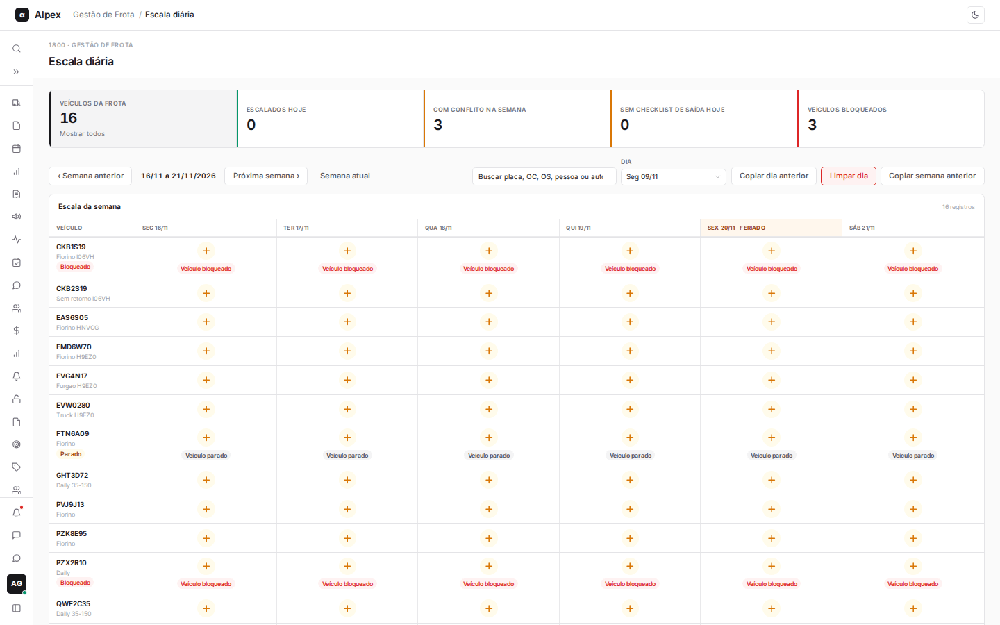
  </Step>
</Steps>

## Escalar motorista e ajudante em um dia

<Steps>
  <Step title="Clique no símbolo + da célula">
    Na linha do veículo, no dia desejado, clique no **+** laranja. Células já preenchidas mostram os campos direto.

    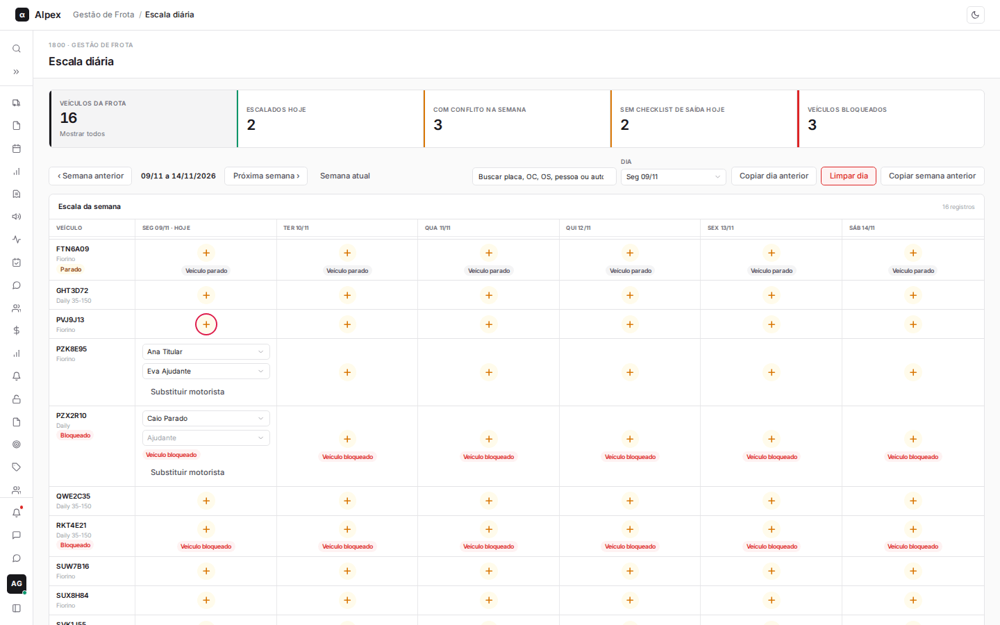
  </Step>
  <Step title="Abra o campo Motorista ou Ajudante">
    Aparecem os campos **Motorista** e **Ajudante**. Se desistir, clique em **Fechar** (o link só aparece enquanto a célula está vazia).

    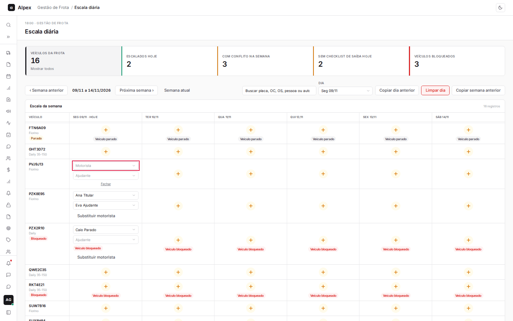
  </Step>
  <Step title="Escolha a pessoa na lista">
    A lista mostra a situação de cada pessoa naquele dia: bolinha verde para livre, amarela para quem já está escalado em outro veículo e vermelha para indisponível, sempre com o motivo (por exemplo, CNH abaixo da mínima do modelo ou férias). Para tirar a pessoa da célula, escolha a primeira linha da lista (**Motorista** ou **Ajudante**).

    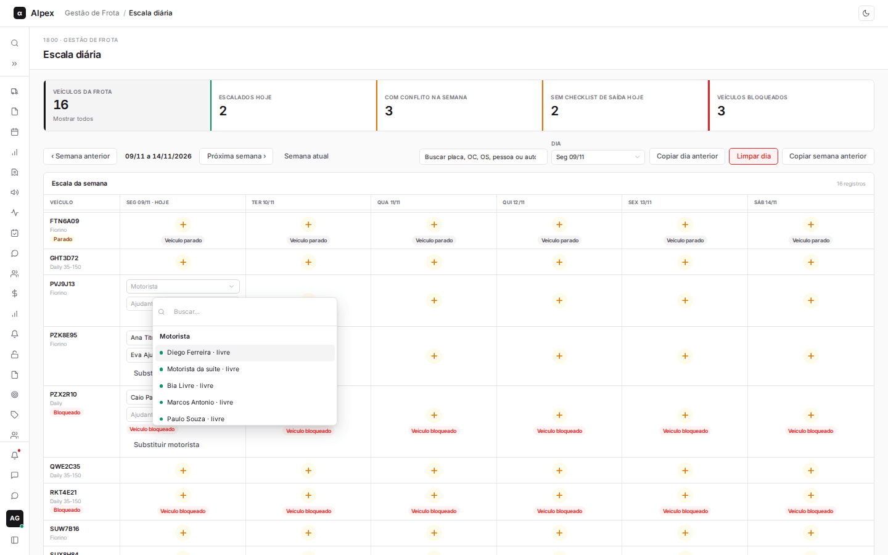
  </Step>
  <Step title="Use a busca da lista, se precisar">
    Digite parte do nome em **Buscar...** para reduzir a lista.

    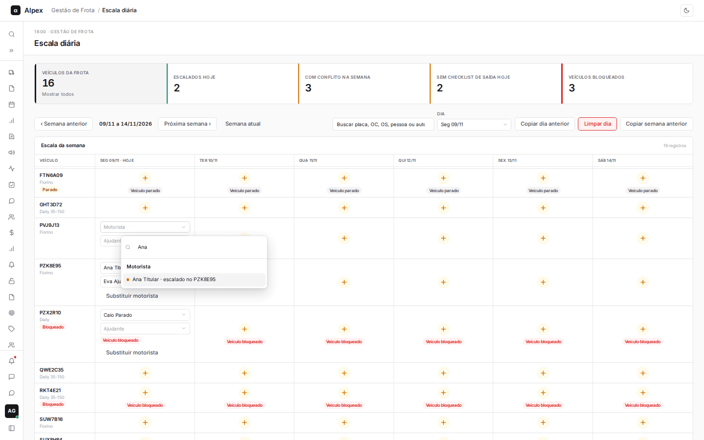
  </Step>
  <Step title="Confirme se houver conflito">
    Ao escolher uma pessoa que já está em outro veículo no mesmo dia (ou com CNH abaixo da mínima), a própria célula mostra um aviso em amarelo e nada é gravado ainda. Clique em **Confirmar troca** para gravar assim mesmo ou em **Cancelar** para voltar atrás.

    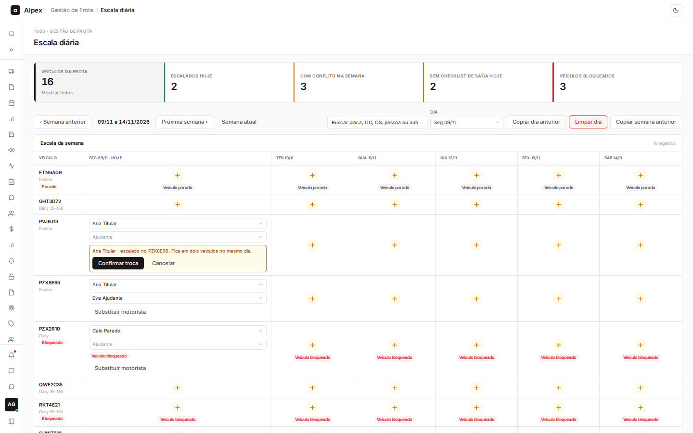
  </Step>
  <Step title="Veja a confirmação e, se quiser, desfaça">
    Sem conflito, a escolha é gravada na hora e aparece a mensagem "Escala salva". Por cerca de 9 segundos há o botão **Desfazer** na mensagem, que devolve a célula ao que era antes.

    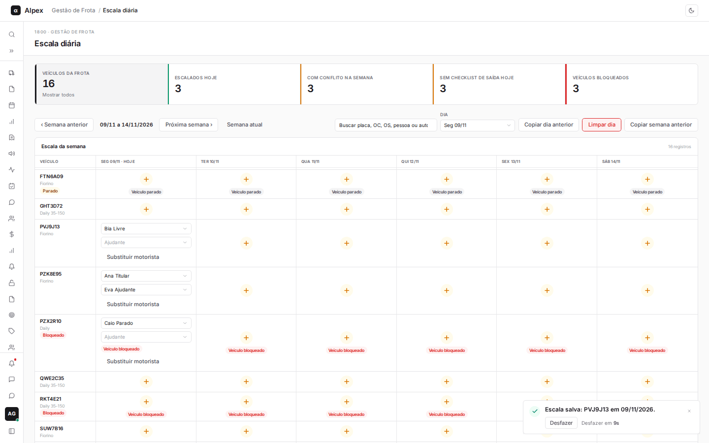

    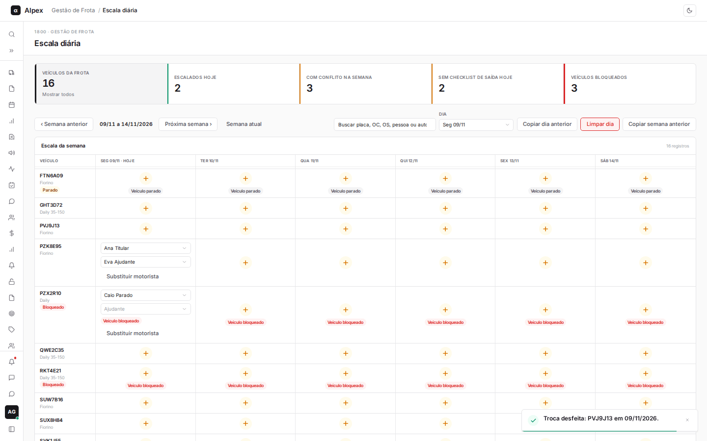
  </Step>
</Steps>

<Note>
A mesma pessoa não pode ser motorista e ajudante do mesmo veículo. Se você esvaziar motorista e ajudante, a célula volta a ficar sem escala. Quem está de férias, ou um motorista de veículo bloqueado, aparece como indisponível ou "escalado" na lista, com o motivo.
</Note>

## Copiar o dia anterior, limpar o dia ou copiar a semana anterior

<Steps>
  <Step title="Escolha o dia de trabalho">
    No campo **Dia**, selecione o dia da semana sobre o qual vai agir. Os botões **Copiar dia anterior** e **Limpar dia** valem para esse dia; **Copiar semana anterior** vale para a semana inteira exibida.

    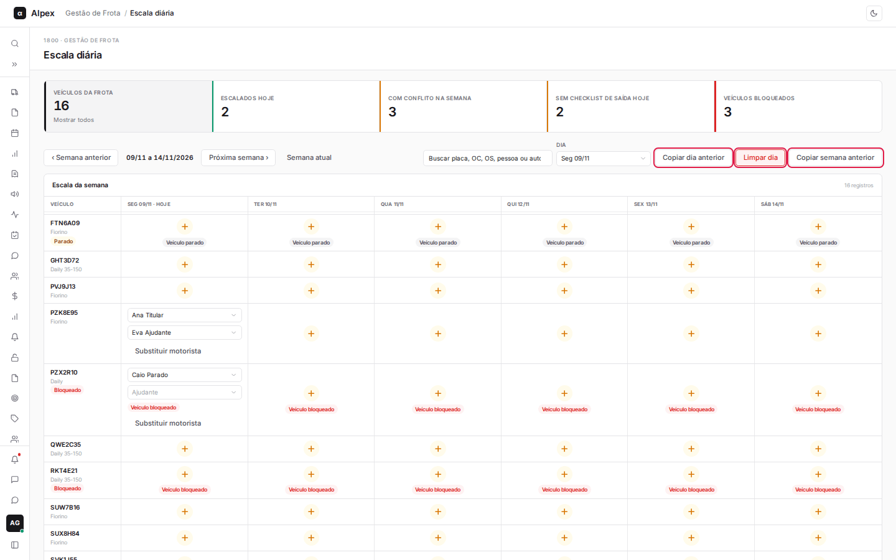
  </Step>
  <Step title="Copiar dia anterior">
    Clique em **Copiar dia anterior**. O sistema usa o último dia com escala nos 7 dias anteriores. Se o dia escolhido já tem escala, ele pede confirmação antes de substituir: clique em **Copiar** para confirmar ou **Cancelar**.

    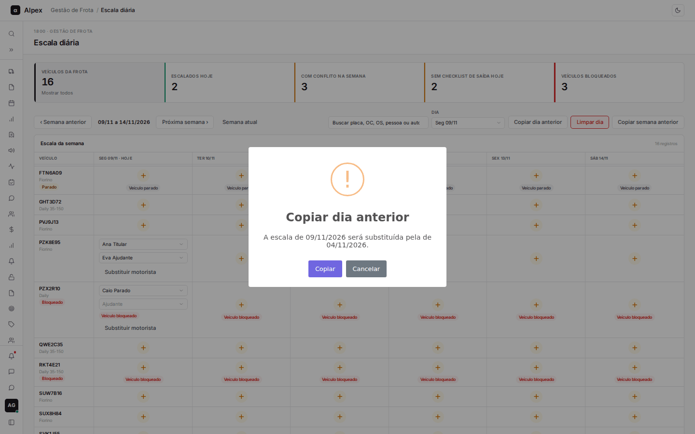
  </Step>
  <Step title="Limpar dia">
    Clique em **Limpar dia** e confirme em **Limpar**. Toda a escala daquele dia é removida; nos dias sem escala, o sistema usa o checklist do dia e, por último, o condutor habitual do veículo.

    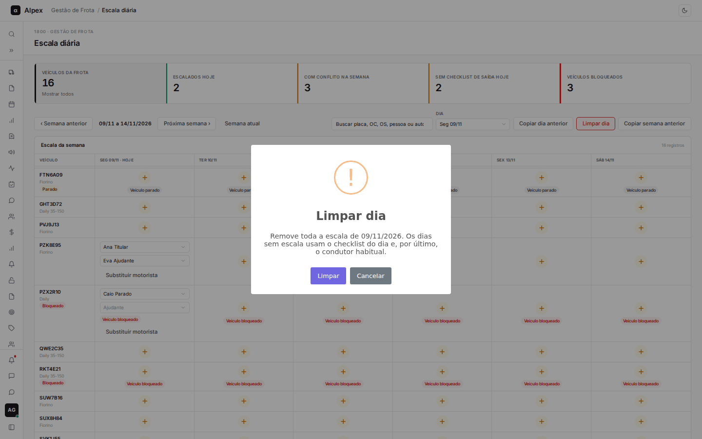
  </Step>
  <Step title="Copiar semana anterior">
    Clique em **Copiar semana anterior** e confirme em **Copiar**. Os dias de segunda a sábado recebem a escala da semana anterior; dias sem escala na semana anterior ficam como estão.

    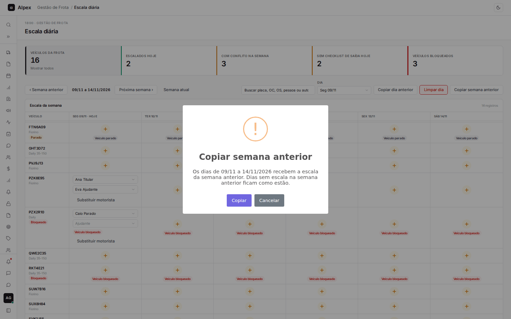
  </Step>
</Steps>

<Warning>
Limpar o dia remove toda a escala dele, de todos os veículos. Copiar substitui o que já estava escalado no destino. Confirme apenas se tiver certeza.
</Warning>

<Note>
Se não houver escala nos 7 dias anteriores, aparece o aviso "Nenhum dia com escala nos 7 dias anteriores." e nada é copiado.

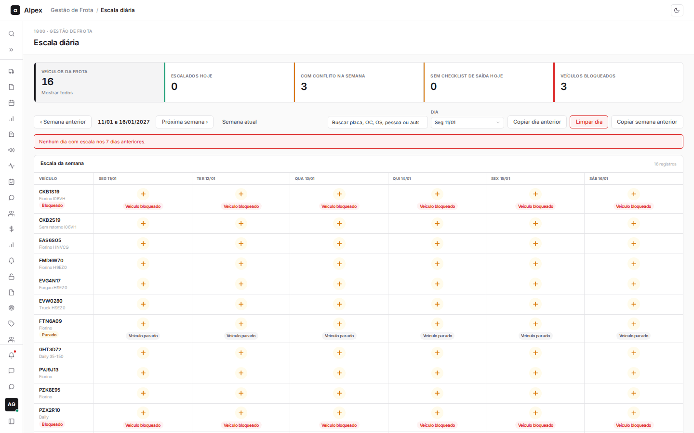

Para limpar um dia sem escala, o aviso é "Não há escala em dd/mm/aaaa para limpar."

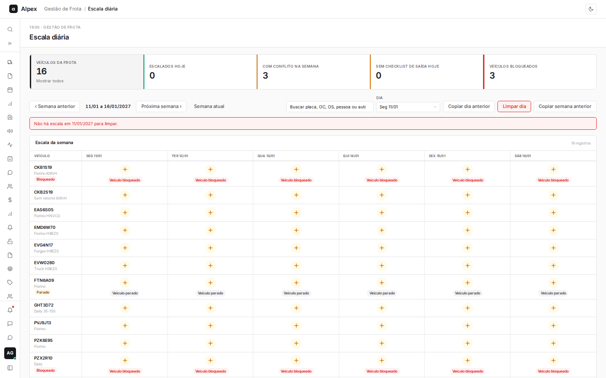

Se a semana anterior estiver vazia, depois de confirmar o aviso é "A semana anterior não tem escala para copiar."

</Note>

## Substituir o motorista de um veículo

<Steps>
  <Step title="Clique em Substituir motorista">
    O botão aparece na célula de hoje que tem motorista escalado (e, em dias futuros, quando a célula tem conflito).

    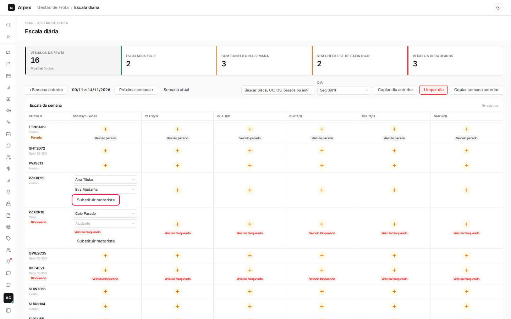
  </Step>
  <Step title="Veja o titular e os candidatos">
    O painel mostra o veículo, o dia, a CNH mínima do modelo e o titular. Abaixo, em **Quem assume**, os candidatos aparecem em grupos: **Livres**, **Motoristas de veículos que não saem**, **Ajudantes com CNH compatível** e **Indisponíveis** (não podem ser escolhidos).

    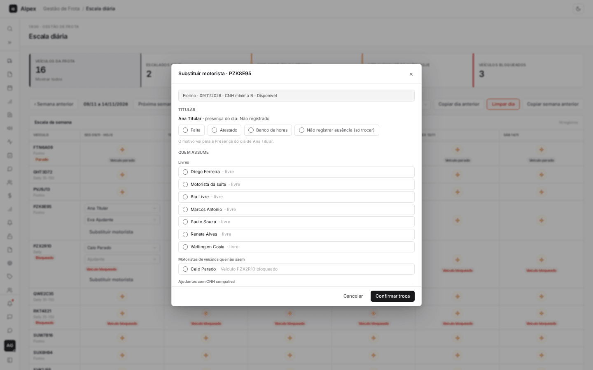
  </Step>
  <Step title="Informe o motivo do titular e escolha quem assume">
    Marque o motivo do titular (**Falta**, **Atestado**, **Banco de horas** ou **Não registrar ausência (só trocar)**) e depois a pessoa que assume o veículo.

    
  </Step>
  <Step title="Clique em Confirmar troca">
    O botão fica no rodapé do painel. Use **Cancelar** para sair sem gravar.

    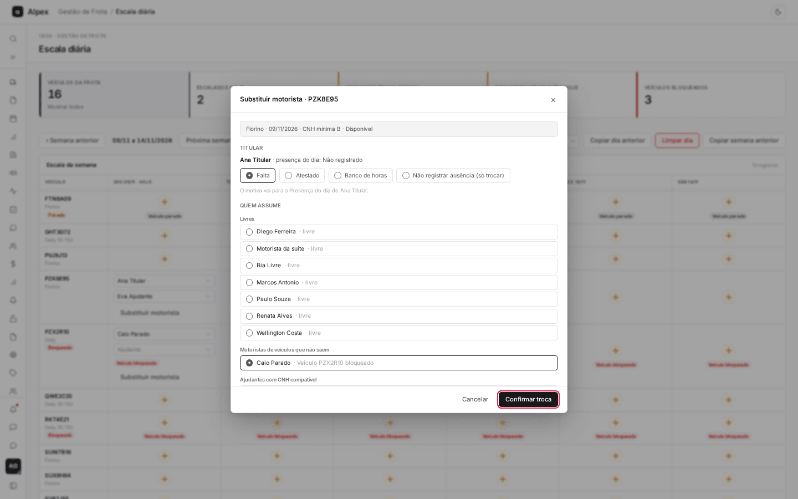
  </Step>
</Steps>

<Note>
A mensagem de sucesso resume o que aconteceu (quem assume, qual veículo foi liberado, qual ausência foi registrada) e traz o botão **Desfazer** por cerca de 9 segundos: ele volta escala e presença ao que eram. O motivo escolhido vai para a Presença do dia do titular. Quem vem de um veículo que não sai (bloqueado, em manutenção ou parado) é liberado da escala de origem ao confirmar. Se o titular estiver de férias, o motivo não é pedido. Sem motivo (e sem marcar "Não registrar ausência") ou sem candidato, o painel avisa o que falta.
</Note>
