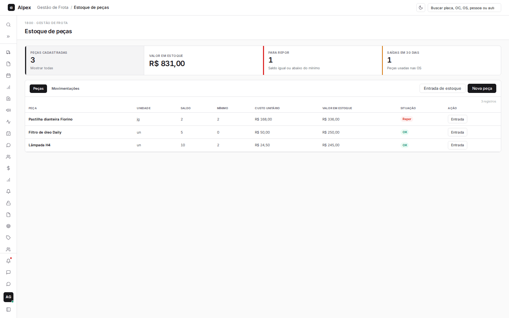
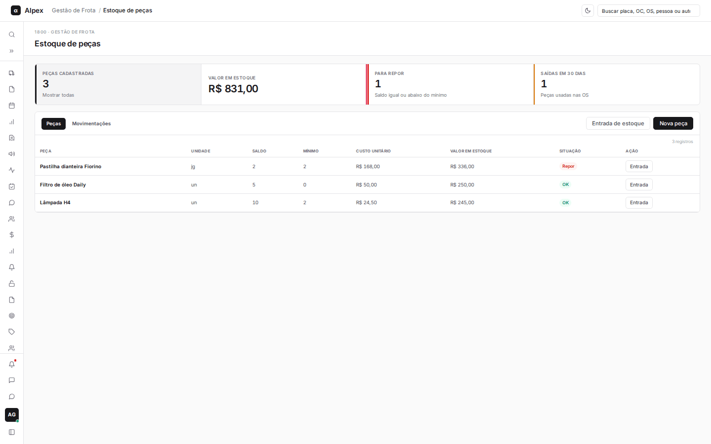
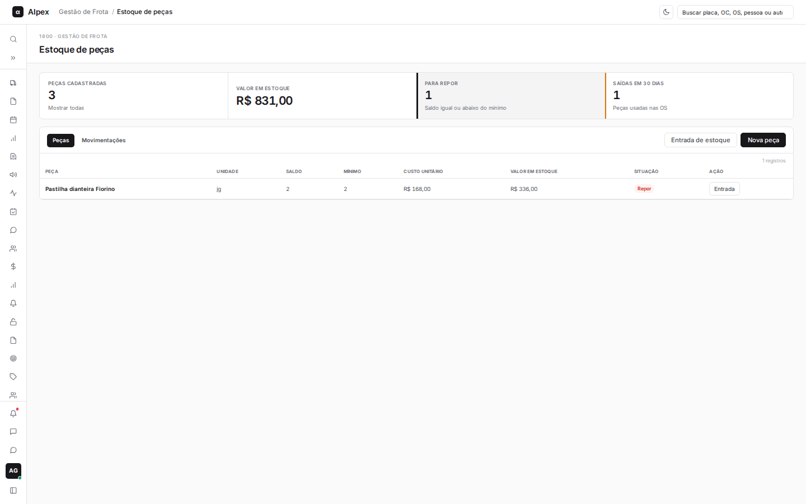
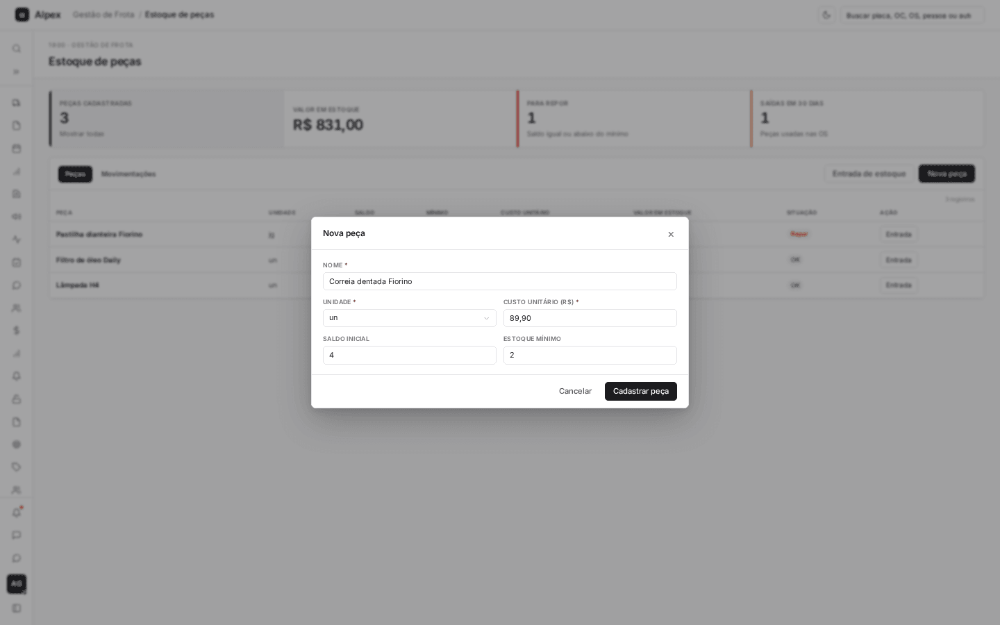
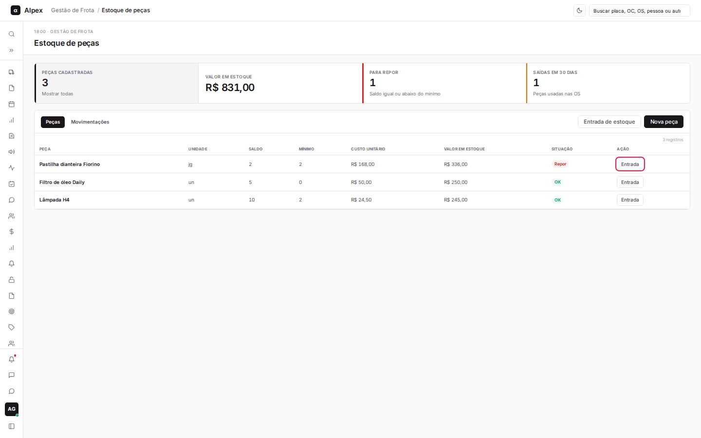
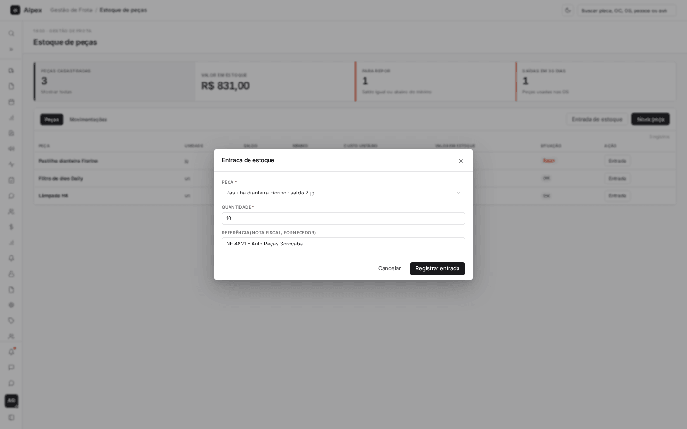
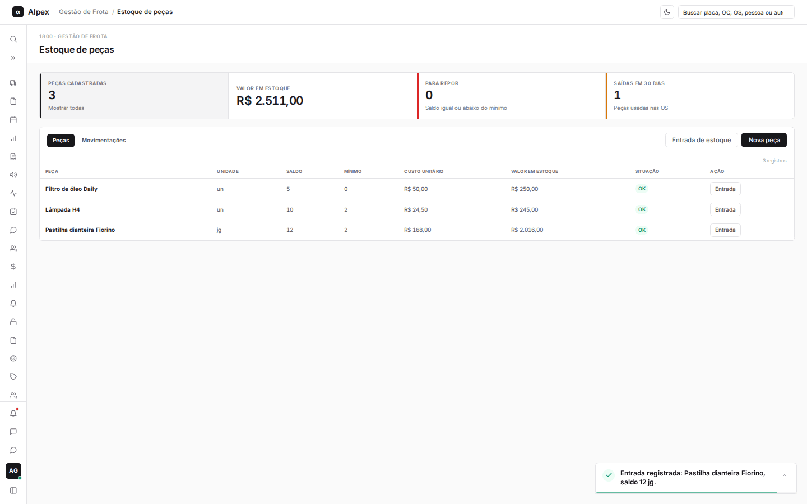
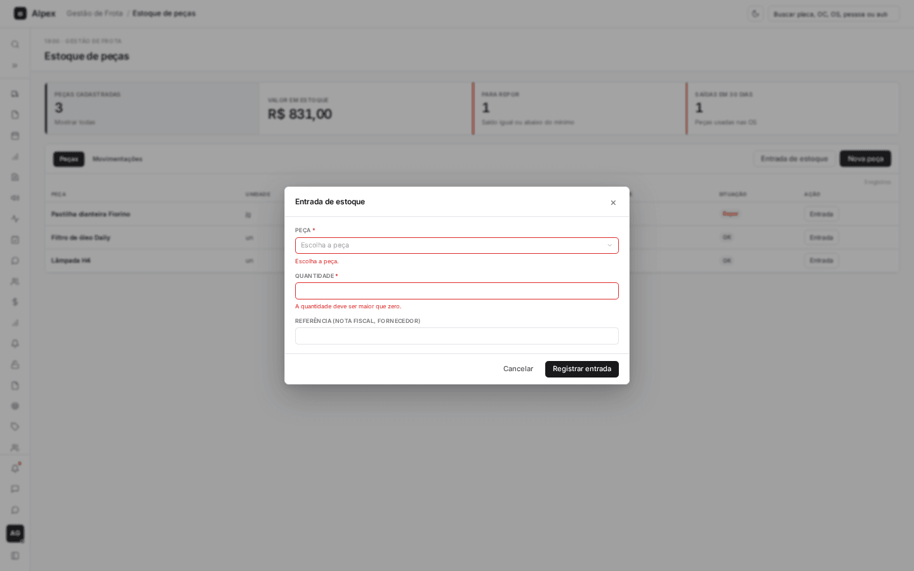
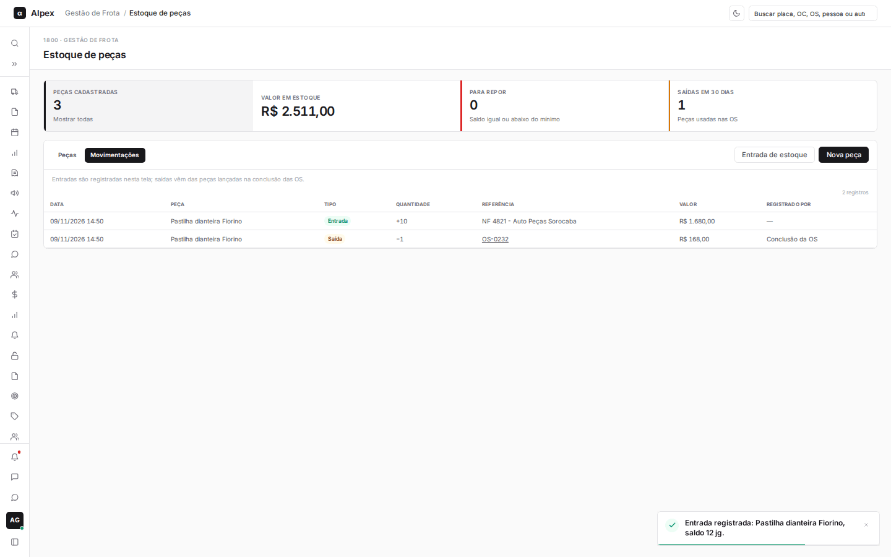
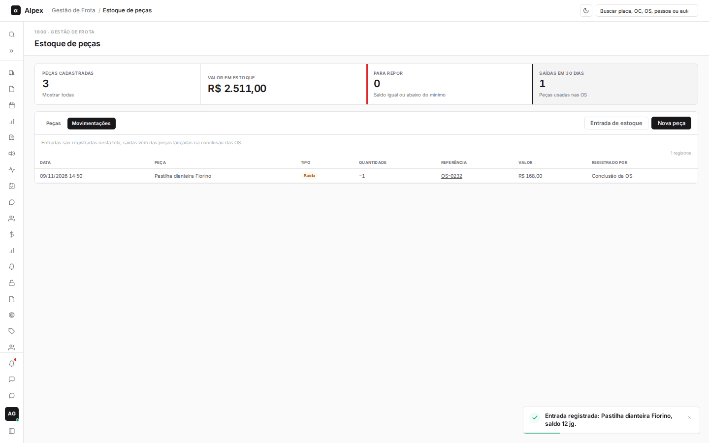

**Menu:** 1917 - Estoque de peças

Controle das peças usadas na manutenção: cadastro, saldo, entradas e o histórico de movimentações. As saídas são lançadas automaticamente quando uma OS é concluída com peças.

## Filtrar as peças e as movimentações

<Steps>
  <Step title="Usar os cartões de total">
    Clique em **Para repor** para ver só as peças com saldo igual ou abaixo do mínimo. Clique em **Saídas em 30 dias** para ir à aba **Movimentações** só com as saídas dos últimos 30 dias. **Peças cadastradas** e **Valor em estoque** mostram o total e, ao clicar, voltam à lista completa.

    

    
  </Step>
  <Step title="Trocar entre as abas">
    Use as abas **Peças** e **Movimentações** acima da tabela.
  </Step>
</Steps>

<Note>
A coluna **Situação** mostra **Repor** (em vermelho) quando o saldo é igual ou menor que o estoque mínimo e **OK** nos demais casos. O **Valor em estoque** é o saldo multiplicado pelo custo unitário.
</Note>

## Cadastrar uma peça

<Steps>
  <Step title="Clicar em Nova peça">
    Clique em **Nova peça**, no alto da tabela.
  </Step>
  <Step title="Preencher os dados">
    Informe o **Nome**, escolha a **Unidade**, digite o **Custo unitário (R$)** e, se quiser, o **Saldo inicial** e o **Estoque mínimo**.

    
  </Step>
  <Step title="Cadastrar">
    Clique em **Cadastrar peça**. A peça aparece na tabela e já pode ser usada ao concluir uma OS.
  </Step>
</Steps>

<Note>
O **Nome** precisa ter pelo menos 3 caracteres e não pode repetir o de outra peça. O **Custo unitário** deve ser maior que zero; saldo e estoque mínimo não podem ser negativos. Para dar entrada em mais unidades depois, use **Entrada de estoque**; o saldo não é editado diretamente.
</Note>

## Registrar a entrada de peças

<Steps>
  <Step title="Abrir a entrada">
    Clique em **Entrada de estoque** no alto da tabela, ou em **Entrada** na linha da peça (assim a peça já vem escolhida).

    
  </Step>
  <Step title="Preencher">
    Escolha a **Peça** (digite para procurar), informe a **Quantidade** e, se quiser, a **Referência (nota fiscal, fornecedor)**.

    
  </Step>
  <Step title="Registrar">
    Clique em **Registrar entrada**. O aviso na tela mostra o novo saldo e a tabela já traz a quantidade atualizada.

    

    Se a peça ou a quantidade estiverem em branco, os campos ficam em vermelho e nada é registrado:

    
  </Step>
</Steps>

<Note>
A peça e a quantidade (maior que zero) são obrigatórias. A entrada soma ao saldo e fica registrada na aba **Movimentações**. Não há tela para registrar saída manual: as saídas vêm das peças lançadas na conclusão das OS.
</Note>

## Consultar as movimentações

<Steps>
  <Step title="Abrir a aba">
    Clique em **Movimentações**.

    
  </Step>
  <Step title="Ler a lista">
    Cada linha mostra a data, a peça, o tipo (**Entrada** ou **Saída**), a quantidade, a referência, o valor e quem registrou. Nas saídas, a referência é o número da OS: clique nele para abri-la.
  </Step>
  <Step title="Ver só as saídas recentes">
    Volte à aba **Peças** e clique no cartão **Saídas em 30 dias**.

    
  </Step>
</Steps>
