**Menu:** 1908 - Multas

Aqui o Gestor lança as multas recebidas, vincula cada uma ao condutor, indica o condutor ao órgão de trânsito dentro do prazo e marca a multa como paga.

## Filtrar as multas

<Steps>
  <Step title="Usar os quadros do topo">
    Clique em **Pendentes de indicação** para ver só as multas que ainda não têm condutor indicado ao órgão, ou em **Prazo em até 7 dias ou atrasado** para ver as urgentes. Clique em **Valor total** ou **Pontos** para mostrar todas de novo.

    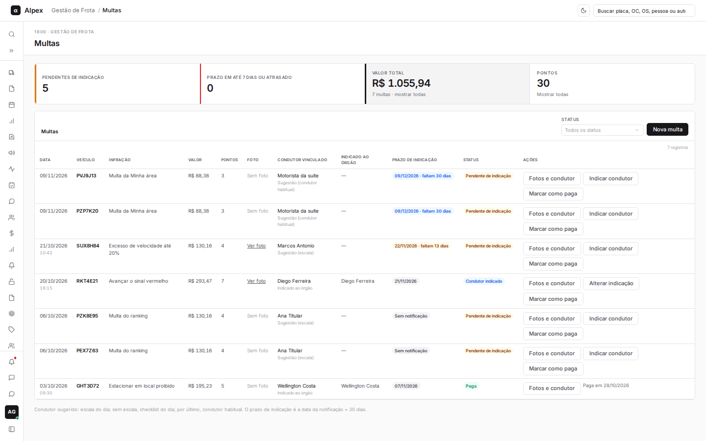

    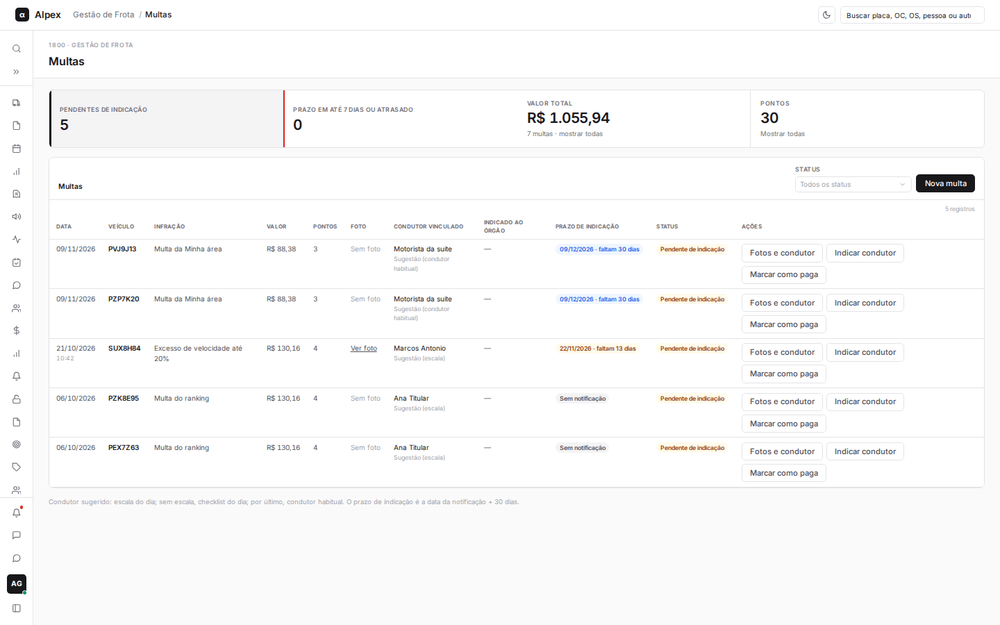
  </Step>
  <Step title="Filtrar por status">
    No campo **Status**, escolha Pendente de indicação, Condutor indicado ou Paga. Para limpar, escolha **Todos os status**.

    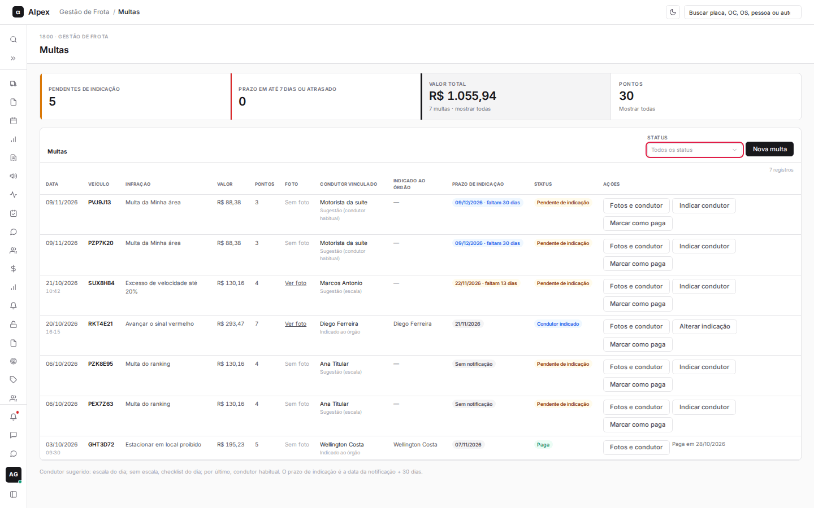
  </Step>
</Steps>

## Cadastrar uma multa

<Steps>
  <Step title="Abrir o formulário">
    Clique em **Nova multa**.

    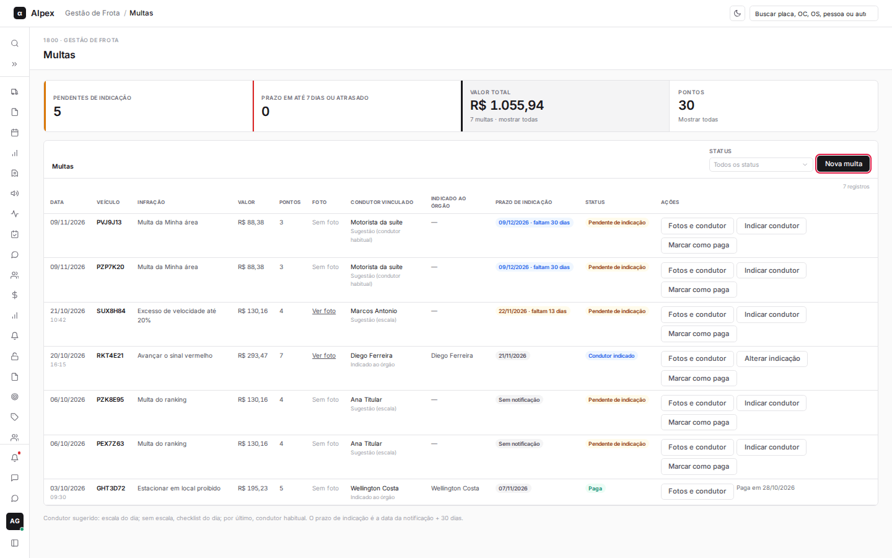
  </Step>
  <Step title="Anexar a foto da notificação">
    Em **Foto da notificação**, clique em **Tirar foto** (usa a câmera do aparelho) ou em **Anexar foto** (imagem ou PDF). Dá para anexar mais de uma.
  </Step>
  <Step title="Preencher os dados">
    Escolha o **Veículo** e informe **Data da infração**, **Hora**, **Infração**, **Valor (R$)**, **Pontos**, **Data da notificação**, **Local** e **Auto de infração**. O campo **Infração** sugere descrições já usadas. Em **Condutor**, o sistema mostra o condutor sugerido; deixe **Usar a sugestão** ou escolha outro (ou **Não identificado**) em **Condutor vinculado à multa**.

    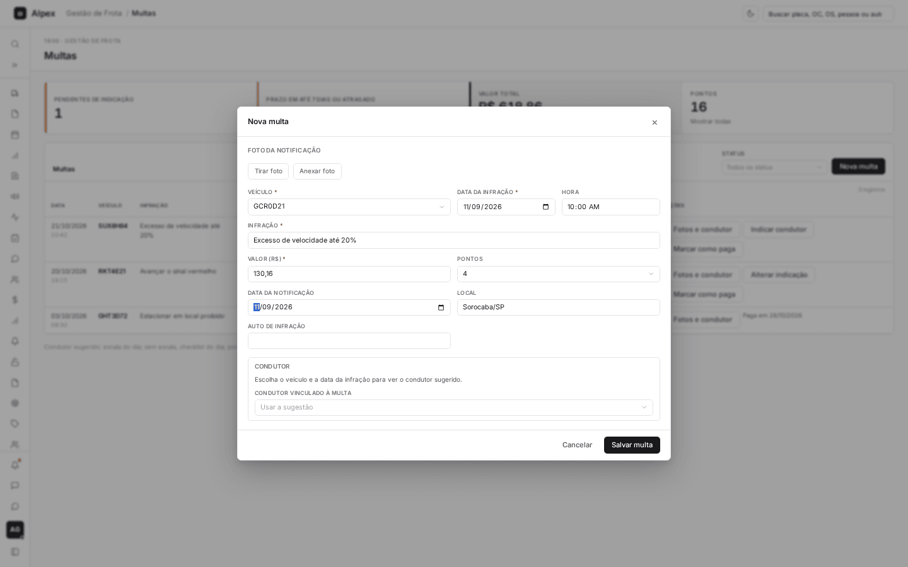
  </Step>
  <Step title="Salvar">
    Clique em **Salvar multa**.
  </Step>
</Steps>

<Note>
Veículo, data da infração, infração e valor são obrigatórios, e a data da infração não pode ser futura. O condutor sugerido vem da escala do dia; sem escala, do checklist do dia; por último, do condutor habitual. O prazo de indicação é a data da notificação mais 30 dias.
</Note>

## Ver as fotos e alterar o condutor vinculado

<Steps>
  <Step title="Abrir o painel">
    Na linha da multa, clique em **Fotos e condutor**.

    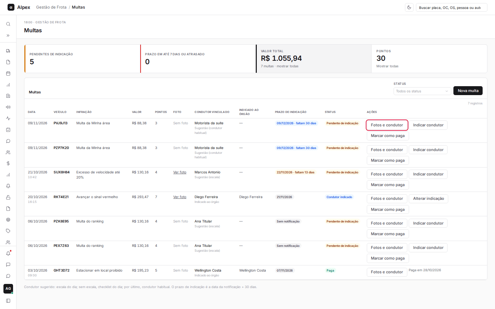
  </Step>
  <Step title="Ver ou trocar as fotos">
    Clique na foto para abri-la em tamanho grande. Use **Tirar foto** ou **Anexar foto** para incluir novas e clique em **Salvar fotos** para gravar.

    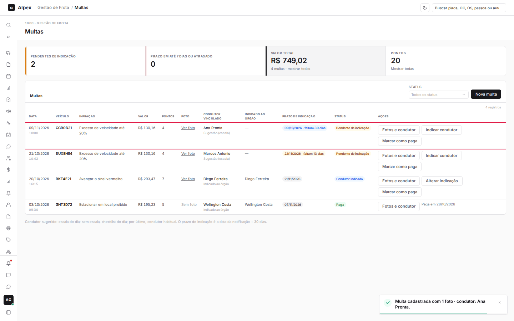
  </Step>
  <Step title="Remover uma foto">
    Abaixo da foto, clique em **Remover**. Confirme na janela que abre. A foto some da multa.

    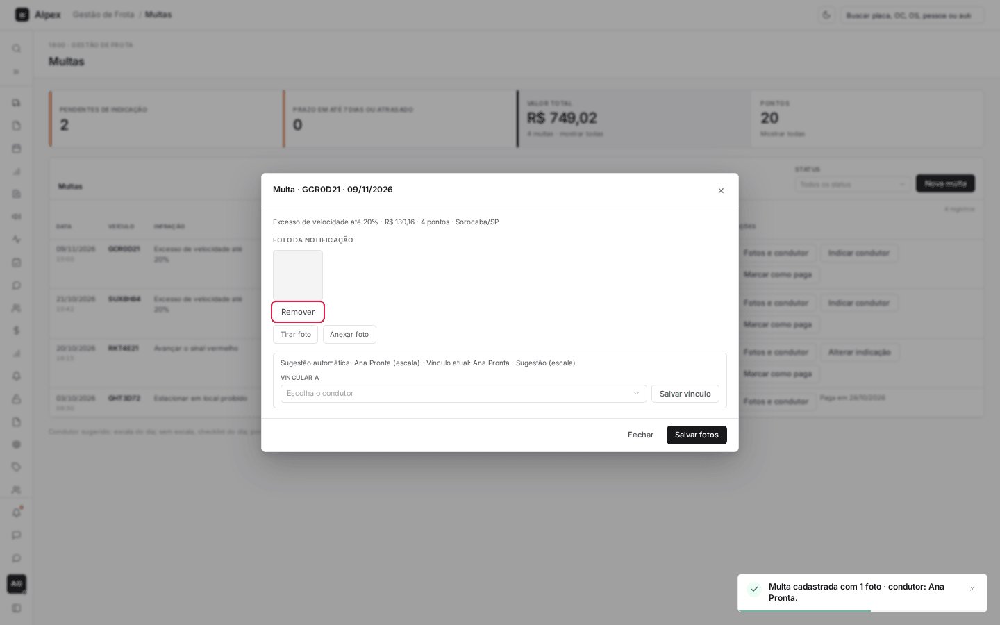

    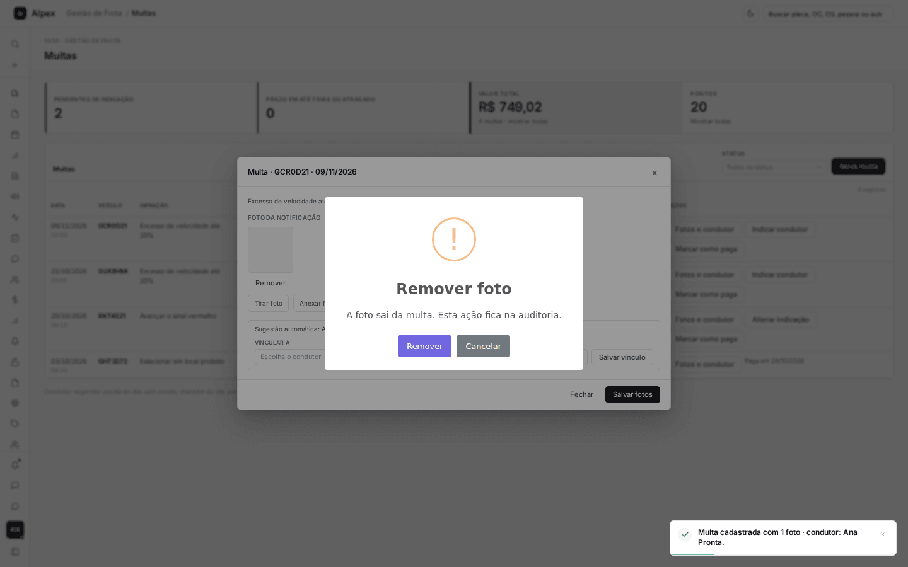

    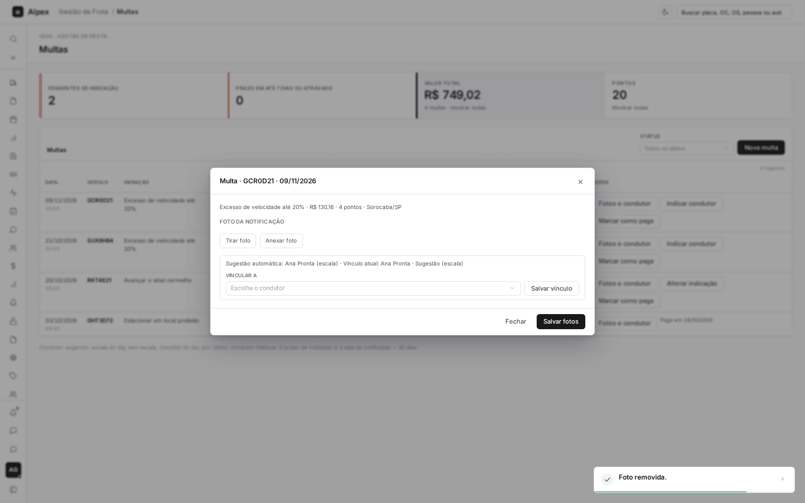
  </Step>
  <Step title="Trocar o condutor vinculado">
    O painel mostra a sugestão automática e o vínculo atual. Em **Vincular a**, escolha o condutor e clique em **Salvar vínculo**.

    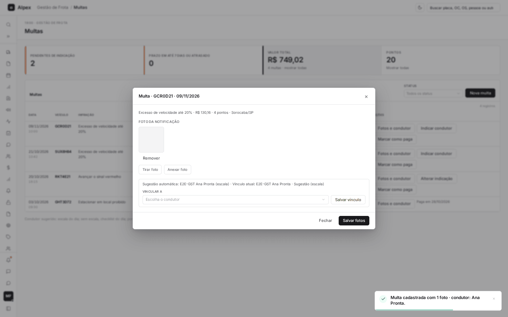
  </Step>
</Steps>

<Note>
Remover uma foto pede confirmação. O vínculo é diferente da indicação ao órgão: o vínculo diz quem dirigia, a indicação é o ato formal junto ao órgão de trânsito.
</Note>

## Indicar o condutor ao órgão de trânsito

<Steps>
  <Step title="Abrir a indicação">
    Na linha da multa, clique em **Indicar condutor** (ou em **Alterar indicação**, se já houver uma).

    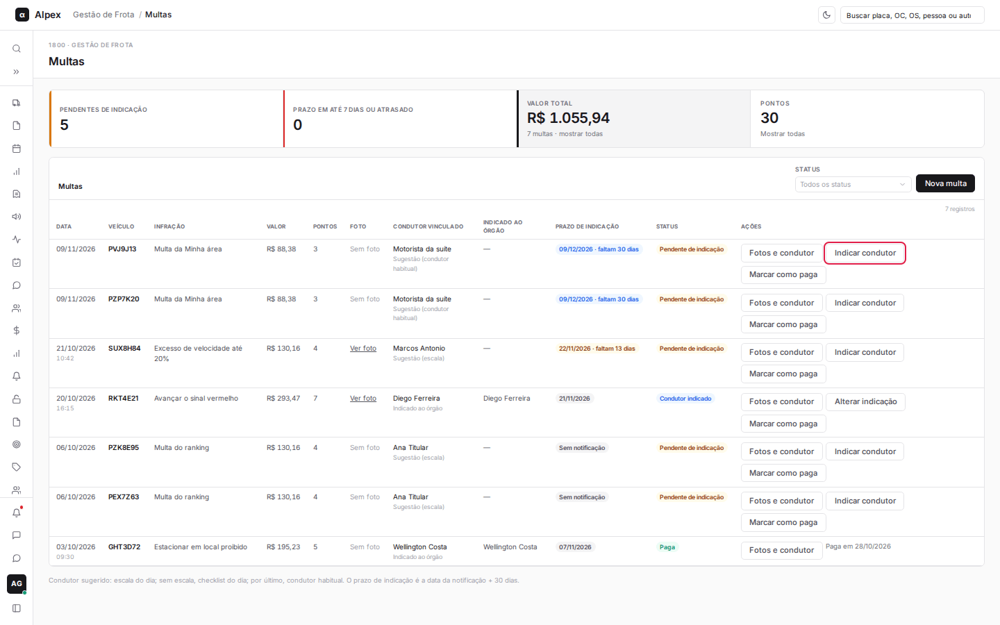
  </Step>
  <Step title="Escolher o condutor">
    Confira a sugestão e o prazo, escolha o **Condutor indicado ao órgão** e clique em **Indicar condutor**.

    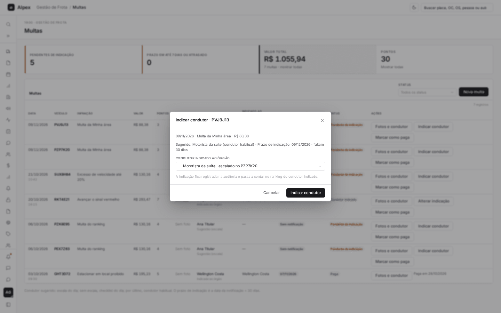
  </Step>
</Steps>

<Note>
A indicação fica registrada na auditoria e passa a contar no ranking do condutor indicado. A multa muda para o status Condutor indicado.
</Note>

## Marcar a multa como paga

<Steps>
  <Step title="Pedir a baixa">
    Na linha da multa, clique em **Marcar como paga**.

    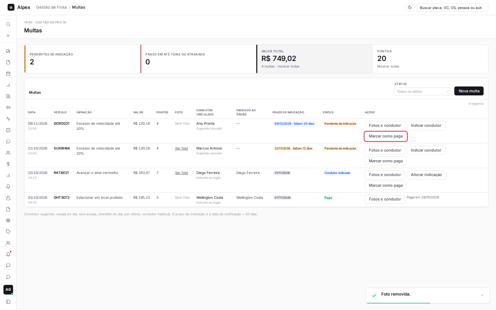
  </Step>
  <Step title="Confirmar">
    Na janela de confirmação, clique em **Marcar como paga**. Para desistir, clique em **Cancelar**.

    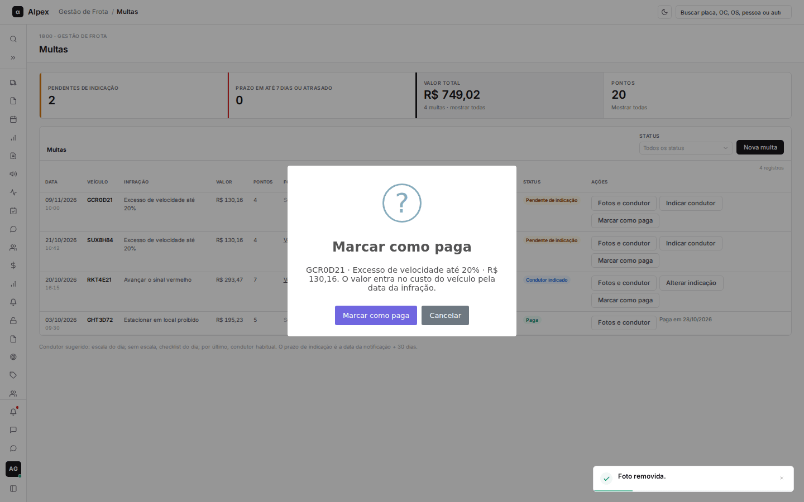
  </Step>
  <Step title="Conferir o resultado">
    A linha passa para o status **Paga**, com a data do pagamento, e os botões de indicação somem.

    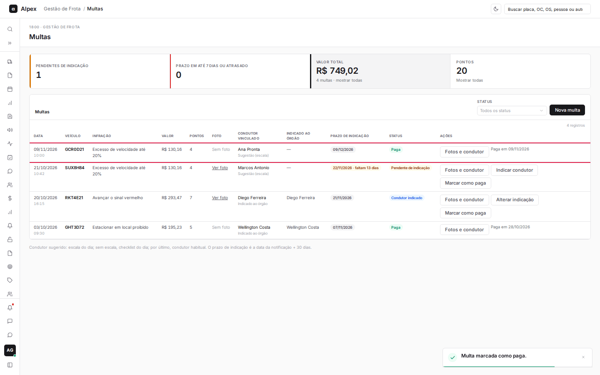
  </Step>
</Steps>

<Note>
O valor entra no custo do veículo pela data da infração. Multa paga fica com a data do pagamento na linha e não aceita mais indicação.
</Note>
