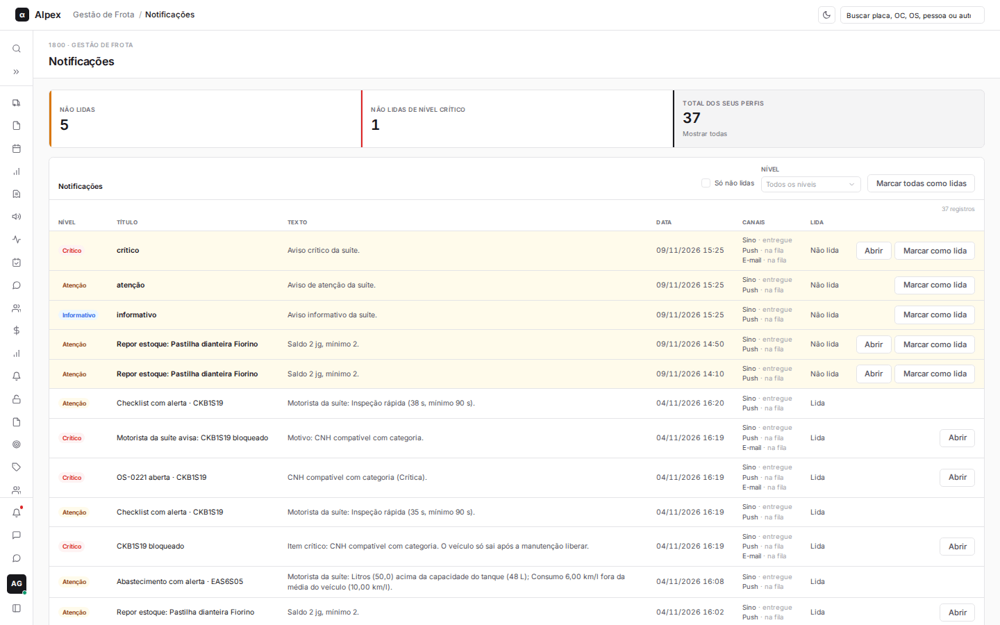
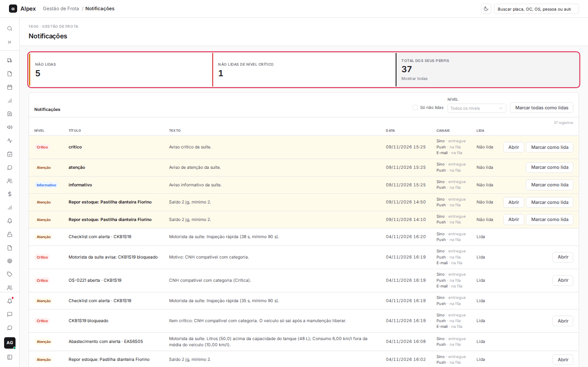
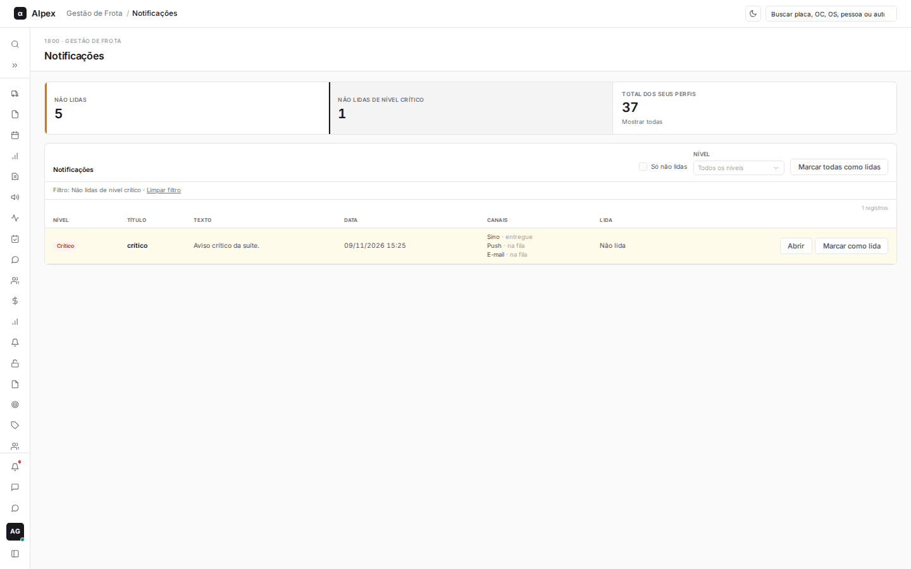
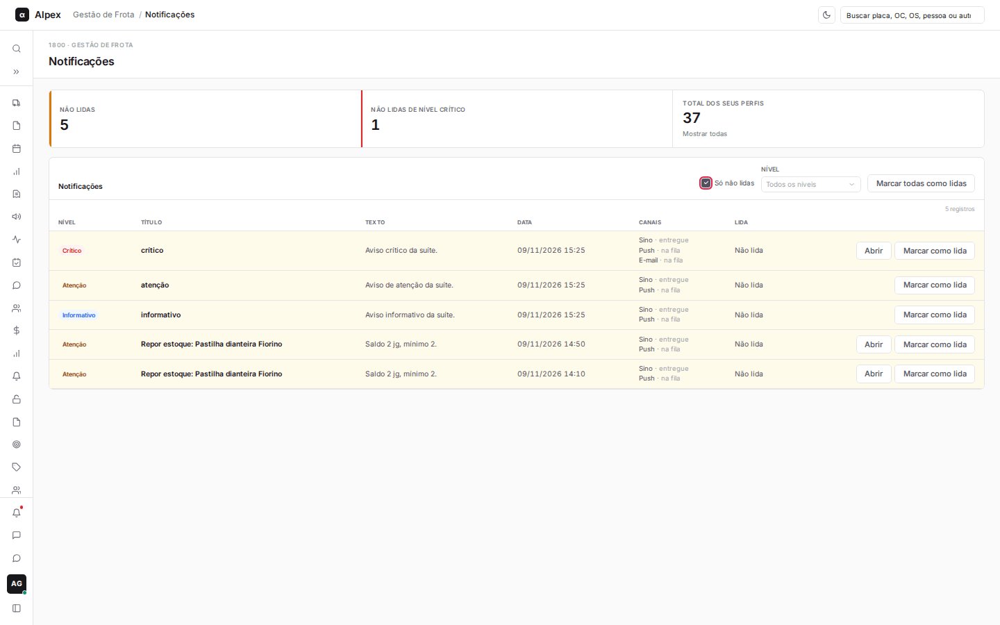
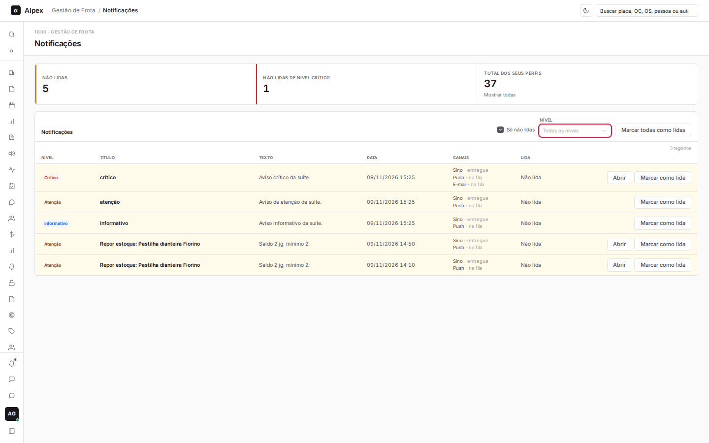
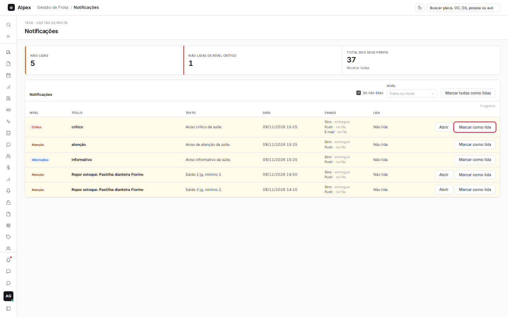
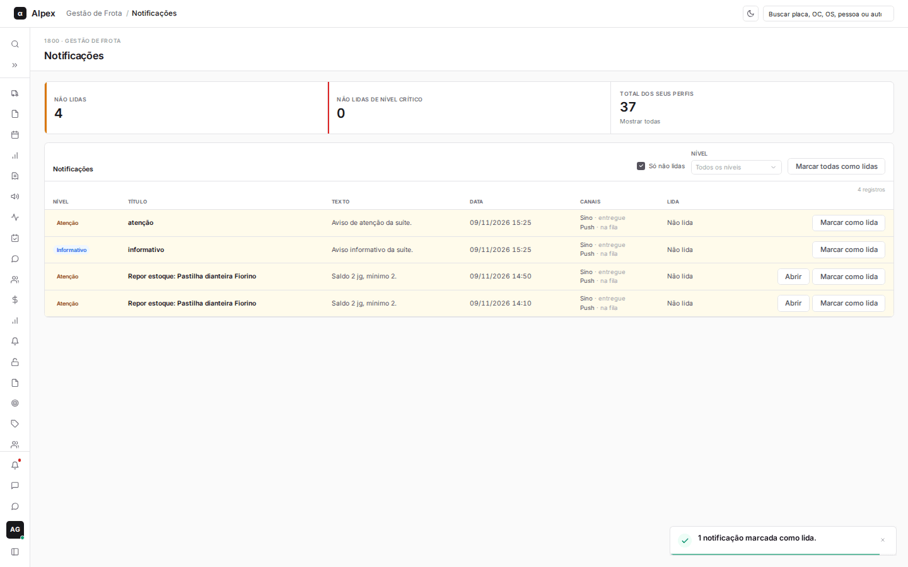
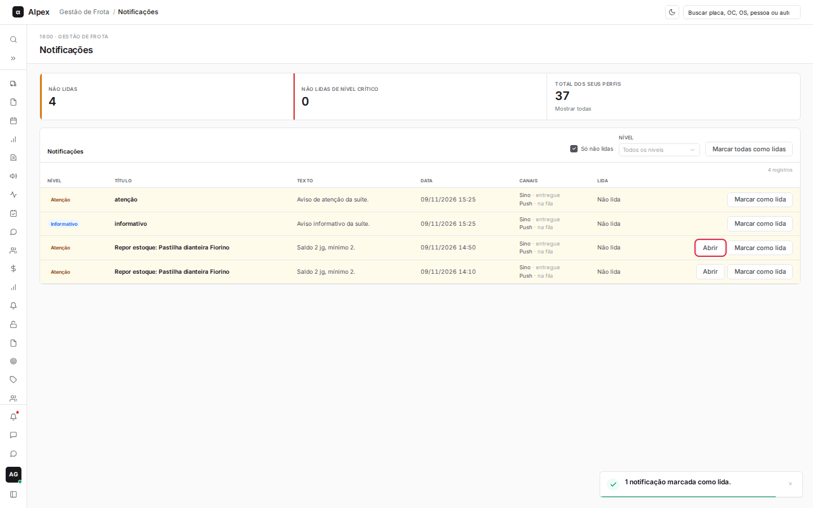
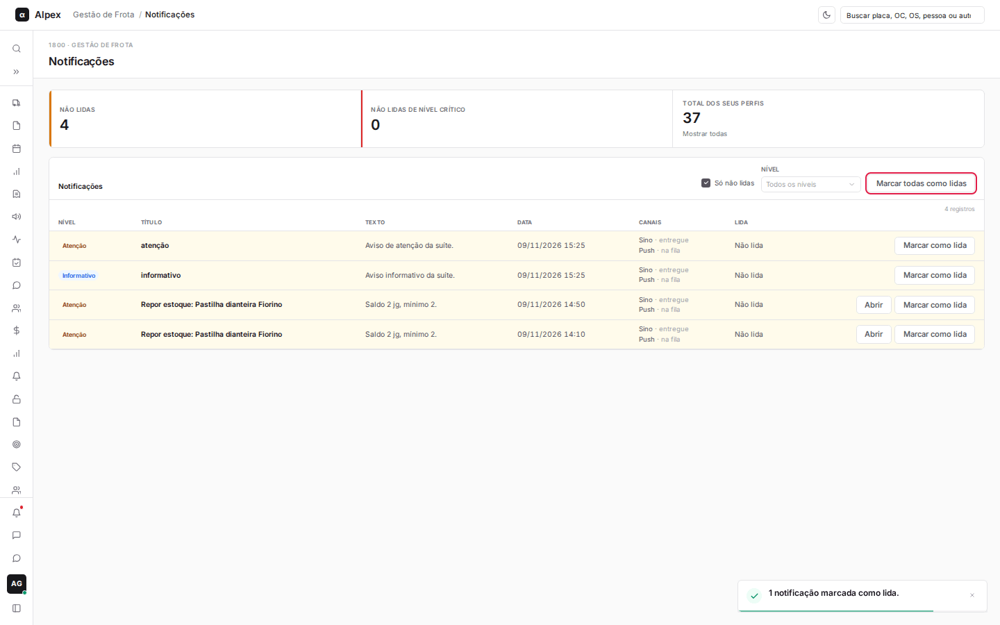

**Menu:** 1905 - Notificações

Aqui cada pessoa vê os avisos gerados pelo sistema para o seu perfil (veículo bloqueado, checklist com alerta, estoque baixo, multas e outros), com o nível de gravidade e o status de leitura. Todos os perfis acessam. Cada pessoa vê só os avisos dos seus próprios perfis.

## Filtrar as notificações

<Steps>
  <Step title="Usar os quadros do topo">
    Clique em **Não lidas** ou **Não lidas de nível crítico** para filtrar. Clique em **Total dos seus perfis** para mostrar todas de novo.

    

    
  </Step>
  <Step title="Só não lidas">
    Marque **Só não lidas** para esconder o que você já leu.

    
  </Step>
  <Step title="Filtrar por nível">
    No campo **Nível**, escolha Crítico, Atenção ou Informativo. Para limpar, escolha **Todos os níveis**, ou clique em **Limpar filtro** na faixa que aparece acima da lista.

    
  </Step>
</Steps>

## Marcar como lida e abrir a notificação

<Steps>
  <Step title="Marcar como lida">
    Na linha da notificação não lida (fundo amarelado), clique em **Marcar como lida**. A linha passa a aparecer como **Lida**.

    

    
  </Step>
  <Step title="Ir para a tela relacionada">
    Quando a notificação tem destino, aparece o botão **Abrir**. Ele leva direto à tela do assunto (por exemplo, o veículo bloqueado) e já marca como lida.

    
  </Step>
  <Step title="Marcar todas">
    Para limpar a caixa de uma vez, clique em **Marcar todas como lidas**.

    
  </Step>
</Steps>

<Note>
A coluna **Canais** mostra por onde o aviso foi enviado (Sino, Push, E-mail) e a situação de cada envio. Os canais ativos são definidos em Configurações, aba **Parâmetros**.
</Note>
