**Menu:** 1915 - Ocorrências

Acompanha os defeitos registrados nos checklists. Cada item NOK vira uma ocorrência, que pode ser tratada com uma OS ou encerrada sem OS.

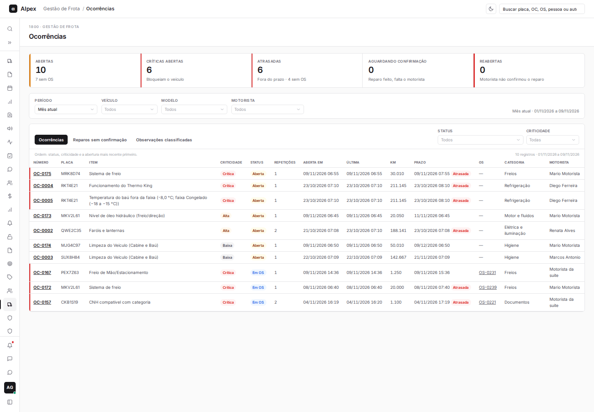

## Filtrar e priorizar as ocorrências

<Steps>
  <Step title="Ler os cartões">
    **Abertas**, **Críticas abertas** (bloqueiam o veículo), **Atrasadas**, **Aguardando confirmação** e **Reabertas**. Clique em um cartão para filtrar a lista; clique de novo para voltar.

    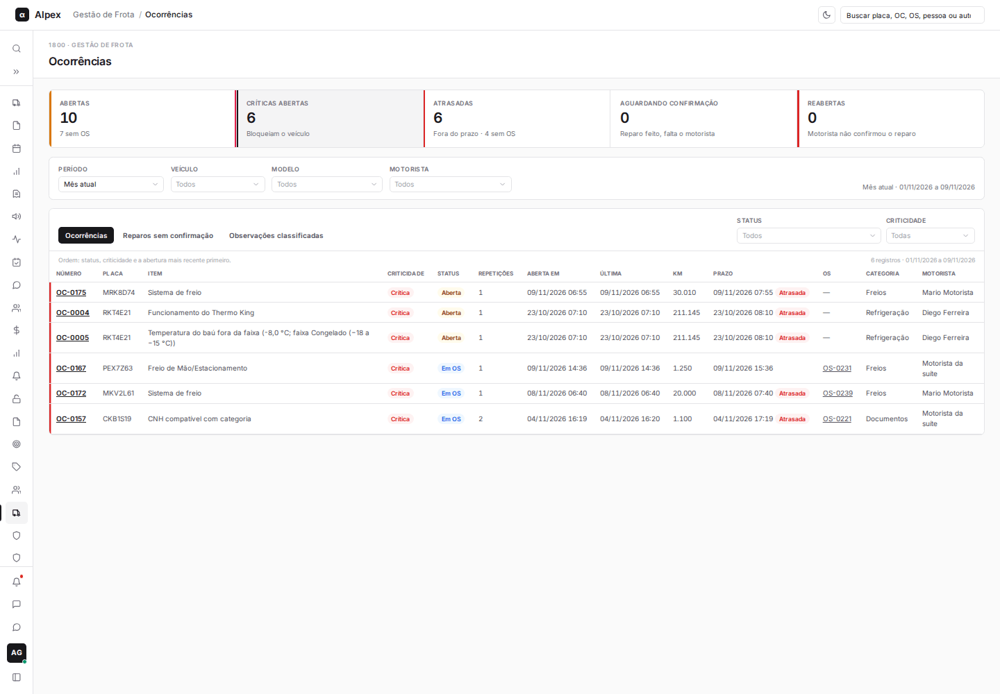
  </Step>
  <Step title="Filtrar por status e criticidade">
    Em **Status**, escolha por exemplo **Em aberto**. Em **Criticidade**, escolha o nível. Use também **Período**, **Veículo**, **Modelo** e **Motorista** na barra acima.

    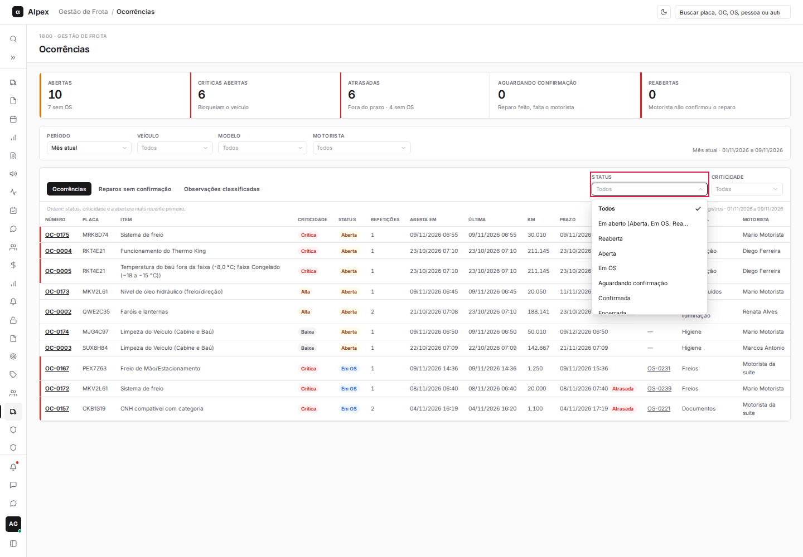
  </Step>
</Steps>

<Note>
Para Manutenção, a lista abre em **Em aberto**, ordenada por criticidade e pela abertura mais antiga. Líder e Gestor veem todos os status, ordenados por status, criticidade e abertura mais recente. Uma ocorrência **Atrasada** passou do prazo.
</Note>

## Abrir uma ocorrência

<Steps>
  <Step title="Clicar na linha">
    Na aba **Ocorrências**, clique na linha ou no número (por exemplo, **OC-0161**).

    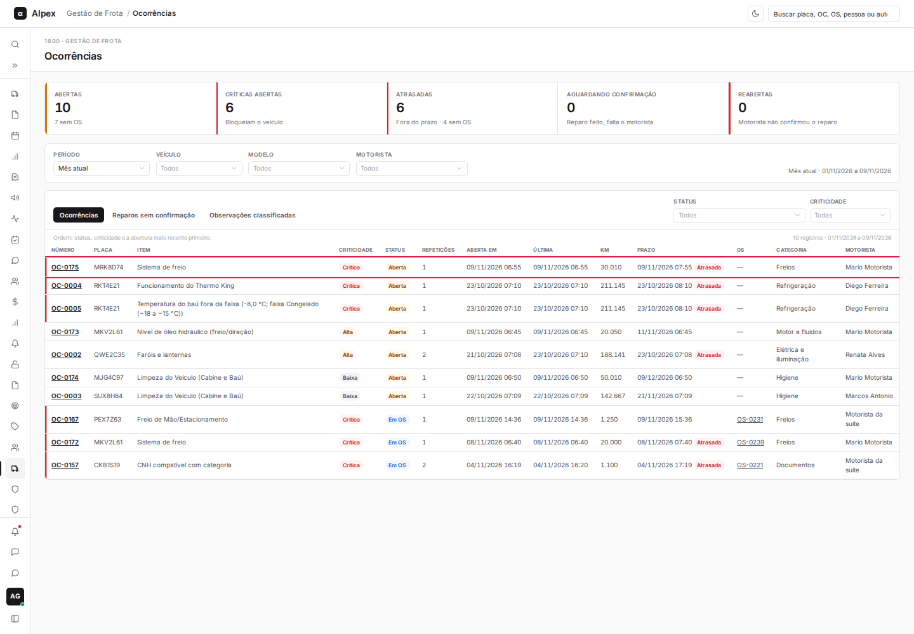
  </Step>
  <Step title="Ler o detalhe">
    A janela mostra situação, criticidade, veículo, item, categoria, origem, datas, prazo, KM, motorista que registrou e a OS ligada. Mais abaixo ficam as **Fotos**, as **Observações**, as **Repetições**, a **OS vinculada** e a **Cadeia de confirmações** do reparo.

    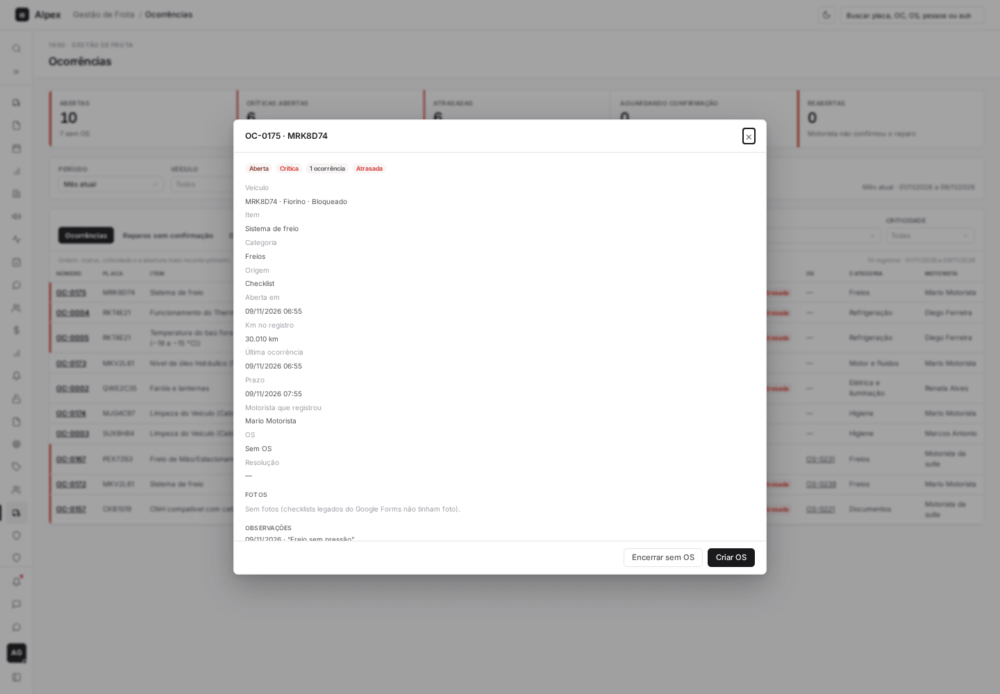
  </Step>
</Steps>

<Note>
Líder consulta apenas: ele vê a janela com a mensagem "Perfil de consulta: as ações ficam com Manutenção e Gestor" e só o botão **Fechar**.
</Note>

## Encaminhar a ocorrência para uma OS

<Steps>
  <Step title="Abrir a ocorrência aberta">
    Abra uma ocorrência com situação **Aberta** ou **Reaberta** e clique em **Criar OS**.

    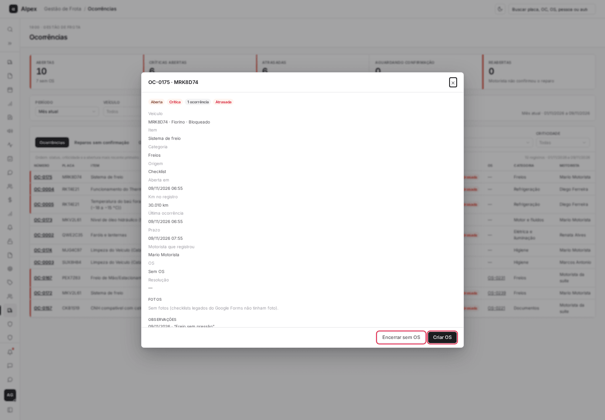
  </Step>
  <Step title="Preencher a OS">
    O formulário **Criar OS** já vem com o veículo, a prioridade e o título da ocorrência. Complete **Previsão de conclusão**, **Responsável**, **Oficina** e **Descrição** se quiser.

    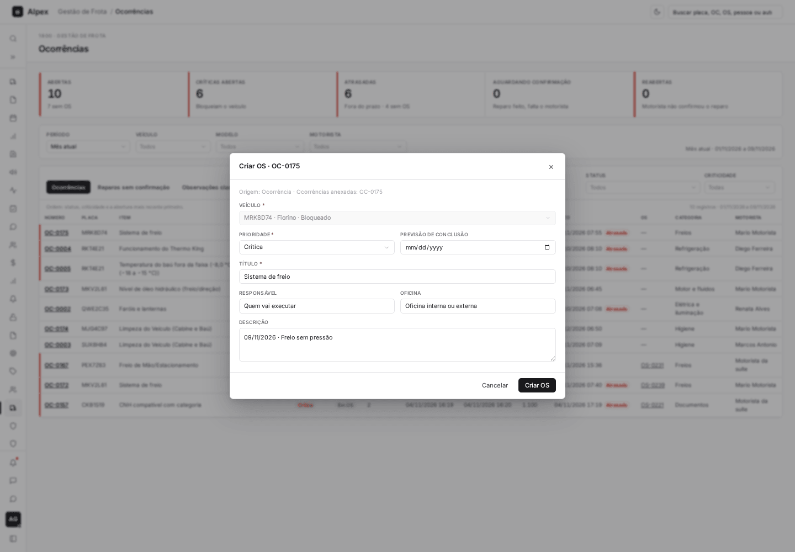
  </Step>
  <Step title="Salvar">
    Clique em **Criar OS**. A ocorrência passa a **Em OS** e a OS é anexada a ela.
  </Step>
</Steps>

<Note>
Se o veículo já tem uma OS em aberto, aparece também o botão **Anexar a OS aberta** (veja a ação seguinte).
</Note>

## Anexar a ocorrência a uma OS já aberta

<Steps>
  <Step title="Abrir a ocorrência">
    Abra uma ocorrência **Aberta** de um veículo que já tem uma OS em aberto e clique em **Anexar a OS aberta**.
  </Step>
  <Step title="Escolher a OS">
    Em **Ordem de serviço**, escolha a OS do veículo (aparece número, título e situação).

    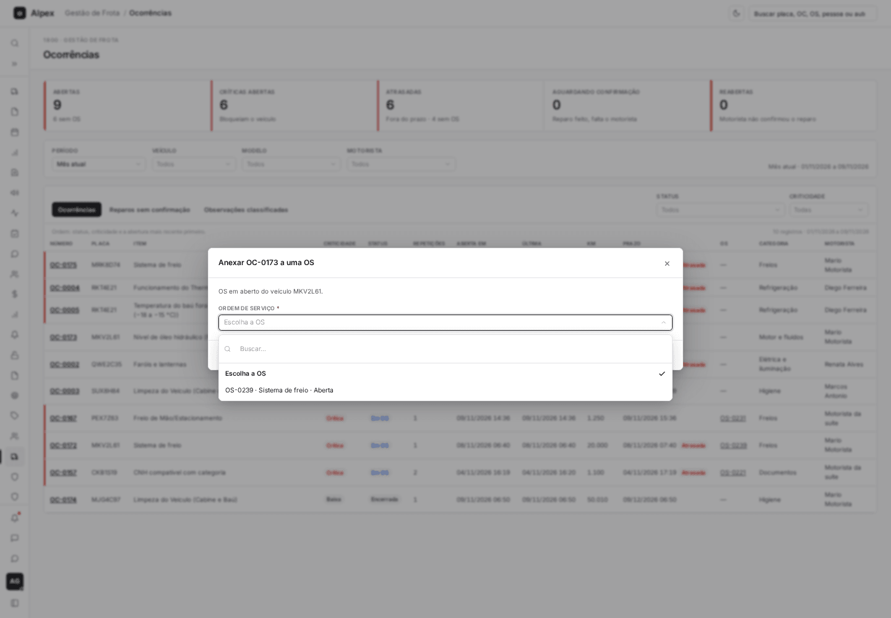
  </Step>
  <Step title="Anexar">
    Clique em **Anexar**.

    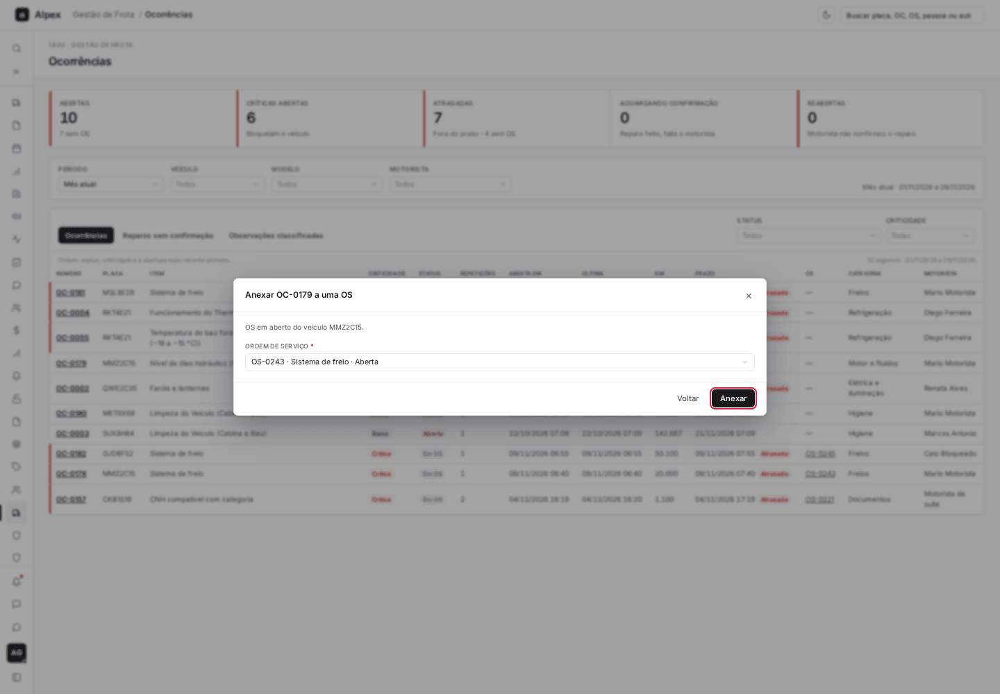

    A ocorrência passa a **Em OS** e aparece o aviso "anexada à OS".

    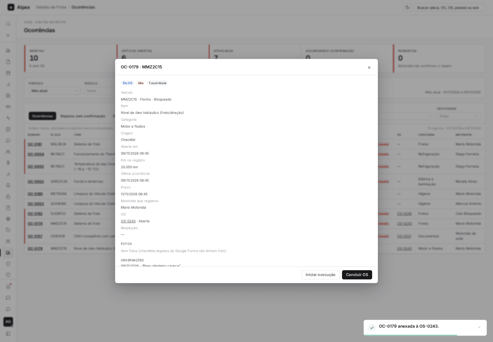
  </Step>
</Steps>

<Note>
O botão **Anexar a OS aberta** só aparece quando o veículo tem uma OS em aberto. Anexar junta a ocorrência à OS existente em vez de abrir outra.
</Note>

## Encerrar a ocorrência sem OS

<Steps>
  <Step title="Clicar em Encerrar sem OS">
    Na ocorrência aberta, clique em **Encerrar sem OS**.
  </Step>
  <Step title="Escolher a resolução">
    Em **Resolução**, escolha **Não é defeito** ou **Reparo não necessário para operar**.

    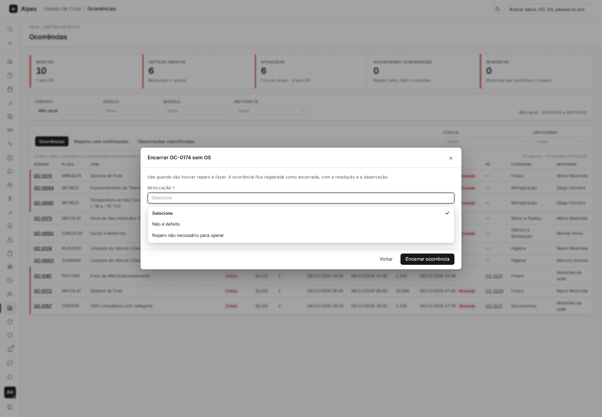
  </Step>
  <Step title="Escrever a observação">
    Preencha **Observação (obrigatória)** com pelo menos 5 caracteres.

    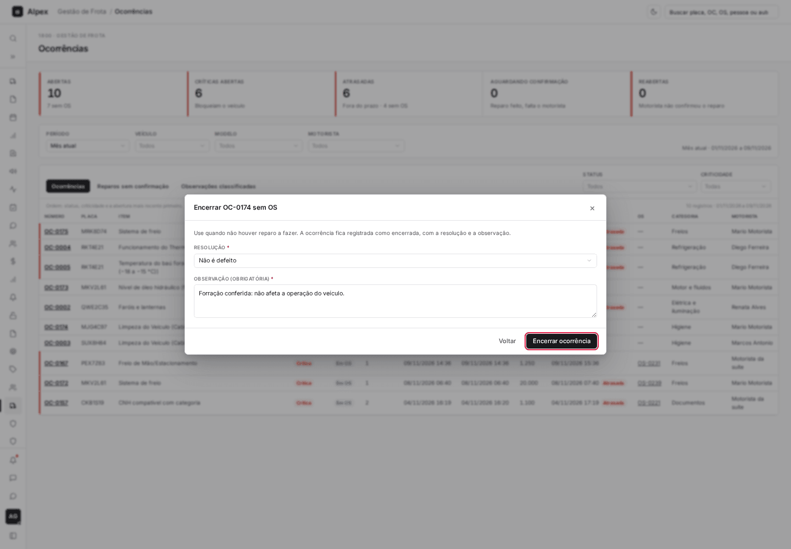
  </Step>
  <Step title="Confirmar">
    Clique em **Encerrar ocorrência**. Para desistir, clique em **Voltar**.

    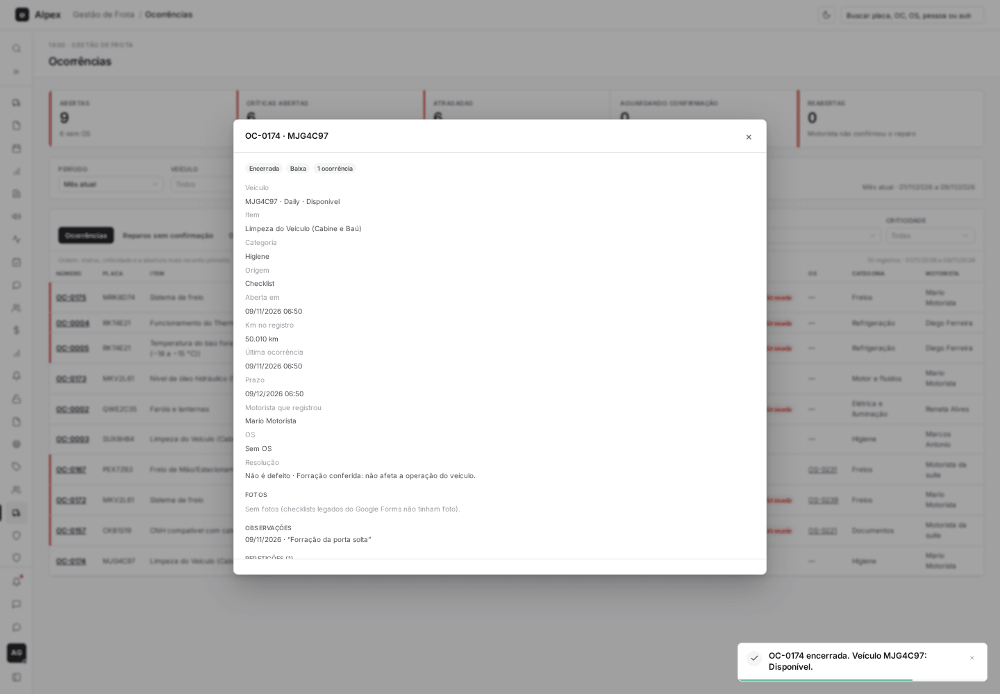
  </Step>
</Steps>

<Warning>
Use só quando não houver reparo a fazer. A ocorrência fica registrada como encerrada com a resolução e a observação, e o veículo é reavaliado (por exemplo, deixa de estar bloqueado se era o último item crítico).
</Warning>

## Acompanhar a OS pela ocorrência

<Steps>
  <Step title="Abrir uma ocorrência que está em OS">
    Abra a ocorrência com situação **Em OS**. A seção **OS vinculada** mostra número, título, situação, responsável, oficina e previsão. O botão do número da OS leva à tela de Ordens de serviço.

    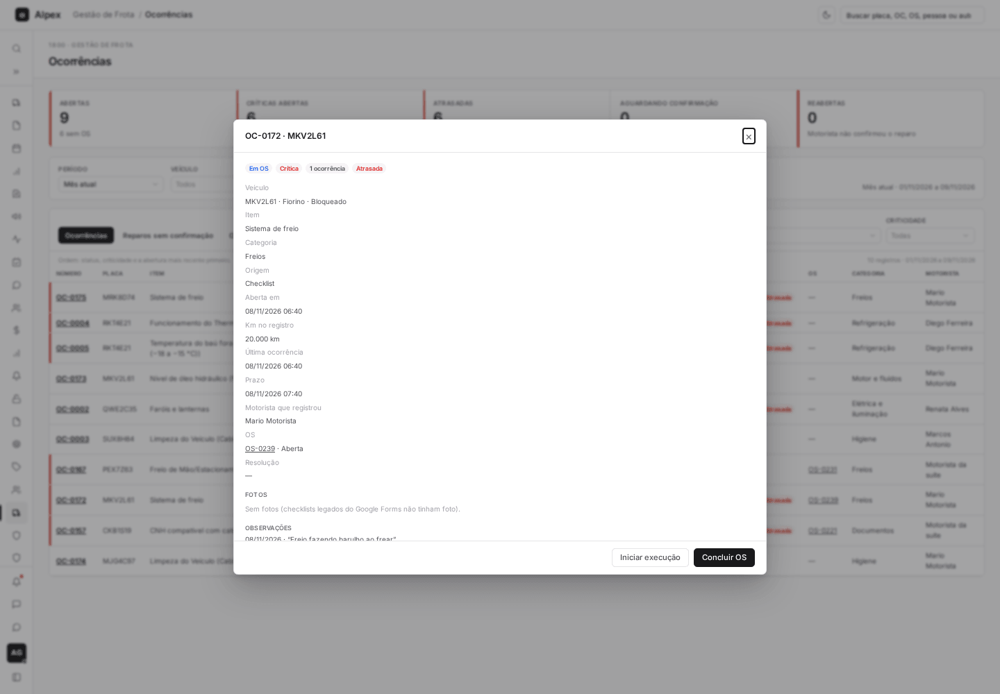
  </Step>
  <Step title="Mudar a situação da OS">
    Use os botões do rodapé conforme a situação da OS: **Iniciar execução** (OS aberta), **Aguardando peça** (informe **Qual peça falta**, obrigatório, e clique em **Confirmar**) e **Voltar para execução**.
  </Step>
</Steps>

## Concluir a OS pela ocorrência

<Steps>
  <Step title="Abrir a ocorrência em OS">
    Abra a ocorrência com situação **Em OS** e clique em **Concluir OS**.

    
  </Step>
  <Step title="Preencher a conclusão">
    Escolha a **Resolução** (por exemplo, **Reparado**), lance as peças em **Adicionar peça** se houver, informe **Mão de obra (R$)**, **Oficina**, **Responsável**, **Executado por: nome completo** e **CPF ou CNPJ de quem executou**. O **Total** é calculado na hora (peças x custo unitário + mão de obra). A **Observação** é obrigatória quando a resolução não é **Reparado**.

    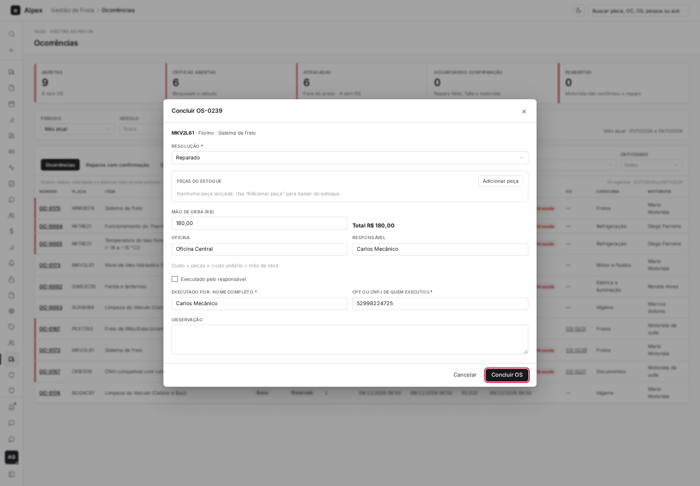
  </Step>
  <Step title="Salvar">
    Clique em **Concluir OS**. Aparece o aviso com o total da OS e o novo estado do veículo, e a ocorrência passa a **Aguardando confirmação** do próximo motorista.

    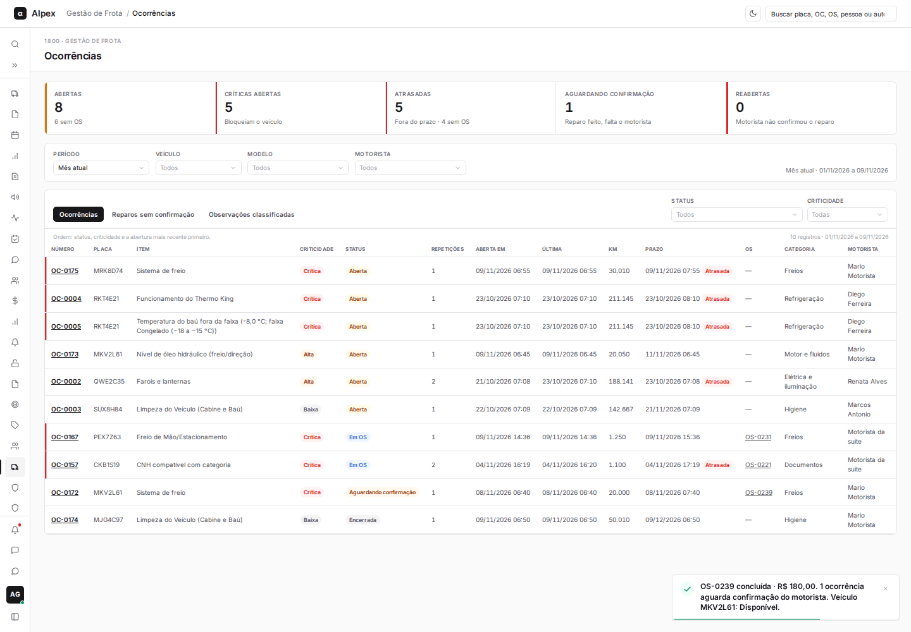
  </Step>
</Steps>

<Note>
O custo lançado aparece na aba **Custos** do veículo, em **Manutenção (OS)**. Os detalhes de peças e estoque estão na tela de Ordens de serviço.
</Note>

## Reparos sem confirmação e observações classificadas

<Steps>
  <Step title="Reparos sem confirmação">
    Clique na aba **Reparos sem confirmação**. O reparo só fecha com 3 confirmações: o motorista registrou o defeito, a manutenção executou o serviço e o motorista do próximo checklist de saída confirmou no veículo. A tabela mostra quem falta confirmar. Clique em uma linha para abrir a ocorrência.

    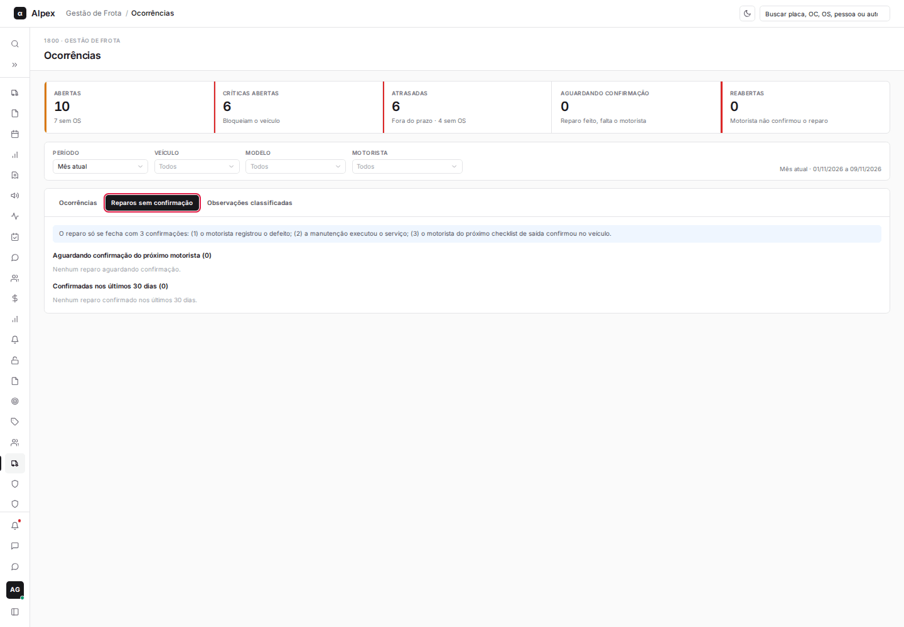
  </Step>
  <Step title="Observações classificadas">
    Clique na aba **Observações classificadas**. As observações escritas pelos motoristas são agrupadas por categoria, com os veículos e os relatos parecidos. Clique em **checklist** para abrir o checklist de origem.

    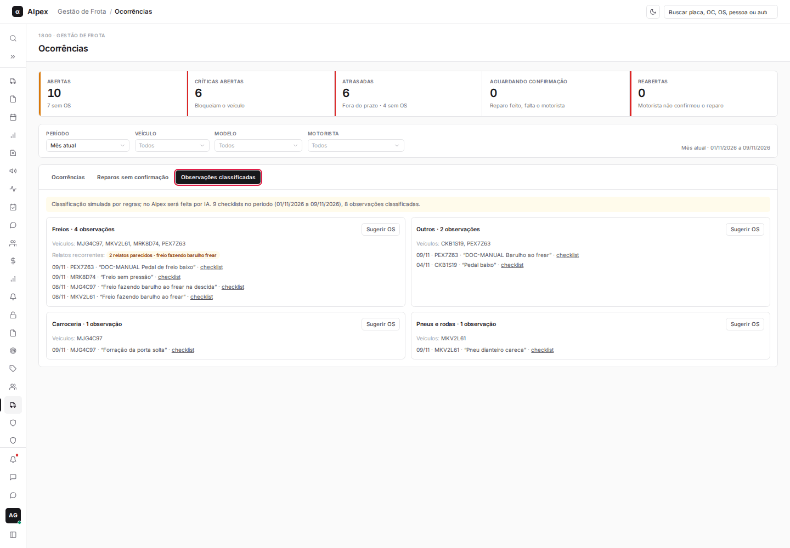
  </Step>
  <Step title="Sugerir OS">
    Clique em **Sugerir OS** no grupo para abrir o formulário de OS já preenchido com a categoria e as observações do grupo (somente Manutenção e Gestor).
  </Step>
</Steps>

<Note>
A classificação das observações hoje é feita por regras; mais adiante será feita por IA. O botão **Sugerir OS** só aparece para quem pode tratar ocorrências.
</Note>
