**Menu:** 1916 - Ordens de serviço

Quadro de todas as ordens de serviço (OS) da frota, da abertura à conclusão. Daqui você abre OS, acompanha o andamento, lança peças e custos e conclui o serviço.

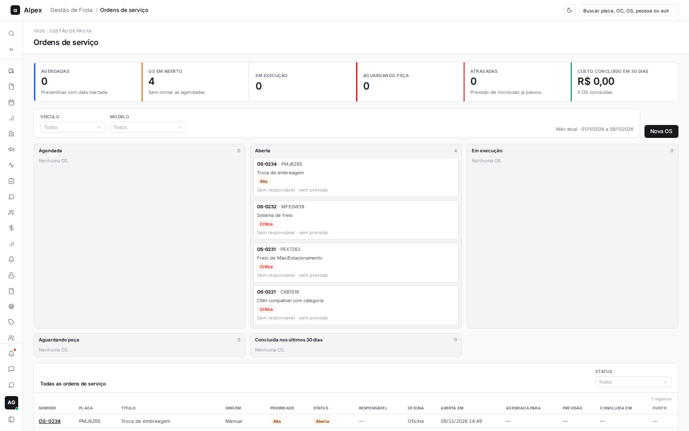

A tela tem três partes: os cartões de totais no topo, o quadro com uma coluna por situação (**Agendada**, **Aberta**, **Em execução**, **Aguardando peça** e **Concluída nos últimos 30 dias**) e a tabela **Todas as ordens de serviço** logo abaixo.

## Filtrar e buscar ordens de serviço

<Steps>
  <Step title="Escolher um cartão de total">
    Clique em um dos cartões do topo (**Agendadas**, **OS em aberto**, **Em execução**, **Aguardando peça**, **Atrasadas** ou **Custo concluído em 30 dias**). O quadro e a tabela passam a mostrar só essas OS. Clique de novo no mesmo cartão para voltar a ver tudo.

    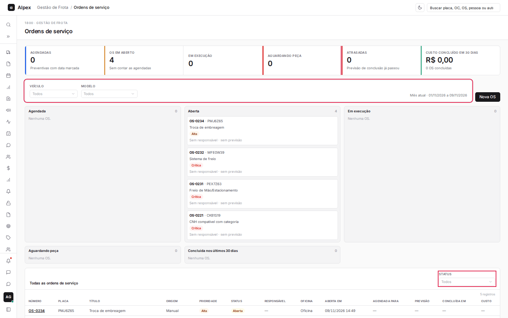
  </Step>
  <Step title="Filtrar por veículo ou modelo">
    Na barra de filtros, abra **Veículo** ou **Modelo**, digite parte da placa ou do nome e escolha a opção. Para limpar, escolha **Todos**.
  </Step>
  <Step title="Filtrar a tabela por status">
    No campo **Status**, acima da tabela, escolha a situação desejada (por exemplo, **Concluída** ou **Cancelada**). A tabela mostra também as OS canceladas, que não aparecem no quadro.
  </Step>
  <Step title="Procurar uma OS específica">
    Use a busca no alto da página (**Buscar placa, OC, OS, pessoa ou auto**) para ir direto a uma OS pelo número.
  </Step>
</Steps>

<Note>
Cada coluna do quadro mostra só as OS mais recentes; quando houver mais, aparece o aviso "Mais N na tabela abaixo". Uma OS está **Atrasada** quando a previsão de conclusão já passou e ela ainda não foi concluída. As OS **Agendadas** (preventivas com data marcada) não entram no total de **OS em aberto**.
</Note>

## Abrir uma nova OS

<Steps>
  <Step title="Clicar em Nova OS">
    No canto direito da barra de filtros, clique em **Nova OS**. Se já houver um veículo escolhido no filtro, ele vem preenchido.

    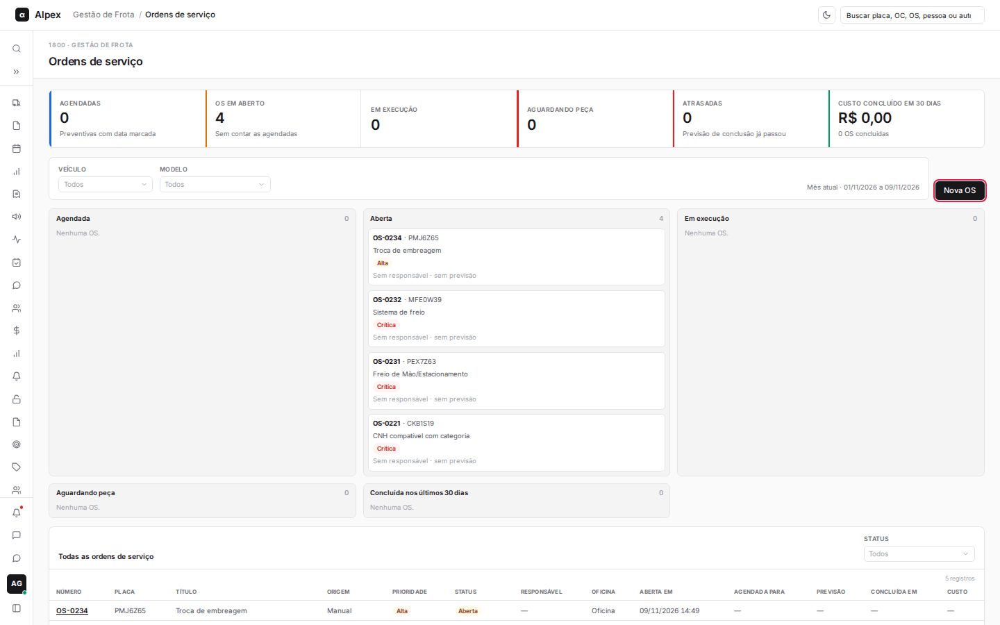
  </Step>
  <Step title="Preencher os dados">
    Escolha o **Veículo** (digite a placa para procurar) e a **Prioridade**. Escreva o **Título** da OS. Se quiser, informe a **Previsão de conclusão**, o **Responsável**, a **Oficina** e a **Descrição**.

    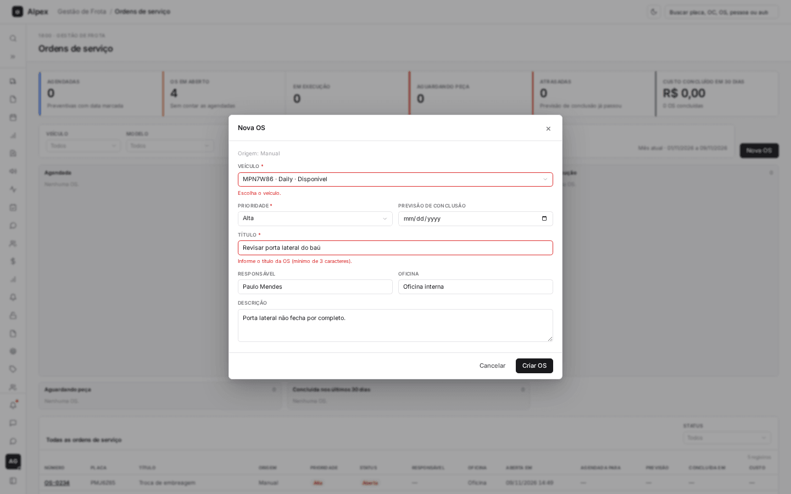
  </Step>
  <Step title="Criar a OS">
    Clique em **Criar OS**. A OS nasce **Aberta**, recebe o próximo número e o painel dela abre em seguida.

    Se faltar algum dado obrigatório, os campos ficam em vermelho com a explicação e a OS não é criada:

    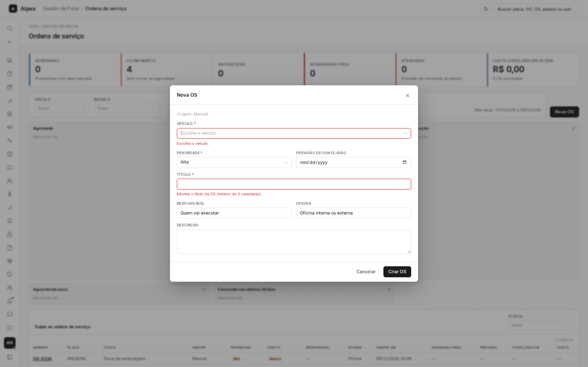
  </Step>
</Steps>

<Note>
**Veículo**, **Prioridade** e **Título** são obrigatórios; o título precisa ter pelo menos 3 caracteres. A **Previsão de conclusão** não pode ser anterior a hoje. Ao abrir a OS, o status do veículo é recalculado e a equipe é avisada. OS criadas aqui têm origem **Manual**; as que nascem de uma ocorrência ou de um plano preventivo mostram a origem correspondente.
</Note>

## Abrir e consultar uma OS

<Steps>
  <Step title="Escolher a OS">
    Clique no cartão da OS no quadro, ou na linha dela na tabela (também vale clicar no número).

    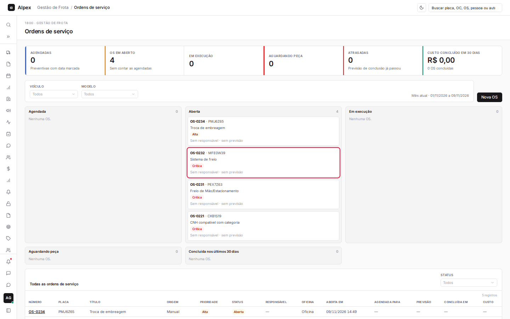
  </Step>
  <Step title="Ler os dados do painel">
    O painel mostra a situação e a prioridade, o veículo, a origem, o responsável, a oficina, as datas, a resolução e quem executou. Os botões de ação ficam no rodapé e mudam conforme a situação da OS.

    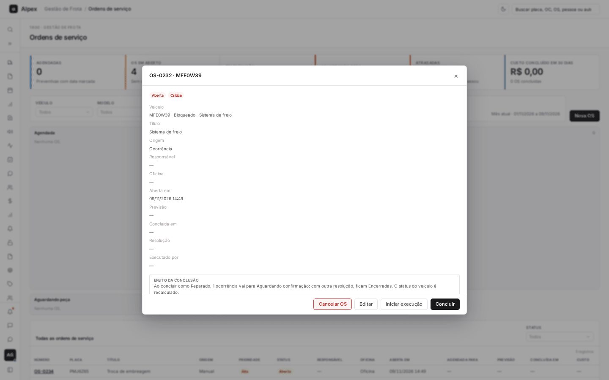
  </Step>
  <Step title="Ver ocorrências, peças e histórico">
    Role o painel para baixo para ver as **Ocorrências vinculadas**, as **Peças e custos** e o **Histórico de status**. Clique no número de uma ocorrência para abri-la na tela de Ocorrências.

    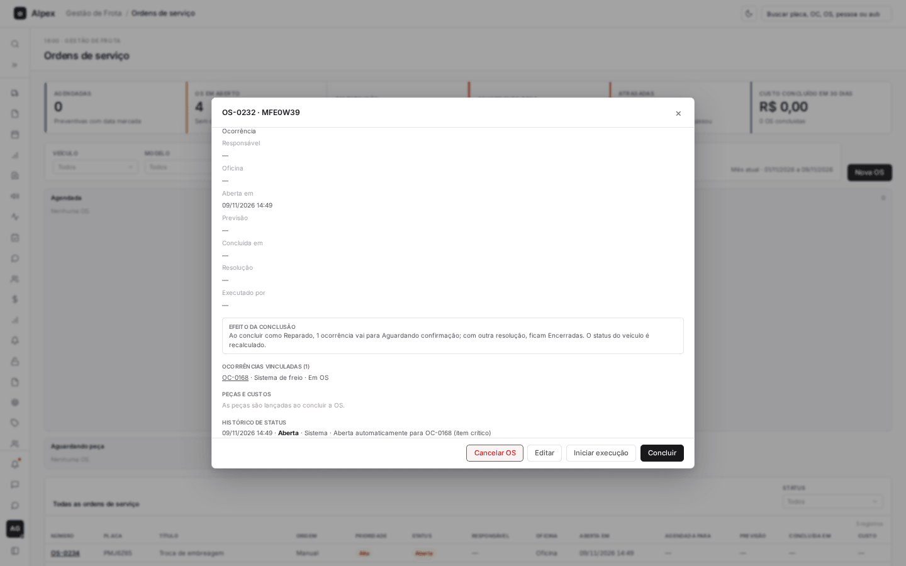
  </Step>
</Steps>

<Note>
Ligação com as ocorrências: uma ocorrência de item crítico do checklist abre uma OS automaticamente; nas demais, a OS é criada ou escolhida na tela de Ocorrências (**Criar OS** ou **Anexar a OS aberta**). Enquanto a OS está em andamento, a ocorrência fica **Em OS**. Ao concluir a OS como **Reparado**, a ocorrência passa para **Aguardando confirmação** do próximo motorista; com as outras resoluções ela é **Encerrada**. Se a OS for cancelada, as ocorrências voltam para **Aberta**. O painel mostra, no bloco **Efeito da conclusão**, exatamente o que vai acontecer.
</Note>

## Iniciar execução e marcar aguardando peça

<Steps>
  <Step title="Iniciar a execução">
    Abra a OS (situação **Aberta** ou **Agendada**) e clique em **Iniciar execução**. A OS vai para a coluna **Em execução** e o status do veículo é atualizado.

    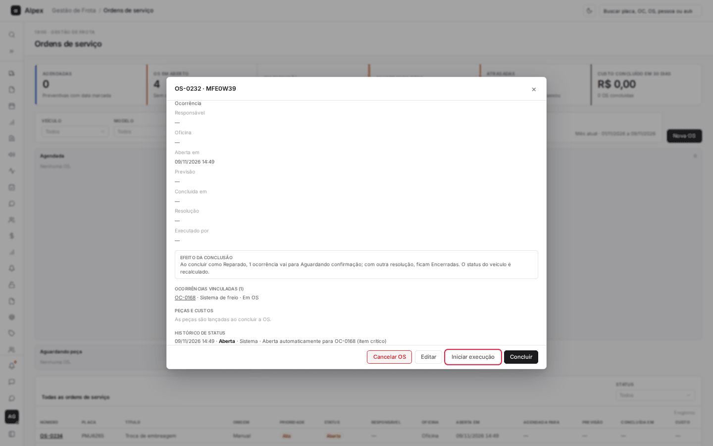

    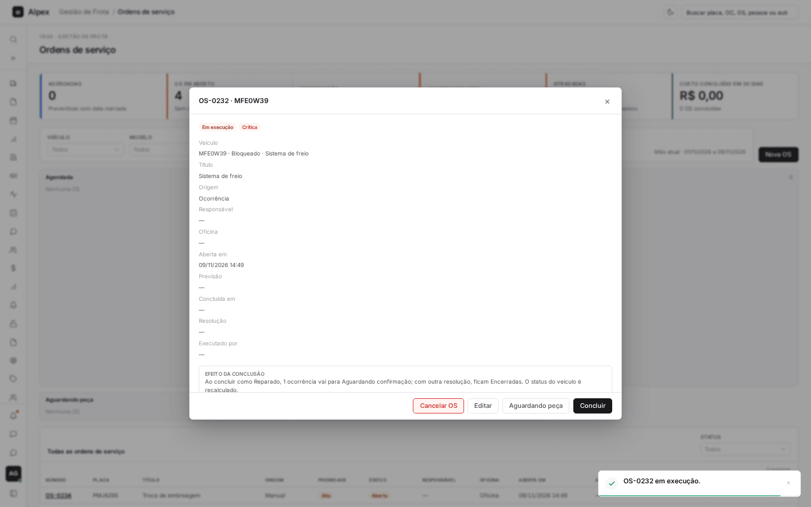
  </Step>
  <Step title="Avisar que falta peça">
    Com a OS **Em execução**, clique em **Aguardando peça**. Descreva qual peça falta no campo **Qual peça falta (obrigatório)** e clique em **Confirmar**. A OS vai para a coluna **Aguardando peça**.

    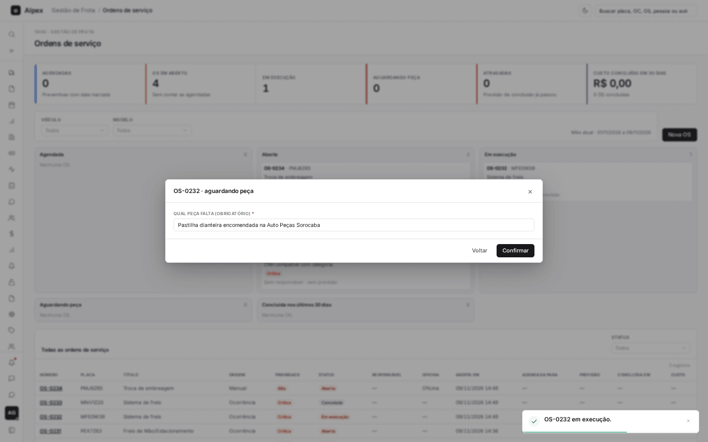
  </Step>
  <Step title="Voltar para execução">
    Quando a peça chegar, abra a OS e clique em **Voltar para execução**.
  </Step>
</Steps>

<Note>
A descrição da peça é obrigatória (mínimo de 3 caracteres) e fica registrada no **Histórico de status**. O caminho normal é **Aberta**, **Em execução**, **Aguardando peça** (e de volta a **Em execução**) e, por fim, **Concluída**; a conclusão pode ser feita de qualquer uma das três situações abertas. Uma OS já concluída ou cancelada não muda mais de situação.
</Note>

## Editar responsável, oficina e previsão

<Steps>
  <Step title="Abrir a edição">
    Abra a OS e clique em **Editar** (disponível enquanto ela estiver aberta, em execução ou aguardando peça).
  </Step>
  <Step title="Alterar os campos">
    Ajuste o **Responsável**, a **Oficina** ou a **Previsão de conclusão**.

    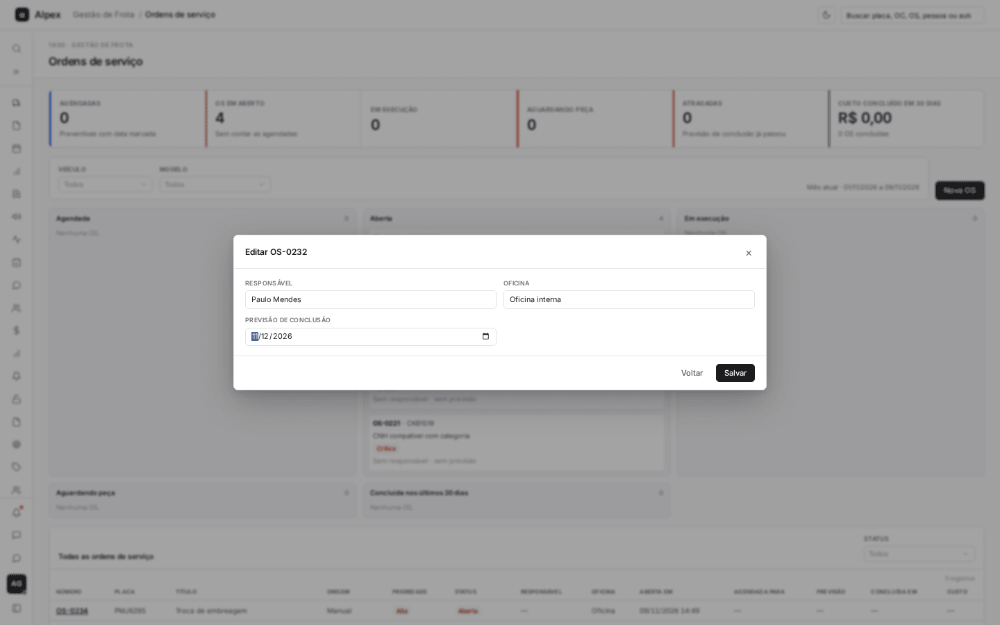
  </Step>
  <Step title="Salvar">
    Clique em **Salvar**. Para desistir, clique em **Voltar**.
  </Step>
</Steps>

<Note>
A previsão não pode ser anterior à data de abertura da OS. Título, veículo e prioridade não podem ser alterados depois de criada a OS.
</Note>

## Concluir uma OS (com peças do estoque)

<Steps>
  <Step title="Clicar em Concluir">
    Abra a OS aberta, em execução ou aguardando peça e clique em **Concluir** no rodapé do painel. Se você já concluiu outra OS antes, oficina, responsável e executor vêm preenchidos com o último uso; confira antes de seguir.

    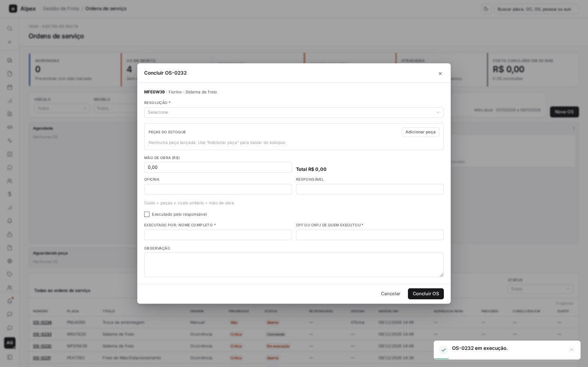
  </Step>
  <Step title="Escolher a resolução">
    No campo **Resolução**, escolha **Reparado**, **Não é defeito** ou **Reparo não necessário para operar**.
  </Step>
  <Step title="Lançar as peças usadas">
    Clique em **Adicionar peça**. Digite parte do nome em **Filtrar** (se só houver uma peça possível, ela já é escolhida) ou abra o campo **Peça**. As opções aparecem em três grupos: peças do modelo do veículo, peças de uso geral e peças de outros modelos. Informe a **Qtd.** e, para tirar uma linha, clique em **Remover**.

    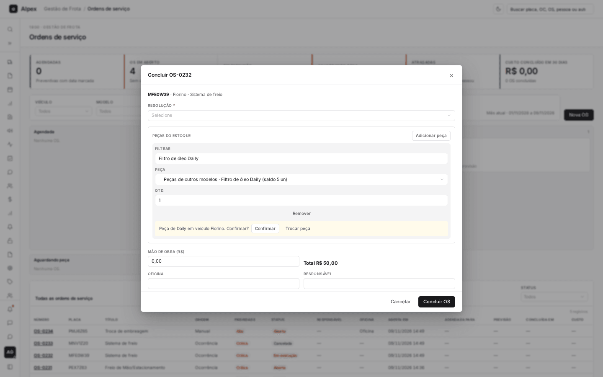
  </Step>
  <Step title="Confirmar peça de outro modelo (se for o caso)">
    Quando a peça escolhida é de outro modelo, aparece o aviso "Peça de ... em veículo ... Confirmar?". Clique em **Confirmar** se for isso mesmo, ou em **Trocar peça** para escolher outra.
  </Step>
  <Step title="Informar mão de obra, oficina e executor">
    Preencha **Mão de obra (R$)**, **Oficina** e **Responsável**. Informe **Executado por: nome completo** e **CPF ou CNPJ de quem executou**; se foi o próprio responsável, marque **Executado pelo responsável**. O **Total** é calculado na hora (peças x custo unitário + mão de obra). Use **Observação** para qualquer detalhe.

    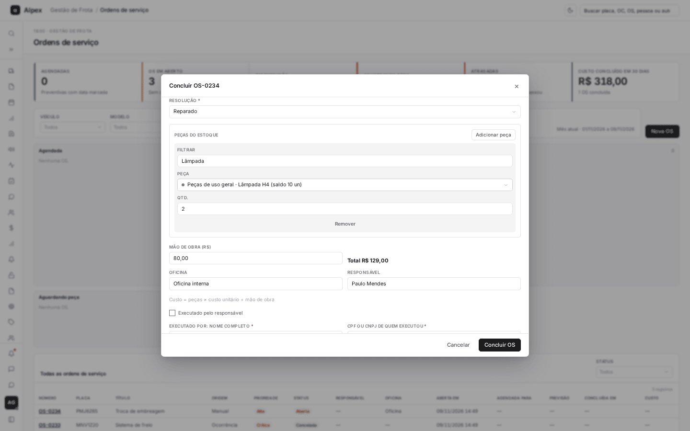

    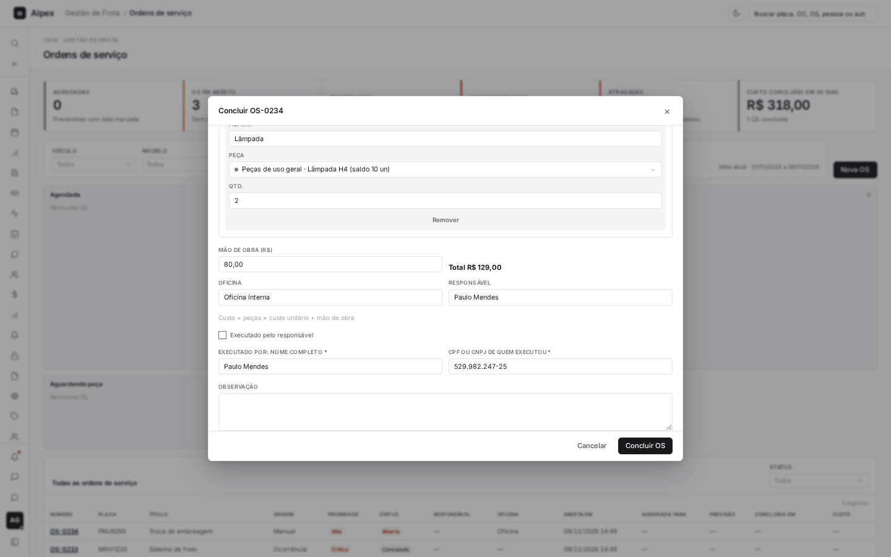
  </Step>
  <Step title="Concluir a OS">
    Clique em **Concluir OS**. Se faltar algo, os campos com problema ficam marcados em vermelho com a explicação.

    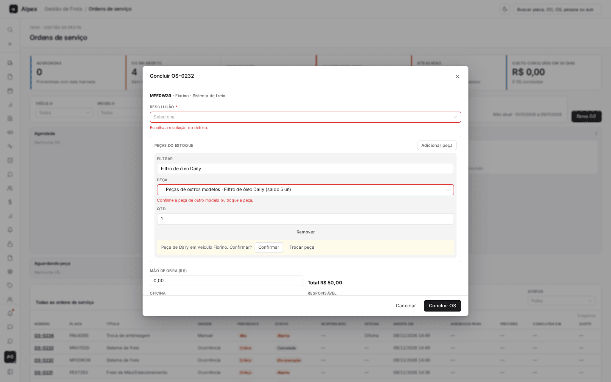
  </Step>
  <Step title="Conferir o resultado">
    A OS passa para **Concluída** e o painel mostra o efeito da conclusão, o custo e o histórico. Um aviso na tela resume o resultado, com o valor total e a situação do veículo.

    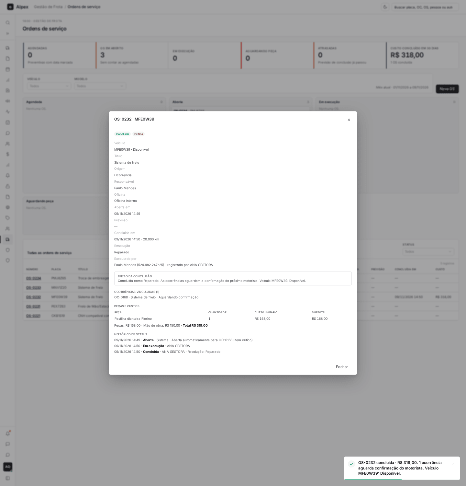
  </Step>
</Steps>

<Note>
Regras da conclusão:

- A **Resolução** é obrigatória. Se não for **Reparado**, a **Observação** também é obrigatória ("Explique na observação por que não houve reparo").
- Cada peça precisa de quantidade maior que zero. Se o saldo do estoque for menor que a quantidade, a OS não conclui ("Estoque insuficiente de ... (saldo N)"). Se a mesma peça aparecer em mais de uma linha, as quantidades são somadas.
- Peça de outro modelo só é aceita depois de confirmada.
- A **Mão de obra** não pode ser negativa. O nome completo e o CPF ou CNPJ de quem executou são obrigatórios e o documento é validado. O gestor vê o CPF completo; para os demais perfis ele aparece parcialmente oculto.
- Ao concluir, o sistema dá baixa das peças no estoque (as saídas aparecem em **Movimentações**, com o número da OS), avisa quando o saldo chega ao mínimo, registra o km do veículo na execução e recalcula o status do veículo.
- As ocorrências ligadas à OS seguem o efeito descrito em "Abrir e consultar uma OS". Se a OS veio de um plano preventivo, o plano passa a contar a partir de hoje e do km atual do veículo (volta para **Em dia**).
- Quando a **Resolução** não é **Reparado**, a **Observação** passa a ser exigida:

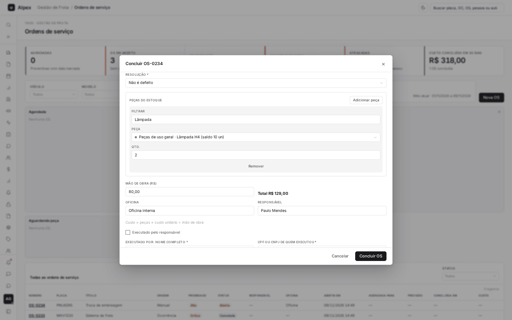
</Note>

<Warning>
Concluir é definitivo: a OS não pode ser reaberta nem editada, e a baixa no estoque não é desfeita. Confira peças, quantidades e executor antes de clicar em **Concluir OS**.
</Warning>

## Cancelar uma OS

<Steps>
  <Step title="Abrir o cancelamento">
    Abra a OS aberta, em execução ou aguardando peça e clique em **Cancelar OS**.
  </Step>
  <Step title="Ler o aviso">
    O painel informa quantas ocorrências vinculadas vão voltar para **Aberta**.

    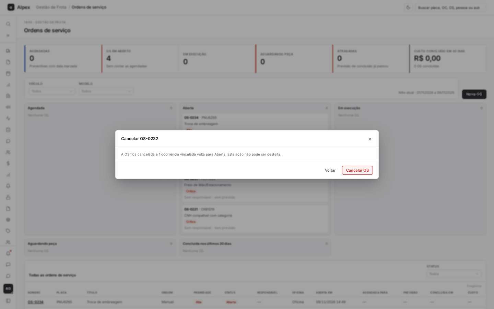
  </Step>
  <Step title="Confirmar">
    Clique em **Cancelar OS** para confirmar, ou em **Voltar** para desistir.
  </Step>
</Steps>

<Warning>
O cancelamento não pode ser desfeito. As ocorrências vinculadas voltam para **Aberta** e o status do veículo é recalculado.
</Warning>

## Reagendar ou cancelar o agendamento de uma preventiva

<Steps>
  <Step title="Abrir a OS agendada">
    No quadro, clique no cartão da coluna **Agendada**. O painel mostra a data e a hora marcadas.

    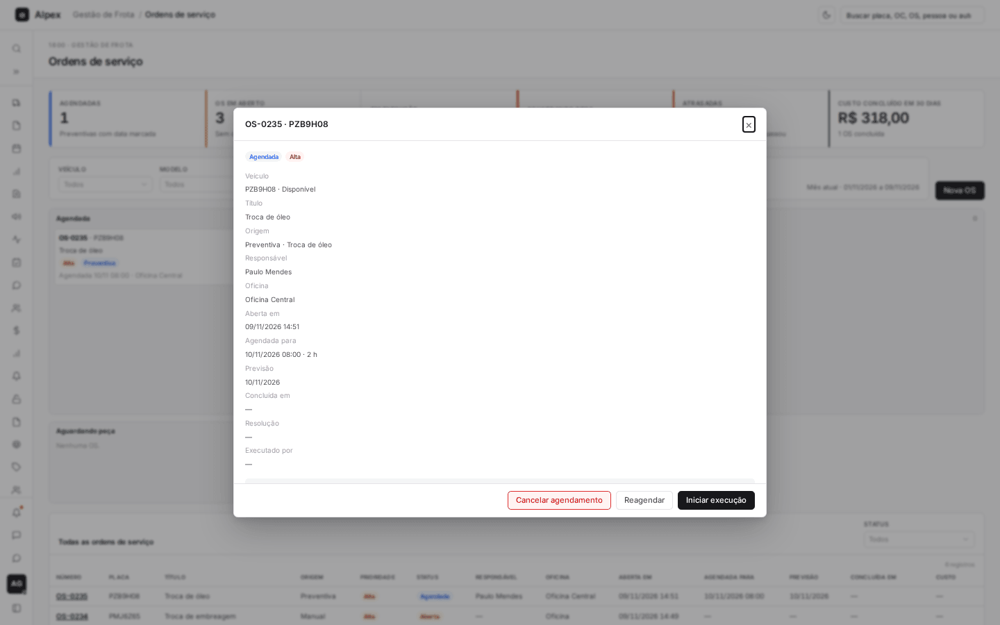
  </Step>
  <Step title="Reagendar">
    Clique em **Reagendar**, informe a **Nova data**, a **Hora** e, se quiser, o **Motivo**. Clique em **Reagendar** para salvar.

    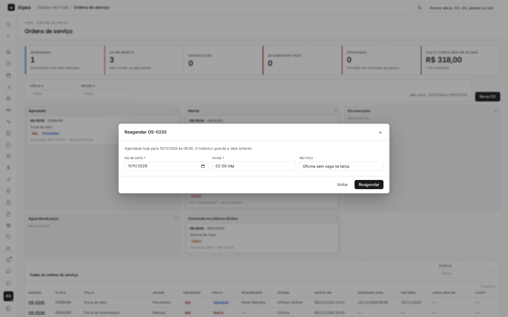
  </Step>
  <Step title="Ou cancelar o agendamento">
    Clique em **Cancelar agendamento** e confirme em **Cancelar agendamento**.

    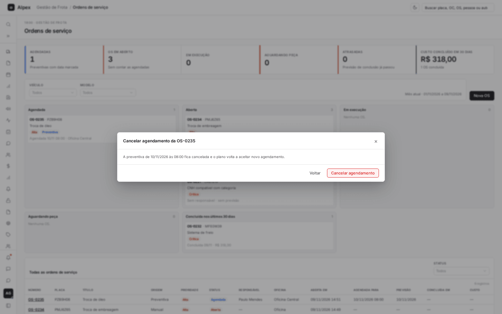
  </Step>
</Steps>

<Note>
A nova data não pode ser anterior a hoje e a hora usa o formato hh:mm. Se nada mudou, o sistema avisa "Nenhuma alteração para salvar". Cancelar o agendamento libera o plano para ser agendado de novo. O agendamento é cancelado de forma definitiva.
</Note>
