**Menu:** 1906 - Presença

Reúne a presença do mês de cada colaborador (motoristas e ajudantes): dias ativos, banco de horas, faltas, atestados, férias e o quanto cada motorista enviou de checklist. Também permite registrar o status de hoje.

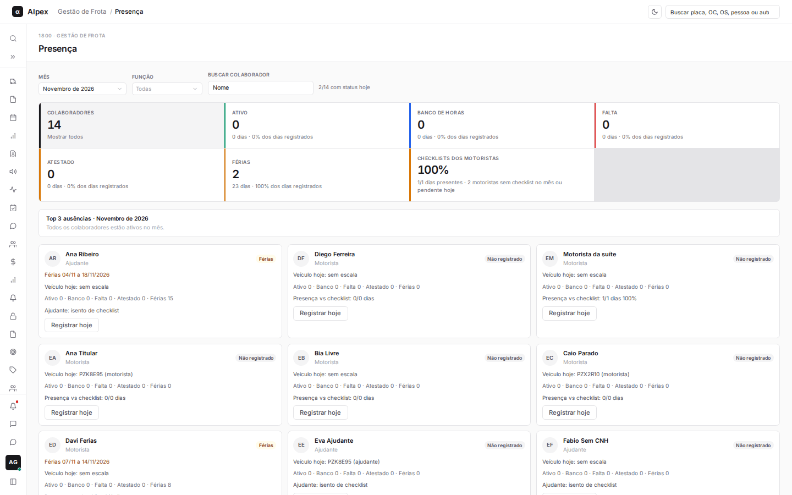

## Filtrar por mês, função, nome ou indicador

<Steps>
  <Step title="Escolha o mês, a função e o nome">
    Use **Mês** (os últimos 12 meses e o próximo), **Função** (**Todas**, **Motorista** ou **Ajudante**) e **Buscar colaborador** para reduzir a lista. Ao lado, "x/y com status hoje" mostra quantos colaboradores já têm status no dia.

    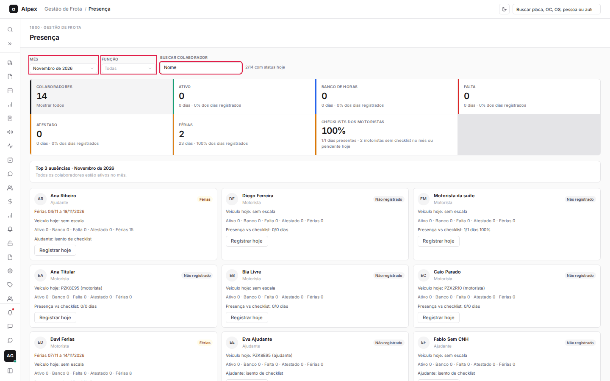
  </Step>
  <Step title="Veja o resultado da busca">
    Os indicadores, o Top 3 e os cartões passam a considerar só os colaboradores filtrados.

    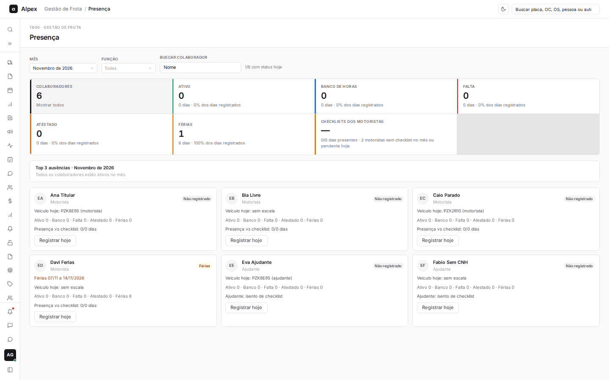
  </Step>
  <Step title="Clique em um indicador para filtrar os cartões">
    Clique em **Ativo**, **Banco de horas**, **Falta**, **Atestado**, **Férias** ou **Checklists dos motoristas** para ver só quem tem aquele sinal no mês. Clique de novo, ou em **Colaboradores**, para limpar.

    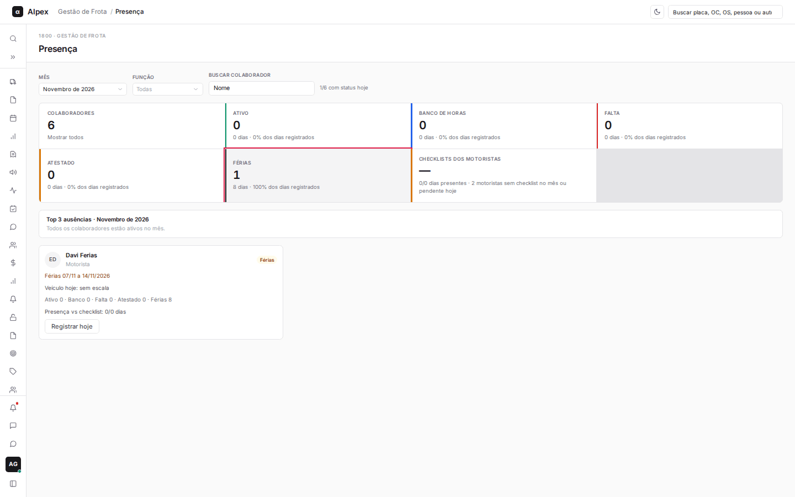
  </Step>
  <Step title="Consulte o Top 3 de ausências">
    O quadro **Top 3 ausências** lista quem mais se ausentou no mês (banco de horas, falta e atestado; férias não contam).

    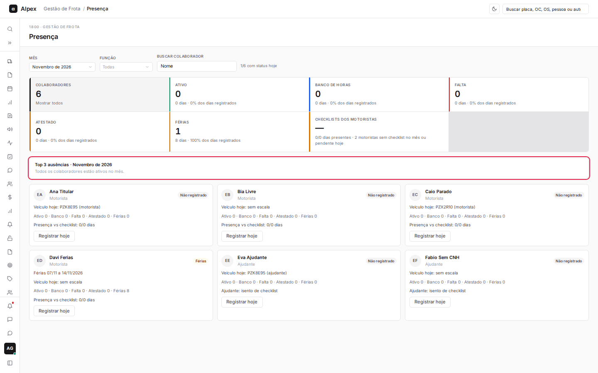
  </Step>
</Steps>

## Registrar ou alterar o status de hoje

<Steps>
  <Step title="Clique em Registrar hoje">
    No cartão do colaborador, clique em **Registrar hoje** (ou **Editar hoje**, quando já existe status no dia).

    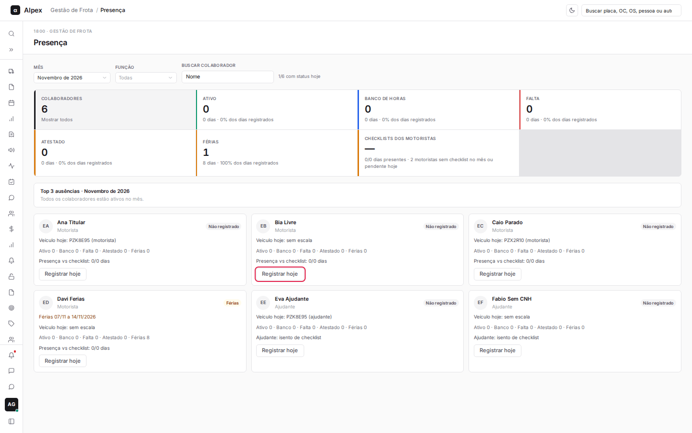
  </Step>
  <Step title="Confira o painel do dia">
    O painel mostra o status atual, a escala do dia (veículo e papel) e os checklists enviados.

    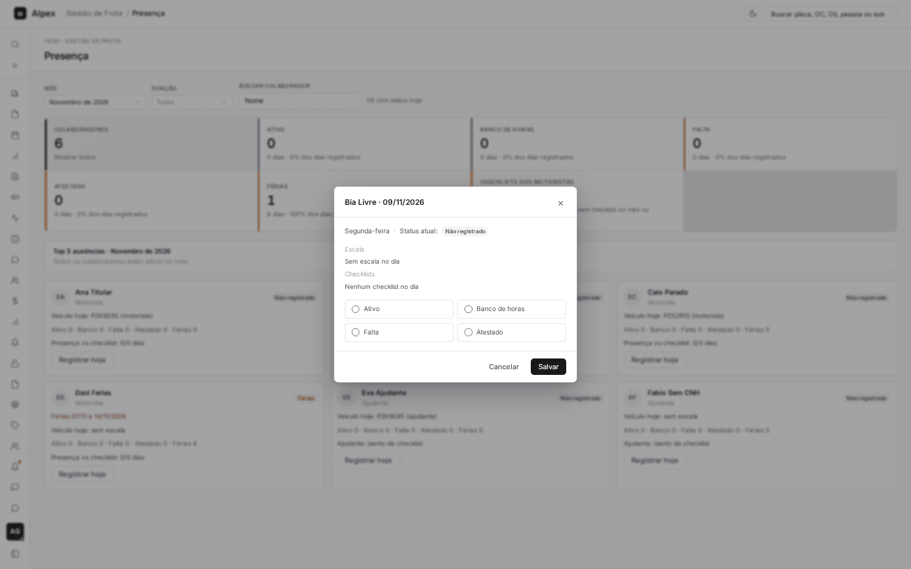
  </Step>
  <Step title="Escolha o status">
    Marque **Ativo**, **Banco de horas**, **Falta** ou **Atestado**.

    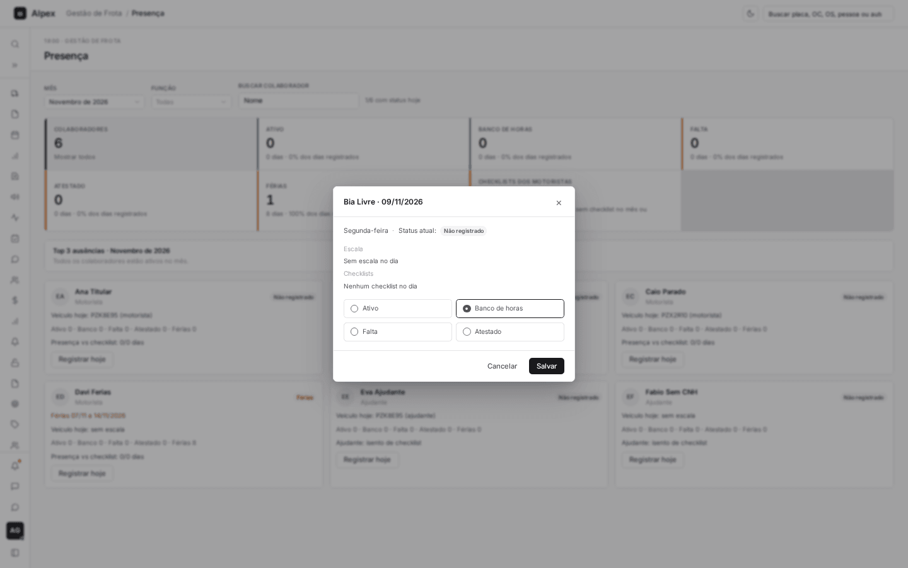
  </Step>
  <Step title="Clique em Salvar">
    O cartão mostra o novo status e aparece a mensagem de confirmação.

    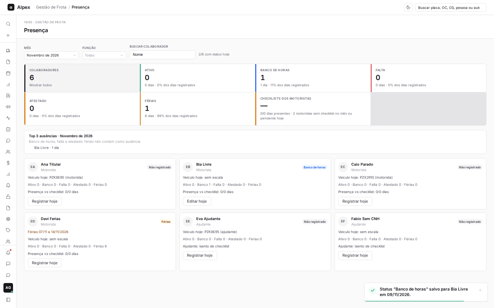
  </Step>
</Steps>

<Note>
O mesmo painel abre também ao clicar em um dia do calendário no perfil do colaborador, para qualquer data. Dias dentro de um período de férias não podem ter o status alterado: o painel avisa e orienta a ajustar ou remover as férias no perfil.
</Note>

## Remover o registro de um dia

<Steps>
  <Step title="Abra o painel do dia">
    Clique em **Editar hoje** no cartão. O botão **Remover registro** só aparece quando já existe um registro naquele dia.

    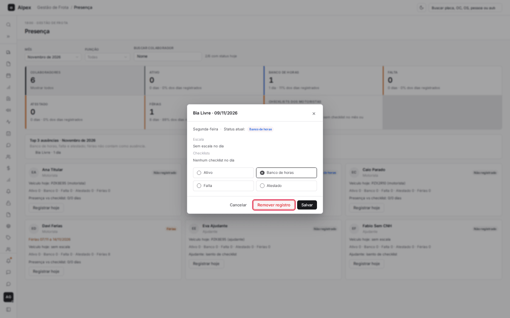
  </Step>
  <Step title="Clique em Remover registro">
    O dia volta a ficar como "Não registrado" e o cartão é atualizado.

    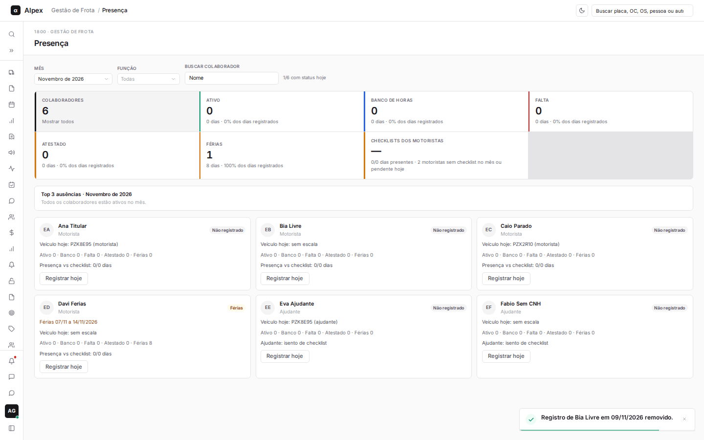
  </Step>
</Steps>

## Ver colaboradores em férias e abrir o perfil

<Steps>
  <Step title="Reconheça as férias no cartão">
    Colaboradores em férias mostram o período no cartão e o selo **Férias**. Ao abrir **Registrar hoje** de alguém de férias, o painel avisa que o dia está dentro do período de férias e que, para mudar o status, é preciso ajustar o período no perfil.

    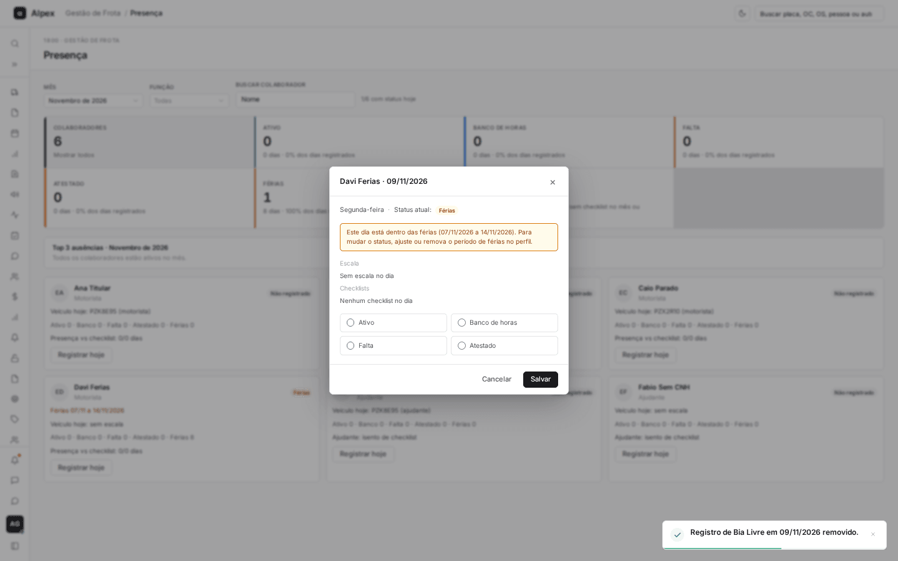
  </Step>
  <Step title="Abra o perfil do colaborador">
    Clique no nome (ou na foto de iniciais) do cartão para abrir o perfil completo da pessoa.

    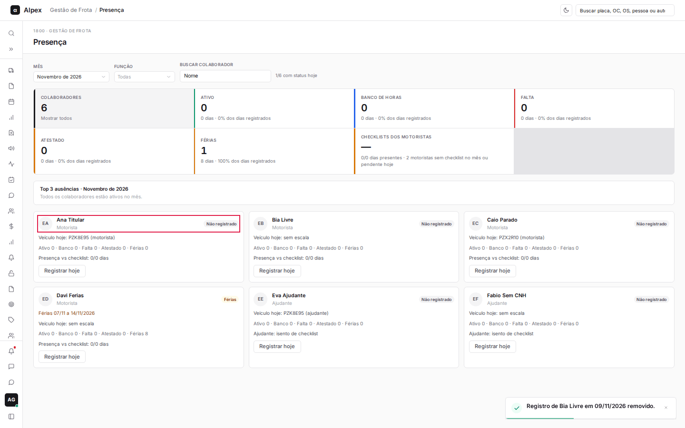
  </Step>
</Steps>
