**Menu:** 1918 - Preventiva

Acompanha os planos de manutenção preventiva (troca de óleo, revisão de freios etc.), mostra o que vence e permite abrir OS ou agendar a oficina.

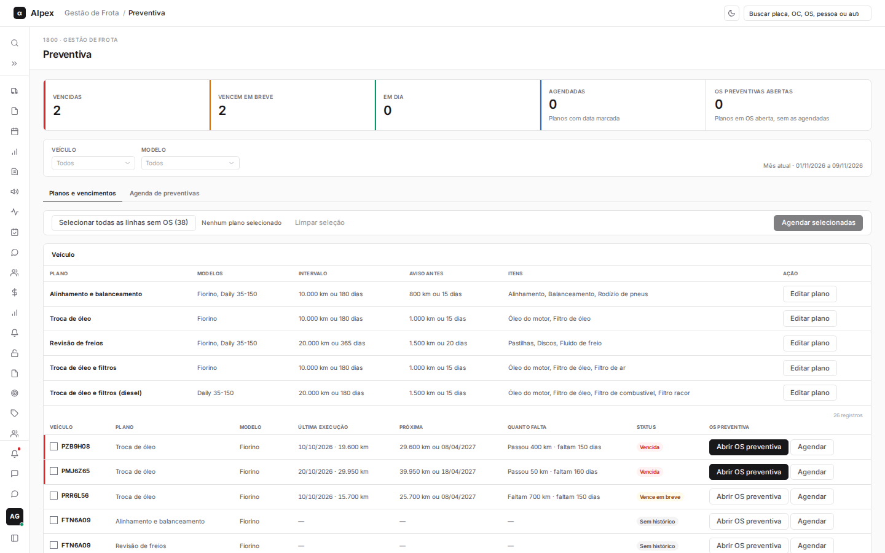

A tela tem duas abas: **Planos e vencimentos** (lista dos planos e, abaixo, uma linha para cada veículo e plano) e **Agenda de preventivas** (calendário e lista dos próximos agendamentos).

## Filtrar os vencimentos

<Steps>
  <Step title="Escolher um cartão de total">
    Clique em **Vencidas**, **Vencem em breve**, **Em dia**, **Agendadas** ou **OS preventivas abertas** para ver só essas linhas. Clique de novo para voltar a ver tudo.

    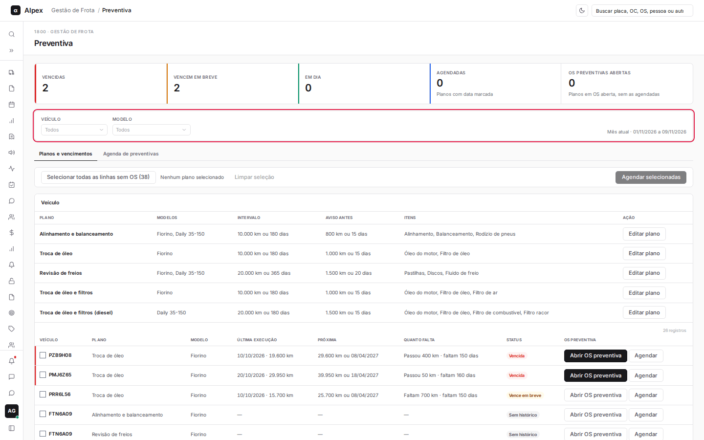

    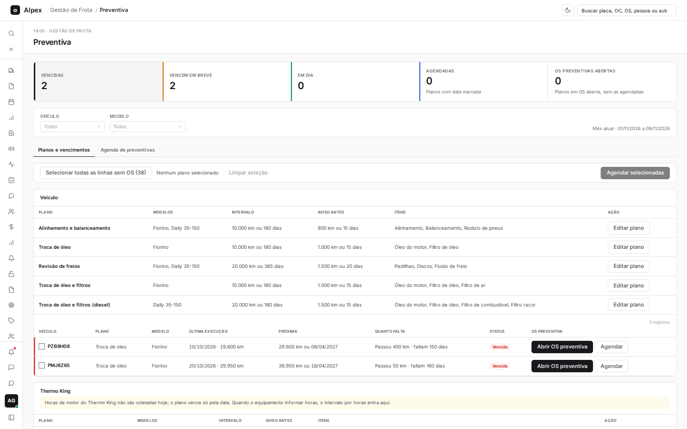
  </Step>
  <Step title="Filtrar por veículo ou modelo">
    Na barra de filtros, escolha o **Veículo** ou o **Modelo**. Os planos e as agendas passam a considerar só o que foi escolhido.

    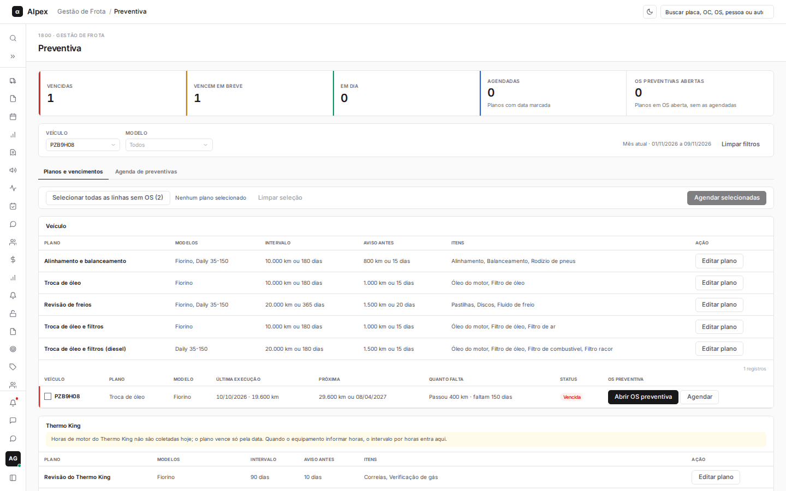
  </Step>
</Steps>

<Note>
Cada linha mostra a última execução, a próxima (por km, por data ou pelas duas) e quanto falta. O status pode ser **Vencida**, **Vence em breve** (dentro do aviso do plano), **Em dia** ou **Sem histórico** (o plano nunca foi executado nesse veículo). O plano da Thermo King vence apenas por data, porque as horas de motor não são coletadas hoje.
</Note>

## Abrir uma OS preventiva

<Steps>
  <Step title="Achar a linha">
    Na aba **Planos e vencimentos**, procure a linha do veículo e do plano (use os filtros se precisar).
  </Step>
  <Step title="Abrir a OS">
    Clique em **Abrir OS preventiva** na coluna **OS preventiva**. A OS é criada na hora, e o aviso na tela informa o número.

    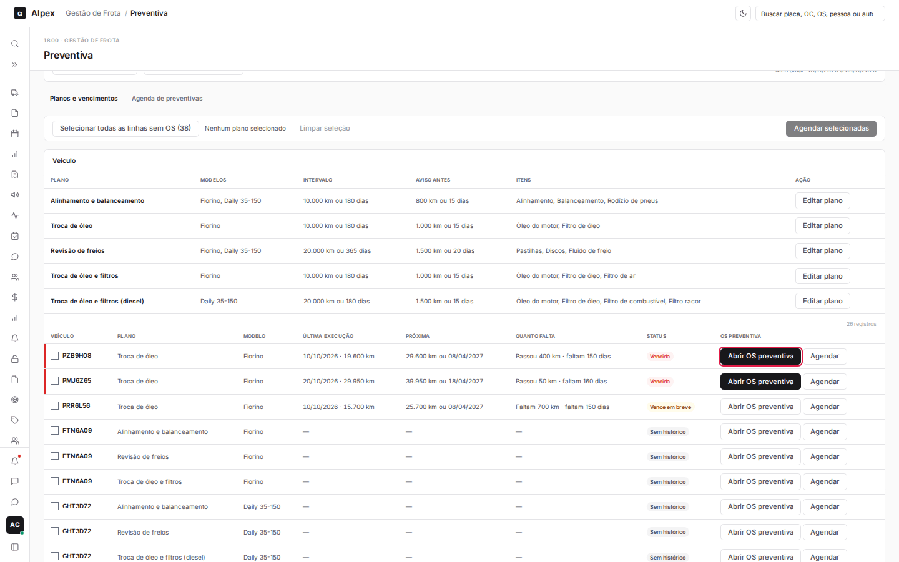
  </Step>
</Steps>

<Note>
A OS nasce **Aberta** com prioridade **Alta** quando o plano está vencido e **Baixa** nos demais casos. Depois disso a linha passa a mostrar o número da OS e a situação dela (clique no número para abri-la). Só é possível abrir uma OS por veículo e plano enquanto a anterior não for concluída ou cancelada. O plano só volta a **Em dia** quando a OS é concluída.
</Note>

## Agendar uma preventiva

<Steps>
  <Step title="Clicar em Agendar">
    Na linha do veículo e do plano, clique em **Agendar**.

    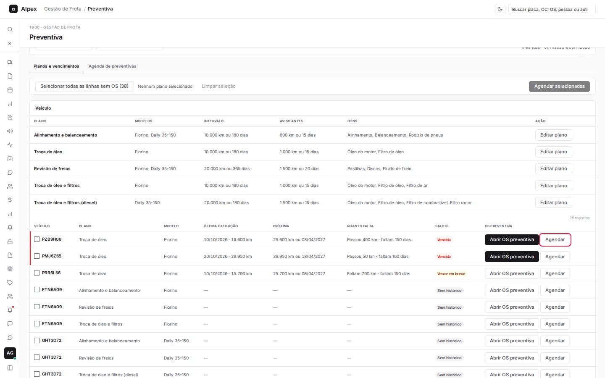
  </Step>
  <Step title="Ler a sugestão">
    O quadro cinza no alto do formulário sugere uma data e um horário livres e explica o motivo (por exemplo, "Plano vencido: sugerido para amanhã"). A **Data** e a **Hora** já vêm preenchidas com essa sugestão.
  </Step>
  <Step title="Preencher o formulário">
    Informe a **Oficina** e o **Responsável**, confira a **Data** e a **Hora**, ajuste a **Duração prevista (horas)** e, se quiser, escreva uma **Observação**.

    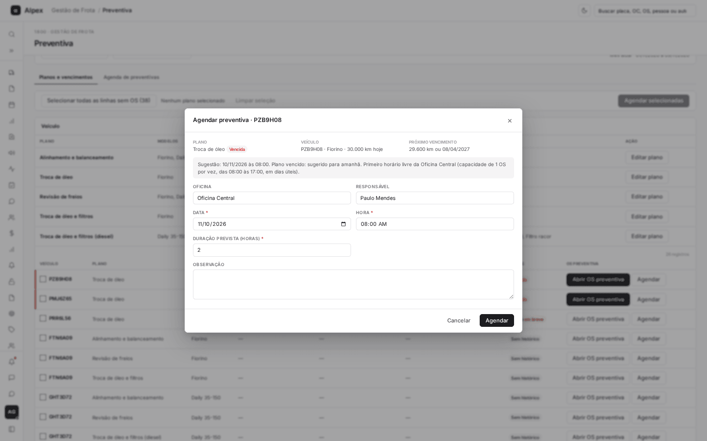

    
  </Step>
  <Step title="Agendar">
    Clique em **Agendar**. A OS é criada na situação **Agendada** e a linha mostra o número dela com a data e a hora marcadas.

    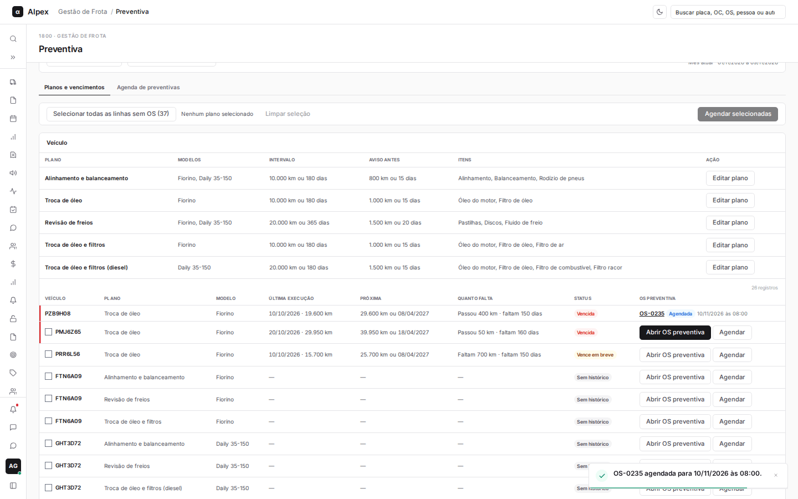
  </Step>
  <Step title="Se o horário estiver ocupado">
    Quando o veículo já tem outra preventiva marcada no mesmo horário, o campo **Data** fica em vermelho com a mensagem "Horário ocupado ..." e o agendamento não é feito. Escolha outro horário e clique em **Agendar** de novo. Avisos em amarelo no fim do formulário (oficina cheia no horário) não impedem o agendamento.

    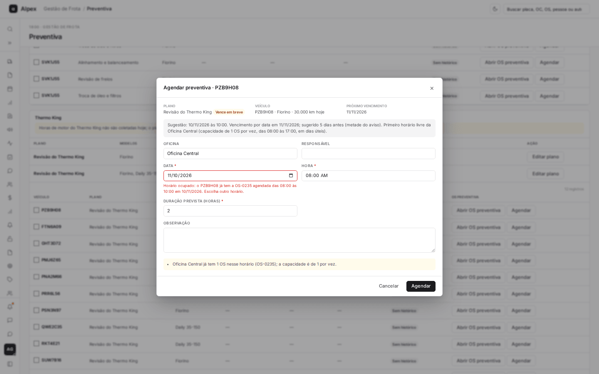

    Os avisos aparecem assim que você muda a data ou a hora; por exemplo, dia que não é útil e horário fora do expediente da oficina:

    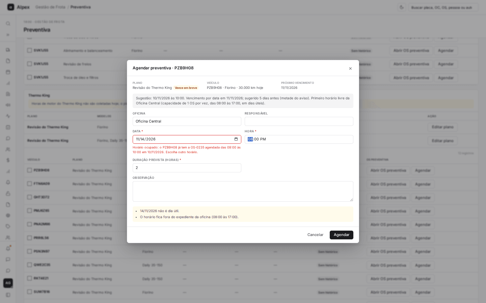
  </Step>
</Steps>

<Note>
Regras do agendamento:

- **Data** (não anterior a hoje), **Hora** (hh:mm) e **Duração prevista (horas)** (de 0,5 a 24) são obrigatórias.
- O sistema bloqueia o agendamento se o próprio veículo já tem outra preventiva marcada no mesmo horário ("Horário ocupado ...").
- Alguns avisos aparecem em vermelho no formulário mas não impedem de agendar: motorista escalado no veículo naquele dia, oficina já com o número máximo de OS no horário, dia que não é útil e horário fora do expediente da oficina.
- A sugestão usa a data de vencimento (ou uma estimativa pela média de km dos últimos 30 dias), vai para o primeiro horário livre dos próximos 60 dias e respeita a capacidade e o expediente da oficina, só em dias úteis.
- A OS agendada recebe prioridade **Alta** se o plano estiver vencido e **Baixa** nos demais casos. Quem recebe os avisos da frota é lembrado no dia anterior e no dia do agendamento.
- Para mudar o dia ou cancelar o agendamento, veja "Reagendar ou cancelar o agendamento de uma preventiva" na tela Ordens de serviço.
</Note>

## Agendar vários planos de uma vez

<Steps>
  <Step title="Selecionar os planos">
    Marque a caixinha ao lado da placa de cada linha, ou clique em **Selecionar todas as linhas sem OS** para marcar tudo que ainda não tem OS. O contador mostra quantos planos e veículos foram escolhidos. **Limpar seleção** desmarca tudo.

    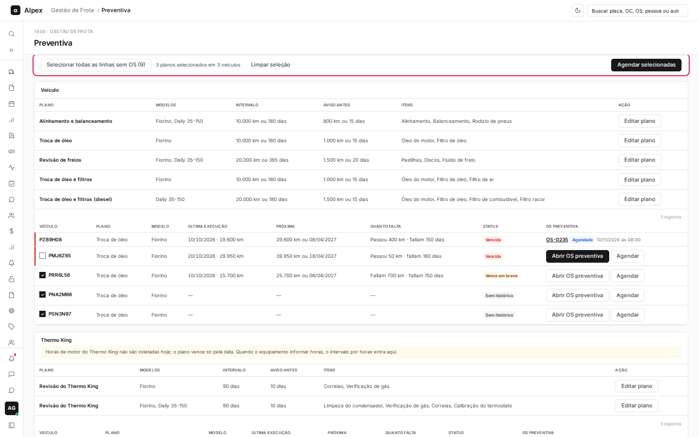
  </Step>
  <Step title="Abrir o agendamento">
    Clique em **Agendar selecionadas**.
  </Step>
  <Step title="Preencher os dados">
    Informe a **Oficina** (obrigatória), o **Responsável**, a **Data inicial**, a **Capacidade (OS ao mesmo tempo)** e o **Início do expediente** e o **Fim do expediente**.

    
  </Step>
  <Step title="Conferir a prévia">
    A **Prévia da distribuição** mostra, para cada veículo, a ação (**Agendar nova OS** ou incluir em OS aberta), a duração, a data e o horário. Para mudar a duração de uma OS, edite o número na coluna **Duração (h)**.

    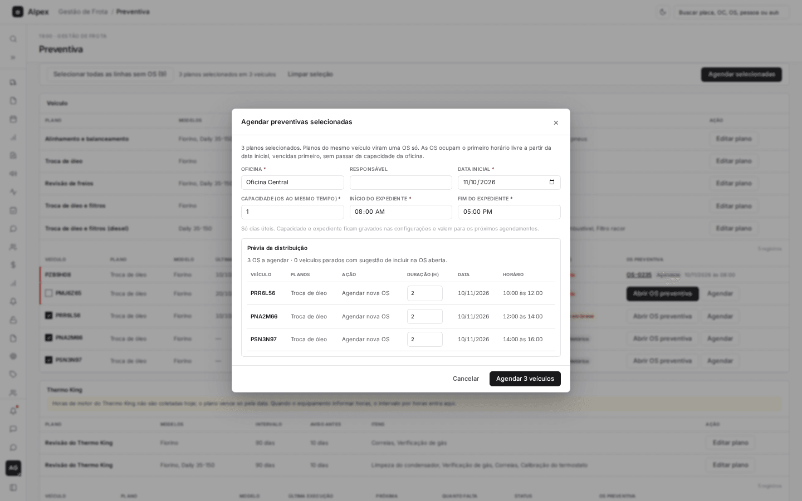
  </Step>
  <Step title="Confirmar">
    Clique em **Agendar N veículos**. O aviso na tela resume as OS criadas e as inclusões feitas, e as linhas passam a mostrar o número e o horário de cada OS.

    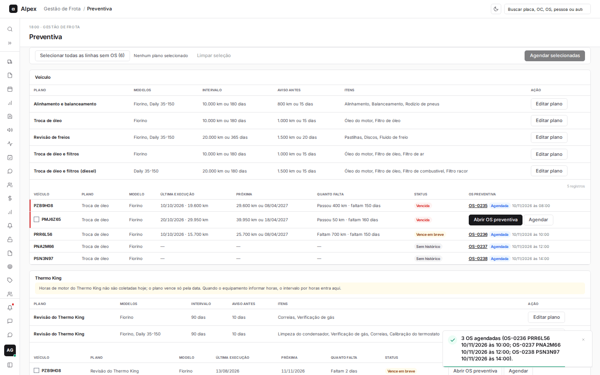
  </Step>
</Steps>

<Note>
Planos do mesmo veículo viram uma OS só. As OS ocupam o primeiro horário livre a partir da data inicial, com as vencidas primeiro, sem passar da capacidade da oficina e só em dias úteis (até 60 dias à frente). Se o veículo está parado e já tem uma OS aberta, a prévia sugere incluir o plano nessa OS em vez de criar outra. A **Capacidade** e o expediente ficam gravados e valem para os próximos agendamentos. Se não houver horário livre ou algum dado estiver errado, a prévia mostra o erro em vermelho e o botão não conclui. Linhas que já têm OS não podem ser selecionadas.
</Note>

## Editar um plano de preventiva

<Steps>
  <Step title="Abrir o plano">
    Na tabela de planos, clique em **Editar plano** na linha desejada.

    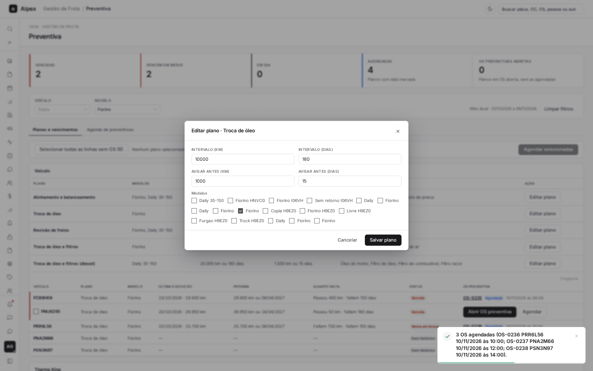
  </Step>
  <Step title="Alterar os valores">
    Ajuste o **Intervalo (km)**, o **Intervalo (dias)**, **Avisar antes (km)** e **Avisar antes (dias)**, e marque ou desmarque os **Modelos** em que o plano vale.
  </Step>
  <Step title="Salvar">
    Clique em **Salvar plano**. Para desistir, clique em **Cancelar**. O aviso "Plano ... atualizado" confirma e a tabela já mostra o novo intervalo.

    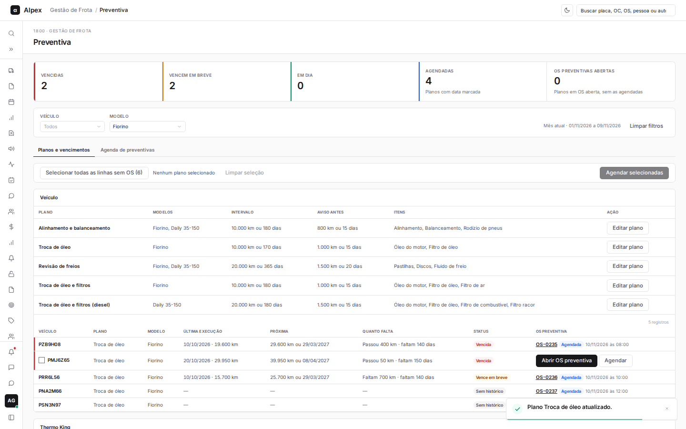
  </Step>
</Steps>

<Note>
É preciso informar pelo menos um intervalo (km ou dias), sempre com número inteiro maior que zero, e escolher pelo menos um modelo. O aviso precisa ser menor que o intervalo e não pode ser negativo. No plano da Thermo King só há intervalo por dias. Se nada foi alterado, o sistema avisa "Nenhuma alteração para salvar". A mudança vale para todos os veículos dos modelos marcados e fica registrada.
</Note>

## Consultar a agenda de preventivas

<Steps>
  <Step title="Abrir a aba da agenda">
    Clique na aba **Agenda de preventivas**.

    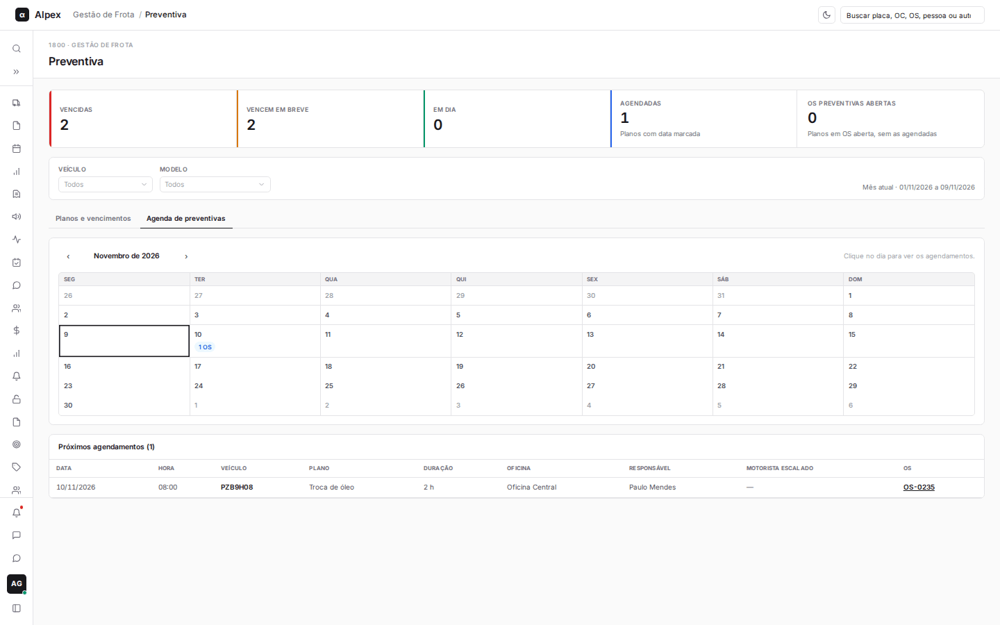
  </Step>
  <Step title="Navegar pelos meses">
    Use as setas ao lado do nome do mês para ir ao mês anterior ou ao próximo. Os dias com OS mostram um selo azul com a quantidade.
  </Step>
  <Step title="Ver os agendamentos de um dia">
    Clique no dia para abrir a lista dele, com hora, veículo, plano, duração, oficina, responsável, motorista escalado e número da OS. Clique em **Fechar** para voltar.

    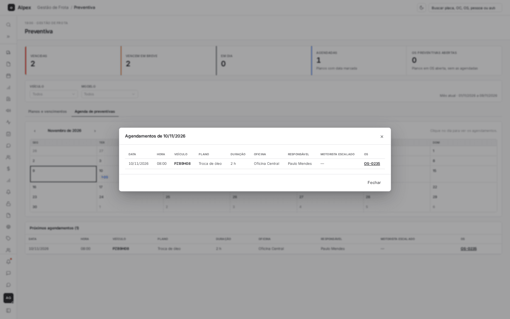
  </Step>
  <Step title="Abrir uma OS agendada">
    Na lista **Próximos agendamentos** (ou na lista do dia), clique no número da OS para abri-la na tela Ordens de serviço.
  </Step>
</Steps>
