**Menu:** 1907 - Ranking de motoristas

Classifica os motoristas ativos de cada mês por uma nota de 0 a 100, calculada a partir de checklists, pontualidade, multas, alertas e reincidência. O ranking zera a cada mês; no mês corrente conta até hoje.

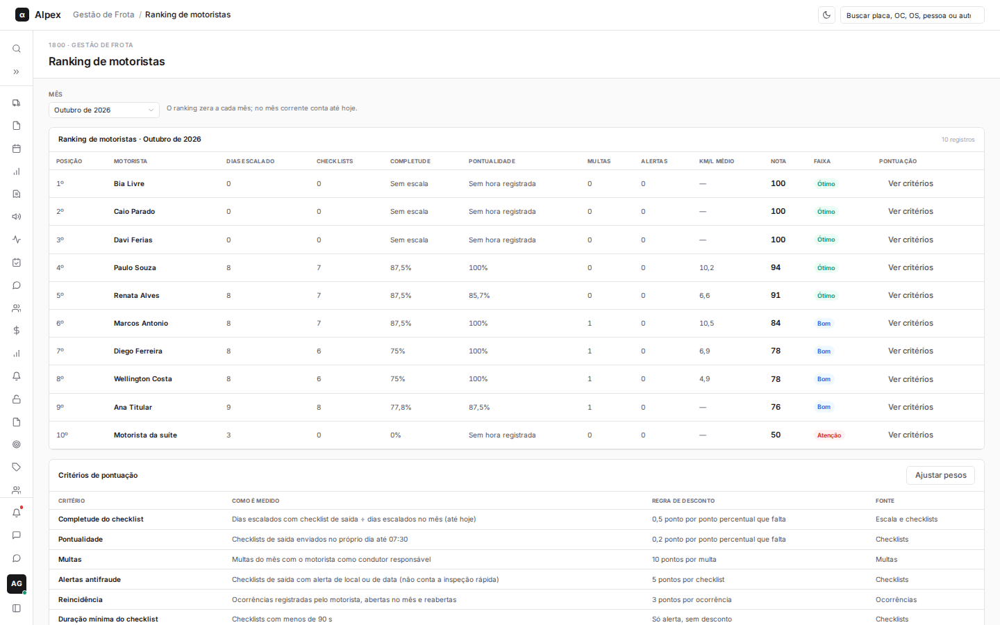

## Trocar o mês do ranking

<Steps>
  <Step title="Escolha o mês">
    No campo **Mês**, selecione o mês desejado (os últimos 12 meses). A tabela mostra posição, motorista, dias escalado, checklists, completude, pontualidade, multas, alertas, km/l médio, nota e faixa (Ótimo, Bom ou Atenção).

    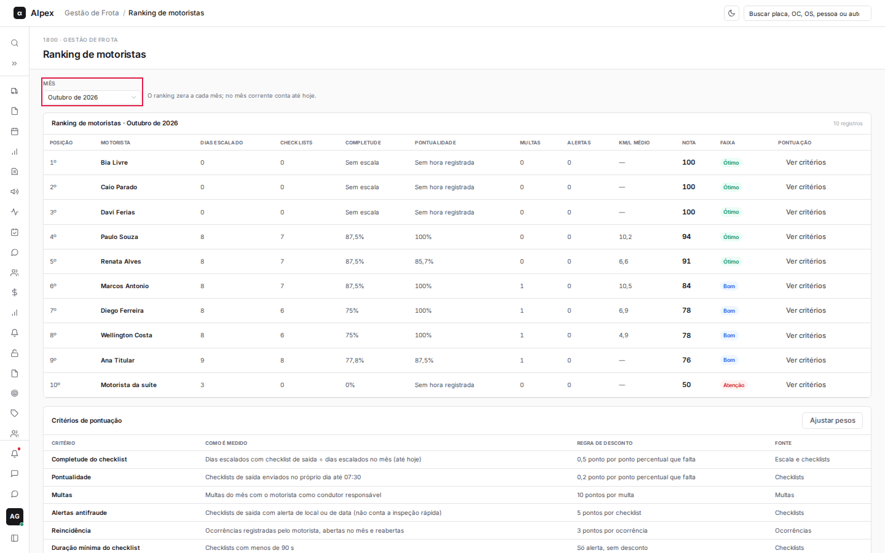
  </Step>
</Steps>

<Note>
No empate, fica à frente quem enviou mais checklists. A multa conta para o condutor indicado ao órgão; sem indicação, para o vinculado pela gestão; sem vínculo, para o sugerido pela escala.
</Note>

## Ver os critérios da nota de um motorista

<Steps>
  <Step title="Clique em Ver critérios">
    Na linha do motorista, clique em **Ver critérios**.

    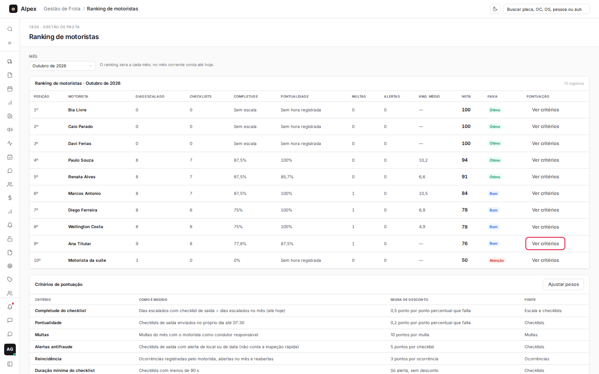
  </Step>
  <Step title="Leia a pontuação">
    O painel detalha cada critério, quanto foi descontado, e fecha com "100 menos os descontos" e a nota final.

    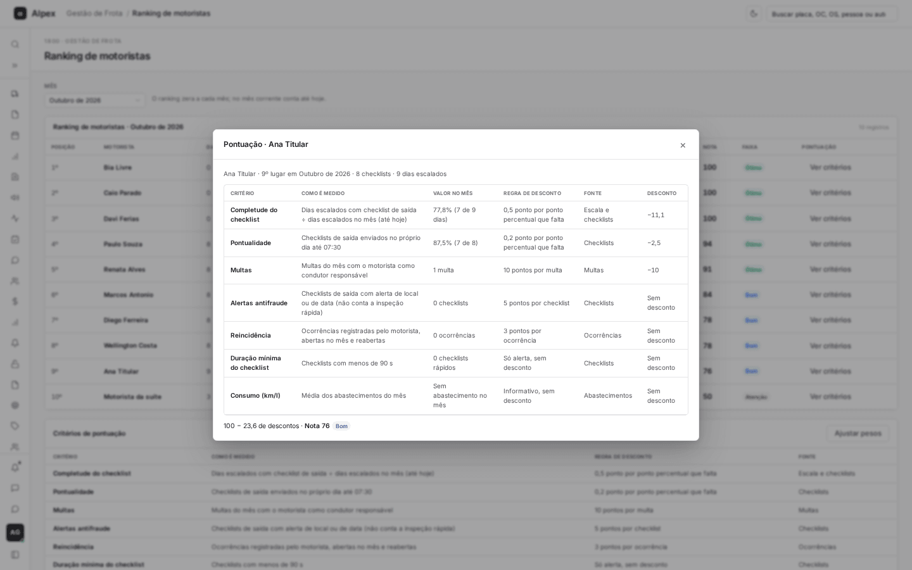
  </Step>
</Steps>

## Abrir o perfil de um motorista

<Steps>
  <Step title="Clique no nome do motorista">
    O nome na tabela é um link para o perfil do colaborador.

    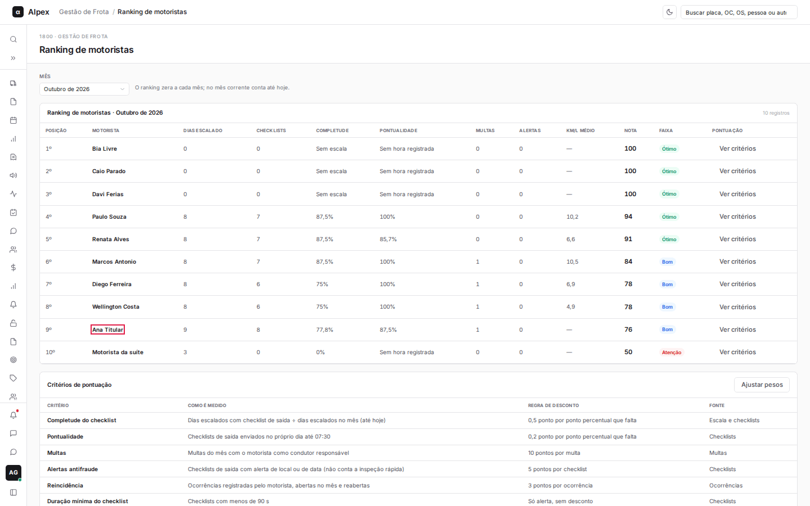
  </Step>
</Steps>

## Consultar as regras de pontuação

<Steps>
  <Step title="Role até Critérios de pontuação">
    A tabela explica cada critério: como é medido, a regra de desconto e a fonte. Logo abaixo, as observações sobre a pontuação.

    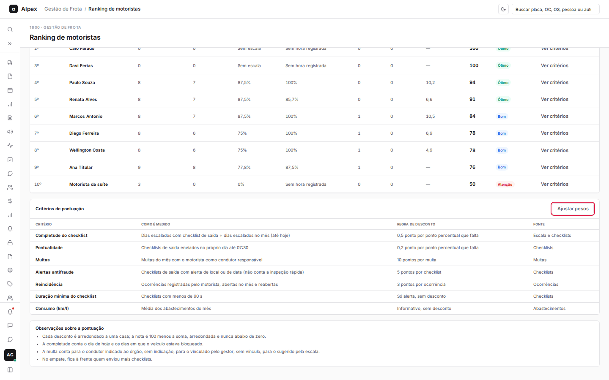
  </Step>
</Steps>

## Ajustar os pesos da pontuação

<Steps>
  <Step title="Clique em Ajustar pesos">
    O botão fica no quadro **Critérios de pontuação**. Só o Gestor o vê.

    
  </Step>
  <Step title="Altere os valores">
    Informe os pontos descontados por critério e as faixas de nota: completude e pontualidade (por ponto percentual que falta), multa, checklist com alerta, ocorrência reaberta, **Faixa Ótimo a partir de** e **Faixa Bom a partir de**.

    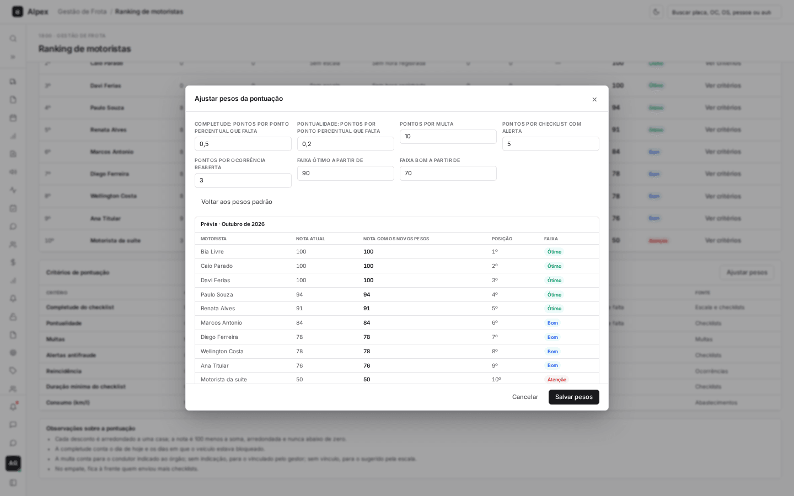
  </Step>
  <Step title="Confira a prévia">
    A **Prévia** mostra, para cada motorista, a nota atual, a nota com os novos pesos, a nova posição e a faixa, sem gravar nada.

    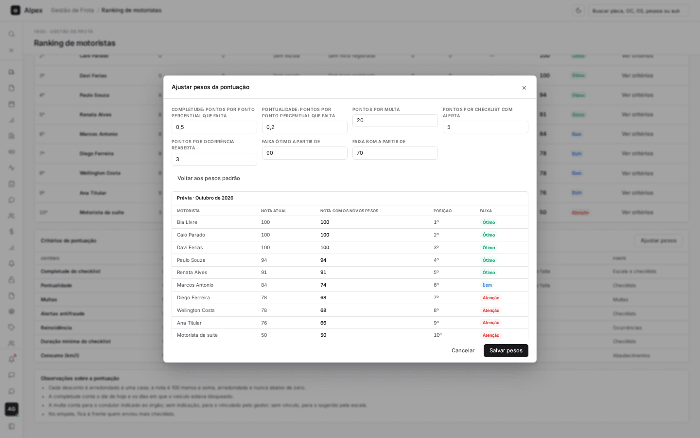
  </Step>
  <Step title="Volte aos pesos padrão, se quiser">
    Clique em **Voltar aos pesos padrão** para recarregar os valores originais no formulário.

    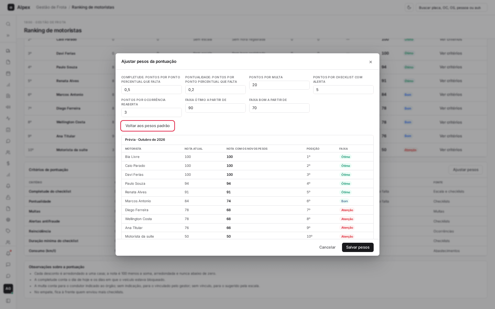
  </Step>
  <Step title="Clique em Salvar pesos">
    Se nada foi alterado, o painel avisa "Nenhuma alteração para salvar."

    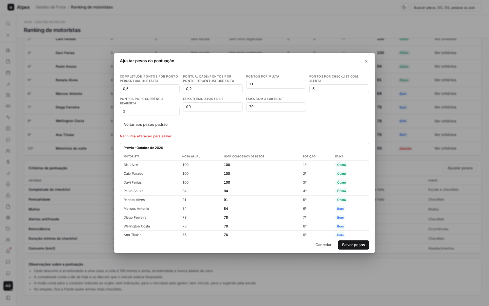

    Com um valor alterado (aqui, pontos por multa de 10 para 12), clique em **Salvar pesos**.

    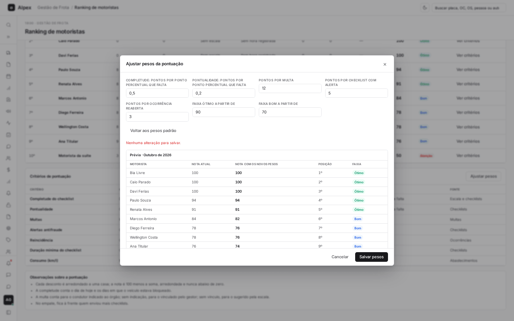

    Aparece a mensagem "Pesos salvos (versão N). Ranking recalculado." e a tabela de critérios já mostra a nova regra. Use **Cancelar** para sair sem alterar.

    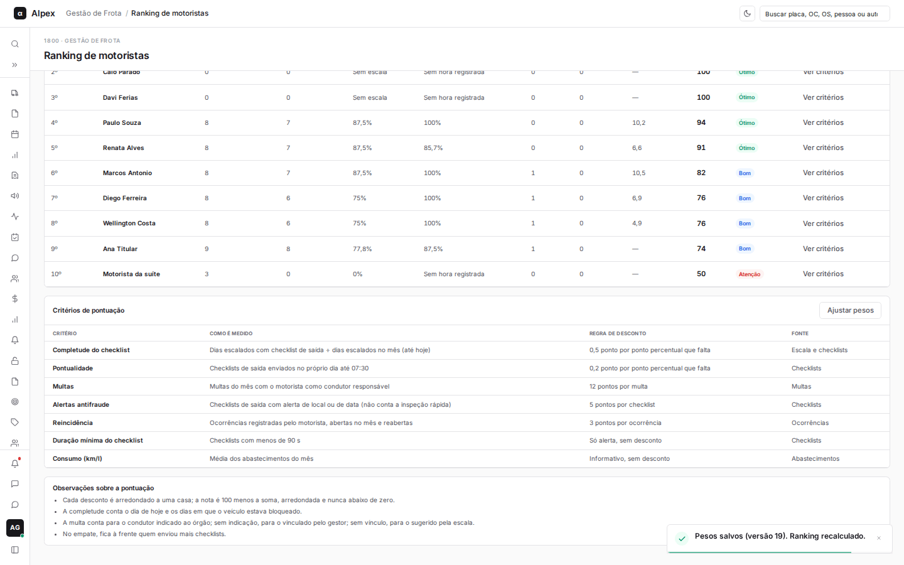
  </Step>
  <Step title="Para desfazer, volte ao padrão e salve">
    Abra **Ajustar pesos** de novo, clique em **Voltar aos pesos padrão** e depois em **Salvar pesos**. Cada salvamento gera uma nova versão.

    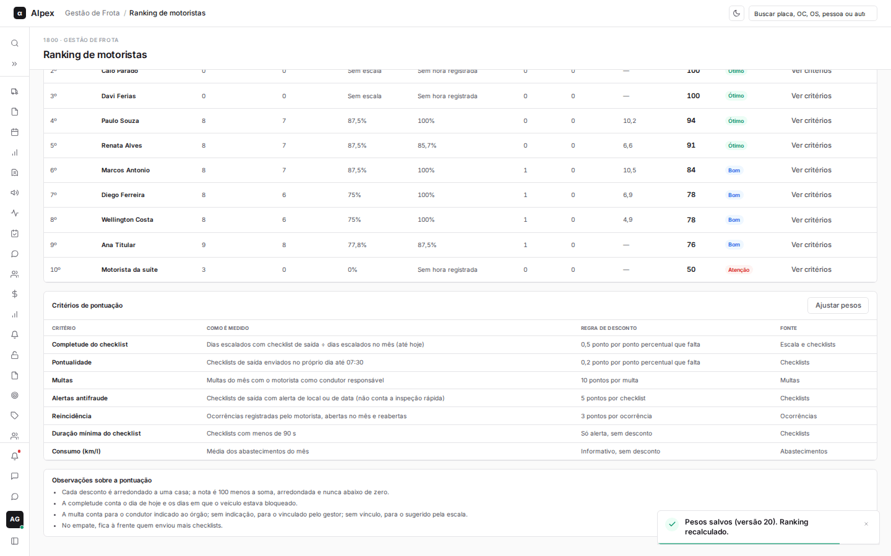
  </Step>
</Steps>

<Warning>
Os novos pesos valem para todo o ranking e recalculam todos os meses exibidos. Use a prévia antes de salvar.
</Warning>

<Note>
Validações: todos os campos devem ser números maiores ou iguais a zero; completude e pontualidade aceitam até 5; a faixa Bom precisa ser menor que a faixa Ótimo e Ótimo vai até 100. Sem nenhuma alteração, o sistema avisa "Nenhuma alteração para salvar."

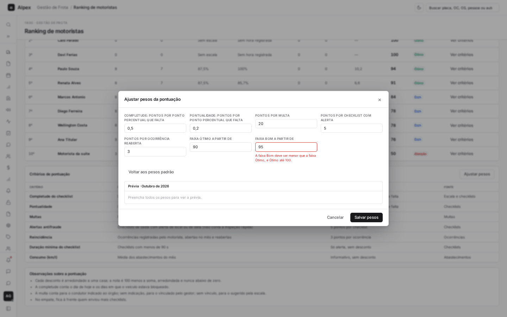
</Note>
