**Menu:** 1914 - Relatórios

Aqui o Gestor gera os relatórios da frota para baixar (PDF, PowerPoint e Excel), agenda o envio automático e consulta o histórico de envios e gerações.

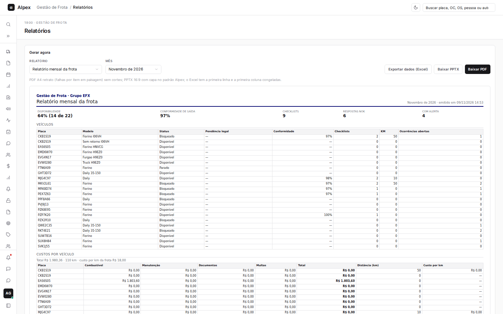

## Gerar e baixar um relatório

<Steps>
  <Step title="Escolher o relatório">
    No bloco **Gerar agora**, escolha o relatório em **Relatório** (Relatório mensal da frota ou Falhas por item e veículo).

    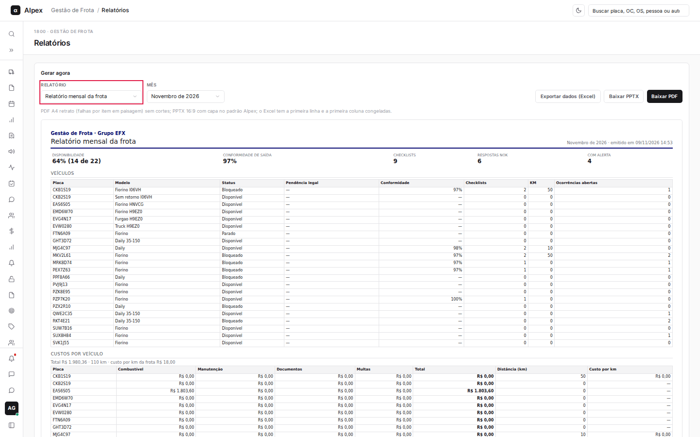

    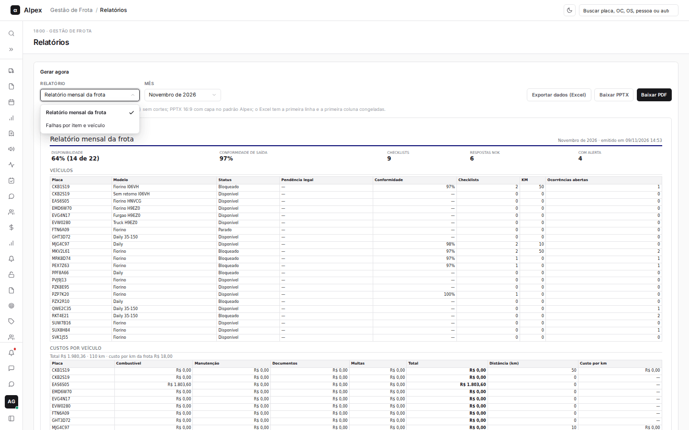
  </Step>
  <Step title="Escolher o mês">
    Em **Mês**, escolha o mês de referência. A prévia logo abaixo muda na hora para mostrar o relatório do mês escolhido.

    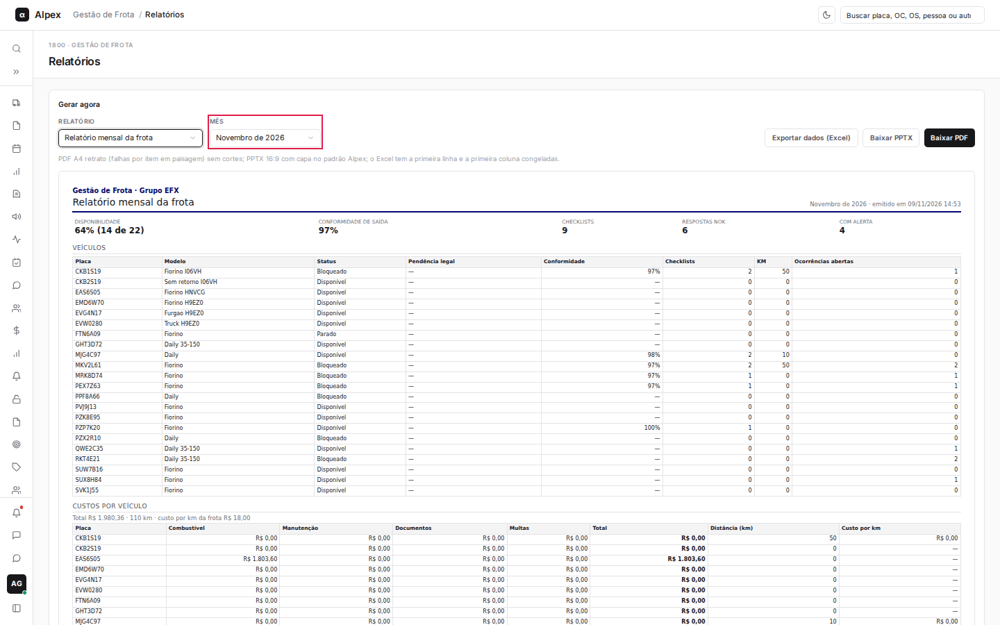
  </Step>
  <Step title="Baixar">
    Clique em **Baixar PDF**, **Baixar PPTX** (apresentação em PowerPoint) ou **Exportar dados (Excel)**. O arquivo é baixado pelo navegador.

    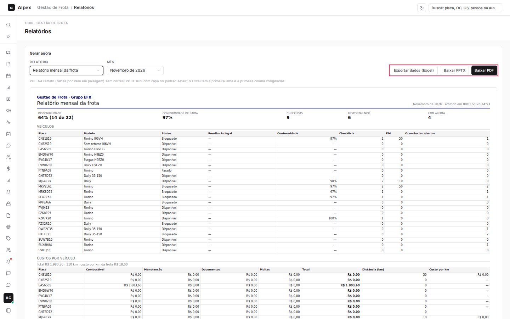
  </Step>
</Steps>

<Note>
O PDF é A4 retrato (o relatório de falhas por item sai em paisagem), sem cortes. O PowerPoint é 16:9, com capa no padrão Alpex. No Excel, a primeira linha e a primeira coluna ficam congeladas. Cada geração fica registrada no histórico de envios e gerações, no fim da tela.
</Note>

## Agendar o envio automático de um relatório

<Steps>
  <Step title="Abrir o formulário">
    No bloco **Relatórios agendados**, clique em **Novo agendamento**.

    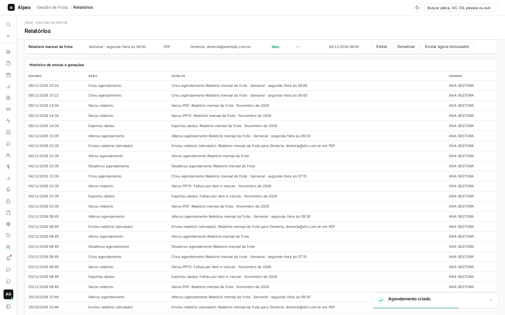

    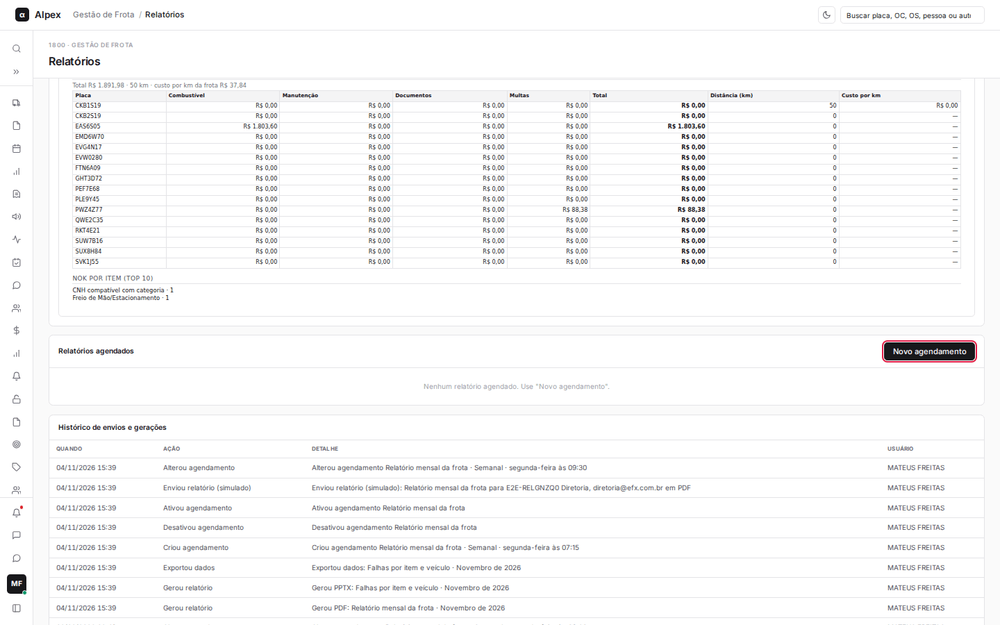
  </Step>
  <Step title="Preencher">
    Escolha o **Relatório**, a **Frequência** (diária, semanal ou mensal), o **Dia** (da semana, ou do mês de 1 a 28) e a **Hora**. Marque os **Formatos** (PDF e/ou PPTX) e escreva os **Destinatários**, separados por ponto e vírgula. Deixe **Agendamento ativo** marcado.

    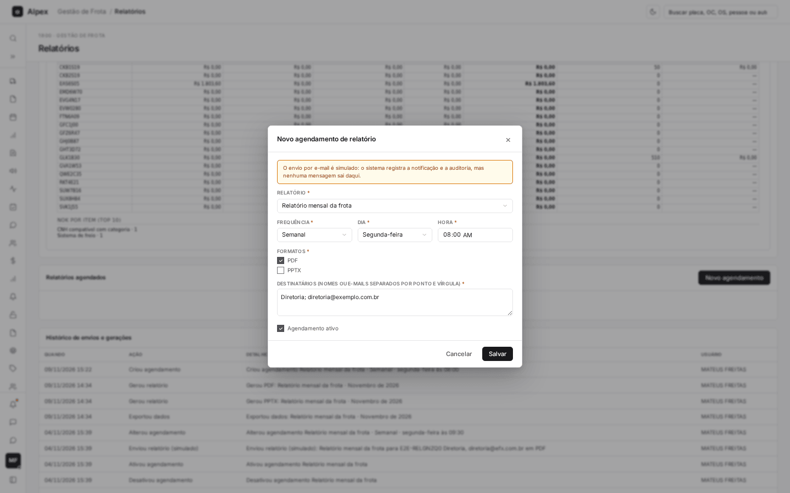
  </Step>
  <Step title="Salvar">
    Clique em **Salvar**. O agendamento aparece na lista, com a data do próximo envio.
  </Step>
</Steps>

<Note>
O envio por e-mail é simulado: o sistema registra a notificação e a auditoria, mas nenhuma mensagem sai do sistema. Marque pelo menos um formato.
</Note>

## Editar, ativar ou desativar um agendamento e enviar na hora

<Steps>
  <Step title="Achar o agendamento">
    Na tabela **Relatórios agendados**, veja a frequência, os formatos, os destinatários, a situação e as datas do último e do próximo envio.

    

    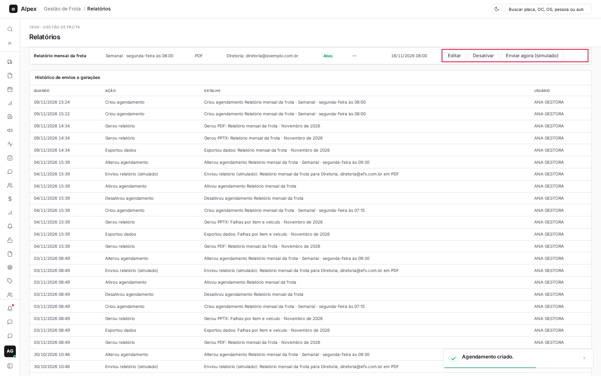
  </Step>
  <Step title="Editar">
    Clique em **Editar**, mude os dados e clique em **Salvar**.

    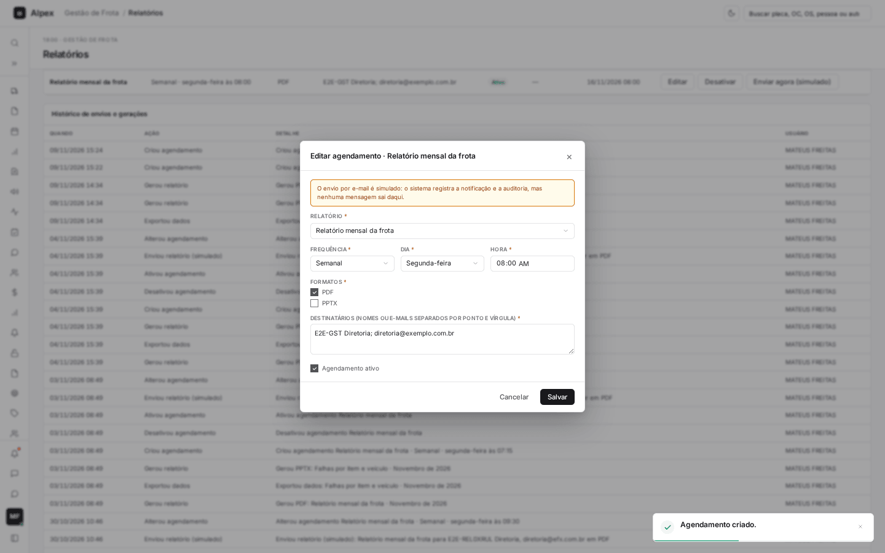
  </Step>
  <Step title="Desativar ou ativar">
    Clique em **Desativar** para pausar (a situação passa para **Inativo**) ou em **Ativar** para retomar.

    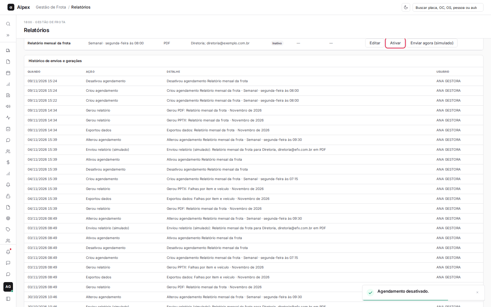
  </Step>
  <Step title="Enviar na hora">
    Clique em **Enviar agora (simulado)** para disparar o envio sem esperar o horário agendado. Aparece um aviso de que o envio foi registrado e que nenhum e-mail real foi enviado.

    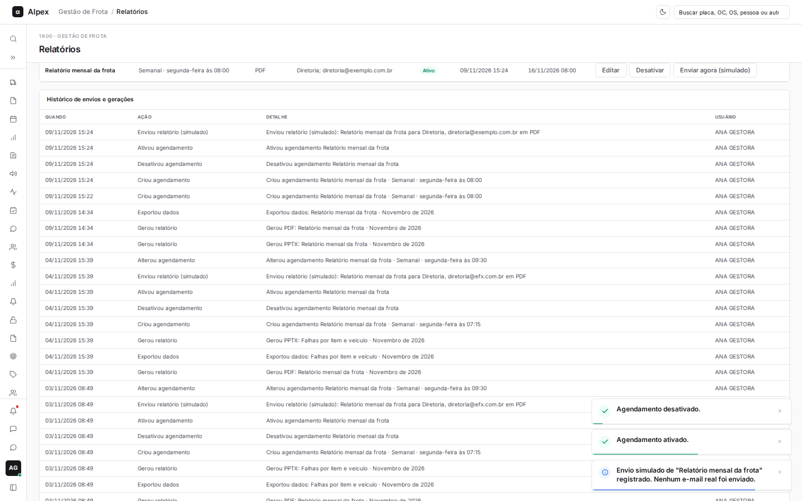
  </Step>
  <Step title="Conferir o resultado">
    Cada envio e geração aparece no bloco **Histórico de envios e gerações**, com data, ação, detalhe e usuário.

    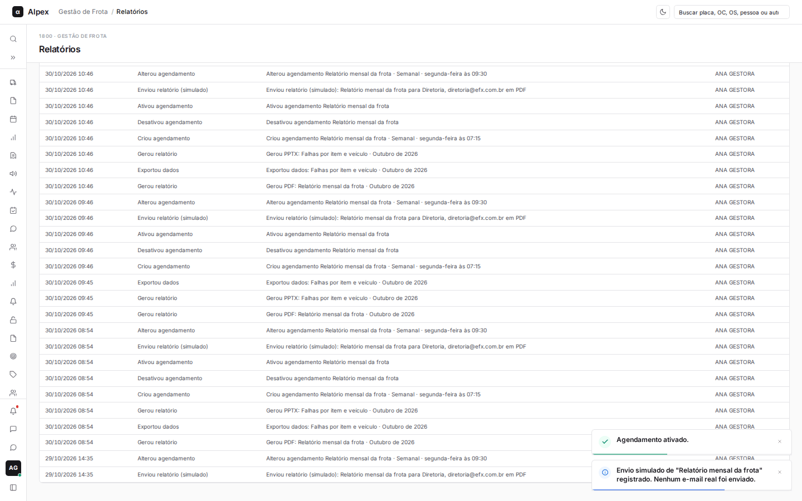
  </Step>
</Steps>
