**Menu:** 1912 - Veículos (clique em um veículo)

O detalhe reúne tudo sobre um veículo: situação, calendário de checklists, linha do tempo, saúde, custos, etiqueta QR e relatório do mês.

## Trocar de veículo

<Steps>
  <Step title="Clicar na placa">
    No alto da tela há uma faixa com a placa de todos os veículos; a bolinha colorida mostra a situação (verde disponível, vermelho bloqueado, cinza parado). Clique na placa desejada para trocar sem voltar à lista. A aba escolhida é mantida.

    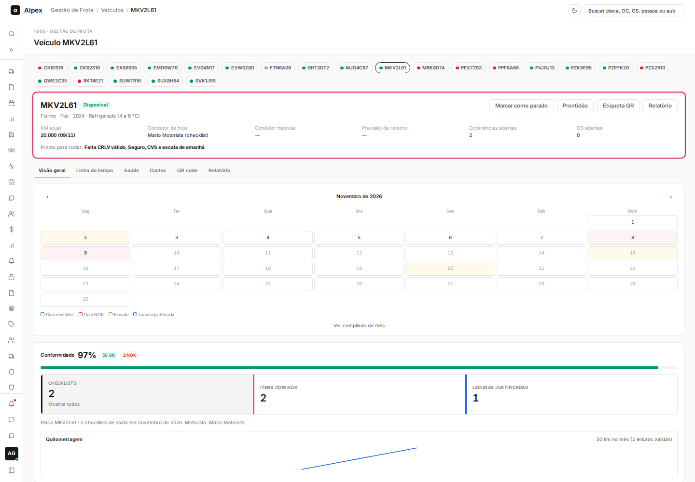
  </Step>
</Steps>

## Ver o calendário e a conformidade do mês

<Steps>
  <Step title="Escolher o mês">
    Na aba **Visão geral**, use as setas **‹** e **›** ao lado do nome do mês para navegar entre os meses.

    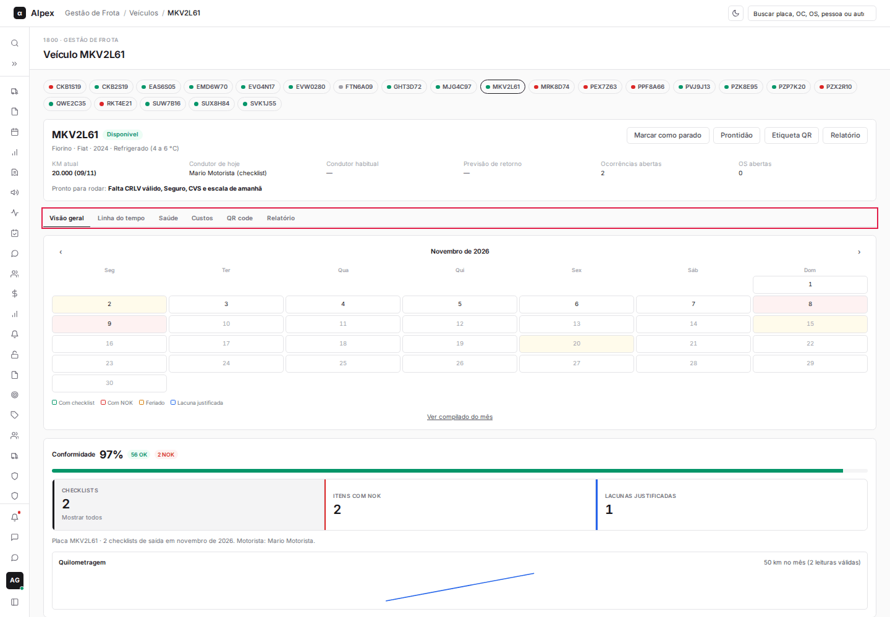
  </Step>
  <Step title="Ler o calendário">
    Dias em verde têm checklist, em vermelho têm NOK, em amarelo são feriado e em azul são lacunas justificadas. Dias com mais de um checklist mostram a quantidade (por exemplo, 2x).
  </Step>
  <Step title="Abrir um dia">
    Clique em um dia para ver os checklists dele: motorista, ajudante, KM, temperatura e os itens NOK. Clique em **Abrir checklist completo** para ver todas as respostas.

    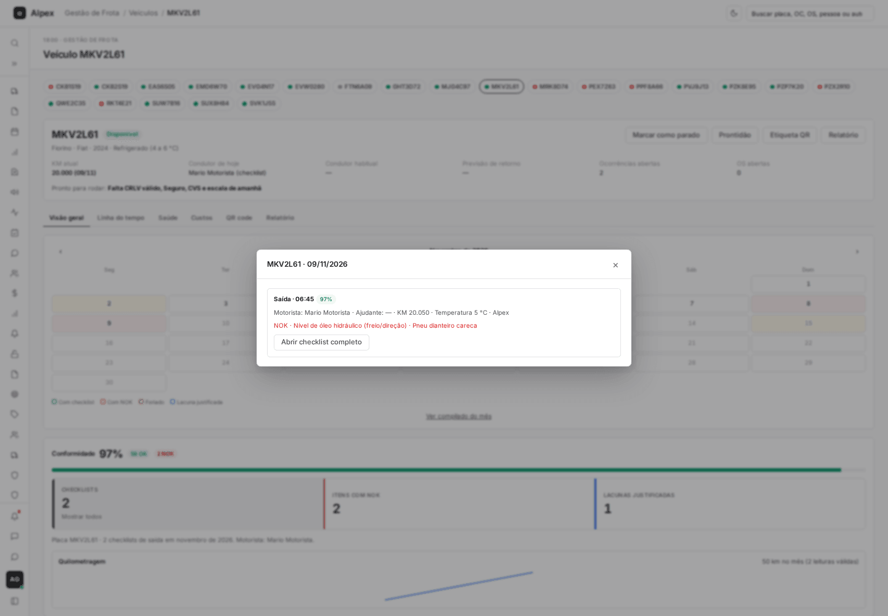
  </Step>
  <Step title="Destacar NOK ou lacunas">
    Em **Conformidade**, clique em **Itens com NOK** ou **Lacunas justificadas** para destacar esses dias no calendário. Clique em **Checklists** para tirar o destaque.

    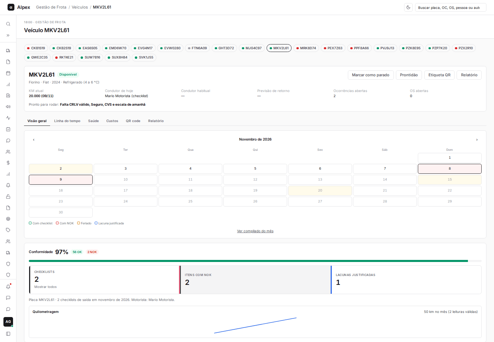
  </Step>
  <Step title="Ver os itens com NOK do mês">
    Em **Checklist por pergunta**, clique no número de NOK de um item para listar as respostas NOK dele. Clique em uma linha para abrir o checklist.

    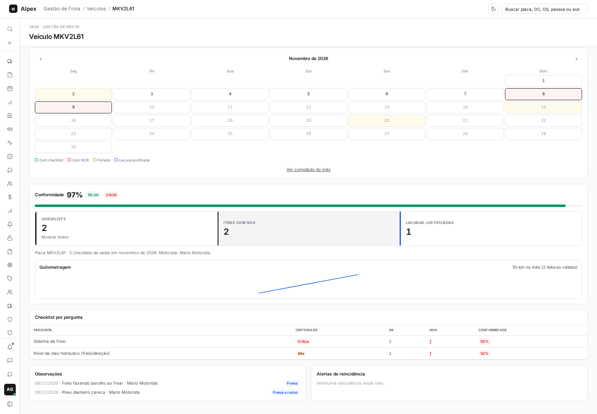

    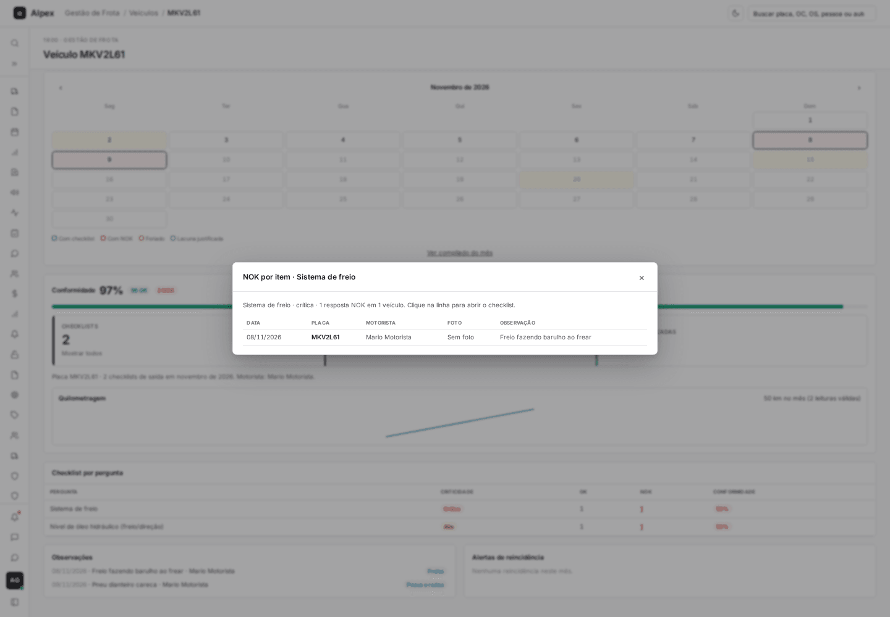
  </Step>
</Steps>

<Note>
Os dias de feriado e as lacunas justificadas ficam destacados no calendário e as lacunas são listadas em **Lacunas justificadas do mês**, mais abaixo na mesma aba. Dias futuros aparecem esmaecidos.
</Note>

## Consultar a linha do tempo

<Steps>
  <Step title="Abrir a aba">
    Clique na aba **Linha do tempo**. Ela lista os checklists, ocorrências, OS, abastecimentos, documentos, multas e mudanças de situação do veículo.

    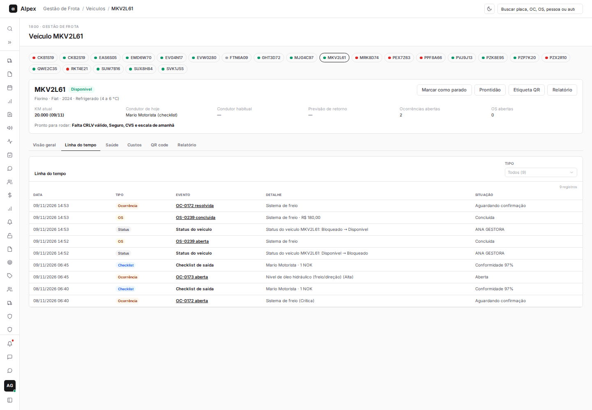
  </Step>
  <Step title="Filtrar por tipo">
    Abra o campo **Tipo** e escolha o tipo de evento. Cada opção mostra a quantidade entre parênteses.

    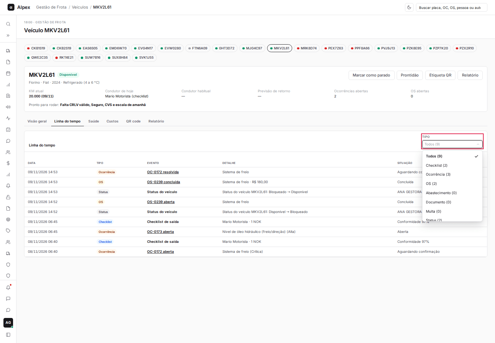
  </Step>
  <Step title="Abrir o item do evento">
    Clique em uma linha de checklist para abrir o checklist. O nome sublinhado de uma ocorrência ou de uma OS leva à respectiva tela, quando o seu perfil tem acesso a ela.
  </Step>
</Steps>

## Ver a saúde do veículo

<Steps>
  <Step title="Abrir a aba">
    Clique em **Saúde**. À esquerda aparecem as pendências do veículo com a **Pontuação de urgência**. À direita ficam as **Preventivas** do modelo (situação, próxima execução e quanto falta) e os **Documentos do veículo e do baú** com a validade.

    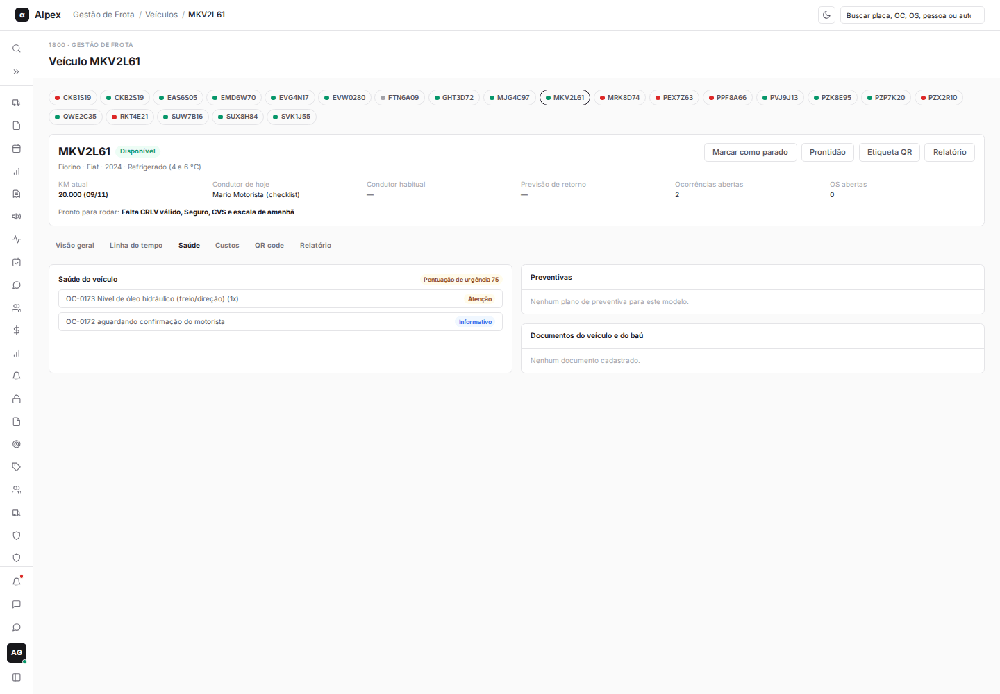
  </Step>
</Steps>

## Consultar os custos do veículo

<Steps>
  <Step title="Abrir a aba e escolher o mês">
    Clique em **Custos** e use **‹** e **›** para trocar o mês. O período exibido aparece ao lado.

    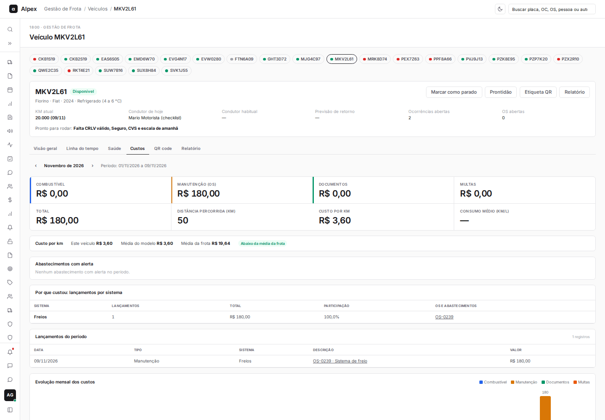
  </Step>
  <Step title="Ler os cartões">
    Os cartões mostram **Combustível**, **Manutenção (OS)**, **Documentos**, **Multas**, **Total**, **Distância percorrida (km)**, **Custo por km** e **Consumo médio (km/l)**. Clique em **Combustível**, **Manutenção (OS)**, **Documentos** ou **Multas** para listar só esse tipo nos lançamentos.
  </Step>
  <Step title="Comparar e investigar">
    **Custo por km** compara este veículo com a média do modelo e da frota. Em **Abastecimentos com alerta** e nos lançamentos, clique no item para abrir o detalhe do abastecimento.
  </Step>
</Steps>

## Imprimir a etiqueta QR do veículo

<Steps>
  <Step title="Abrir a aba QR code">
    Clique em **Etiqueta QR** no cabeçalho ou na aba **QR code**. A tela mostra o QR do veículo e o código dele.

    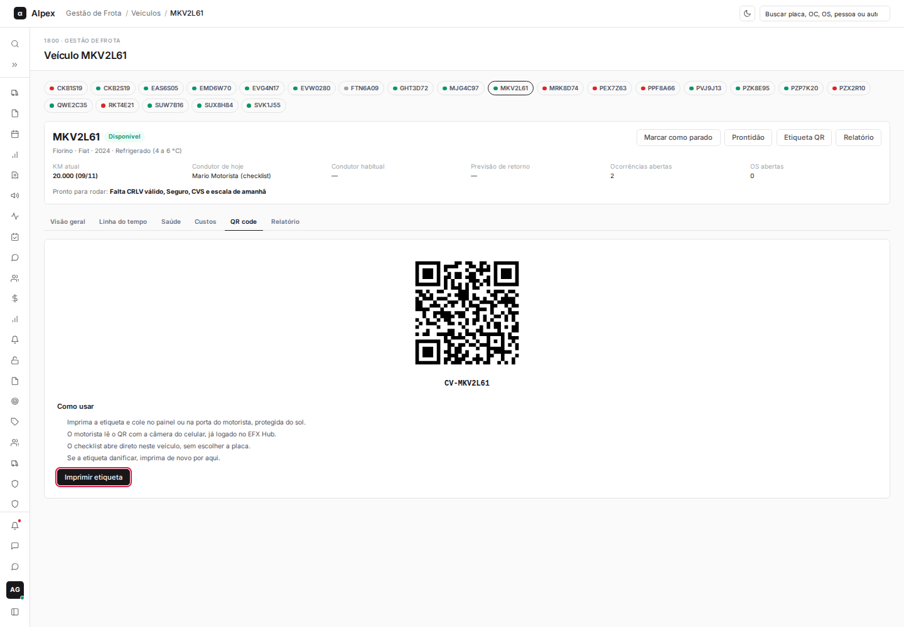
  </Step>
  <Step title="Imprimir">
    Clique em **Imprimir etiqueta**. Abre uma nova aba com a etiqueta (80 x 100 mm) e a janela de impressão do navegador.

    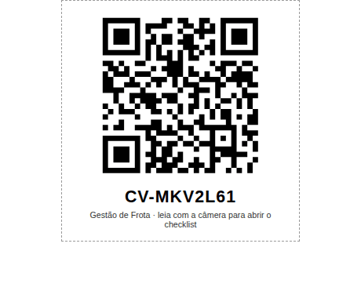
  </Step>
  <Step title="Colar no veículo">
    Cole a etiqueta no painel ou na porta, protegida do sol. O motorista lê o QR com a câmera do celular, já logado no EFX Hub, e o checklist abre direto neste veículo.
  </Step>
</Steps>

<Note>
Cada impressão fica registrada. Se a etiqueta estragar, imprima de novo por aqui.
</Note>

## Gerar o relatório do veículo (PDF, Excel ou PPTX)

<Steps>
  <Step title="Escolher o mês">
    Na aba **Visão geral**, navegue até o mês desejado. O relatório usa o mês do calendário.
  </Step>
  <Step title="Abrir a aba Relatório">
    Clique em **Relatório** (ou em **Ver compilado do mês**). A tela mostra a prévia do documento executivo de 1 página A4 do mês.

    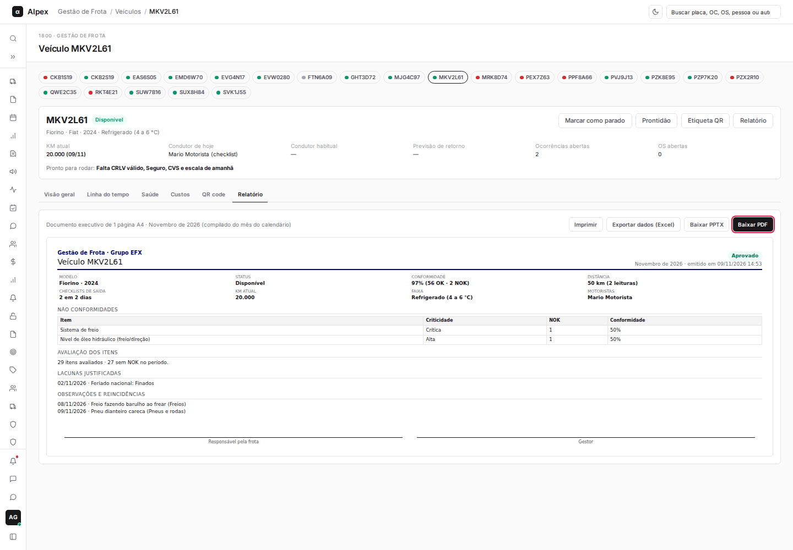
  </Step>
  <Step title="Escolher o formato">
    - **Imprimir**: abre o PDF em uma nova aba para visualizar e imprimir.
    - **Baixar PDF**: baixa o arquivo Relatorio_PLACA_AAAA-MM.pdf.
    - **Baixar PPTX**: baixa a apresentação do veículo.
    - **Exportar dados (Excel)**: baixa a planilha com resumo, não conformidades e demais dados do mês.

    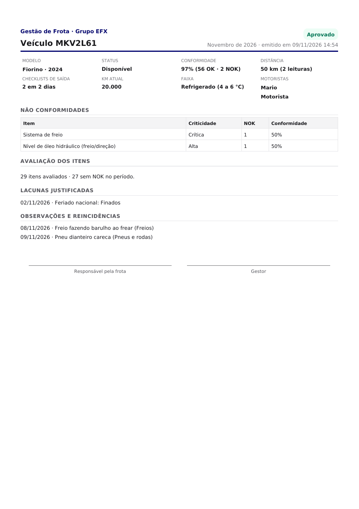

  </Step>
</Steps>

<Note>
Cada geração de PDF, PPTX ou Excel fica registrada no histórico de atividades do sistema.
</Note>

## Marcar um veículo como parado

<Steps>
  <Step title="Abrir o veículo">
    No cabeçalho do veículo, clique em **Marcar como parado**.

    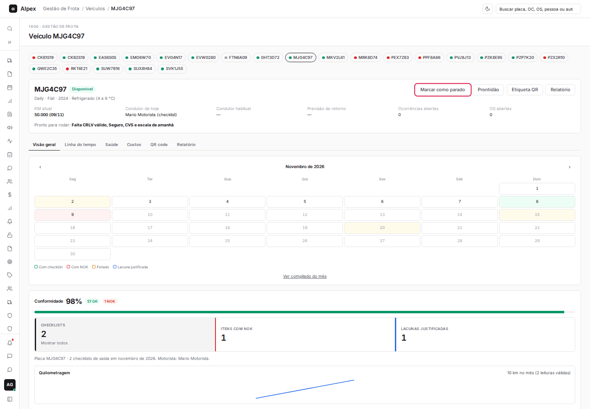
  </Step>
  <Step title="Preencher o motivo e a previsão">
    Na janela, escreva o **Motivo** (obrigatório, mínimo de 5 caracteres) e, se souber, a **Previsão de retorno**.

    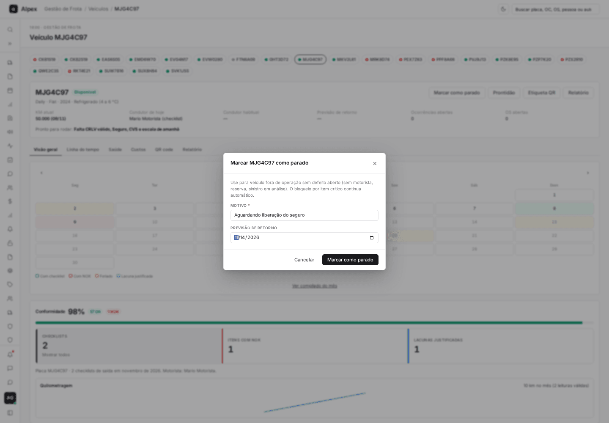
  </Step>
  <Step title="Salvar">
    Clique em **Marcar como parado**. Aparece o aviso de confirmação e o botão do cabeçalho vira **Encerrar parada**. O veículo passa a **Parado** e aparece com o motivo e a previsão no Painel da frota e na lista de Veículos.

    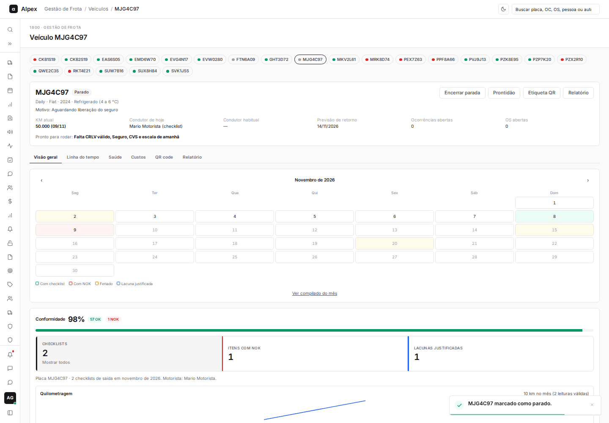
  </Step>
</Steps>

<Note>
Use para veículo fora de operação sem defeito aberto (sem motorista, reserva, sinistro em análise). A previsão não pode ser anterior a hoje. O botão não aparece em veículo **Bloqueado**: o bloqueio por item crítico é automático. Se o veículo já estiver em manutenção, o sistema avisa que ele continua nessa situação até a manutenção liberar.
</Note>

## Encerrar a parada de um veículo

<Steps>
  <Step title="Clicar em Encerrar parada">
    No cabeçalho de um veículo parado manualmente, clique em **Encerrar parada**.

    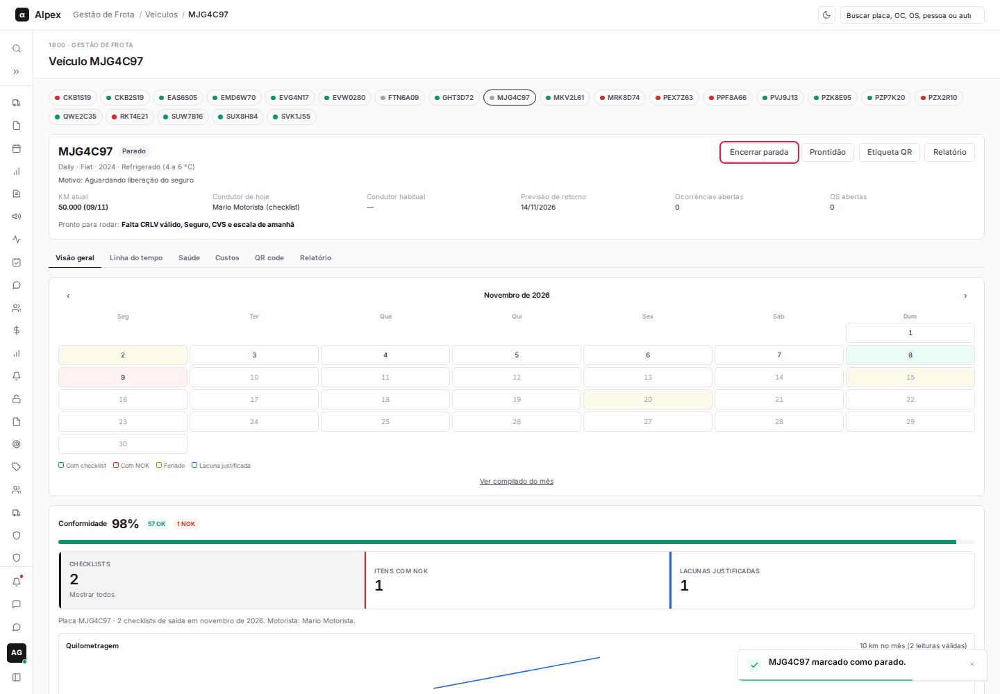
  </Step>
  <Step title="Confirmar">
    Na pergunta "O veículo volta a ser avaliado pelo sistema (ocorrências e OS)", clique em **Encerrar parada**. Para desistir, clique em **Cancelar**.

    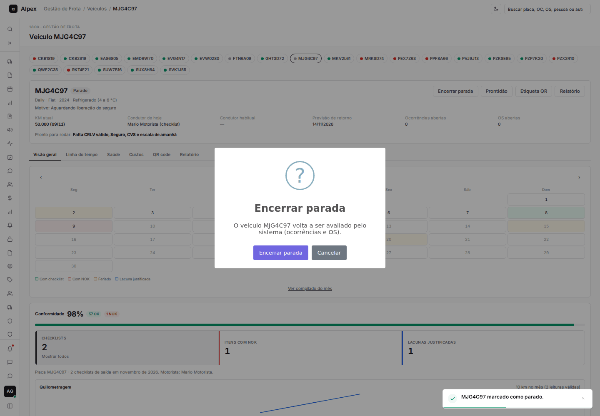
  </Step>
  <Step title="Conferir o resultado">
    Aparece o aviso "Parada encerrada" com a nova situação do veículo.

    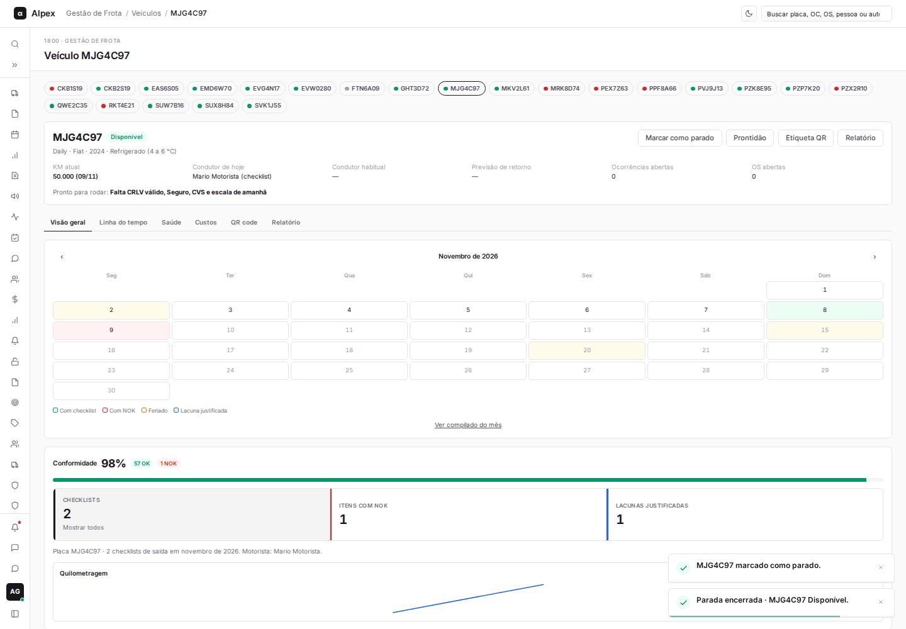
  </Step>
</Steps>

<Note>
Depois de encerrar, o sistema volta a avaliar o veículo pelas ocorrências e OS abertas: ele pode voltar a **Disponível**, ou continuar **Bloqueado** ou **Em manutenção** se houver pendência.
</Note>

## Deixar o veículo pronto para rodar (Prontidão)

<Steps>
  <Step title="Abrir a Prontidão">
    No cabeçalho, a linha **Pronto para rodar** diz o que falta. Clique em **Prontidão** para resolver.

    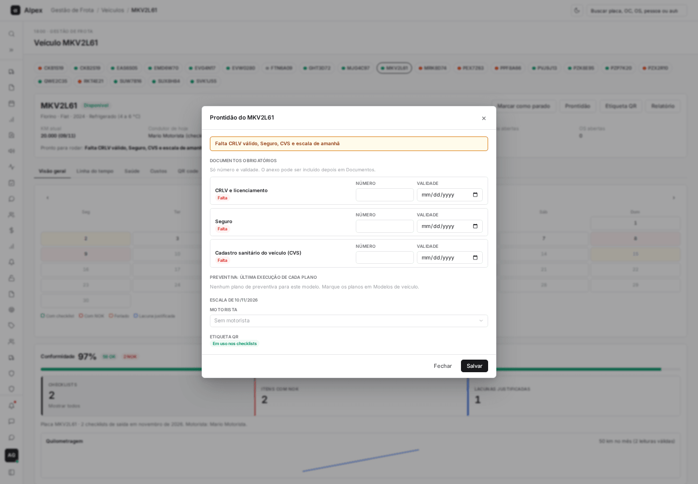
  </Step>
  <Step title="Preencher o que falta">
    - **Documentos obrigatórios**: informe **Número** e **Validade** dos documentos sem validade em dia.
    - **Preventiva**: informe o **KM da última execução** e a **Data da última execução** de cada plano sem histórico.
    - **Escala**: escolha o **Motorista** do próximo dia útil.
    - **Etiqueta QR**: se estiver **Não impressa**, clique em **Imprimir etiqueta**.
  </Step>
  <Step title="Salvar">
    Clique em **Salvar**. Quando tudo estiver em dia, aparece "pronto para rodar" e a janela fecha. Se ainda faltar algo, o aviso diz quantos itens foram salvos e o que continua pendente.
  </Step>
</Steps>

<Note>
O botão **Prontidão** só aparece para o Gestor. Aqui só vão número e validade; o anexo do documento pode ser incluído depois em Documentos.
</Note>
