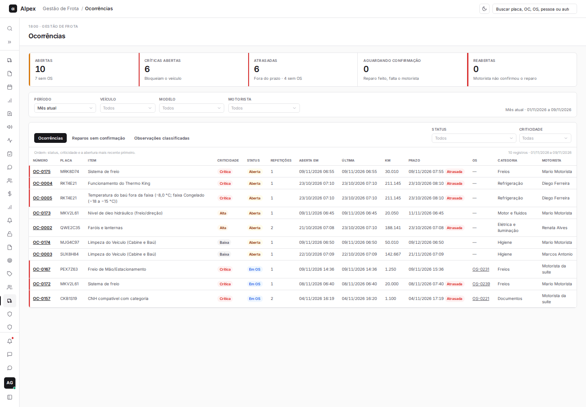
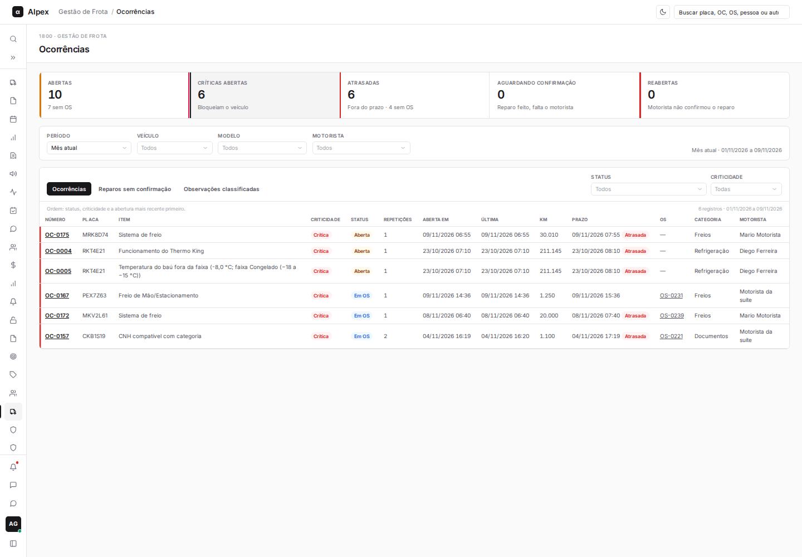
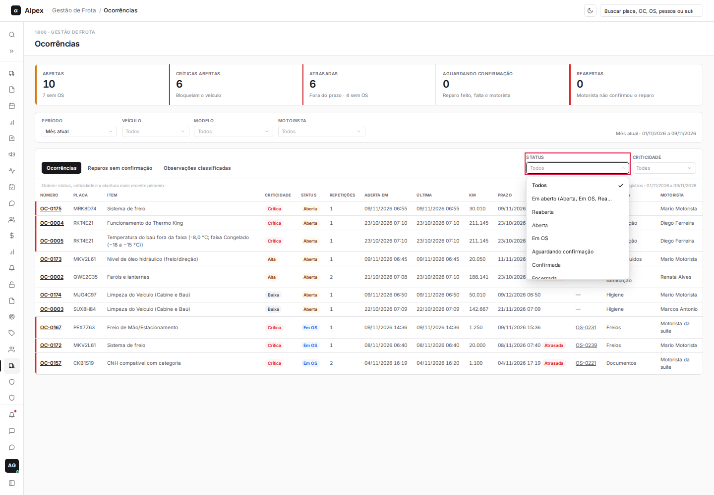
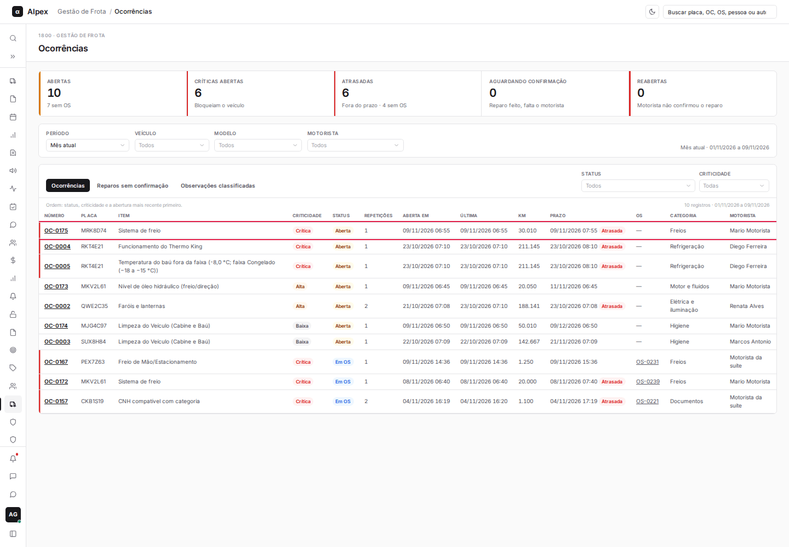
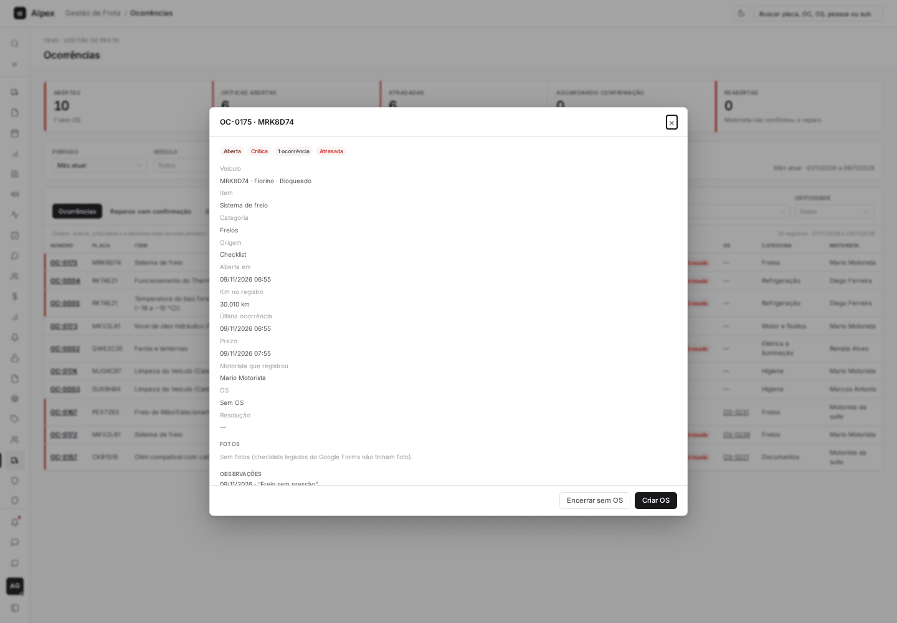
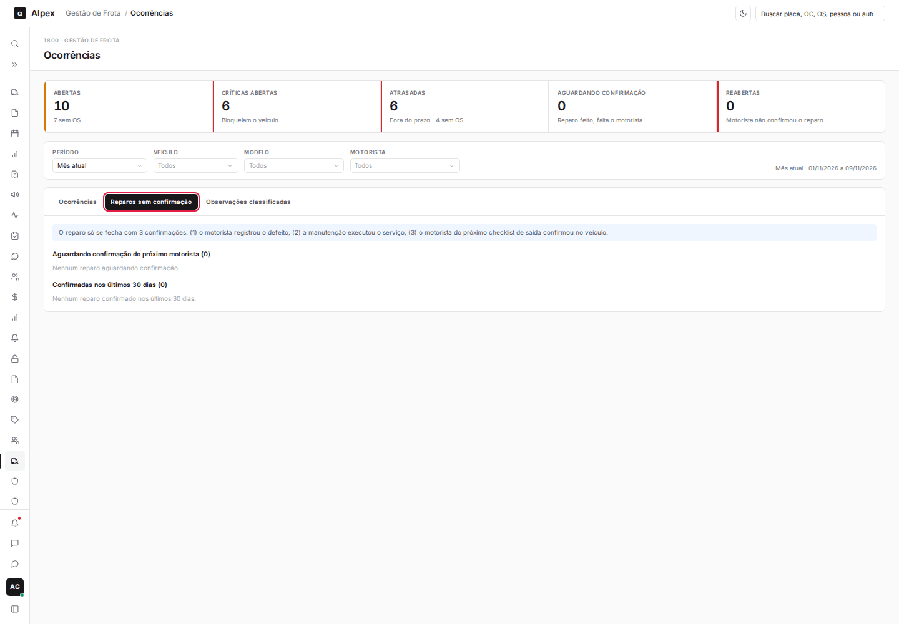
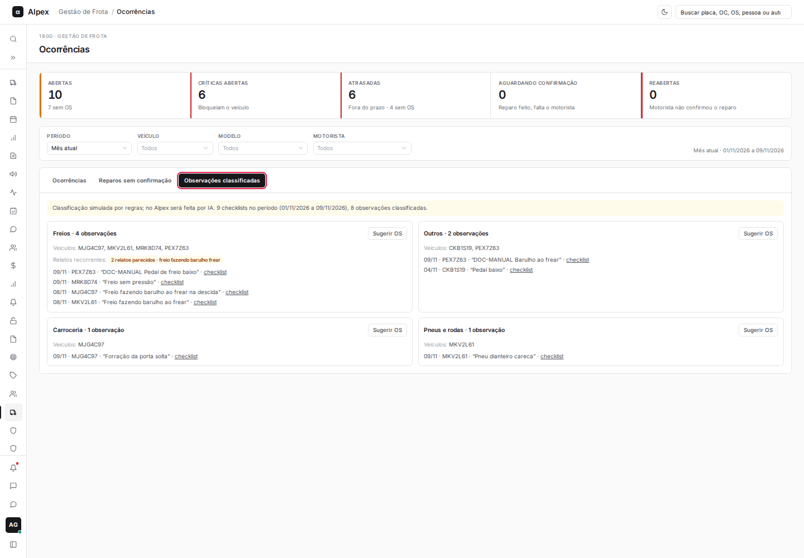

**Menu:** 1915 - Ocorrências

Acompanha os defeitos registrados nos checklists. Cada item NOK vira uma ocorrência, que pode ser tratada com uma OS ou encerrada sem OS.

## Filtrar e priorizar as ocorrências

<Steps>
  <Step title="Ler os cartões">
    **Abertas**, **Críticas abertas** (bloqueiam o veículo), **Atrasadas**, **Aguardando confirmação** e **Reabertas**. Clique em um cartão para filtrar a lista; clique de novo para voltar.

    
  </Step>
  <Step title="Filtrar por status e criticidade">
    Em **Status**, escolha por exemplo **Em aberto**. Em **Criticidade**, escolha o nível. Use também **Período**, **Veículo**, **Modelo** e **Motorista** na barra acima.

    
  </Step>
</Steps>

<Note>
Para Manutenção, a lista abre em **Em aberto**, ordenada por criticidade e pela abertura mais antiga. Líder e Gestor veem todos os status, ordenados por status, criticidade e abertura mais recente. Uma ocorrência **Atrasada** passou do prazo.
</Note>

## Abrir uma ocorrência

<Steps>
  <Step title="Clicar na linha">
    Na aba **Ocorrências**, clique na linha ou no número (por exemplo, **OC-0161**).

    
  </Step>
  <Step title="Ler o detalhe">
    A janela mostra situação, criticidade, veículo, item, categoria, origem, datas, prazo, KM, motorista que registrou e a OS ligada. Mais abaixo ficam as **Fotos**, as **Observações**, as **Repetições**, a **OS vinculada** e a **Cadeia de confirmações** do reparo.

    
  </Step>
</Steps>

<Note>
Líder consulta apenas: ele vê a janela com a mensagem "Perfil de consulta: as ações ficam com Manutenção e Gestor" e só o botão **Fechar**.
</Note>

## Reparos sem confirmação e observações classificadas

<Steps>
  <Step title="Reparos sem confirmação">
    Clique na aba **Reparos sem confirmação**. O reparo só fecha com 3 confirmações: o motorista registrou o defeito, a manutenção executou o serviço e o motorista do próximo checklist de saída confirmou no veículo. A tabela mostra quem falta confirmar. Clique em uma linha para abrir a ocorrência.

    
  </Step>
  <Step title="Observações classificadas">
    Clique na aba **Observações classificadas**. As observações escritas pelos motoristas são agrupadas por categoria, com os veículos e os relatos parecidos. Clique em **checklist** para abrir o checklist de origem.

    
  </Step>
  <Step title="Sugerir OS">
    Clique em **Sugerir OS** no grupo para abrir o formulário de OS já preenchido com a categoria e as observações do grupo (somente Manutenção e Gestor).
  </Step>
</Steps>

<Note>
A classificação das observações hoje é feita por regras; mais adiante será feita por IA. O botão **Sugerir OS** só aparece para quem pode tratar ocorrências.
</Note>
