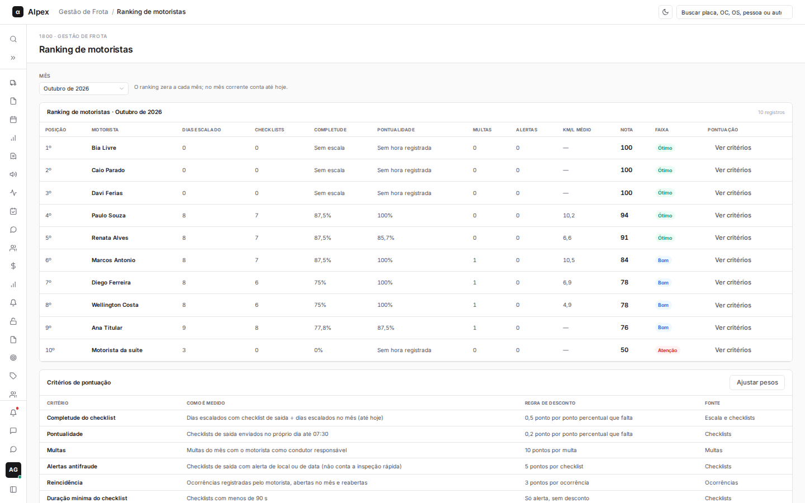
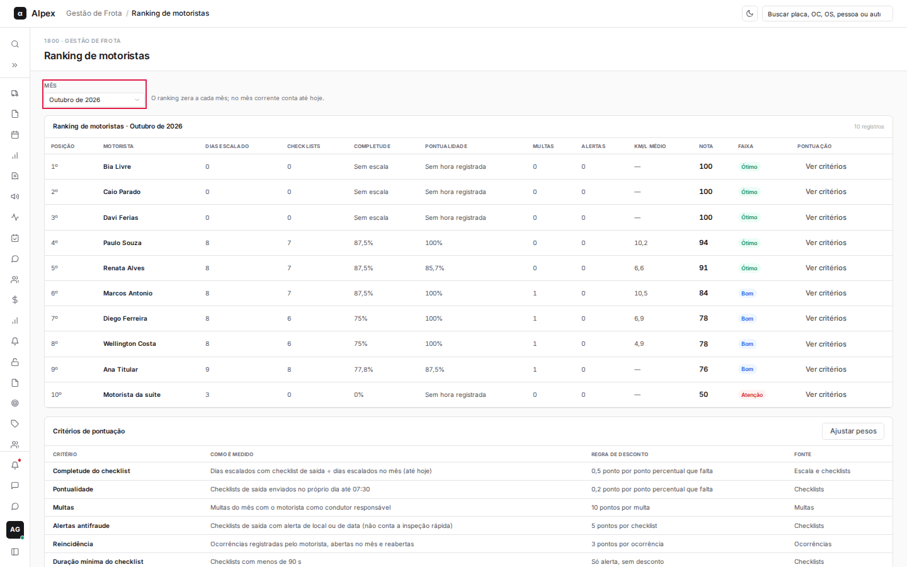
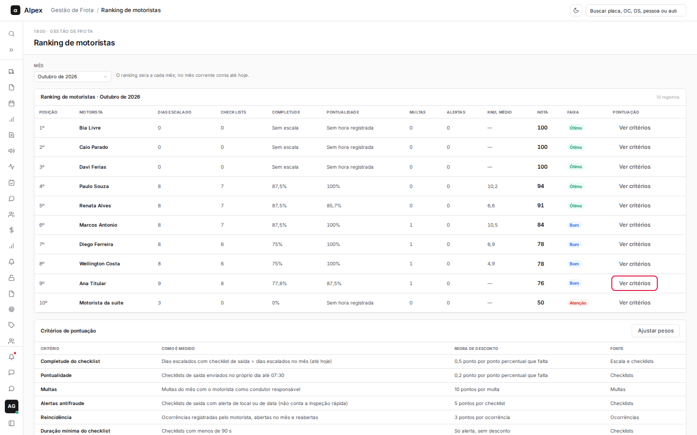
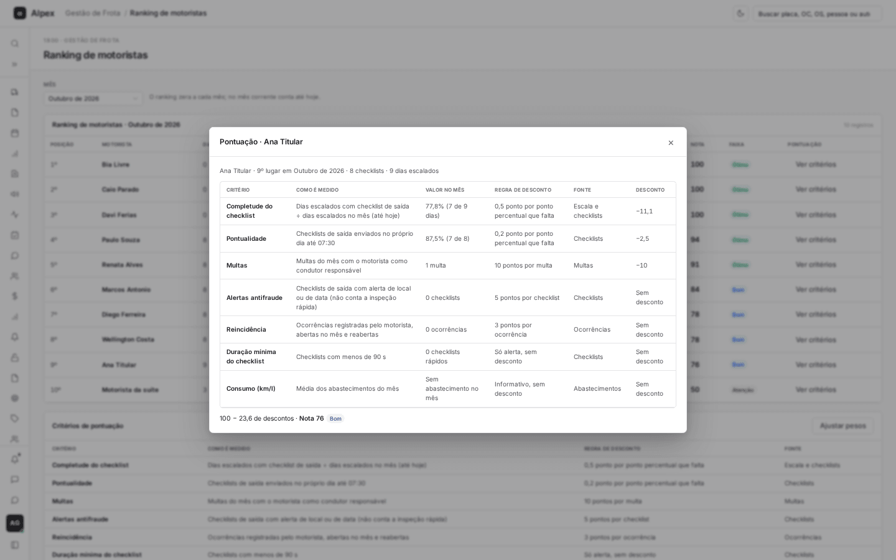
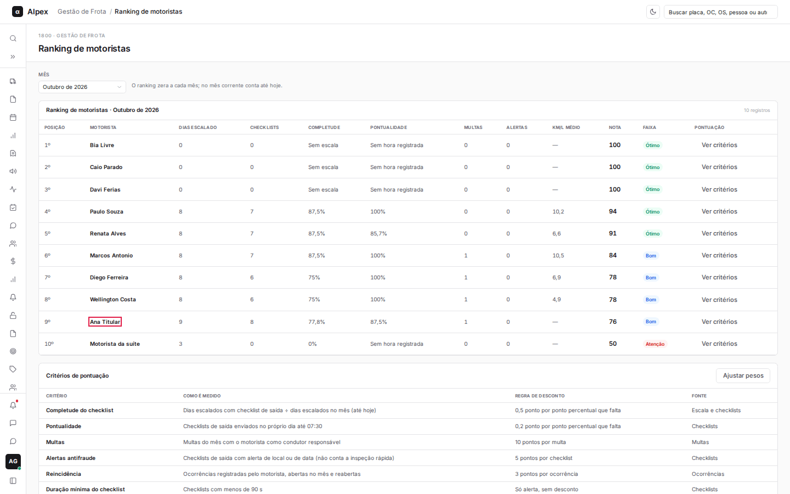
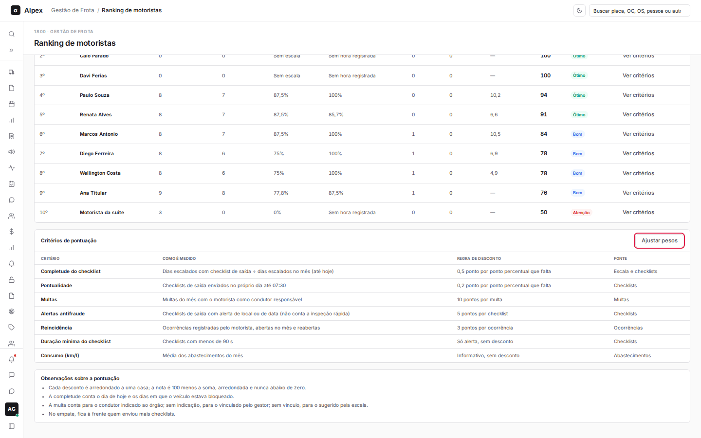

**Menu:** 1907 - Ranking de motoristas

Classifica os motoristas ativos de cada mês por uma nota de 0 a 100, calculada a partir de checklists, pontualidade, multas, alertas e reincidência. O ranking zera a cada mês; no mês corrente conta até hoje.

## Trocar o mês do ranking

<Steps>
  <Step title="Escolha o mês">
    No campo **Mês**, selecione o mês desejado (os últimos 12 meses). A tabela mostra posição, motorista, dias escalado, checklists, completude, pontualidade, multas, alertas, km/l médio, nota e faixa (Ótimo, Bom ou Atenção).

    
  </Step>
</Steps>

<Note>
No empate, fica à frente quem enviou mais checklists. A multa conta para o condutor indicado ao órgão; sem indicação, para o vinculado pela gestão; sem vínculo, para o sugerido pela escala.
</Note>

## Ver os critérios da nota de um motorista

<Steps>
  <Step title="Clique em Ver critérios">
    Na linha do motorista, clique em **Ver critérios**.

    
  </Step>
  <Step title="Leia a pontuação">
    O painel detalha cada critério, quanto foi descontado, e fecha com "100 menos os descontos" e a nota final.

    
  </Step>
</Steps>

## Abrir o perfil de um motorista

<Steps>
  <Step title="Clique no nome do motorista">
    O nome na tabela é um link para o perfil do colaborador.

    
  </Step>
</Steps>

## Consultar as regras de pontuação

<Steps>
  <Step title="Role até Critérios de pontuação">
    A tabela explica cada critério: como é medido, a regra de desconto e a fonte. Logo abaixo, as observações sobre a pontuação.

    
  </Step>
</Steps>
