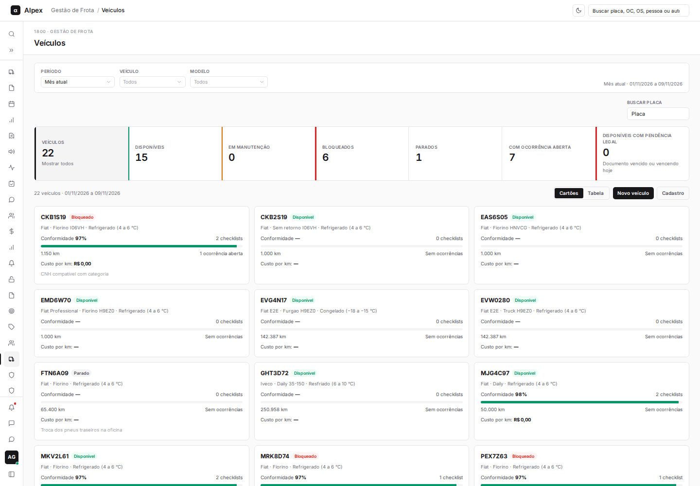
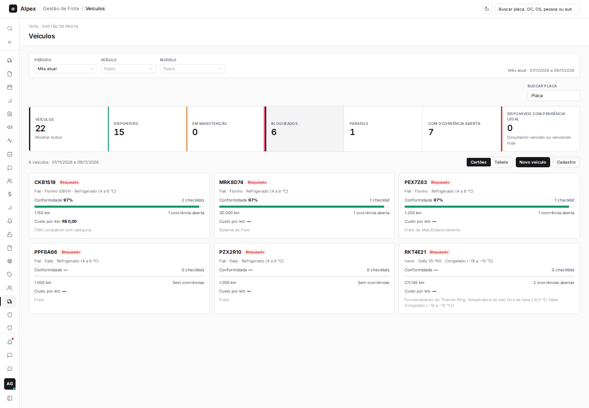
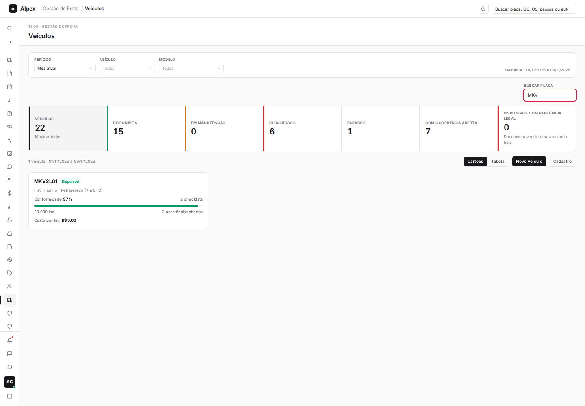
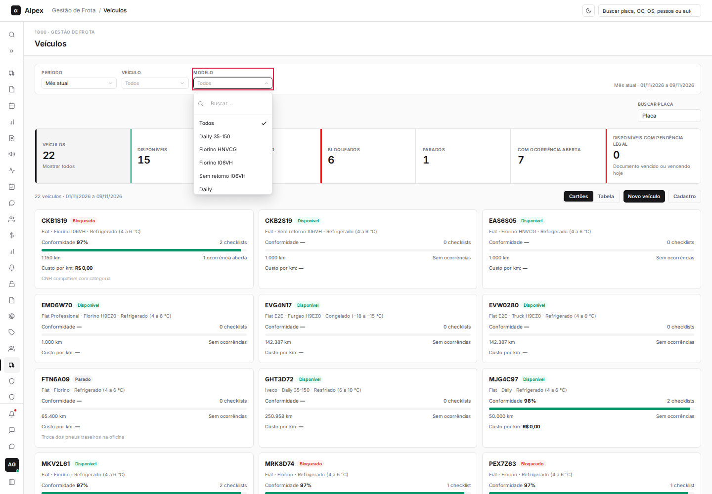
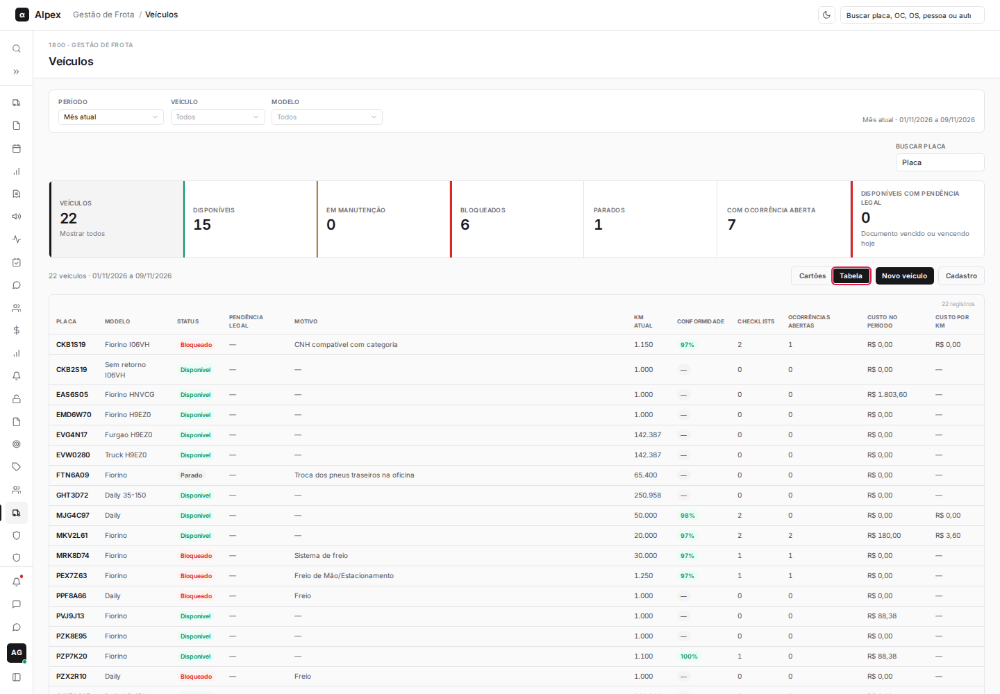
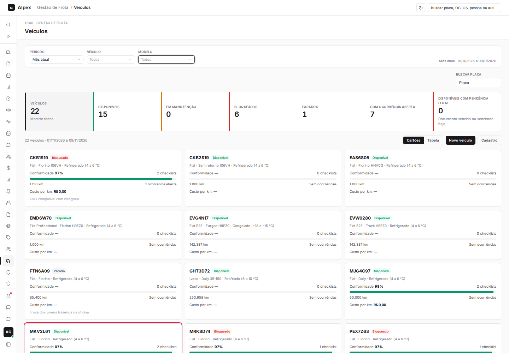

**Menu:** 1912 - Veículos

A tela Veículos lista toda a frota, com situação, conformidade dos checklists, ocorrências abertas e custo por km, em cartões ou em tabela.

## Filtrar e buscar veículos

<Steps>
  <Step title="Filtrar pelos cartões de situação">
    Clique em **Disponíveis**, **Em manutenção**, **Bloqueados**, **Parados**, **Com ocorrência aberta** ou **Disponíveis com pendência legal**. Clique no mesmo cartão de novo, ou em **Veículos**, para mostrar todos.

    
  </Step>
  <Step title="Buscar pela placa">
    No campo **Buscar placa**, digite parte da placa. A lista é filtrada enquanto você digita.

    
  </Step>
  <Step title="Filtrar por período, veículo ou modelo">
    Use a barra no topo: **Período**, **Veículo** e **Modelo**. O período define o intervalo usado em conformidade, checklists e custo.

    
  </Step>
</Steps>

## Alternar entre cartões e tabela

<Steps>
  <Step title="Escolher o modo">
    Acima da lista, clique em **Cartões** ou **Tabela**.

    
  </Step>
  <Step title="Ler as informações">
    Cada cartão mostra a placa, a situação, o modelo, a conformidade com barra de progresso, o total de checklists, o KM atual, as ocorrências abertas, o **Custo por km** e o motivo quando o veículo não está disponível. A tabela traz as mesmas informações em colunas e inclui **Custo no período**.

    
  </Step>
</Steps>

## Abrir o detalhe de um veículo

<Steps>
  <Step title="Clicar no veículo">
    Clique no cartão, ou em qualquer parte da linha na tabela, para abrir o detalhe do veículo.
  </Step>
</Steps>
