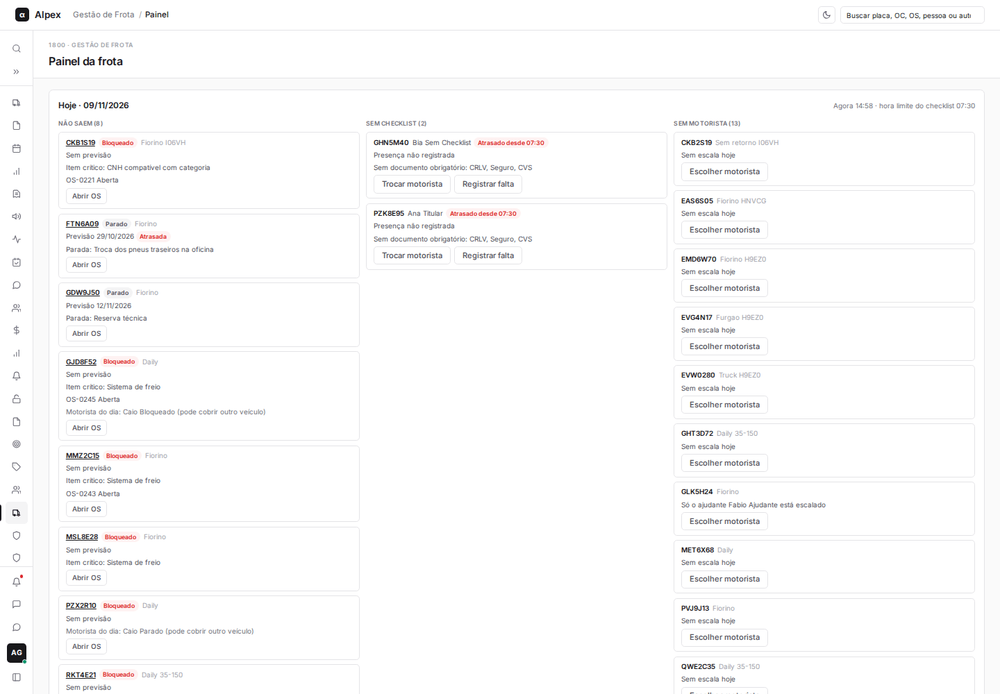
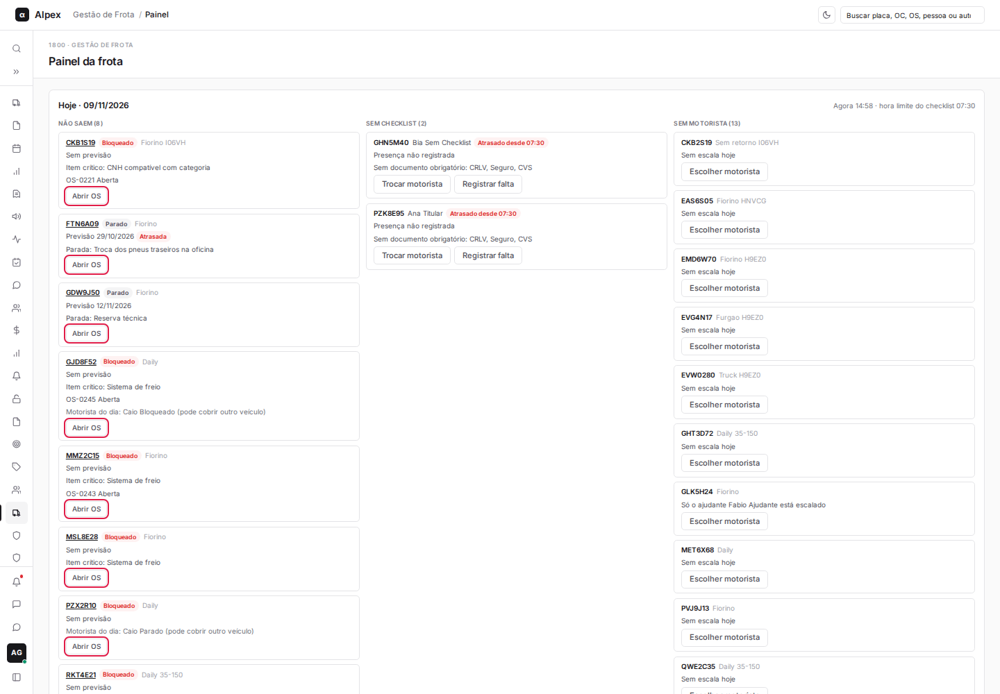
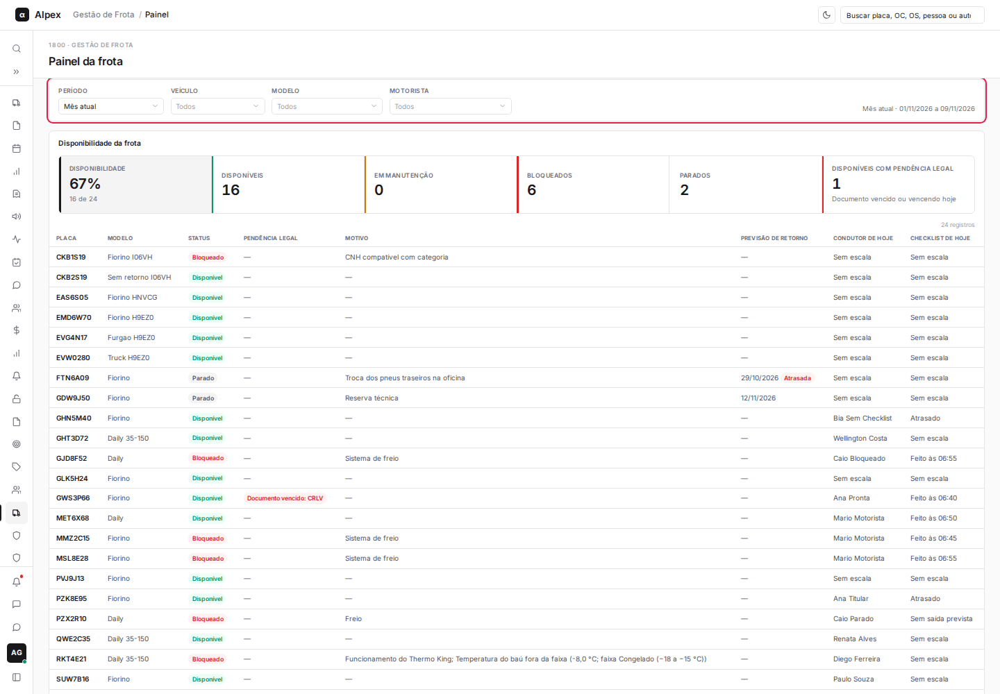
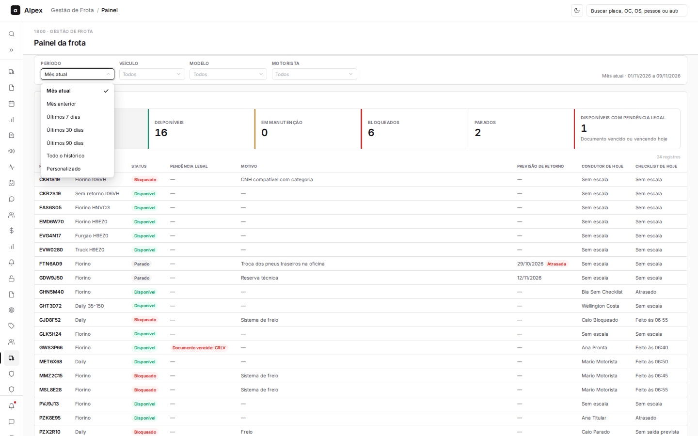
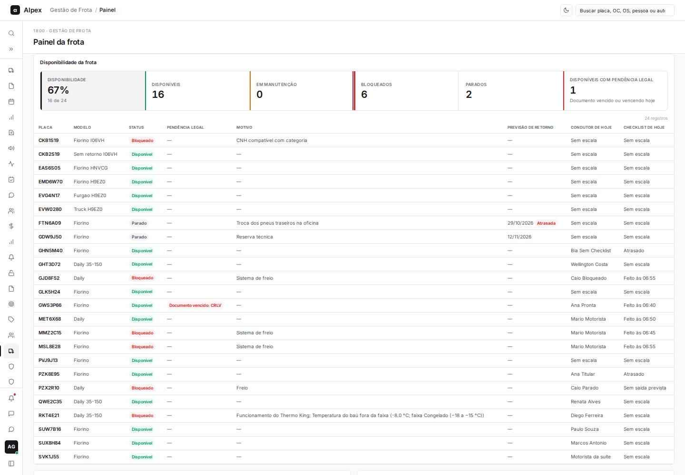
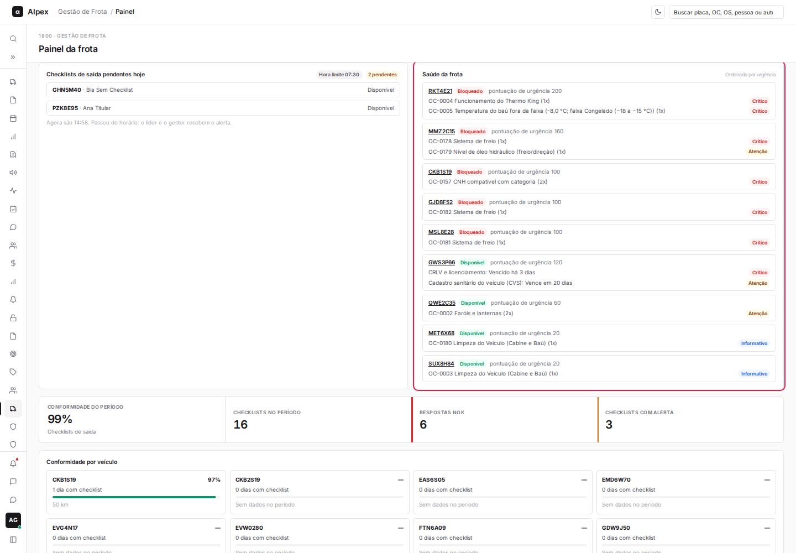
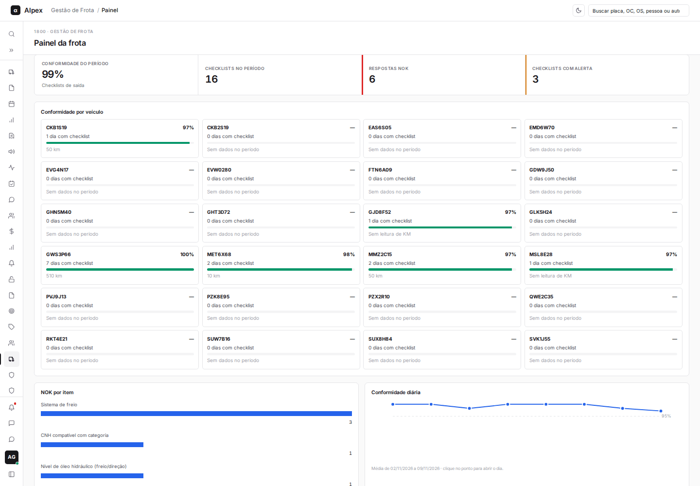
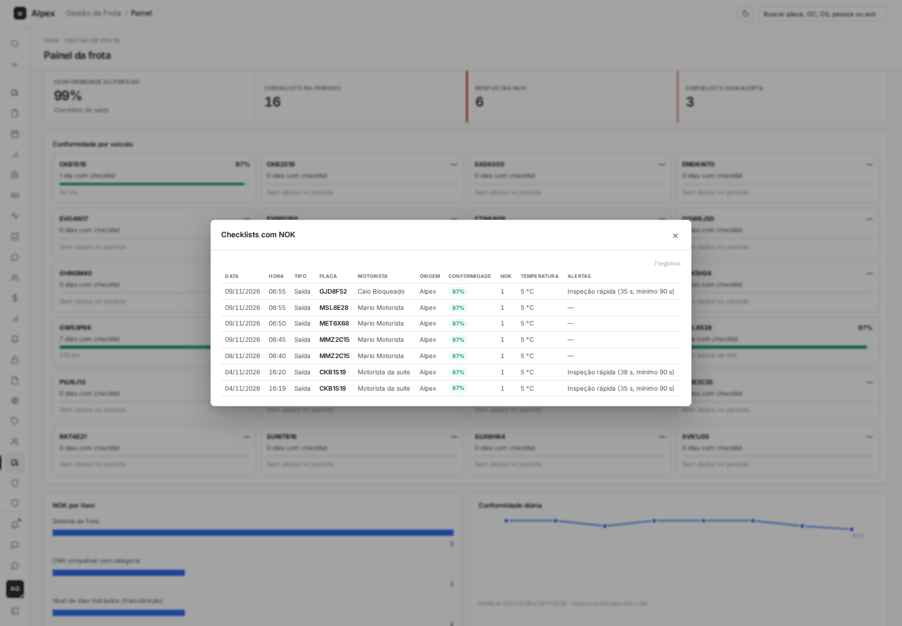
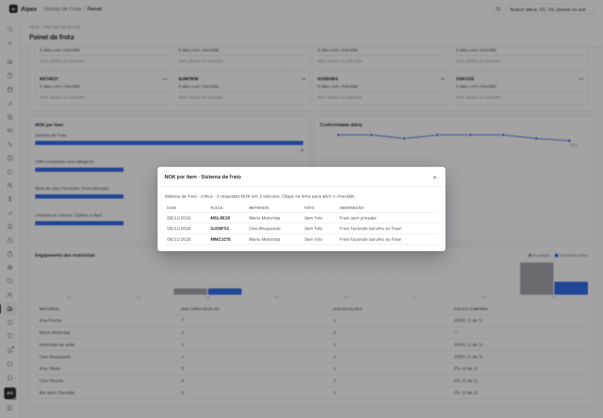
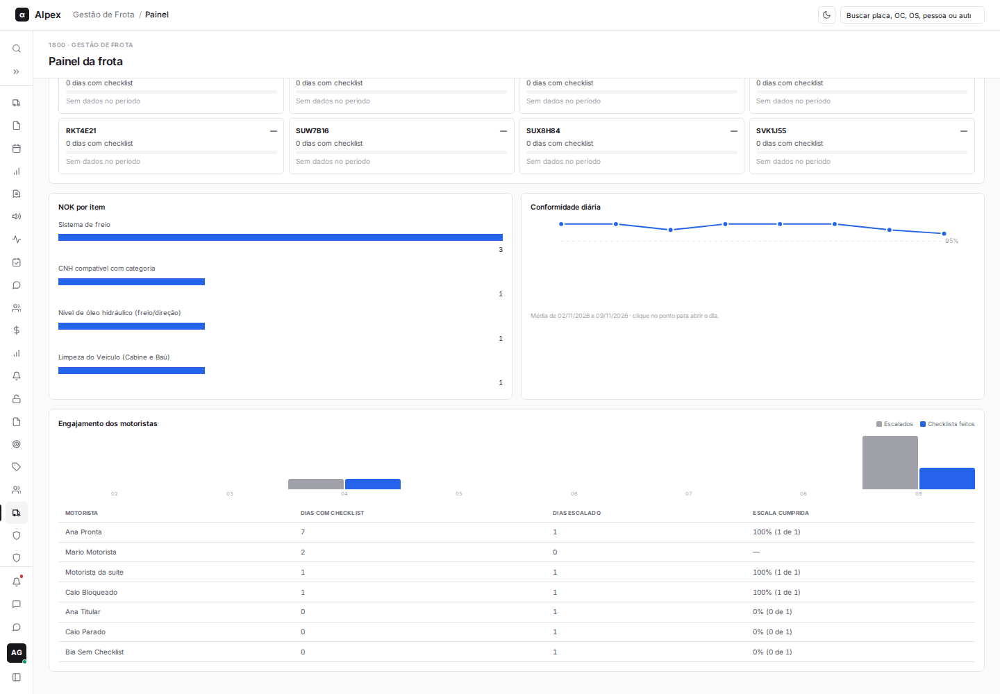

**Menu:** 1913 - Painel da frota

O Painel da frota mostra, em uma só tela, o que acontece com a frota hoje (quem não sai, quem não enviou checklist, quem está sem motorista), a disponibilidade dos veículos e os indicadores de checklist do período escolhido.

## Ler o bloco Hoje

<Steps>
  <Step title="Abrir o painel">
    No menu, abra **1900 - Gestão de Frota** e clique em **1913 - Painel da frota**. O bloco **Hoje** fica no topo e mostra a data, a hora atual e a hora limite do checklist.

    
  </Step>
  <Step title="Entender as três colunas">
    - **Não saem**: veículos bloqueados, parados ou em manutenção, com o motivo, a previsão de retorno e a OS aberta.
    - **Sem checklist**: veículos escalados cujo motorista ainda não enviou o checklist de saída, com o atraso e a situação da presença.
    - **Sem motorista**: veículos sem escala para hoje.

    Clique na placa de um veículo da coluna **Não saem** para abrir o detalhe dele.
  </Step>
  <Step title="Conferir os avisos do rodapé do bloco">
    Abaixo das colunas, o painel informa quantos veículos disponíveis têm pendência legal e quantos saem sem documento obrigatório válido. Clique em **Ver na disponibilidade** para listar só os veículos com pendência legal.
  </Step>
</Steps>

<Note>
Documento vencido só alerta: o veículo continua saindo, mas precisa ser regularizado. Depois da hora limite, o checklist que não chegou aparece como atrasado e o líder e o gestor recebem o alerta.
</Note>

## Abrir OS a partir do painel

<Steps>
  <Step title="Localizar o veículo em Não saem">
    No bloco **Hoje**, encontre o veículo na coluna **Não saem** e clique em **Abrir OS**.

    
  </Step>
  <Step title="Seguir para a OS">
    Se o veículo já tem uma OS em aberto, o sistema leva você direto para ela. Se não tem, abre o formulário de nova OS já com o veículo escolhido.
  </Step>
</Steps>

<Note>
O botão **Abrir OS** só aparece para Manutenção e Gestor. O líder apenas consulta.
</Note>

## Filtrar o painel por período, veículo, modelo e motorista

<Steps>
  <Step title="Ir até a barra de filtros">
    Role a página até a barra com **Período**, **Veículo**, **Modelo** e **Motorista**.

    
  </Step>
  <Step title="Escolher o período">
    Abra **Período** e escolha uma das opções: **Mês atual**, **Mês anterior**, **Últimos 7 dias**, **Últimos 30 dias**, **Últimos 90 dias**, **Todo o histórico** ou **Personalizado**. Em **Personalizado**, preencha as datas **De** e **Até**.

    
  </Step>
  <Step title="Restringir por veículo, modelo ou motorista">
    Abra **Veículo**, **Modelo** ou **Motorista**, digite parte do nome na busca e escolha o item. A tela atualiza na hora.
  </Step>
  <Step title="Limpar">
    Quando algum filtro está ativo, aparece o botão **Limpar filtros** no canto direito da barra. Clique nele para voltar ao padrão (**Mês atual**).
  </Step>
</Steps>

<Note>
O filtro escolhido vale para as telas Painel da frota, Veículos, Checklists recebidos e Ocorrências durante a sua sessão. O bloco **Hoje** sempre mostra o dia de hoje, independente do período.
</Note>

## Ver a disponibilidade da frota

<Steps>
  <Step title="Ler os indicadores">
    Em **Disponibilidade da frota**, os cartões mostram a porcentagem de disponibilidade e as quantidades de **Disponíveis**, **Em manutenção**, **Bloqueados**, **Parados** e **Disponíveis com pendência legal**.

    
  </Step>
  <Step title="Filtrar a tabela">
    Clique em um cartão, por exemplo **Bloqueados**, para listar só esses veículos. Clique de novo no mesmo cartão (ou em **Disponibilidade**) para voltar a ver todos.
  </Step>
  <Step title="Abrir um veículo">
    Clique na placa para abrir o detalhe do veículo.
  </Step>
</Steps>

## Acompanhar saúde, conformidade e engajamento

<Steps>
  <Step title="Checklists de saída pendentes hoje">
    Lista os veículos escalados que ainda não enviaram o checklist de saída, com a hora limite e a quantidade de pendentes.

    
  </Step>
  <Step title="Saúde da frota">
    Ordena os veículos pela pontuação de urgência e mostra os itens que pesam: ocorrências abertas e preventivas vencidas ou perto de vencer. Clique na placa para abrir a aba **Saúde** do veículo.
  </Step>
  <Step title="Conformidade do período">
    Os cartões **Conformidade do período**, **Checklists no período**, **Respostas NOK** e **Checklists com alerta** resumem o período filtrado. Clique em qualquer um para abrir a lista dos checklists correspondentes.

    

    
  </Step>
  <Step title="NOK por item">
    No gráfico **NOK por item**, clique em uma barra para ver as respostas NOK daquele item, com data, placa, motorista e observação. Clique em uma linha para abrir o checklist completo.

    
  </Step>
  <Step title="Conformidade diária e engajamento">
    **Conformidade diária** mostra a evolução dia a dia (clique em um ponto para ver os checklists do dia). **Engajamento dos motoristas** compara os dias escalados com os dias em que o checklist foi feito.

    
  </Step>
</Steps>

<Note>
Os números acompanham o filtro de período e de veículo, modelo e motorista da barra de filtros.
</Note>
