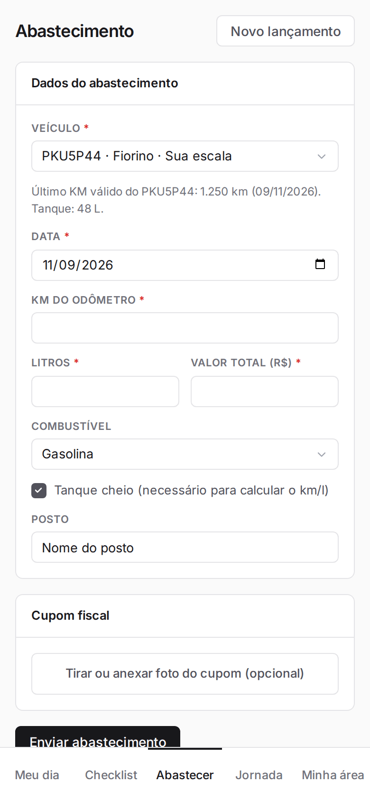
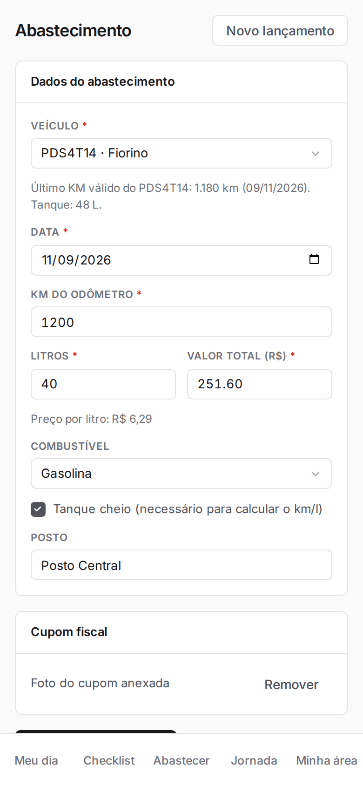
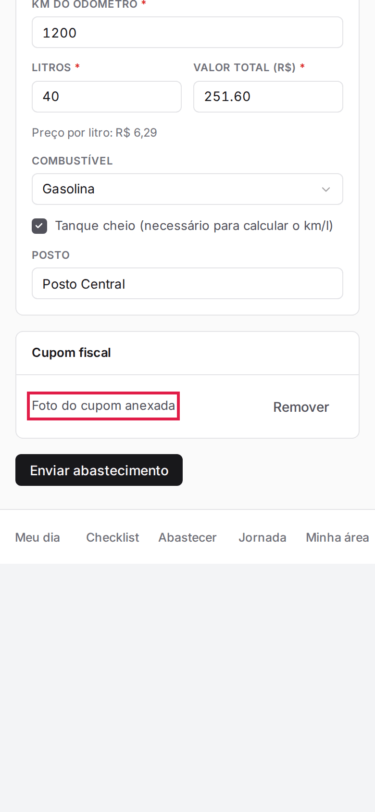
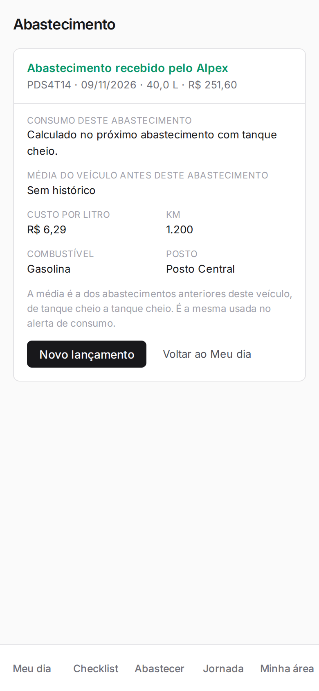
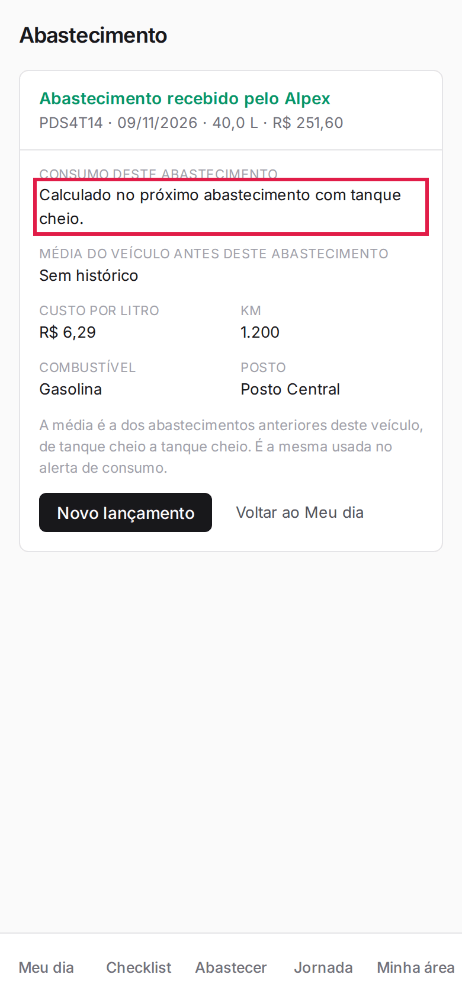
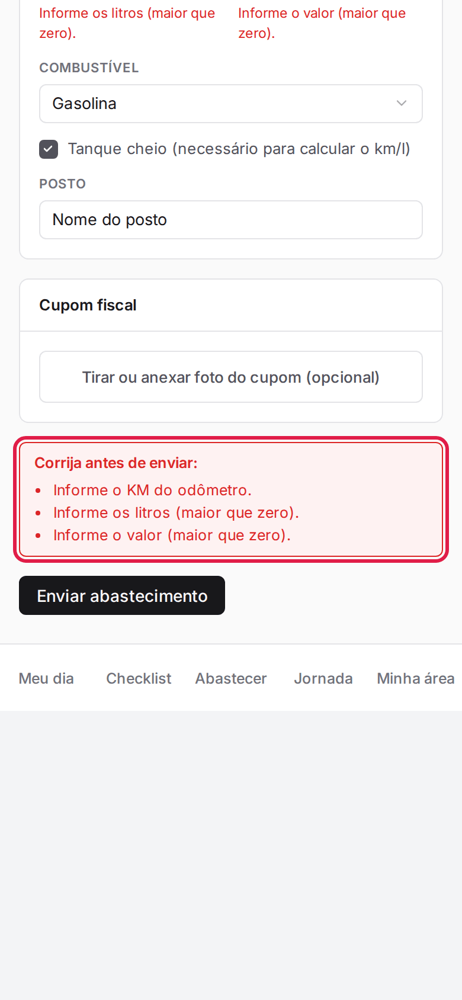

**Menu:** 1904 - Meu dia (motorista)

Serve para lançar um abastecimento com KM, litros, valor e foto do cupom, e ver o consumo (km/l) calculado.

## Lançar um abastecimento

<Steps>
  <Step title="Abrir o Abastecimento">
    Toque em **Abastecimento** no Meu dia ou em **Abastecer** na barra de baixo.
  </Step>
  <Step title="Escolher o veículo">
    No campo **Veículo**, escolha a placa. A tela mostra o último KM válido e o tanque do veículo.
  </Step>
  <Step title="Preencher os dados">
    Confira a **Data** (hoje), informe **KM do odômetro**, **Litros** e **Valor total (R$)**; o preço por litro aparece na hora. Ajuste o **Combustível**, mantenha ou desmarque **Tanque cheio (necessário para calcular o km/l)** e preencha o **Posto**.

    
  </Step>
  <Step title="Anexar o cupom">
    Em **Cupom fiscal**, toque em **Tirar ou anexar foto do cupom (opcional)**. Para trocar a foto, use **Remover**.

    
  </Step>
  <Step title="Enviar">
    Toque em **Enviar abastecimento**. Aparece "Abastecimento recebido pelo Alpex", com consumo, média do veículo e custo por litro.

    

    
  </Step>
  <Step title="Novo lançamento">
    Toque em **Novo lançamento** para lançar outro ou em **Voltar ao Meu dia**.
  </Step>
</Steps>

<Note>
O km/l só é calculado entre dois abastecimentos com tanque cheio; no primeiro aparece "Calculado no próximo abastecimento com tanque cheio". Escolhas de combustível: Gasolina, Etanol, Diesel S10 e Diesel S500.
</Note>

## Corrigir os erros do abastecimento

<Steps>
  <Step title="Ler os erros">
    Se algo estiver errado, aparece "Corrija antes de enviar:" com a lista (KM, litros e valor maiores que zero, data informada e não futura).

    
  </Step>
  <Step title="Corrigir e enviar de novo">
    Ajuste os campos e toque em **Enviar abastecimento**.
  </Step>
</Steps>

<Note>
O KM não pode ser menor que a última leitura do veículo (tolerância de 50 km). Nada é gravado enquanto houver erro.
</Note>
