**Menu:** 1904 - Meu dia (motorista)

Aqui o motorista inspeciona o veículo antes de sair (checklist de saída) e ao chegar (checklist de retorno). Os itens vêm agrupados por etapa do percurso: na cabine, na frente, nas laterais e na traseira e no baú.

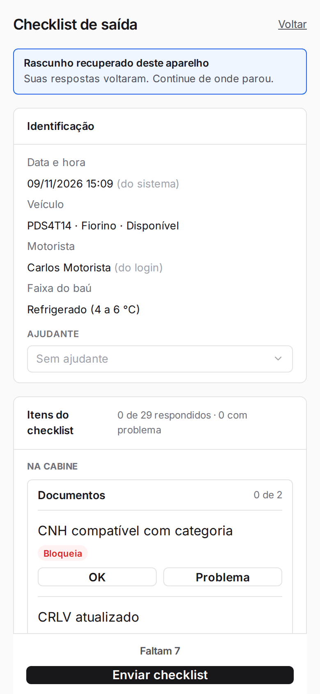

## Fazer e enviar o checklist de saída

<Steps>
  <Step title="Abrir o checklist">
    No **Meu dia**, toque em **Checklist de saída** (ou leia o QR code). O quadro **Identificação** mostra data e hora, veículo, motorista (do login) e a faixa do baú. Se tiver ajudante, escolha-o no campo **Ajudante**.

    
  </Step>
  <Step title="Responder cada item">
    Em **Itens do checklist**, toque em **OK** ou **Problema** em cada item. O contador mostra quantos já foram respondidos. Itens marcados **Bloqueia** são críticos.

    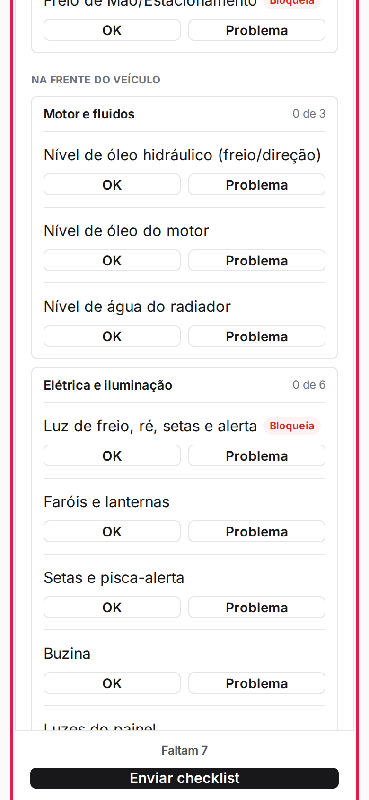

    Um grupo em que tudo está OK se recolhe sozinho; toque no nome do grupo para abrir de novo.

    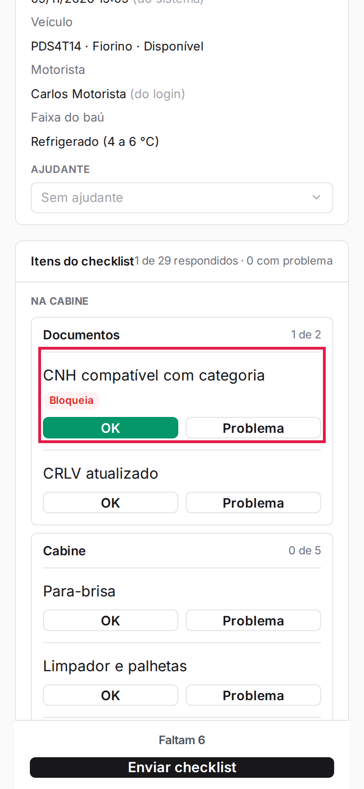
  </Step>
  <Step title="Informar KM e refrigeração">
    Em **KM e refrigeração**, preencha **KM do odômetro** e tire a foto do painel; informe **Temperatura do baú agora (°C)**, **Temperatura programada no Thermo King (°C)** e tire a foto do visor.

    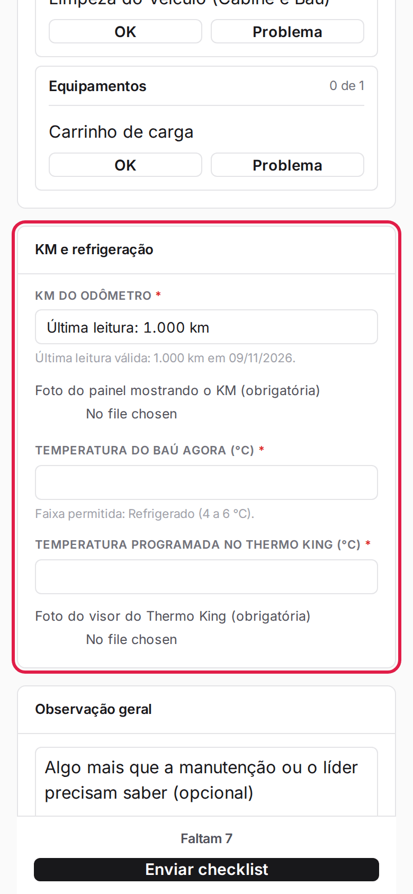
  </Step>
  <Step title="Marcar a declaração">
    Se quiser, escreva uma **Observação geral**. Marque a declaração "Declaro que as informações são verdadeiras e que conferi o veículo pessoalmente".
  </Step>
  <Step title="Enviar">
    Quando aparecer "Pronto para enviar", toque em **Enviar checklist**. Você vai para a tela de resultado.

    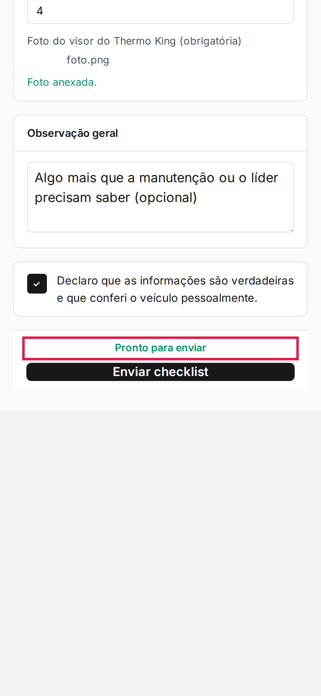
  </Step>
</Steps>

<Note>
Enquanto faltar algo, o botão mostra "Faltam N". O que você já preencheu fica guardado no aparelho (rascunho) e é apagado quando envia ou na virada do dia. Se já houve um envio do mesmo tipo no dia, o sistema pergunta se você quer fazer um novo envio. Se você não está escalado no veículo, o checklist fica registrado no seu nome.

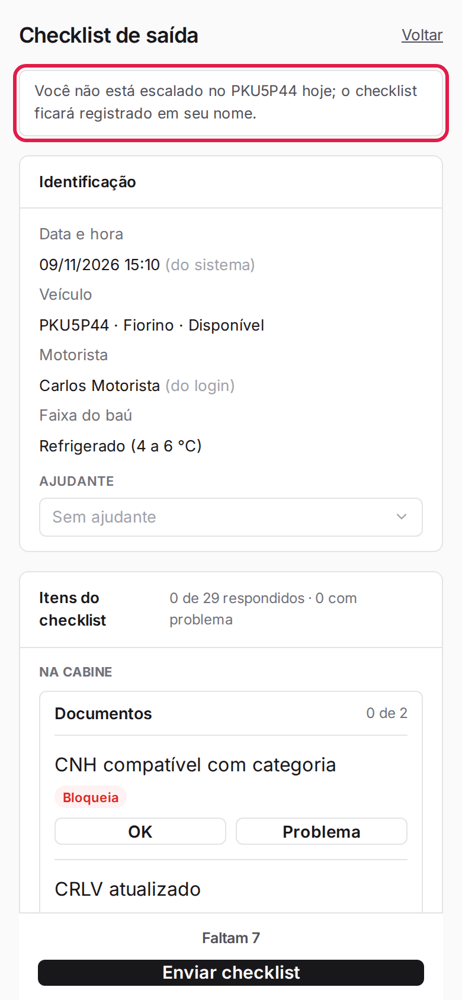
</Note>

## Corrigir pendências, KM e temperatura

<Steps>
  <Step title="Tentar enviar incompleto">
    Ao tocar em **Enviar checklist** com algo faltando, aparece o quadro "Antes de enviar, resolva:" com as pendências (itens sem resposta, KM, fotos, temperatura, declaração).

    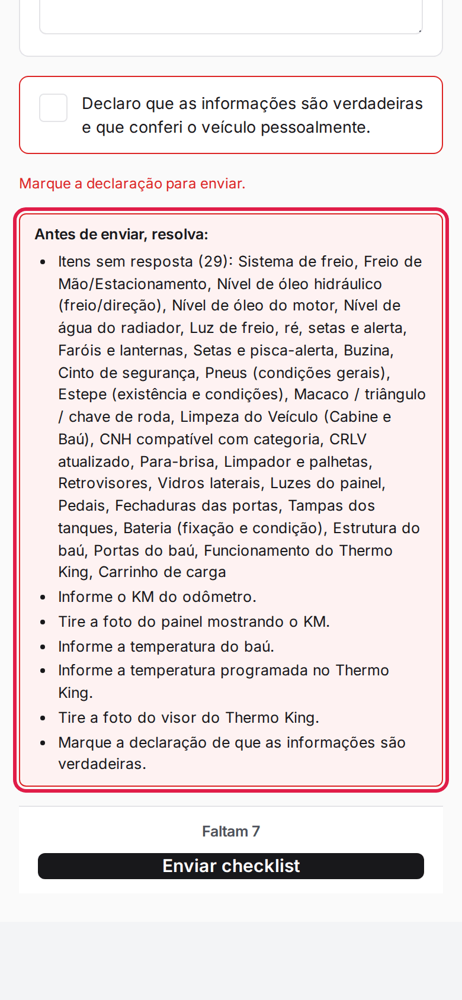
  </Step>
  <Step title="Conferir o KM">
    O KM não pode ser menor que a última leitura do veículo, e um salto grande em poucos dias (acima de 800 km por dia) é recusado: confira o odômetro.

    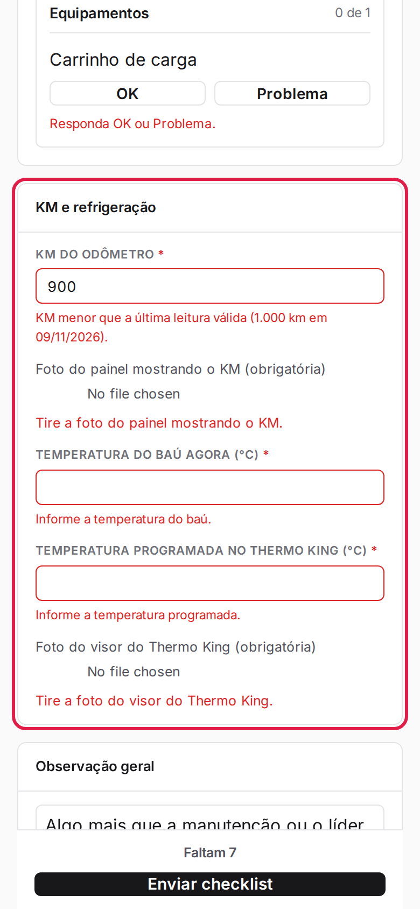
  </Step>
  <Step title="Conferir a temperatura">
    Se a temperatura do baú estiver fora da faixa do veículo, o campo avisa que o veículo será bloqueado.

    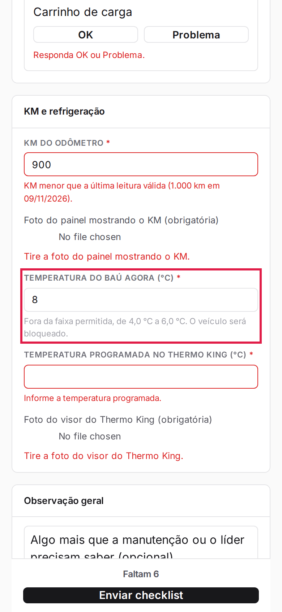
  </Step>
</Steps>

<Warning>
Temperatura fora da faixa permitida bloqueia o veículo quando o checklist for enviado.
</Warning>

Com a temperatura fora da faixa e o envio feito, o resultado mostra o veículo bloqueado:

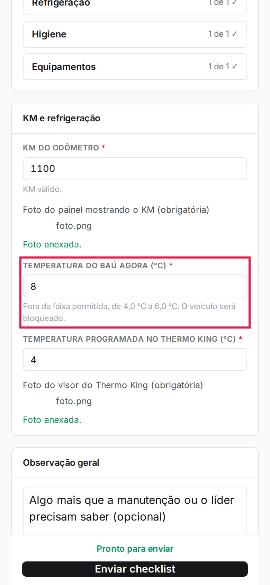

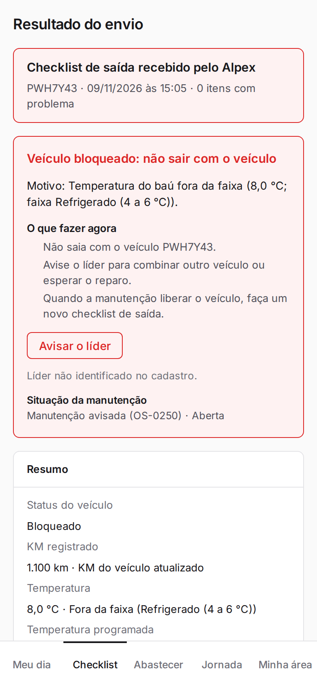

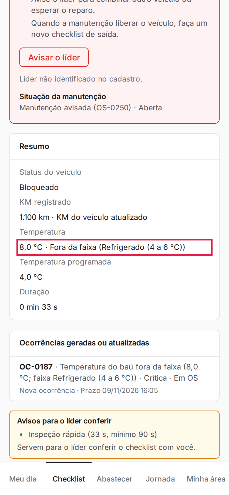

## Registrar um item com problema (NOK) com foto

<Steps>
  <Step title="Tocar em Problema">
    No item com defeito, toque em **Problema**. Se o item for crítico, aparece "Este item bloqueia o veículo até o reparo".

    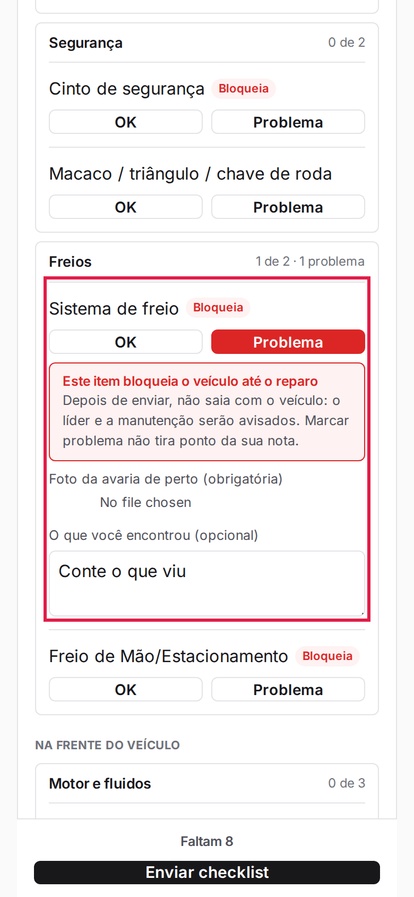
  </Step>
  <Step title="Tirar a foto">
    Em **Foto da avaria de perto**, anexe a foto (obrigatória na maioria dos itens críticos). Sem a foto, o envio é barrado.

    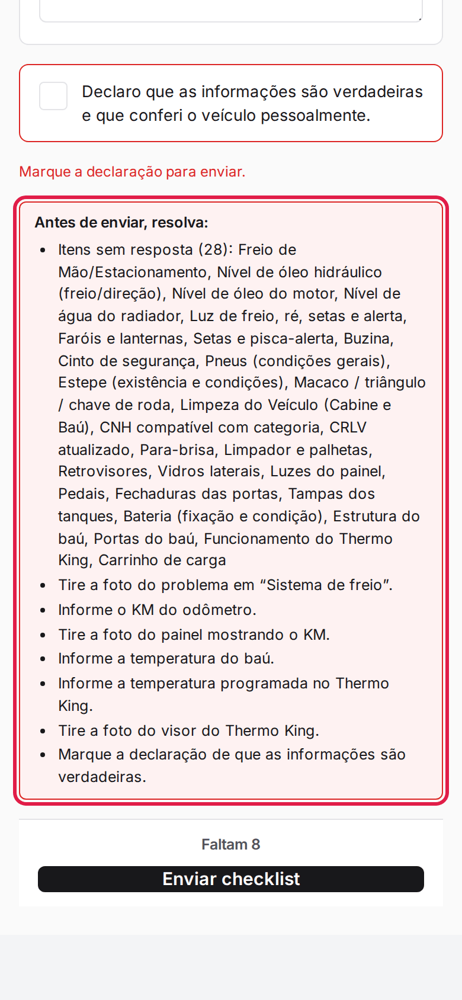
  </Step>
  <Step title="Descrever o que encontrou">
    Em **O que você encontrou (opcional)**, escreva o que viu.

    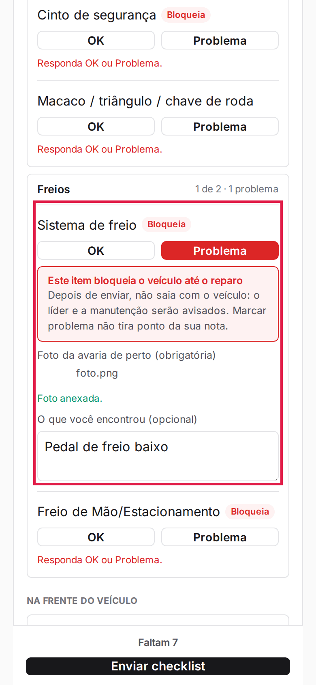
  </Step>
  <Step title="Conferir o contador e enviar">
    O contador passa a mostrar quantos itens estão com problema. Termine o checklist e toque em **Enviar checklist**.

    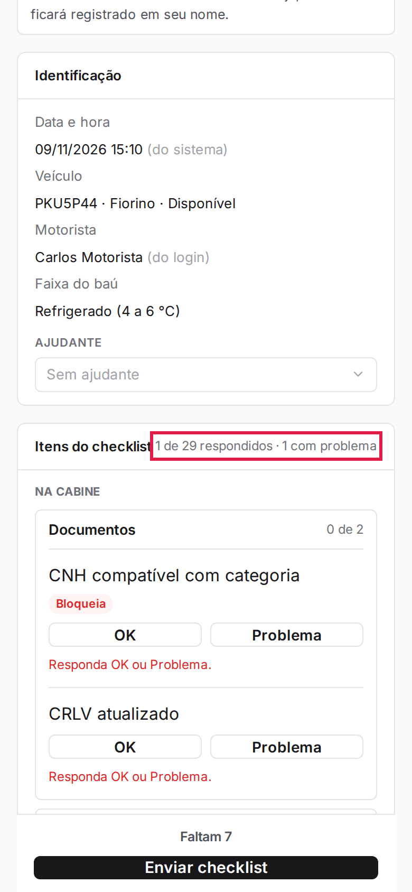
  </Step>
</Steps>

<Note>
Marcar problema não tira ponto da sua nota. Item crítico com problema bloqueia o veículo, abre uma ocorrência e avisa o líder e a manutenção.
</Note>

## Fazer o checklist de retorno

<Steps>
  <Step title="Abrir o checklist de retorno">
    Depois de enviar a saída, no **Meu dia** toque em **Checklist de retorno**.

    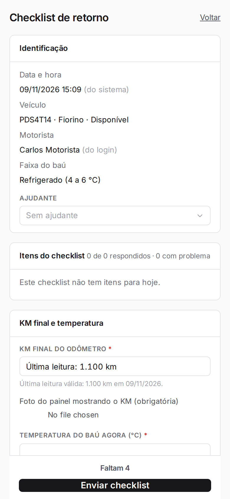
  </Step>
  <Step title="Responder e informar o KM final">
    Responda os itens, preencha **KM final do odômetro** com a foto do painel e a temperatura do baú. Marque a declaração e toque em **Enviar checklist**.

    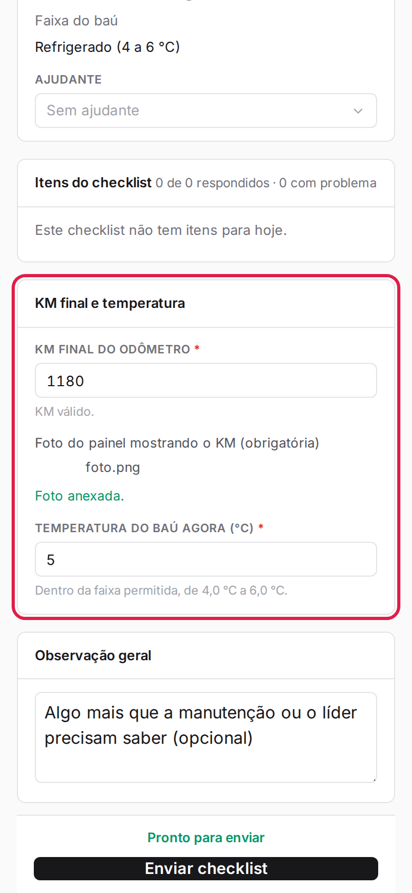
  </Step>
</Steps>

<Note>
O retorno só abre se houve uma saída liberada ("Sem saída liberada"). Modelos de veículo sem checklist de retorno mostram "Checklist de retorno desativado"; avise o líder se algo aconteceu na rota.
</Note>

## Sair do checklist sem enviar

<Steps>
  <Step title="Tocar em Voltar">
    No alto, toque em **Voltar**. Abre a janela "Sair do checklist".

    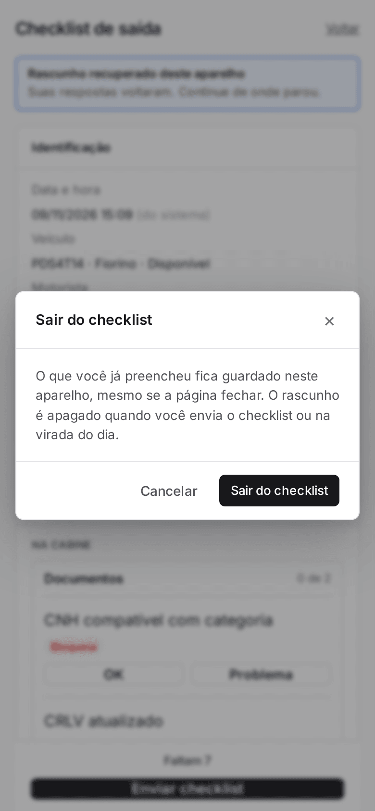
  </Step>
  <Step title="Escolher">
    **Cancelar** continua o checklist; **Sair do checklist** leva ao Meu dia.
  </Step>
</Steps>

<Note>
O que você preencheu fica guardado neste aparelho. Ao voltar, aparece "Rascunho recuperado deste aparelho" e o Meu dia oferece **Continuar checklist**. As fotos podem precisar ser tiradas de novo.
</Note>

## Confirmar um reparo da manutenção

<Steps>
  <Step title="Abrir o checklist de saída do veículo">
    Depois que a manutenção conclui a ordem de serviço, o defeito fica "Aguardando confirmação". No checklist de saída aparece o quadro **Reparos para confirmar**, com os defeitos que a manutenção disse ter corrigido.

    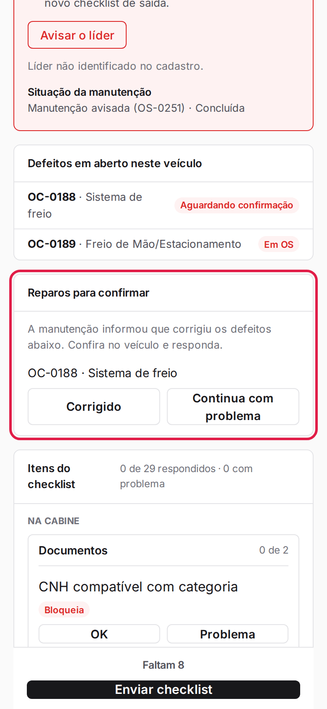
  </Step>
  <Step title="Conferir no veículo e responder">
    Olhe o veículo e toque em **Corrigido** (o reparo foi feito) ou em **Continua com problema** (o defeito ainda existe).

    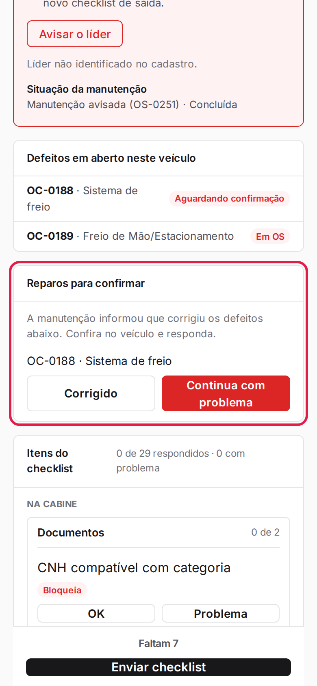

    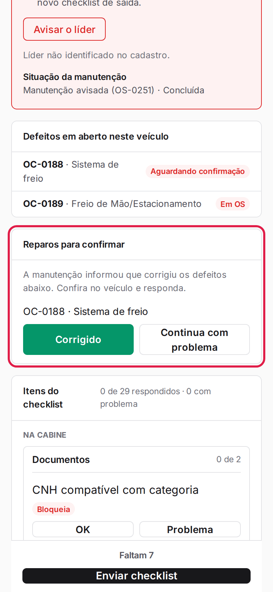
  </Step>
  <Step title="Terminar e enviar">
    Responda os itens do checklist e envie. O resultado traz o quadro **Reparos confirmados**.

    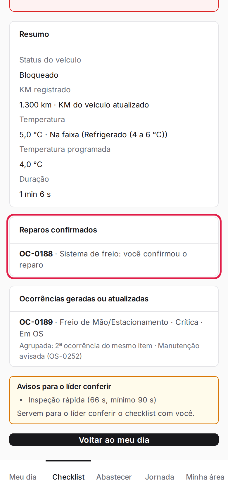
  </Step>
</Steps>

<Note>
É preciso responder todos os reparos listados para enviar o checklist. Se você marcar **Continua com problema**, o defeito volta para a manutenção.
</Note>

## Enviar um segundo checklist no mesmo dia

<Steps>
  <Step title="Enviar o checklist">
    Se já existe um checklist do mesmo tipo para o veículo no dia, o aviso "Checklist de saída já enviado hoje" aparece no alto e, ao tocar em **Enviar checklist**, abre a janela de confirmação.

    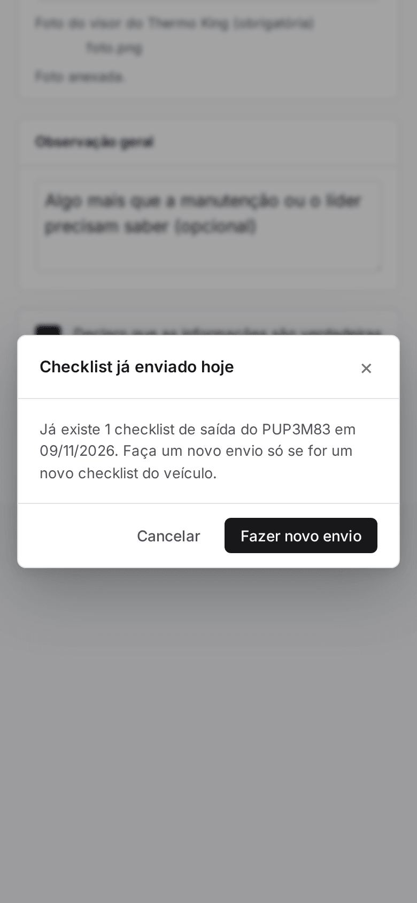
  </Step>
  <Step title="Escolher">
    **Cancelar** volta ao checklist; **Fazer novo envio** envia mesmo assim.
  </Step>
  <Step title="Ver o resultado">
    Se o mesmo item continua com problema, a ocorrência é agrupada com a anterior: "Agrupada: 2ª ocorrência do mesmo item".

    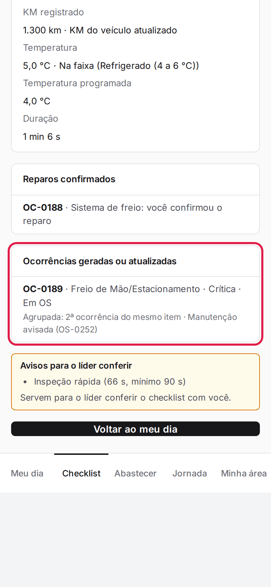
  </Step>
</Steps>

<Note>
Faça um novo envio só se for um novo checklist do veículo.
</Note>
