**Menu:** 1904 - Meu dia (motorista)

Registro auxiliar da jornada do dia: início, pausas, retorno e fim, com os limites de direção contínua, pausa e jornada diária. Não substitui o ponto oficial da empresa.

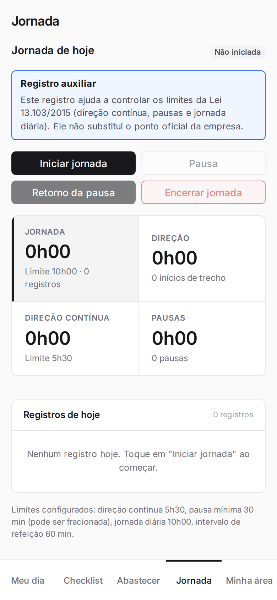

## Iniciar, pausar, retomar e encerrar a jornada

<Steps>
  <Step title="Iniciar a jornada">
    Ao começar, toque em **Iniciar jornada**. O estado vira "Em direção".

    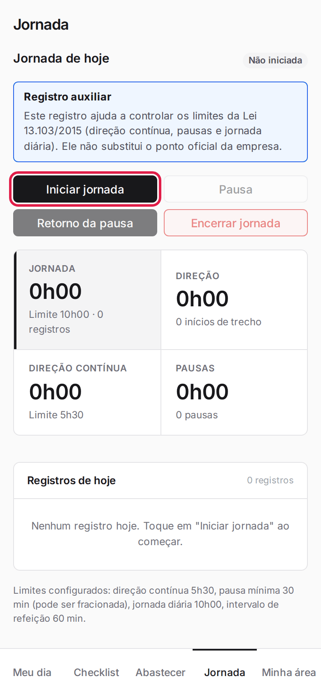

    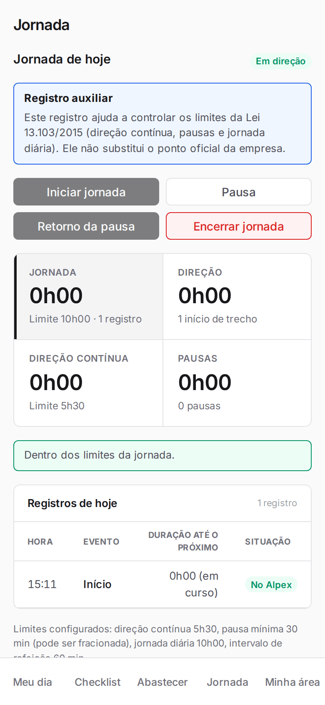
  </Step>
  <Step title="Registrar uma pausa">
    Toque em **Pausa** quando parar. O estado vira "Em pausa".

    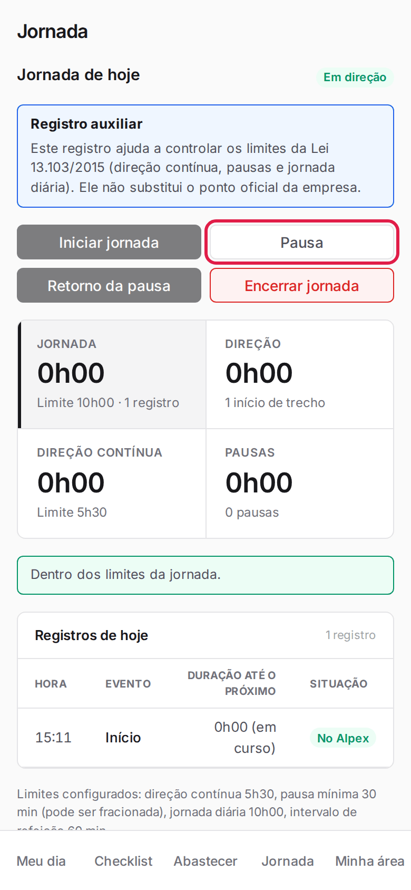

    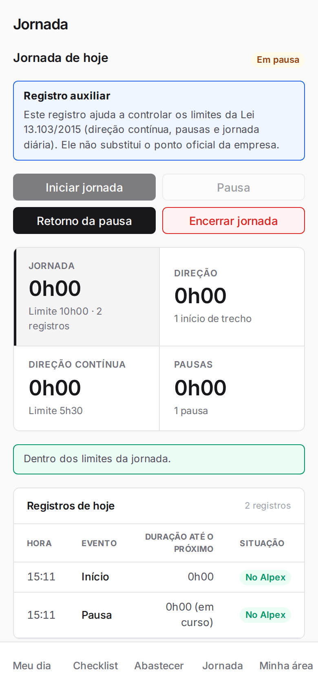
  </Step>
  <Step title="Voltar da pausa">
    Toque em **Retorno da pausa**. A tabela **Registros de hoje** mostra cada evento.

    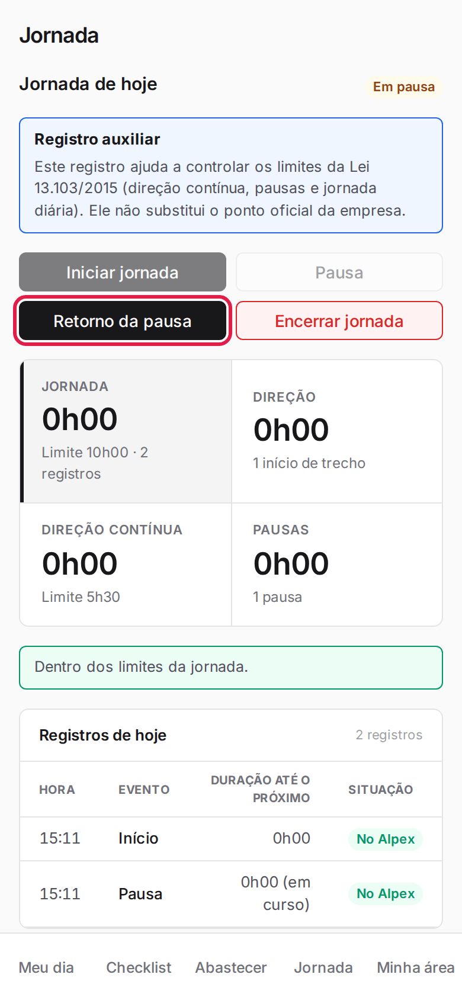

    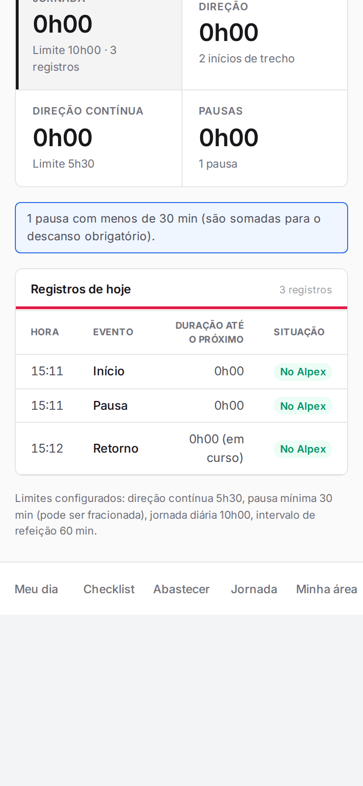
  </Step>
  <Step title="Encerrar a jornada">
    Toque em **Encerrar jornada** e confirme em **Encerrar jornada** na janela.

    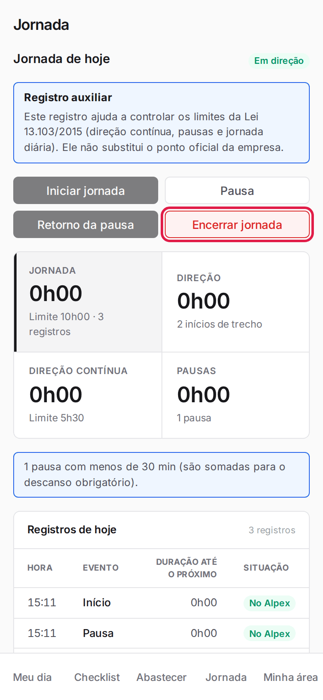

    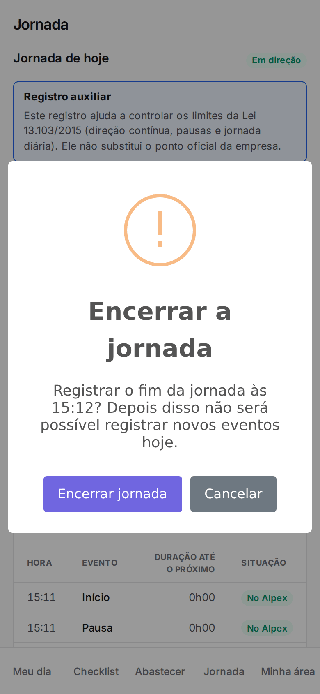

    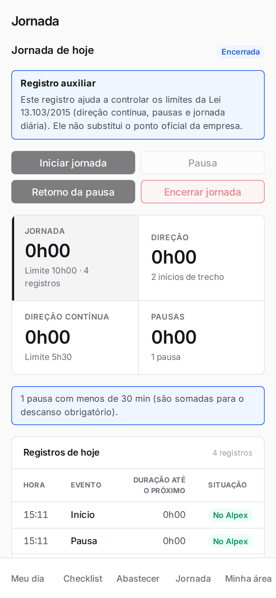
  </Step>
</Steps>

<Warning>
Depois de encerrada, não é possível registrar novos eventos no mesmo dia.
</Warning>

<Note>
Só os botões possíveis no momento ficam habilitados (por exemplo, antes de iniciar só **Iniciar jornada**). Avisos de limite aparecem acima da tabela, e pausas curtas são somadas para o descanso obrigatório.
</Note>

## Filtrar os registros pelos indicadores

<Steps>
  <Step title="Tocar em um indicador">
    Toque em **Jornada**, **Direção**, **Direção contínua** ou **Pausas** para filtrar a tabela.

    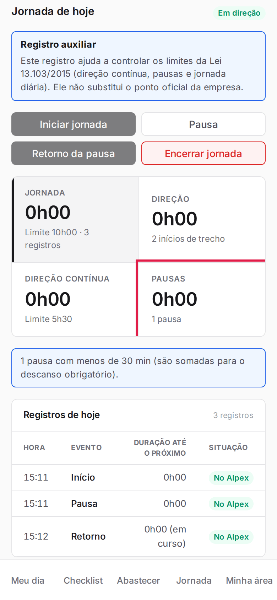
  </Step>
  <Step title="Ver a tabela filtrada">
    A tabela mostra só os registros do indicador.

    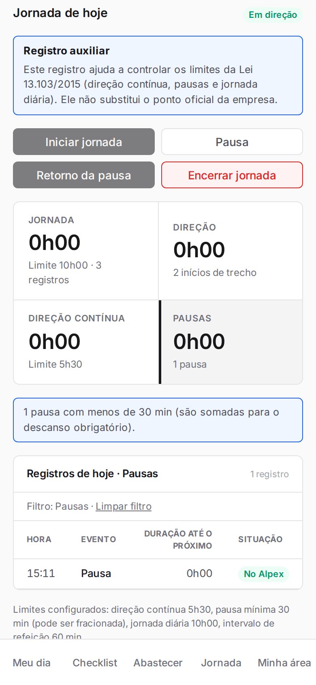
  </Step>
  <Step title="Limpar o filtro">
    Toque em **Limpar filtro** ou no indicador de novo.
  </Step>
</Steps>
