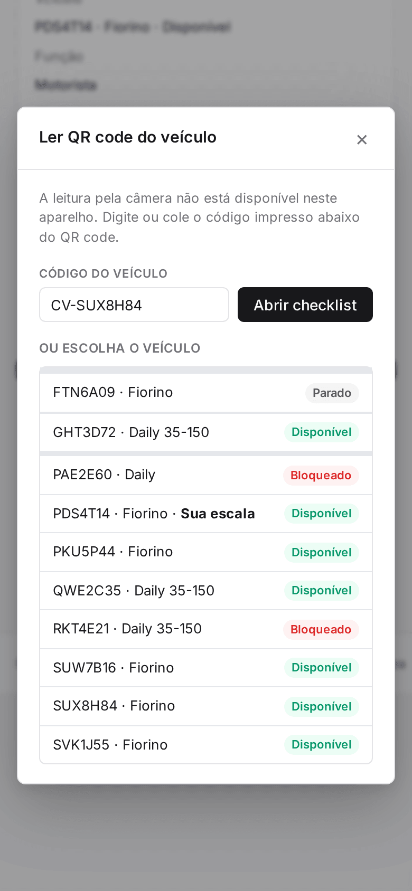
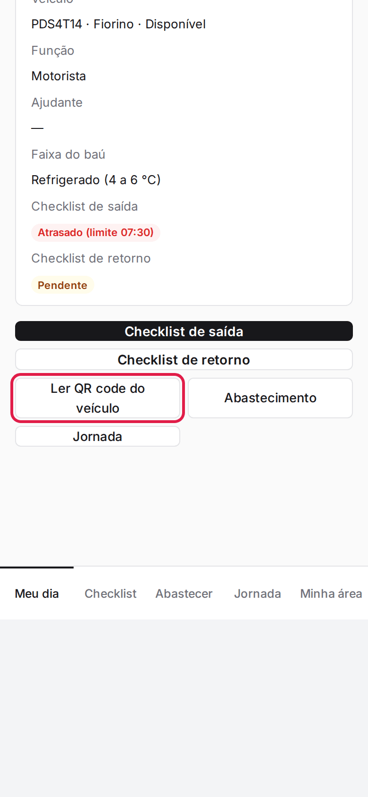
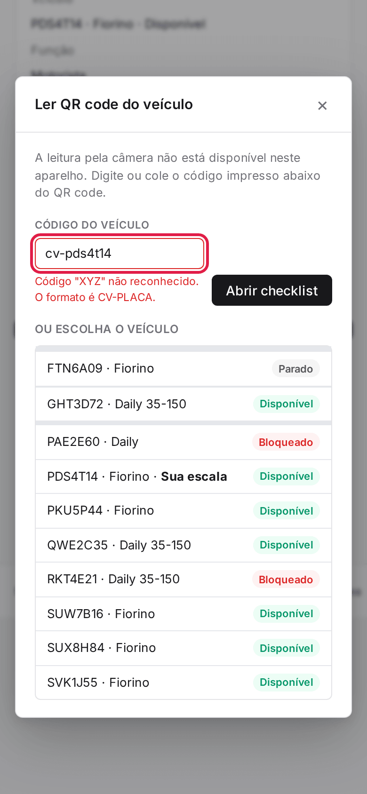
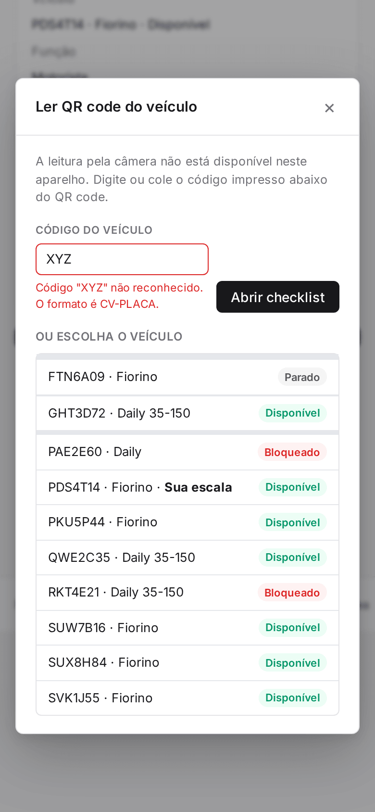
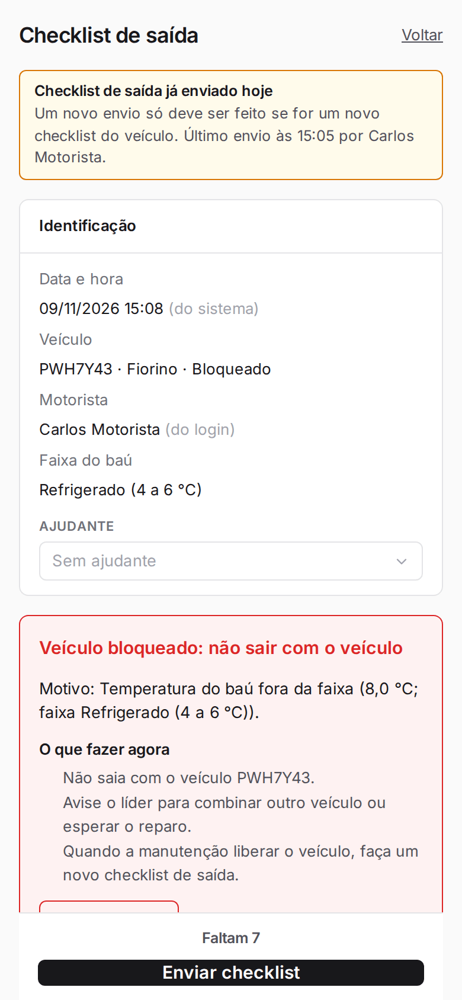
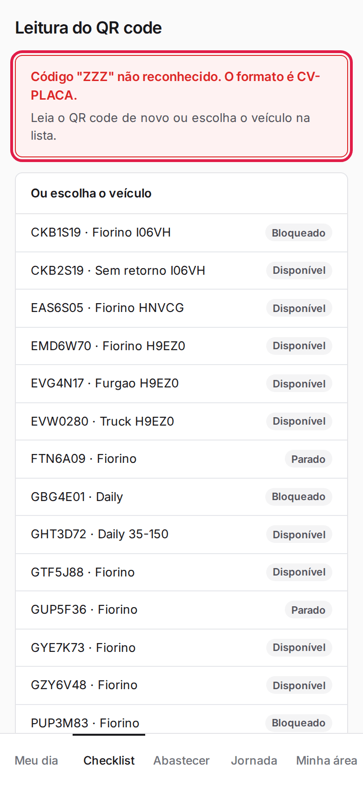

**Menu:** 1904 - Meu dia (motorista)

Serve para abrir o checklist de saída do veículo certo: pelo QR code colado no veículo ou escolhendo o veículo na lista. Abre como uma janela sobre o Meu dia, ao tocar em **Ler QR code do veículo**.

## Abrir o checklist pelo código do veículo

<Steps>
  <Step title="Abrir a leitura">
    No **Meu dia**, toque em **Ler QR code do veículo**.

    
  </Step>
  <Step title="Informar o código">
    Se a câmera não estiver disponível, digite ou cole no campo **Código do veículo** o código impresso abaixo do QR code, no formato CV-PLACA.

    
  </Step>
  <Step title="Abrir o checklist">
    Toque em **Abrir checklist**. Abre o checklist de saída do veículo.
  </Step>
</Steps>

<Note>
Código vazio ou fora do formato é recusado ("Código "XYZ" não reconhecido. O formato é CV-PLACA."). Apontar a câmera do celular para o QR code impresso também abre o checklist direto.

</Note>

## Abrir o checklist pela câmera do celular

<Steps>
  <Step title="Apontar a câmera do celular">
    Aponte o aplicativo de câmera do celular para o QR code colado no veículo e toque no link que aparece. O Alpex abre já logado, no checklist de saída do veículo.

    
  </Step>
  <Step title="Se o código não for reconhecido">
    Uma etiqueta fora do formato CV-PLACA mostra o aviso e a lista de veículos para escolher.

    
  </Step>
</Steps>

<Note>
A leitura é feita pela câmera do próprio celular; dentro do Alpex não há leitor de câmera, por isso a janela "Ler QR code do veículo" pede para digitar o código.
</Note>

## Escolher o veículo na lista

<Steps>
  <Step title="Ver a lista">
    Na janela, role até **Ou escolha o veículo**. Cada linha traz a placa, o modelo e a situação; o veículo da sua escala vem marcado como **Sua escala**.

    
  </Step>
  <Step title="Tocar no veículo">
    Toque na linha do veículo para abrir o checklist de saída dele.
  </Step>
</Steps>
