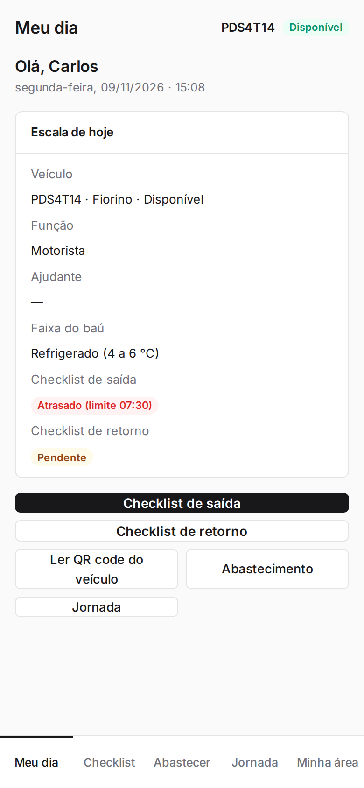
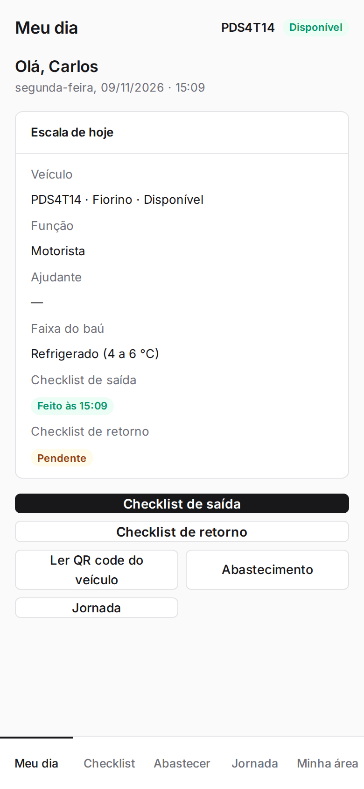
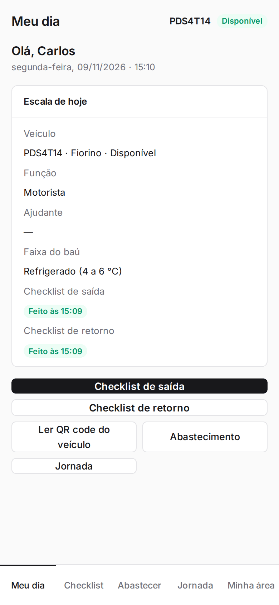
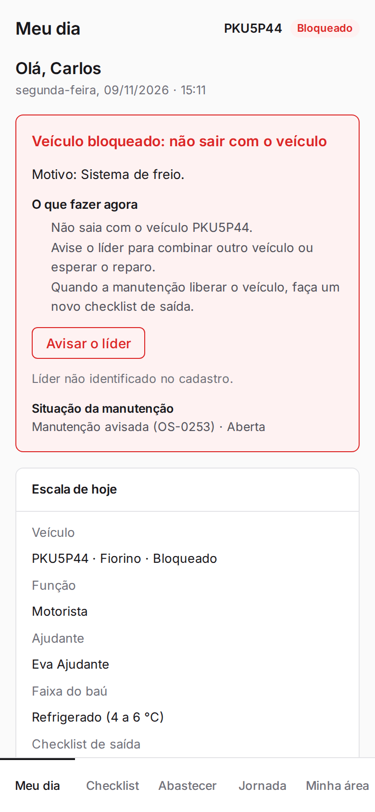
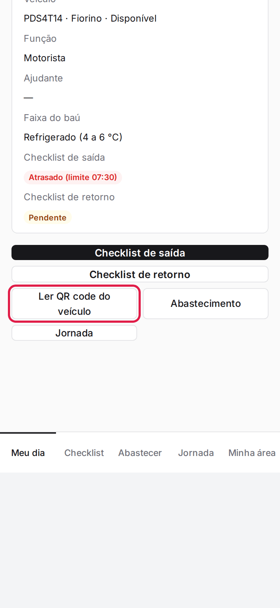

**Menu:** 1904 - Meu dia (motorista)

É a tela inicial do motorista no celular. Mostra o veículo da sua escala de hoje, a situação dos checklists de saída e de retorno e os atalhos para o checklist, o QR code, o abastecimento e a jornada. A barra de baixo leva a **Meu dia**, **Checklist**, **Abastecer**, **Jornada** e **Minha área**.

## Conferir a escala e a situação do dia

<Steps>
  <Step title="Abrir o Meu dia">
    No menu **1904 - Meu dia (motorista)** ou na aba **Meu dia** da barra de baixo. No alto aparecem a placa do veículo e a situação dele (Disponível, Bloqueado etc.).
  </Step>
  <Step title="Ler o cartão Escala de hoje">
    O cartão mostra o veículo, sua função, o ajudante, a faixa de temperatura do baú e a situação do **Checklist de saída** (por exemplo, "Atrasado (limite 07:30)") e do **Checklist de retorno** ("Pendente").

    
  </Step>
  <Step title="Depois de enviar a saída">
    A situação passa a "Feito às HH:MM" e fica disponível o botão **Checklist de retorno**.

    
  </Step>
  <Step title="Depois de enviar o retorno">
    As duas situações ficam como feitas.

    
  </Step>
</Steps>

<Note>
Sem escala hoje, a tela avisa "Sem escala hoje" e o botão do checklist abre a leitura do QR code, para você escolher o veículo. Se você começou um checklist e saiu, o botão vira **Continuar checklist (X de 29)**. Se a sua CNH estiver vencida ou perto de vencer, aparece o aviso "Seus documentos".
</Note>

## Ver o aviso de veículo bloqueado

<Steps>
  <Step title="Abrir o Meu dia com o veículo bloqueado">
    No alto da tela aparece o quadro vermelho **Veículo bloqueado: não sair com o veículo**, com o motivo, o que fazer agora e a situação da manutenção (número da OS).

    
  </Step>
  <Step title="Avisar o líder">
    Toque em **Avisar o líder** (veja a ação na tela "Veículo bloqueado").
  </Step>
</Steps>

<Note>
Com o veículo bloqueado, o botão **Checklist de saída** some e o retorno fica como "Sem saída liberada". Quando a manutenção liberar o veículo, faça um novo checklist de saída.
</Note>

## Usar os atalhos do dia

<Steps>
  <Step title="Escolher o atalho">
    Toque em **Checklist de saída**, **Checklist de retorno**, **Ler QR code do veículo**, **Abastecimento** ou **Jornada**.

    
  </Step>
</Steps>
