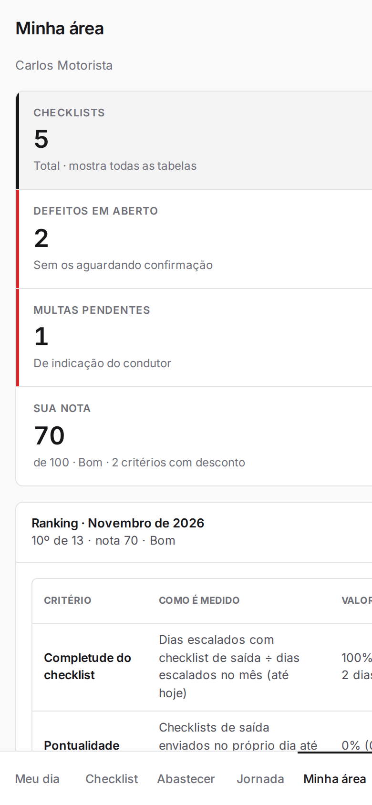
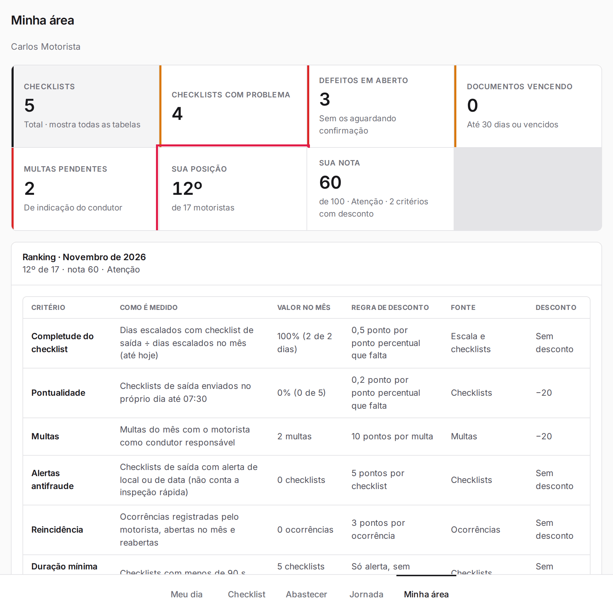
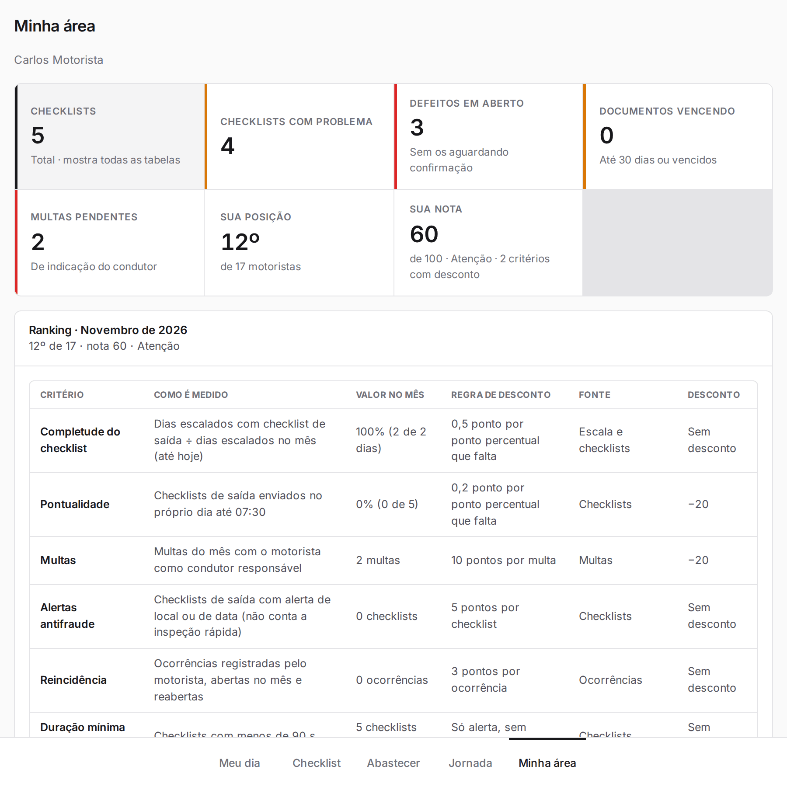
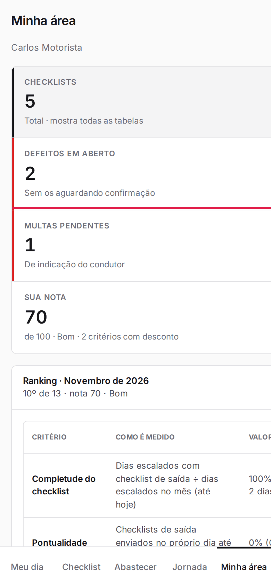
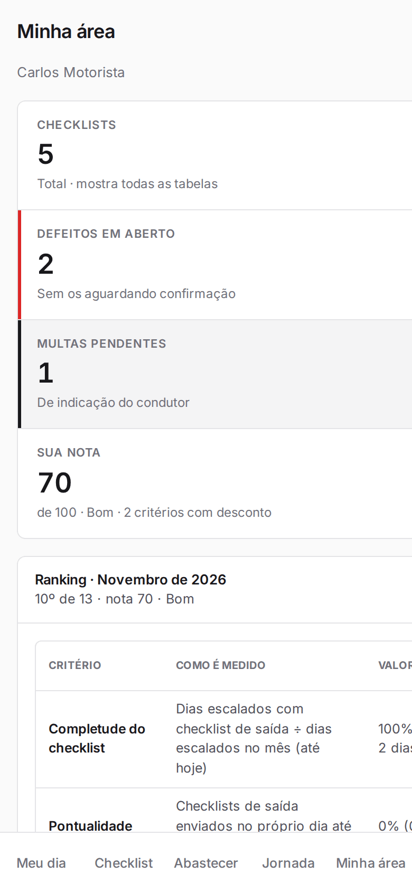

**Menu:** 1909 - Minha área (motorista)

Mostra o seu resumo: checklists enviados, defeitos em aberto, documentos vencendo, multas pendentes, sua posição e nota no ranking do mês.

## Ver seu resumo, nota e ranking

<Steps>
  <Step title="Abrir a Minha área">
    No menu **1909 - Minha área (motorista)** ou na aba **Minha área** da barra de baixo.
  </Step>
  <Step title="Ler os indicadores">
    Veja **Checklists**, **Checklists com problema**, **Defeitos em aberto**, **Documentos vencendo**, **Multas pendentes**, **Sua posição** e **Sua nota**.
  </Step>
  <Step title="Ver o ranking">
    O quadro **Ranking** lista cada critério, como é medido e o desconto. A nota começa em 100, só tem descontos e zera a cada mês.
  </Step>
  <Step title="Ver as listas">
    Abaixo ficam **Meus checklists**, **Defeitos abertos nos meus veículos**, **Meus documentos** e **Minhas multas**.
  </Step>
</Steps>

Em tela mais larga (tablet ou computador) todos os indicadores aparecem, inclusive **Sua posição**:

<Note>
Esta tela foi feita para tela larga: no celular, parte do conteúdo fica fora da tela e é melhor usar o aparelho deitado.
</Note>

## Filtrar as listas por indicador

<Steps>
  <Step title="Tocar em um indicador">
    Por exemplo, **Multas pendentes**.

    
  </Step>
  <Step title="Ver o resultado">
    As listas mostram só o que se refere ao indicador.

    
  </Step>
  <Step title="Voltar a tudo">
    Toque em **Checklists** ("Total · mostra todas as tabelas") ou no mesmo indicador de novo.
  </Step>
</Steps>

<Note>
**Sua nota** mostra só os critérios com desconto. As multas aparecem como informação e não podem ser editadas aqui.
</Note>
