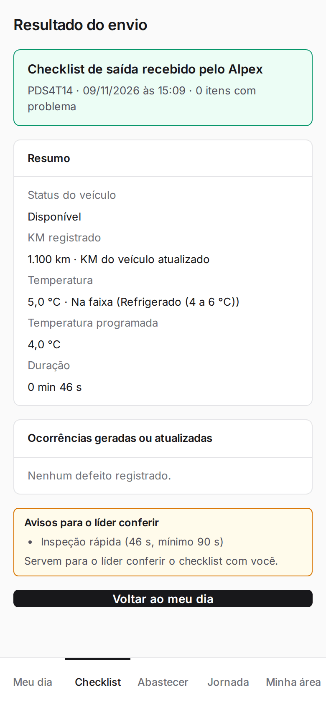
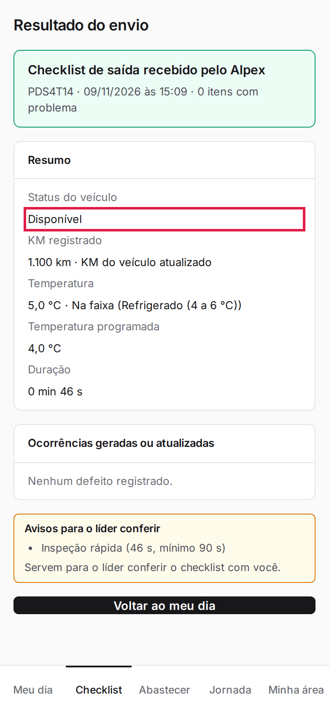
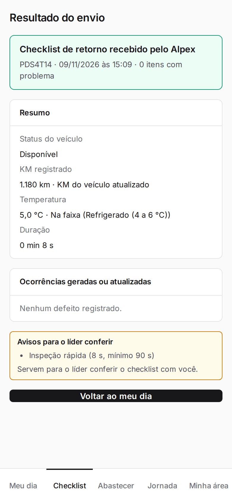
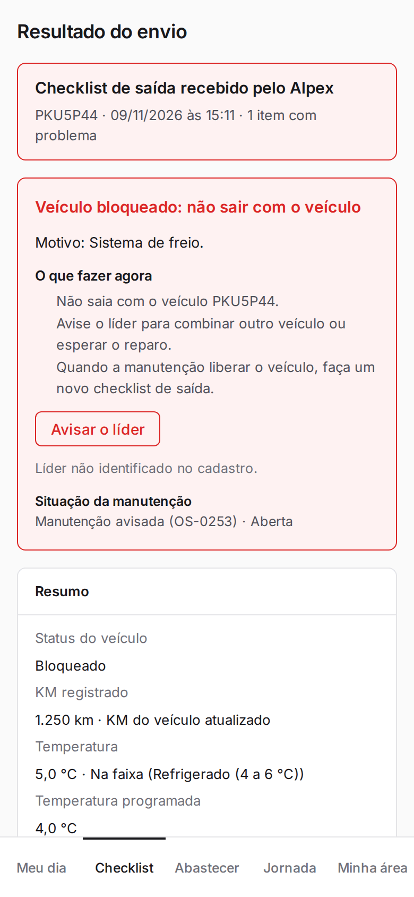
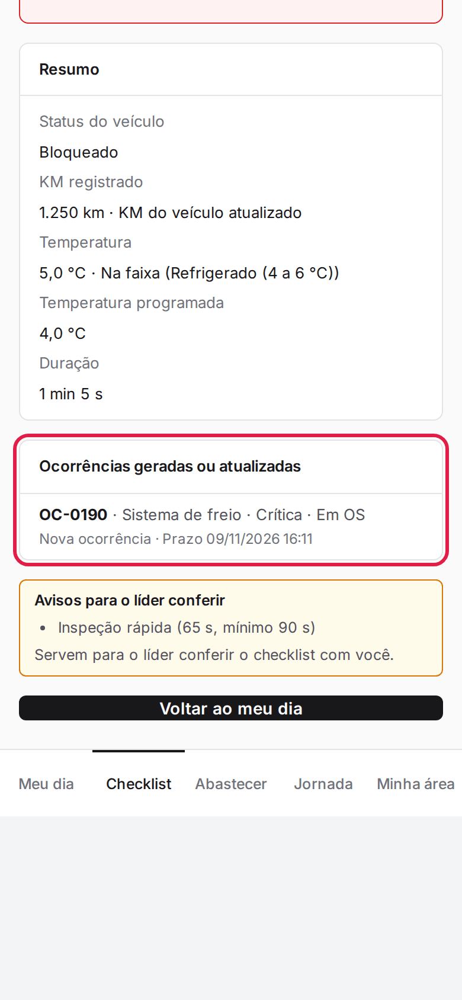
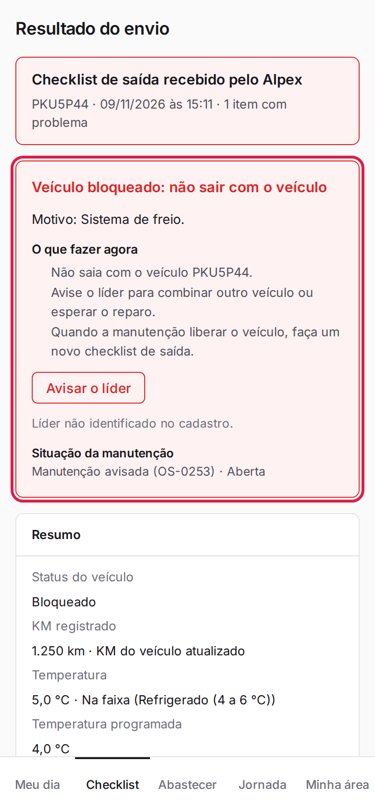

**Menu:** 1904 - Meu dia (motorista)

Aparece logo depois de enviar um checklist e mostra o que o Alpex recebeu: situação do veículo, KM, temperatura e as ocorrências geradas.

## Ler o resultado do envio

<Steps>
  <Step title="Ver o título">
    O quadro verde "Checklist de saída recebido pelo Alpex" indica que o envio foi recebido, com placa, data, hora e quantidade de itens com problema.
  </Step>
  <Step title="Conferir o Resumo">
    Veja **Status do veículo**, **KM registrado**, **Temperatura**, **Temperatura programada** e **Duração**.

    
  </Step>
  <Step title="Ver o resultado de um retorno">
    O checklist de retorno mostra o mesmo resumo.

    
  </Step>
  <Step title="Voltar">
    Toque em **Voltar ao meu dia**.
  </Step>
</Steps>

<Note>
Se houver "Avisos para o líder conferir" (por exemplo, inspeção feita em menos de 90 segundos), eles servem para o líder conversar com você sobre o checklist.
</Note>

## Ler o resultado com item crítico (veículo bloqueado)

<Steps>
  <Step title="Ver o quadro vermelho">
    Com item crítico com problema, o título fica vermelho e aparece **Veículo bloqueado: não sair com o veículo**, com o motivo, o que fazer e a situação da manutenção (OS aberta).

    
  </Step>
  <Step title="Conferir as ocorrências">
    Em **Ocorrências geradas ou atualizadas**, veja o número da ocorrência (OC-xxxx), o item e o prazo.

    
  </Step>
  <Step title="Avisar o líder">
    Toque em **Avisar o líder** no quadro de bloqueio.

    
  </Step>
</Steps>

<Note>
Se o mesmo item já tinha ocorrência aberta, o resultado mostra "Agrupada: 2ª ocorrência do mesmo item" (veja "Enviar um segundo checklist no mesmo dia" na tela Checklist).
</Note>
