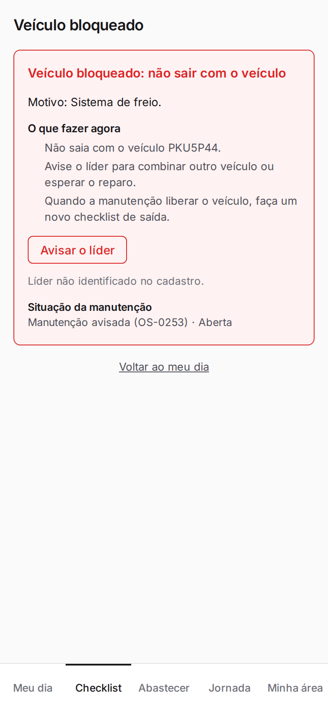
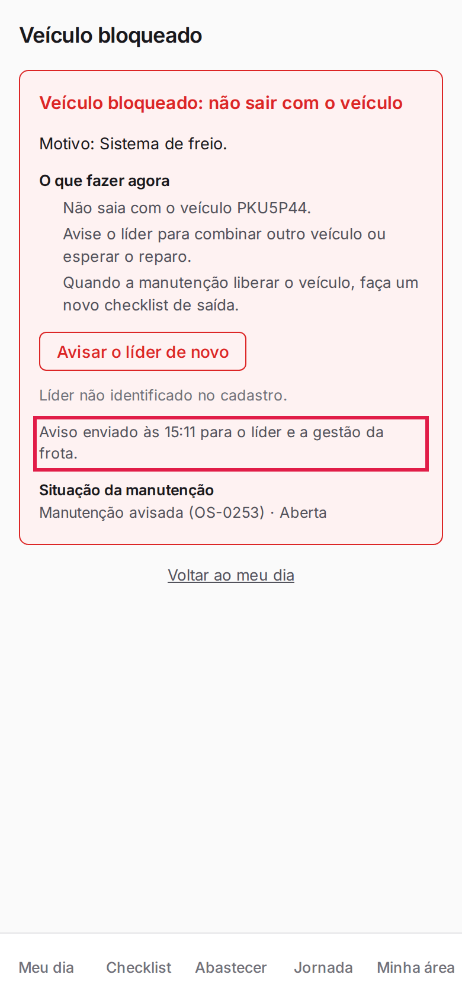
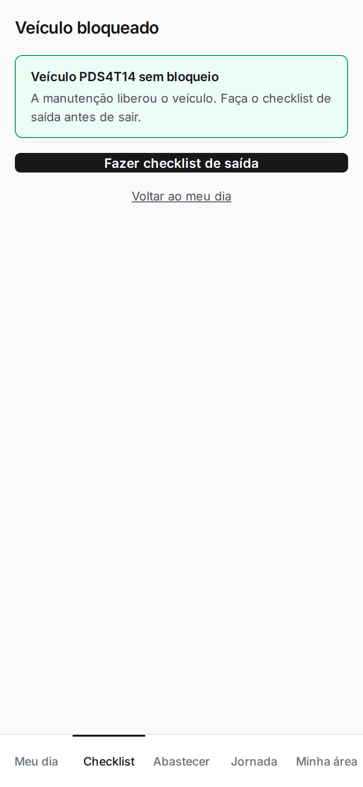

**Menu:** 1904 - Meu dia (motorista)

Mostra por que o veículo está bloqueado, o que fazer e a situação da manutenção, e permite avisar o líder. Abre pelo quadro de bloqueio do Meu dia ou do resultado do envio.

## Avisar o líder sobre o bloqueio

<Steps>
  <Step title="Ler o motivo">
    Veja o **Motivo**, a previsão de liberação (quando houver) e os passos em **O que fazer agora**.
  </Step>
  <Step title="Avisar o líder">
    Toque em **Avisar o líder**. Se o líder tiver telefone cadastrado, também aparece **Ligar para o líder**.
  </Step>
  <Step title="Confirmar o aviso">
    Aparece "Aviso enviado às HH:MM para o líder e a gestão da frota", e o botão vira **Avisar o líder de novo**.

    
  </Step>
</Steps>

<Note>
Não saia com o veículo bloqueado. Quando a manutenção liberar, faça um novo checklist de saída. Se o veículo não estiver bloqueado, a tela diz "Veículo sem bloqueio" e oferece o checklist de saída.

</Note>
