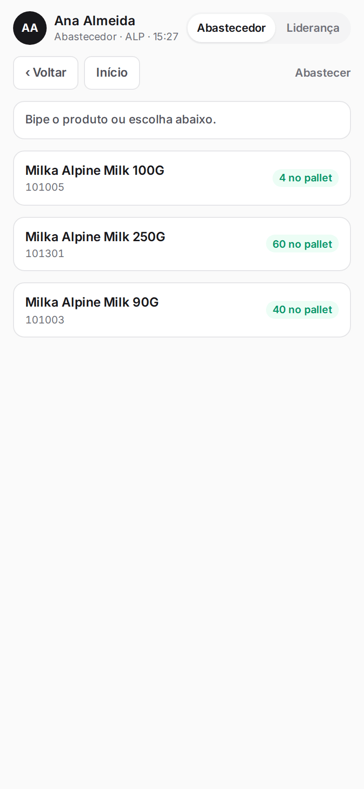
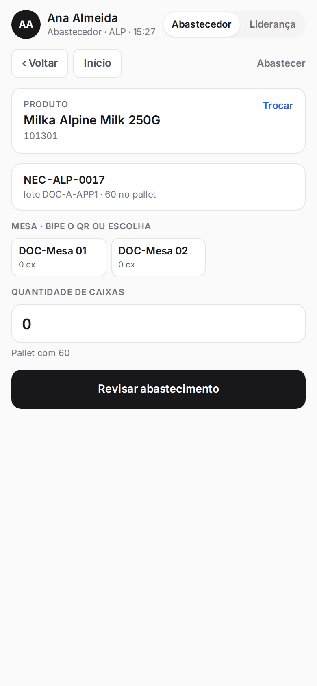
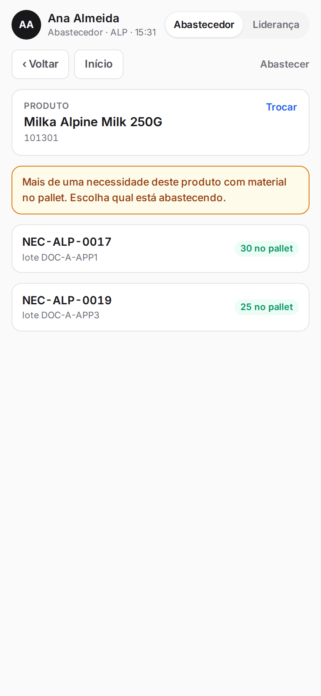
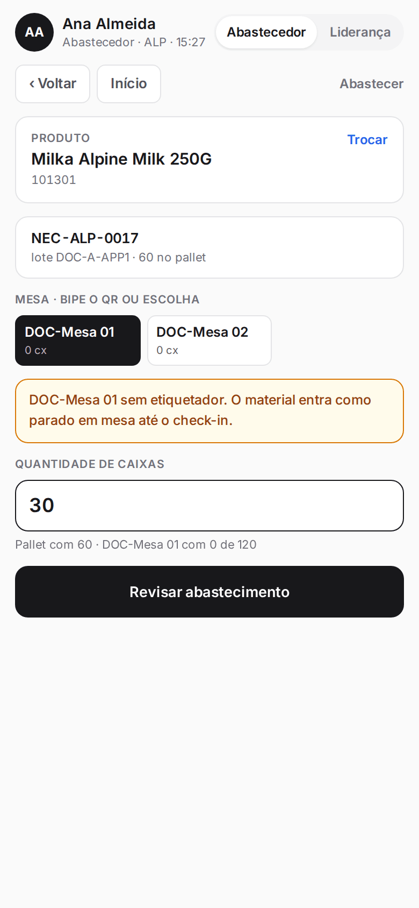
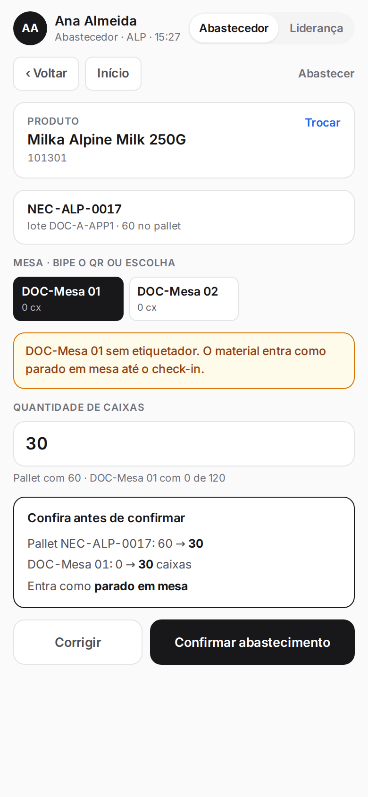
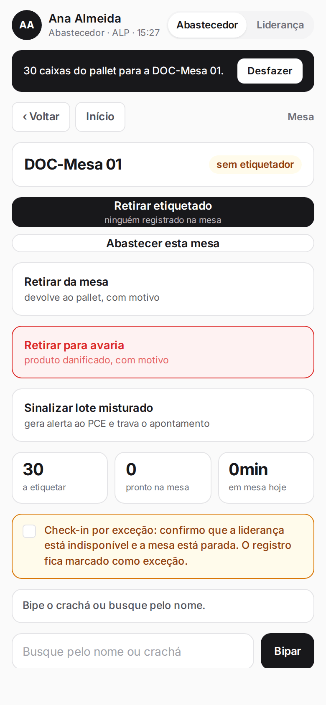
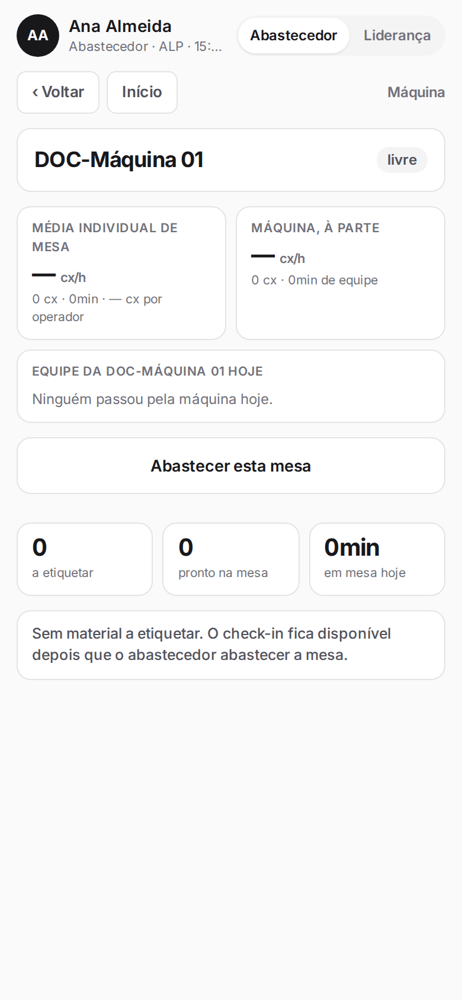
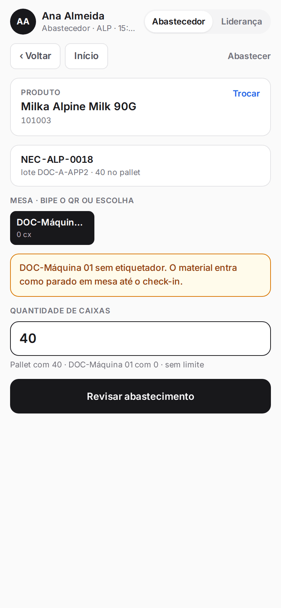
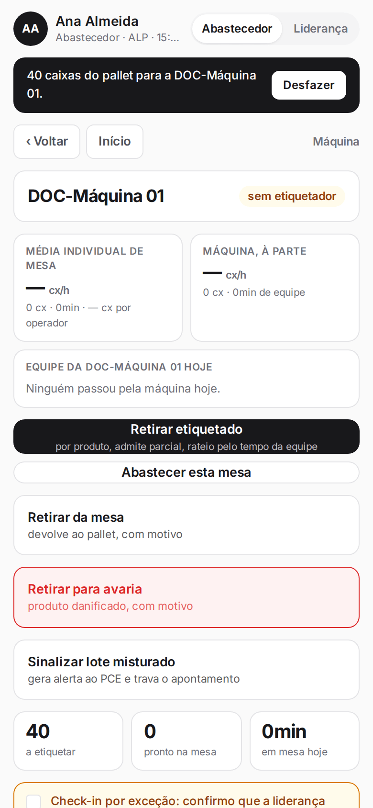

**Menu:** 1702 - Aplicativo de mesa, Abastecedor, Abastecer  
**Perfis:** Abastecedor

Abastecer é levar caixas do pallet (material já liberado pela qualidade) para uma mesa ou para a máquina. O abastecedor escolhe o produto, a mesa e a quantidade, confere o resultado e confirma.

## Abastecer uma mesa

<Steps>
  <Step title="Escolher o produto">
    No painel, toque em **Abastecer**. A lista mostra os produtos liberados pela qualidade, com o saldo **no pallet**. Toque no produto ou bipe o código dele.

    
  </Step>
  <Step title="Escolher a necessidade, se houver mais de uma">
    Quando o mesmo produto tem mais de uma necessidade com material no pallet, o aplicativo pede para escolher qual está abastecendo. Toque na necessidade (chave e lote).

    
  </Step>
  <Step title="Escolher a mesa e a quantidade">
    Toque na mesa de destino (ou bipe o QR dela) e digite a **Quantidade de caixas**. Abaixo do campo aparece o saldo do pallet e da mesa, com o limite de caixas por mesa.

    
  </Step>
  <Step title="Revisar">
    Toque em **Revisar abastecimento**. A caixa "Confira antes de confirmar" mostra como ficam o pallet e a mesa, e como o material entra (por exemplo, "parado em mesa" quando ainda não há etiquetador).

    
  </Step>
  <Step title="Confirmar">
    Toque em **Confirmar abastecimento** (ou **Corrigir** para voltar). O aplicativo abre a mesa e mostra um aviso no topo com o botão **Desfazer**.

    
  </Step>
</Steps>

<Note>
A mesa tem um limite de caixas (padrão de 120; a máquina não tem limite). Se a mesa já tiver outro produto, o aplicativo pede a confirmação "Confirmo misturar produtos nesta mesa". O abastecimento fica bloqueado quando alguma mesa ficou sem fechamento no dia anterior, e é ação exclusiva do perfil Abastecedor. Mesa sem etiquetador recebe o material como "parado em mesa" até o check-in.
</Note>

## Abastecer a máquina

<Steps>
  <Step title="Abrir a máquina">
    No painel, toque no cartão da máquina e depois em **Abastecer esta mesa**.

    
  </Step>
  <Step title="Produto e quantidade">
    Escolha o produto e digite a **Quantidade de caixas**. A única mesa disponível é a própria máquina.

    
  </Step>
  <Step title="Revisar e confirmar">
    Toque em **Revisar abastecimento** e depois em **Confirmar abastecimento**. A tela da máquina volta com o material e o botão **Desfazer** no topo.

    
  </Step>
</Steps>

## Desfazer um abastecimento

<Steps>
  <Step title="Tocar em Desfazer">
    Logo depois de confirmar, o aviso preto no topo mostra o abastecimento feito. Toque em **Desfazer** para as caixas voltarem ao pallet.
  </Step>
</Steps>

<Note>
O desfazer só fica disponível logo após o abastecimento, e o sistema recusa se a mesa já teve outra movimentação com aquele material.
</Note>
