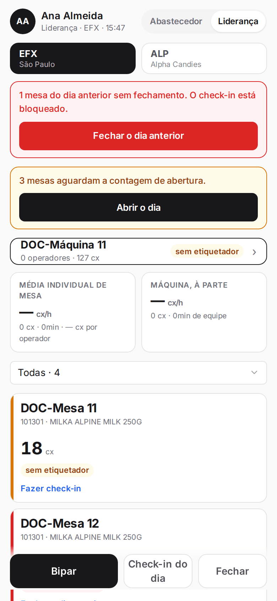
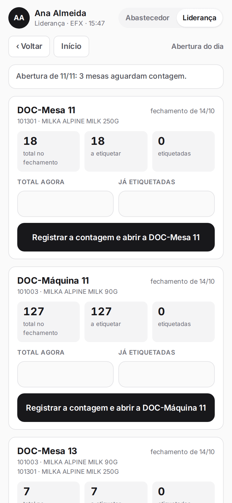
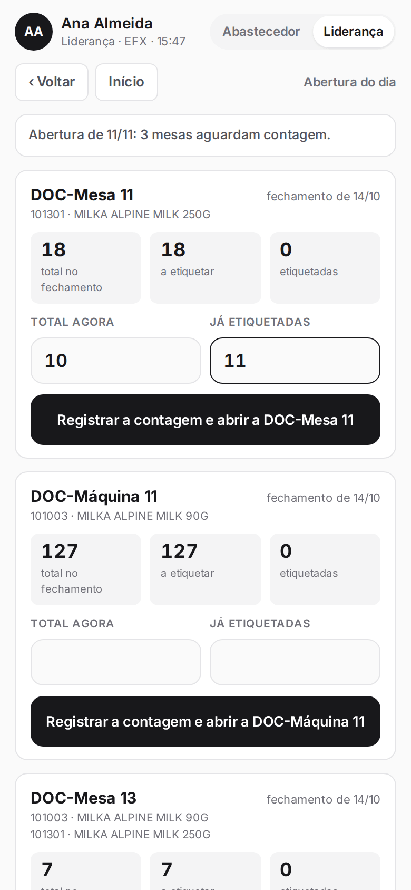

**Menu:** 1702 - Aplicativo de mesa, Liderança, Abrir o dia  
**Perfis:** Liderança

No começo do dia a liderança confere, mesa por mesa, o que ficou do dia anterior. É a contagem de abertura. Enquanto ela não é feita, o check-in da mesa fica bloqueado.

## Contar as mesas e abrir o dia

<Steps>
  <Step title="Abrir a tela">
    Com o perfil **Liderança**, toque em **Abrir o dia** no aviso "mesas aguardam a contagem de abertura".

    

    Cada cartão mostra o que o fechamento anterior registrou: **total no fechamento**, **a etiquetar** e **etiquetadas**.
  </Step>
  <Step title="Contar o que há na mesa">
    Conte as caixas fisicamente e preencha **Total agora** e **Já etiquetadas** de cada mesa. Informe zero quando estiver vazia.

    
  </Step>
  <Step title="Registrar">
    Toque em **Registrar a contagem e abrir a** (nome da mesa). Se a contagem conferiu com o fechamento, o aplicativo avisa que conferiu. Se não conferiu, a diferença vai para a homologação da gestão e o valor contado passa a valer como saldo do dia.
  </Step>
</Steps>

<Note>
As etiquetadas não podem passar do total. Só aparecem mesas ativas que tiveram fechamento em dia anterior e ainda não foram contadas. Se nenhuma aguarda contagem, a tela diz que não há pendência. As imagens desta ação mostram mesas de teste de outra filial, que tinham fechamento antigo aguardando contagem.
</Note>
