**Menu:** 1702 - Aplicativo de mesa, Liderança, Check-in do dia ou cartão da mesa  
**Perfis:** Liderança

Etiquetador é a pessoa que cola as etiquetas. A liderança amarra cada etiquetador a uma mesa (check-in) e o desamarra no fim (check-out). O tempo em mesa conta a partir do check-in e serve para medir a produtividade. Na máquina podem estar vários etiquetadores ao mesmo tempo.

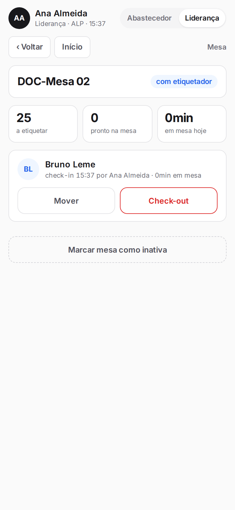

## Check-in do dia pelo crachá

<Steps>
  <Step title="Ver a amarração do dia">
    Com o perfil **Liderança**, toque em **Check-in do dia**. A tela mostra quantas mesas já têm etiquetador e lista as mesas com material a etiquetar.

    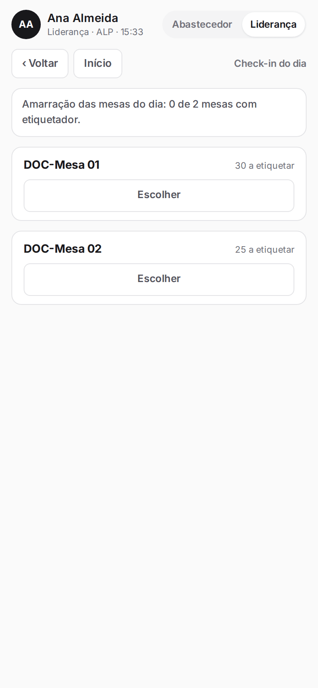
  </Step>
  <Step title="Bipar o crachá">
    Volte ao painel (**Início**), toque em **Bipar** e leia o crachá do etiquetador, ou digite o número do crachá.

    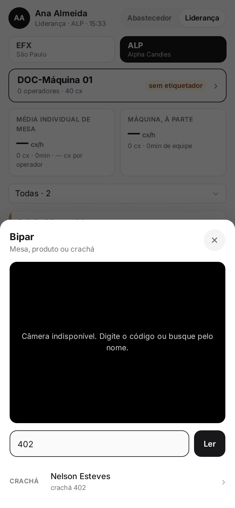
  </Step>
  <Step title="Escolher a mesa">
    O aplicativo mostra o nome do etiquetador. Em cada mesa aparece o botão **Amarrar (nome) aqui**. Toque na mesa certa. **Escolher** abre a mesa para outras opções.

    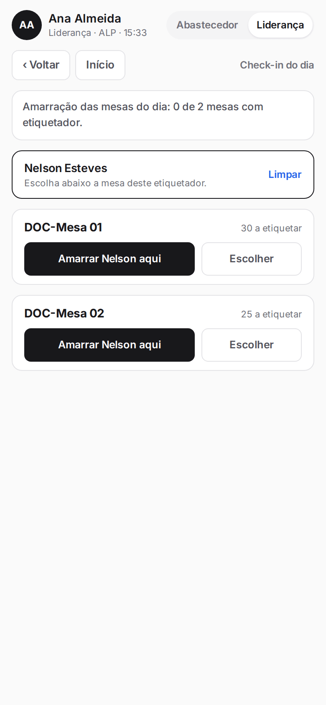
  </Step>
  <Step title="Conferir">
    Uma mensagem confirma o check-in e a hora. A mesa passa a mostrar o nome do etiquetador.

    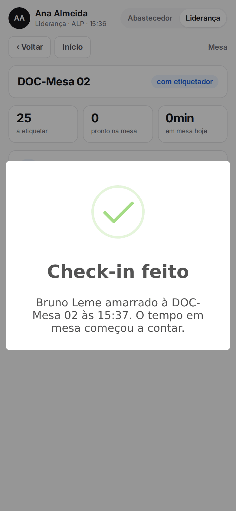

    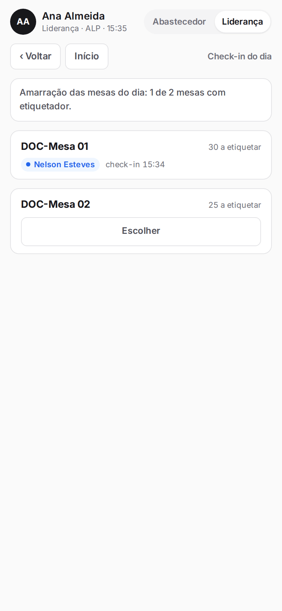
  </Step>
</Steps>

<Note>
Se a mesa teve etiquetador na véspera, o aplicativo sugere o mesmo (botão **Véspera: nome**). O check-in só é feito em mesa ativa com material a etiquetar, depois que o abastecedor abasteceu. Fica bloqueado se houver mesa sem fechamento do dia anterior ou aguardando contagem de abertura. O crachá não pode estar em outra mesa: faça o check-out lá antes. O primeiro registro de uma mesa vence.
</Note>

## Check-in dentro da mesa, buscando pelo nome

<Steps>
  <Step title="Abrir a mesa">
    No painel, toque no cartão da mesa sem etiquetador (ou em **Fazer check-in**).

    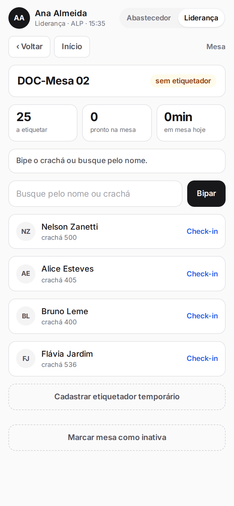
  </Step>
  <Step title="Buscar">
    Digite o nome ou o crachá em **Busque pelo nome ou crachá**, ou toque em **Bipar**. A lista mostra quem está disponível.

    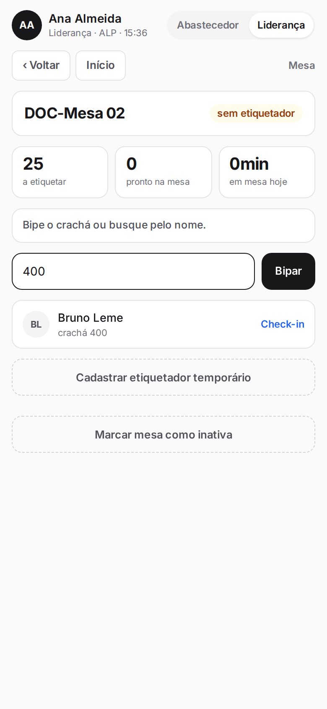
  </Step>
  <Step title="Fazer o check-in">
    Toque em **Check-in** na pessoa certa. Aparece a mensagem "Check-in feito" com a hora.
  </Step>
</Steps>

<Note>
Na máquina, repita o procedimento para cada operador: todos ficam na lista da equipe.
</Note>

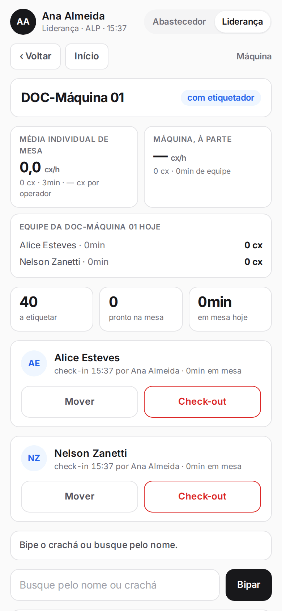

## Cadastrar um etiquetador temporário

<Steps>
  <Step title="Abrir o cadastro">
    Dentro da mesa, toque em **Cadastrar etiquetador temporário**.
  </Step>
  <Step title="Informar o nome">
    Digite o **Nome do etiquetador temporário** e toque em **Cadastrar e fazer check-in**. A pessoa recebe um crachá provisório e já fica amarrada à mesa.

    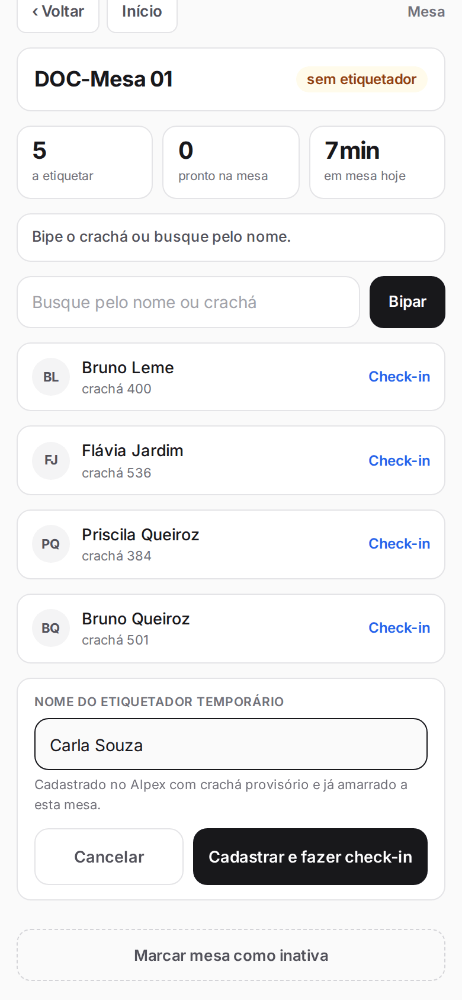
  </Step>
</Steps>

<Note>
Se já existir alguém ativo com o mesmo nome, o aplicativo mostra o crachá dessa pessoa e pede para buscá-la.
</Note>

## Mover um etiquetador para outra mesa

<Steps>
  <Step title="Tocar em Mover">
    Na mesa onde a pessoa está, toque em **Mover** no cartão dela.

    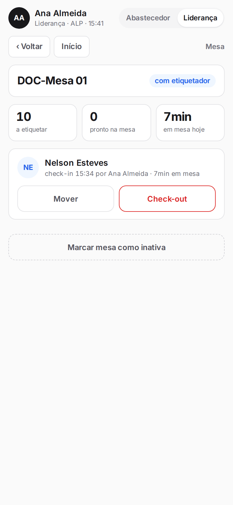
  </Step>
  <Step title="Escolher o destino">
    Escolha a **Mesa de destino** (somente mesas ativas e sem etiquetador) e toque em **Mover**.

    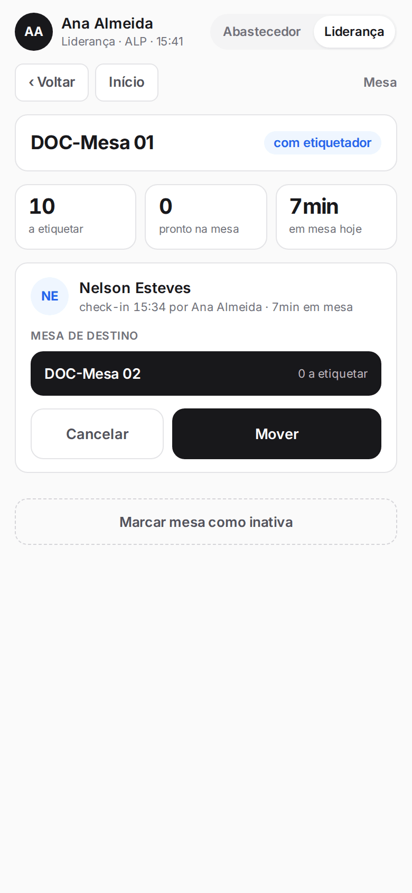
  </Step>
  <Step title="Confirmar">
    Leia o aviso e toque em **Confirmar e mover**. O tempo acumulado na mesa de origem fica guardado e o cronômetro começa do zero na mesa nova.

    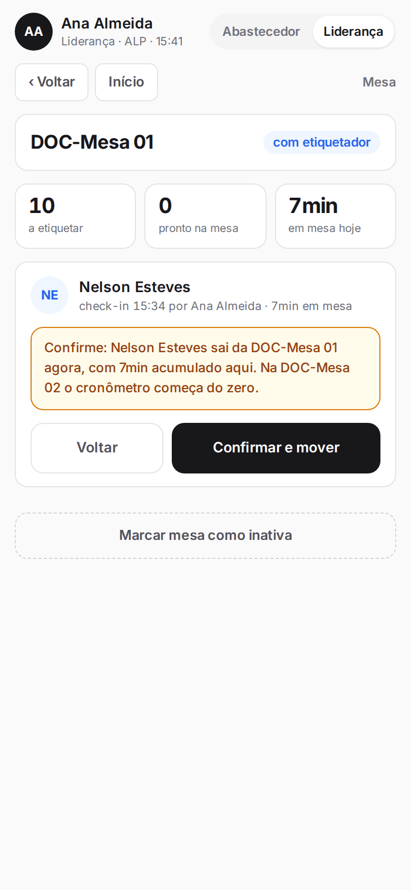

    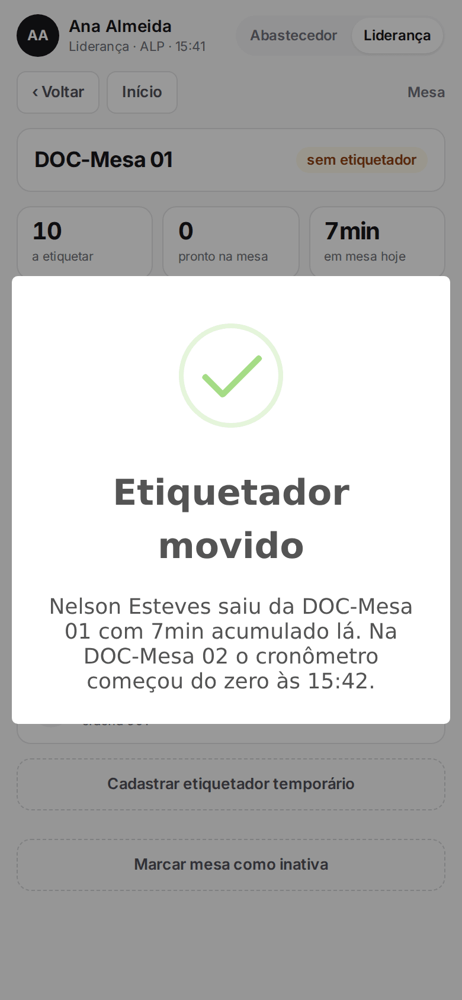
  </Step>
</Steps>

## Fazer o check-out

<Steps>
  <Step title="Tocar em Check-out">
    No cartão do etiquetador, toque em **Check-out**.
  </Step>
  <Step title="Informar as caixas prontas">
    Digite em **Caixas prontas** quantas caixas já etiquetadas ficaram na mesa (zero se não houver) e toque em **Confirmar check-out**.

    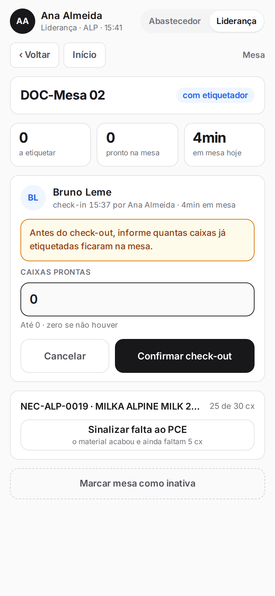
  </Step>
  <Step title="Conferir">
    A mensagem mostra o tempo em mesa da pessoa e quantas caixas prontas aguardam retirada.

    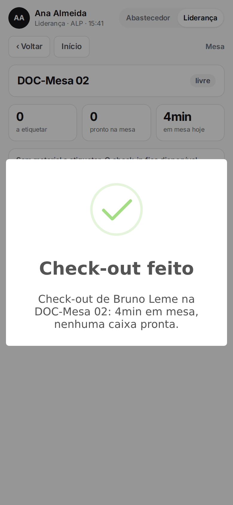
  </Step>
</Steps>

<Note>
O número de caixas prontas não pode passar do que há na mesa para etiquetar.
</Note>

## Check-in por exceção (abastecedor)

*Perfis: Abastecedor*

<Steps>
  <Step title="Marcar a exceção">
    Quando a liderança está indisponível e a mesa está parada, o abastecedor vê na mesa a caixa **Check-in por exceção**. Marque-a para confirmar e então busque ou bipe o crachá.

    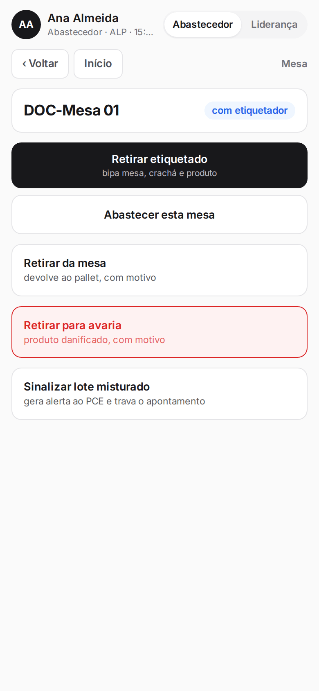
  </Step>
</Steps>

<Note>
O registro fica marcado como exceção. O normal é a liderança fazer o check-in. Mover etiquetador e fazer check-out são sempre da liderança.
</Note>
