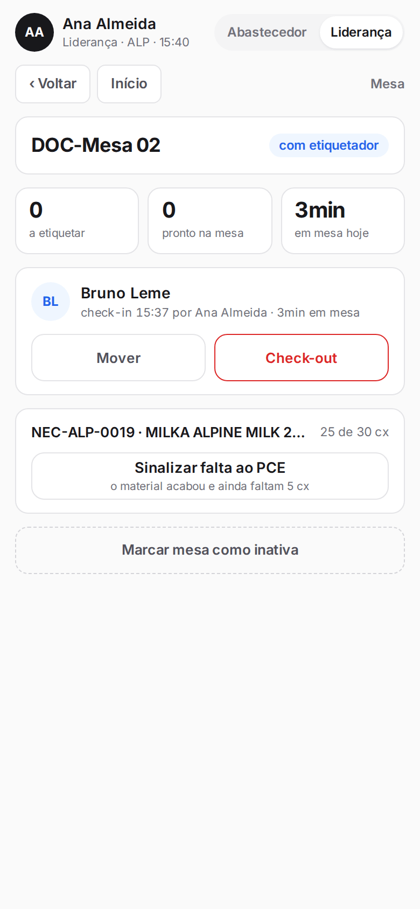
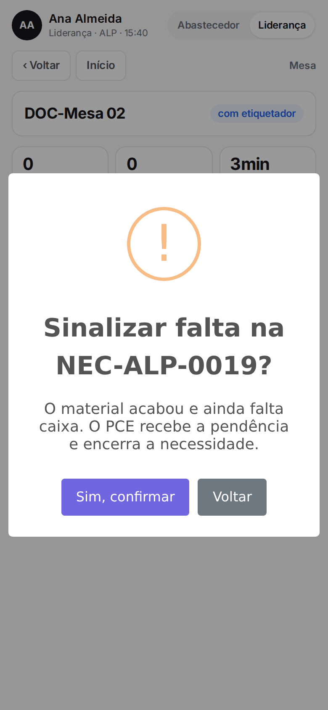
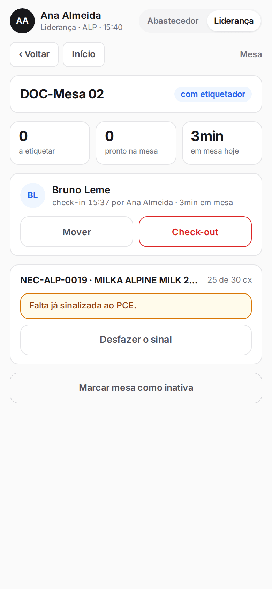
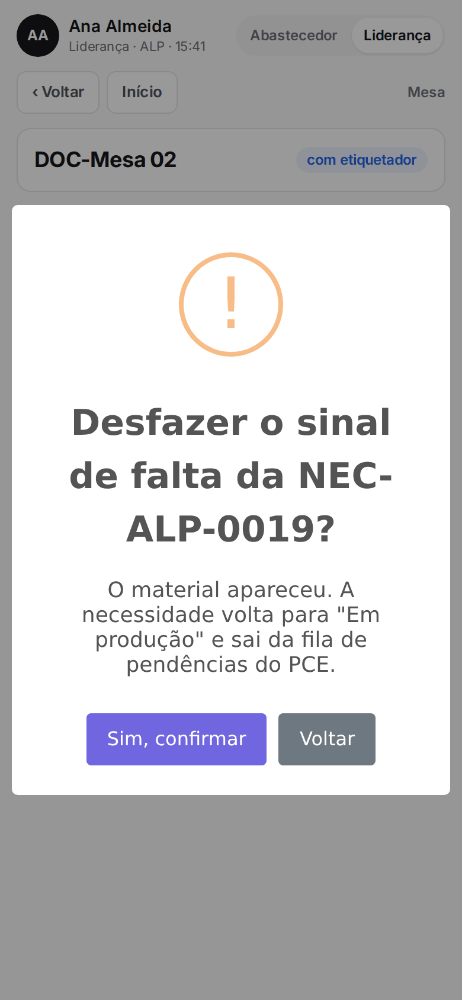

**Menu:** 1702 - Aplicativo de mesa, Liderança, mesa  
**Perfis:** Liderança

Falta de mercadoria é quando o material de uma necessidade acabou e ainda faltam caixas para atender o que foi solicitado. A liderança avisa o PCE por aqui, e o PCE decide o que fazer (por exemplo, encerrar a necessidade).

## Sinalizar falta ao PCE

<Steps>
  <Step title="Achar a necessidade com falta">
    Com o perfil **Liderança**, abra a mesa. Uma necessidade que já passou pela mesa, não tem mais material e não foi atendida por inteiro aparece com a chave, o produto e "(etiquetado) de (solicitado) cx".
  </Step>
  <Step title="Sinalizar">
    Toque em **Sinalizar falta ao PCE** (o botão informa quantas caixas faltam) e confirme com **Sim, confirmar**.

    
  </Step>
  <Step title="Conferir">
    O cartão passa a mostrar "Falta já sinalizada ao PCE." e a necessidade vai para "Falta de mercadoria" no planejamento.

    
  </Step>
</Steps>

## Desfazer o sinal de falta

<Steps>
  <Step title="Tocar em Desfazer o sinal">
    Se o material apareceu, toque em **Desfazer o sinal** e confirme com **Sim, confirmar**.

    
  </Step>
</Steps>

<Note>
Ao desfazer, a necessidade volta para "Em produção" e sai da fila de pendências do PCE. Só a liderança sinaliza e desfaz falta.
</Note>
