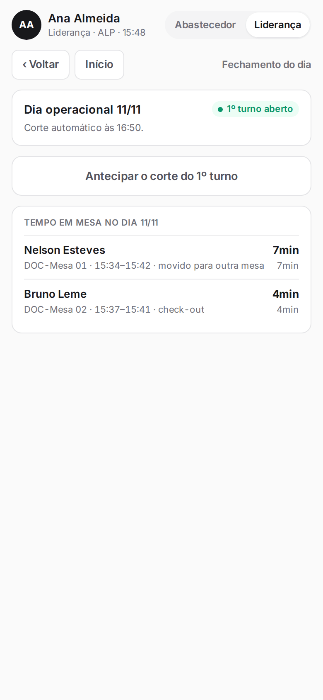
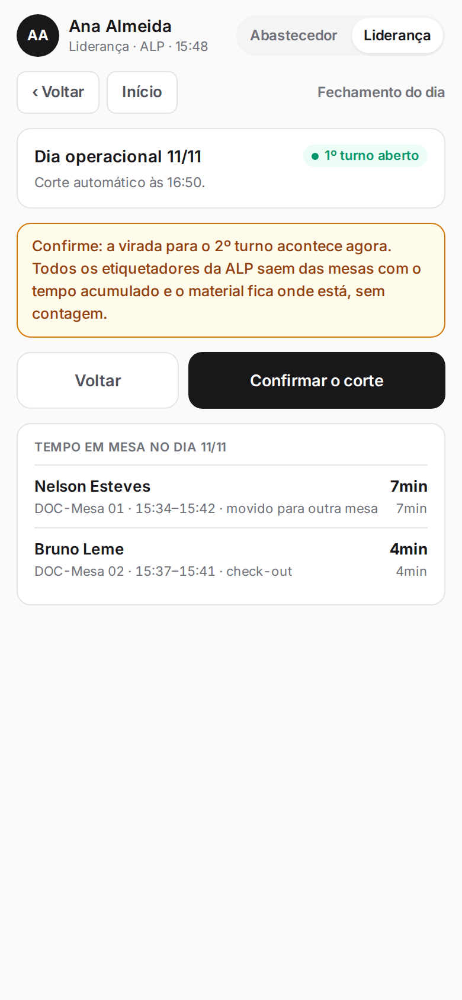
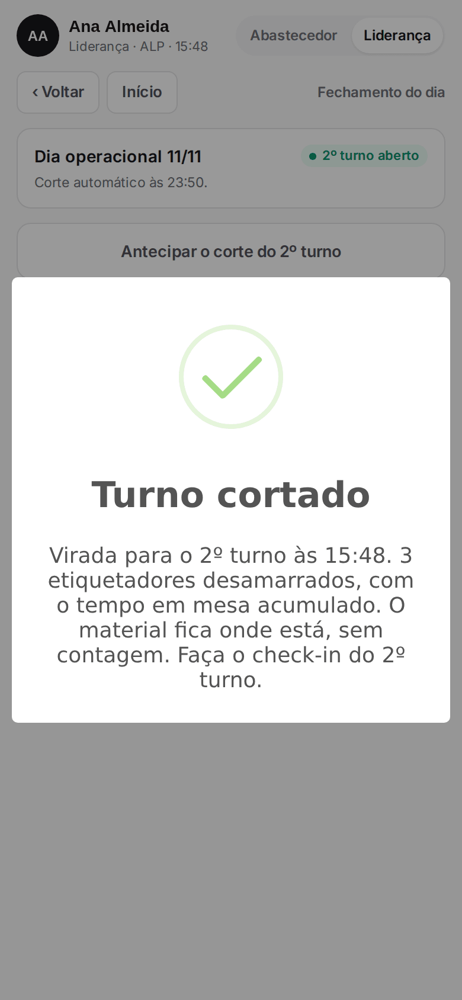
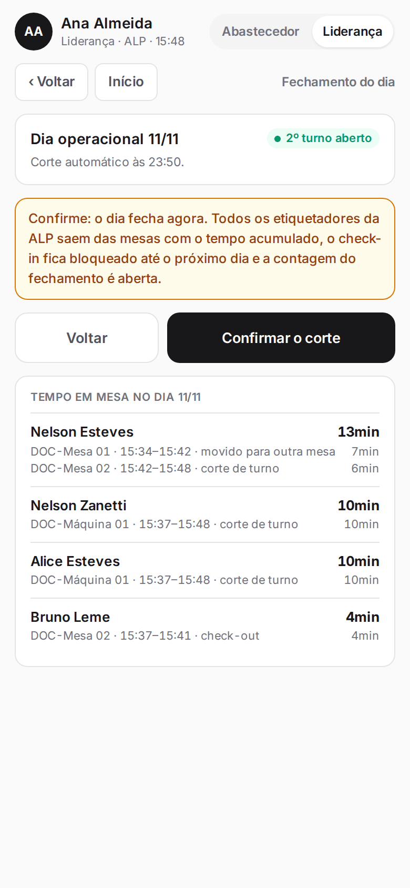
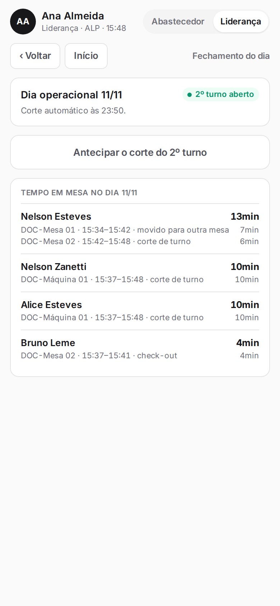
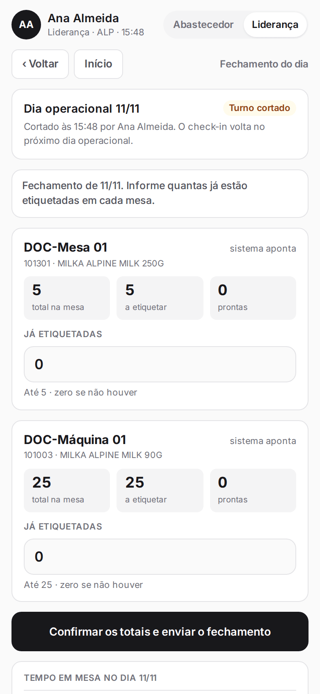
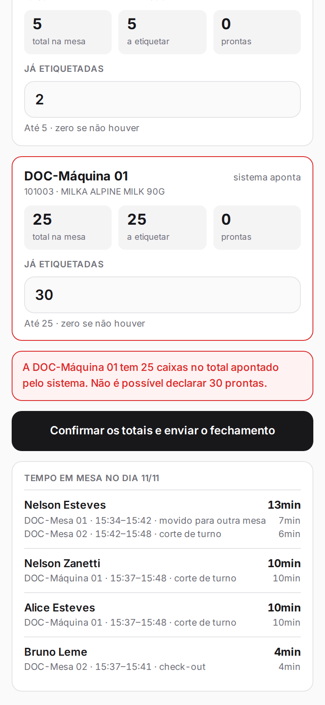
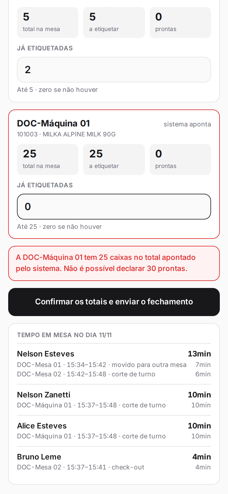
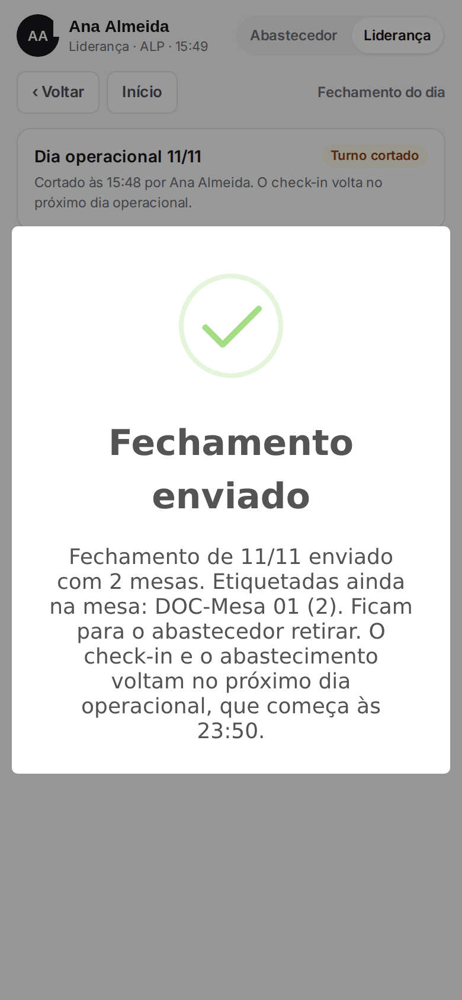
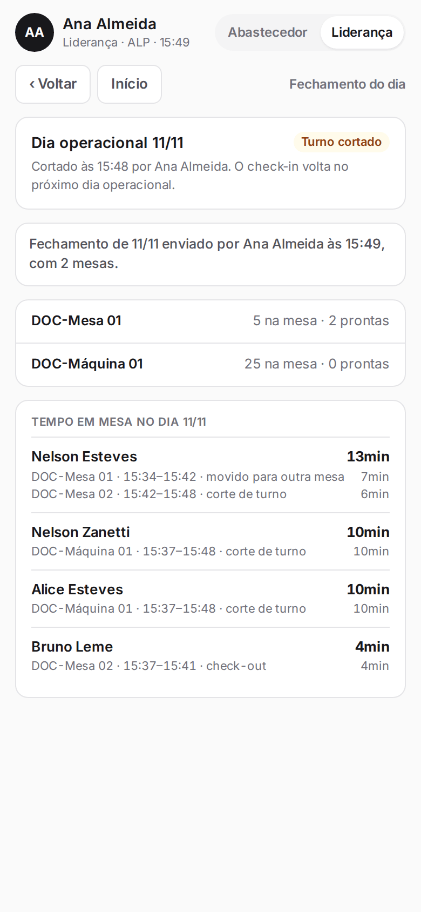

**Menu:** 1702 - Aplicativo de mesa, Liderança, Fechar  
**Perfis:** Liderança

No fim do dia a liderança corta os turnos e confere as caixas de cada mesa. O dia tem dois turnos, com cortes automáticos (padrão de 16:50 para o 1º turno e 23:50 para o 2º). A liderança pode antecipar o corte. O fechamento mostra também o tempo em mesa de cada etiquetador no dia.

## Antecipar o corte do turno

<Steps>
  <Step title="Pedir o corte">
    Com o perfil **Liderança**, toque em **Fechar** e depois em **Antecipar o corte do 1º turno** (ou do 2º turno, conforme o turno aberto).
  </Step>
  <Step title="Confirmar">
    Leia o aviso e toque em **Confirmar o corte**. No 1º turno é a virada para o 2º: todos os etiquetadores da filial saem das mesas, com o tempo acumulado, e o material fica onde está, sem contagem.

    

    
  </Step>
  <Step title="Corte do dia">
    No 2º turno o corte fecha o dia: os etiquetadores saem das mesas, o check-in fica bloqueado até o próximo dia e a contagem do fechamento é aberta.

    
  </Step>
</Steps>

<Warning>
O corte desamarra todos os etiquetadores da filial de uma vez e não pode ser desfeito. Depois do corte do dia, o abastecimento e o check-in só voltam no próximo dia operacional.
</Warning>

## Contar as mesas e enviar o fechamento

<Steps>
  <Step title="Ver as mesas a fechar">
    Depois do corte do dia, a tela lista cada mesa com material: o total que o sistema aponta, quanto está a etiquetar e quanto está pronto.

    
  </Step>
  <Step title="Informar as já etiquetadas">
    Em cada mesa, preencha **Já etiquetadas** com as caixas que estão etiquetadas na mesa (zero se não houver). O valor não pode passar do total da mesa.

    

    
  </Step>
  <Step title="Enviar">
    Toque em **Confirmar os totais e enviar o fechamento**. A mensagem mostra as mesas enviadas, as caixas etiquetadas que ficam para o abastecedor retirar e quando o dia seguinte começa.

    
  </Step>
  <Step title="Conferir o resumo">
    A tela passa a mostrar quem enviou, a hora, as mesas fechadas e o tempo em mesa por etiquetador.

    
  </Step>
</Steps>

<Note>
No dia seguinte, a liderança faz a contagem de abertura dessas mesas ("Abrir o dia"). Se a liderança não fechar o dia, o painel mostra o aviso "mesa do dia anterior sem fechamento" com o botão **Fechar o dia anterior**, e o abastecimento e o check-in ficam bloqueados.
</Note>
