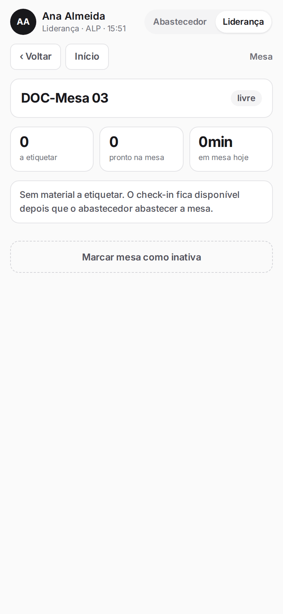
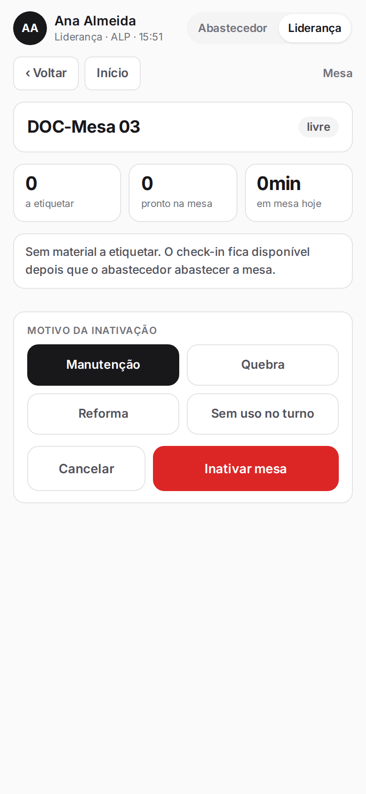
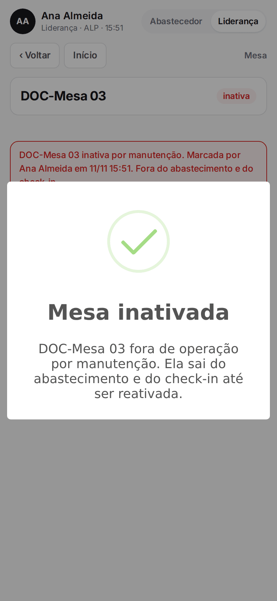
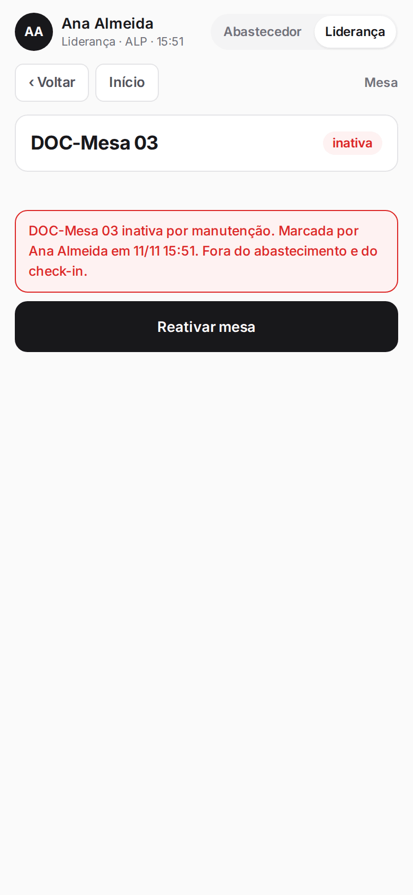
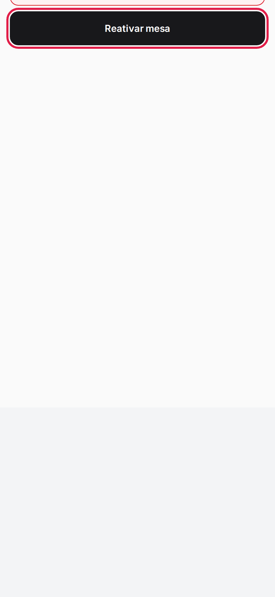
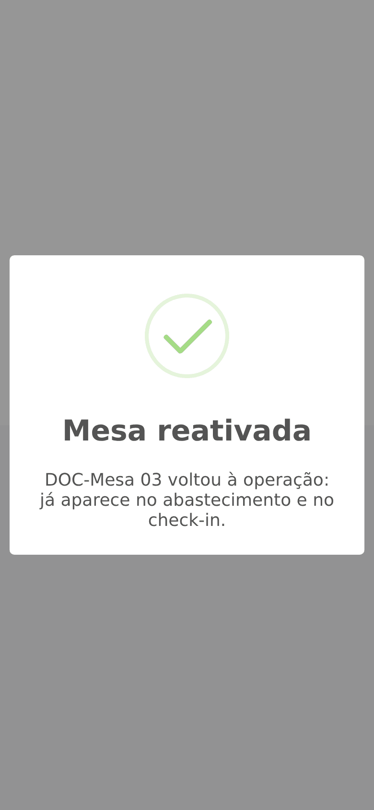

**Menu:** 1702 - Aplicativo de mesa, Liderança, mesa, Marcar mesa como inativa  
**Perfis:** Liderança

A liderança pode tirar uma mesa de operação direto pelo celular, por exemplo quando ela quebrou ou não será usada no turno. A mesa inativa sai do abastecimento e do check-in até ser reativada.

## Marcar a mesa como inativa

<Steps>
  <Step title="Abrir a opção">
    Com o perfil **Liderança**, abra a mesa e toque em **Marcar mesa como inativa**.
  </Step>
  <Step title="Escolher o motivo">
    Toque em um dos motivos: **Manutenção**, **Quebra**, **Reforma** ou **Sem uso no turno**.

    
  </Step>
  <Step title="Confirmar">
    Toque em **Inativar mesa**. Uma mensagem confirma.

    

    
  </Step>
</Steps>

<Note>
Só dá para inativar mesa sem etiquetador e sem caixas. Se houver, o aplicativo recusa e explica o que fazer antes (check-out, retirada ou devolução ao pallet).
</Note>

## Reativar a mesa

<Steps>
  <Step title="Tocar em Reativar mesa">
    Na mesa inativa, toque em **Reativar mesa**.

    
  </Step>
  <Step title="Conferir">
    A mesa volta à operação e já aparece no abastecimento e no check-in.

    
  </Step>
</Steps>
