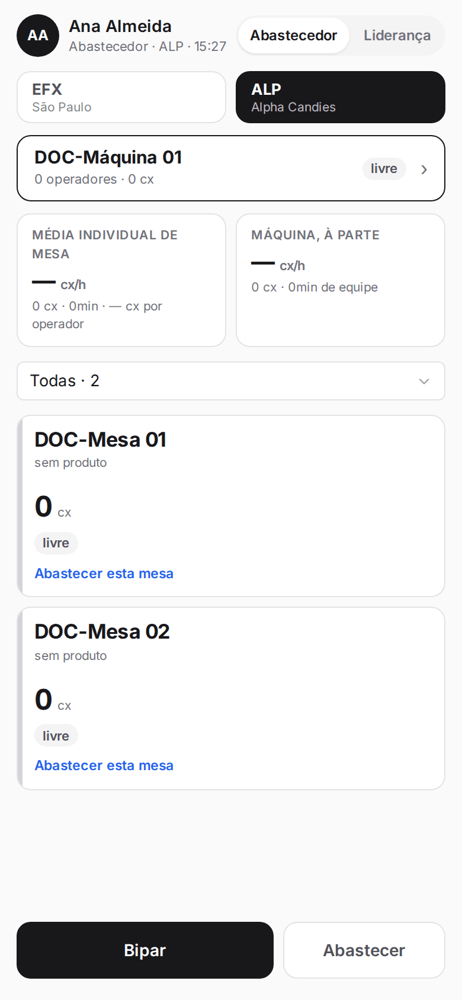
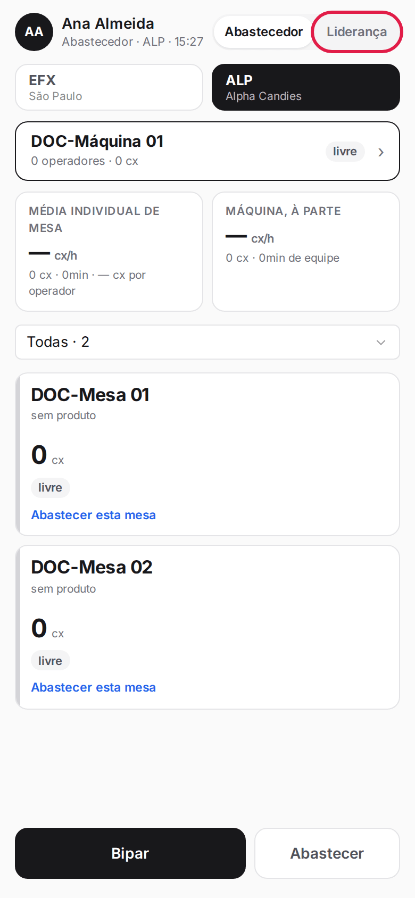
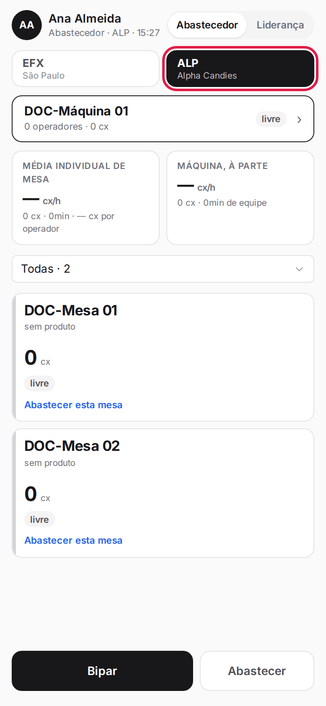
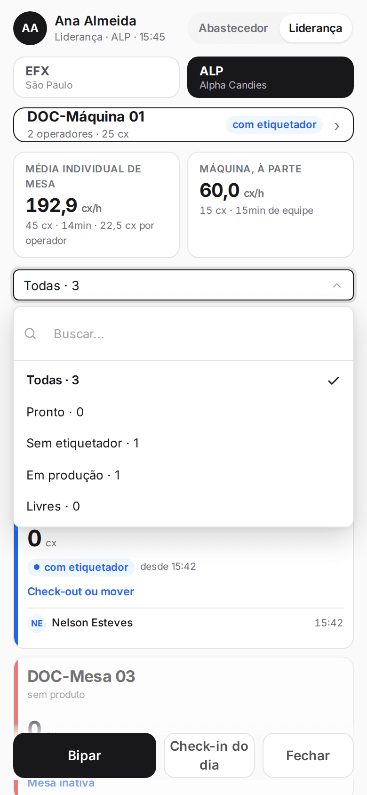
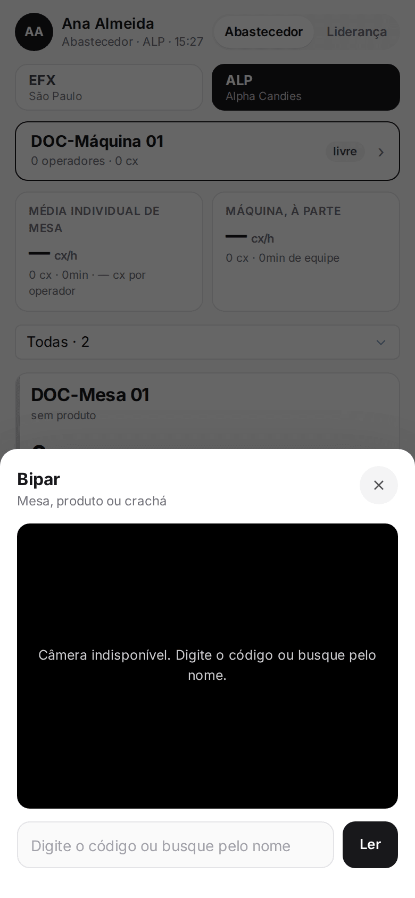
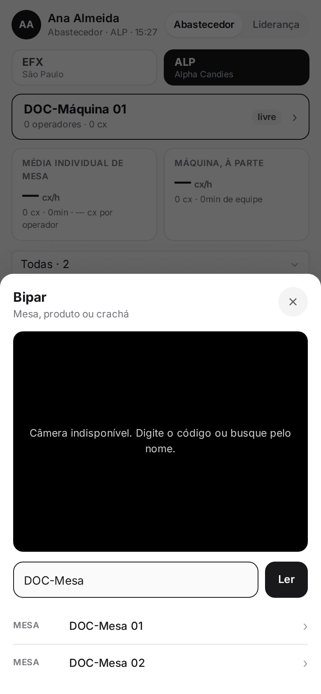
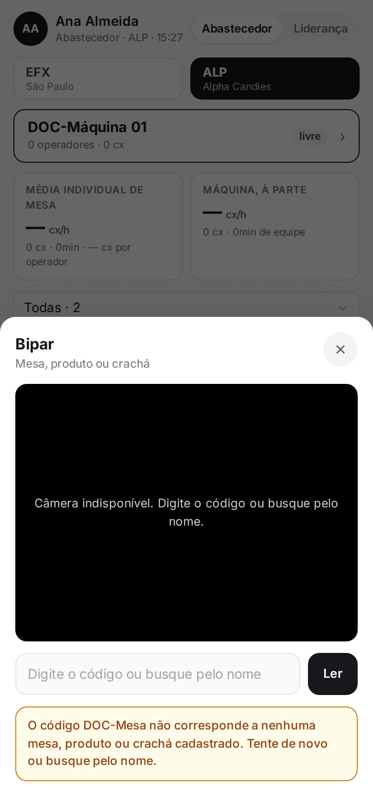
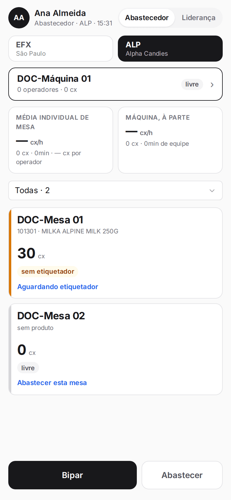

**Menu:** 1702 - Aplicativo de mesa  
**Perfis:** Abastecedor, Liderança

Aplicativo feito para o celular, usado no chão de fábrica durante o turno. Mostra as mesas e a máquina da filial e é a porta de entrada para abrir o dia, abastecer, fazer check-in dos etiquetadores, retirar o etiquetado e fechar o dia. Nas imagens deste manual o aplicativo aparece estreito, como na tela do celular.

No topo ficam o nome de quem está logado, o perfil, a filial e a hora. Abaixo, os botões das filiais e a lista de mesas. Cada cartão de mesa mostra o produto, quantas caixas há nela (**cx**), o estado (**livre**, **sem etiquetador**, **com etiquetador**, **inativa**, entre outros) e a próxima ação sugerida. A máquina aparece em destaque, acima das mesas.

**Perfis do aplicativo**
- **Abastecedor**: leva o material do pallet para a mesa (abastecer), retira o que já foi etiquetado, devolve material ao pallet, retira para avaria e sinaliza lote misturado. No painel, o botão fixo de baixo é **Abastecer**.
- **Liderança**: abre o dia (contagem de abertura), faz o check-in e o check-out dos etiquetadores, move etiquetador de mesa, sinaliza falta de mercadoria, inativa e reativa mesas e fecha o dia. No painel, os botões de baixo são **Check-in do dia** e **Fechar**.

## Trocar de perfil

<Steps>
  <Step title="Tocar no perfil">
    No canto superior direito, toque em **Abastecedor** ou **Liderança**. A tela recarrega com os botões e as ações do perfil escolhido.

    
  </Step>
</Steps>

<Note>
O seletor só aparece para quem tem os dois perfis. Quem tem um só perfil vê direto as ações dele.
</Note>

## Trocar de filial e filtrar as mesas

<Steps>
  <Step title="Escolher a filial">
    No painel, toque no botão da filial: **EFX** (São Paulo) ou **ALP** (Alpha Candies). A lista mostra as mesas e a máquina da filial escolhida.

    
  </Step>
  <Step title="Filtrar as mesas">
    Toque no campo **Todas** e escolha **Pronto**, **Sem etiquetador**, **Em produção** ou **Livres**. O número ao lado mostra quantas mesas se encaixam.

    
  </Step>
</Steps>

## Bipar mesa, produto ou crachá

<Steps>
  <Step title="Abrir o leitor">
    No painel, toque em **Bipar**. Abre uma folha com a câmera para ler o código de barras ou o QR.

    
  </Step>
  <Step title="Ler ou digitar">
    Aponte a câmera para o código. Se a câmera não estiver disponível, digite o código (ou parte do nome) no campo e toque em **Ler**. Enquanto você digita, aparecem as opções encontradas: mesa, produto ou crachá. Toque na opção certa.

    
  </Step>
  <Step title="Código desconhecido">
    Se o código não for de nenhuma mesa, produto ou crachá, o aplicativo avisa para tentar de novo ou buscar pelo nome.

    
  </Step>
</Steps>

<Note>
O que acontece depende do que foi lido e de onde você está. Mesa: abre a mesa. Produto: abre o abastecimento daquele produto (só no perfil Abastecedor). Crachá: abre o check-in do etiquetador (perfil Liderança). Dentro da retirada, cada bip preenche o passo que está esperando. Mesa ou máquina também pode ser lida pelo nome cadastrado.
</Note>

## Abrir uma mesa ou a máquina

<Steps>
  <Step title="Tocar no cartão">
    No painel, toque no cartão da mesa (ou da máquina, no topo). Abre a tela da mesa com as ações do seu perfil.

    
  </Step>
  <Step title="Voltar">
    Use **‹ Voltar** para a tela anterior ou **Início** para o painel.
  </Step>
</Steps>

<Note>
Para o abastecedor, ao abrir uma mesa ela fica "em uso" por ele até o corte do dia. Outro abastecedor que tocar nela vê o aviso "em uso por" e precisa aguardar, para não haver retirada duplicada. Mesas inativas aparecem esmaecidas.
</Note>
