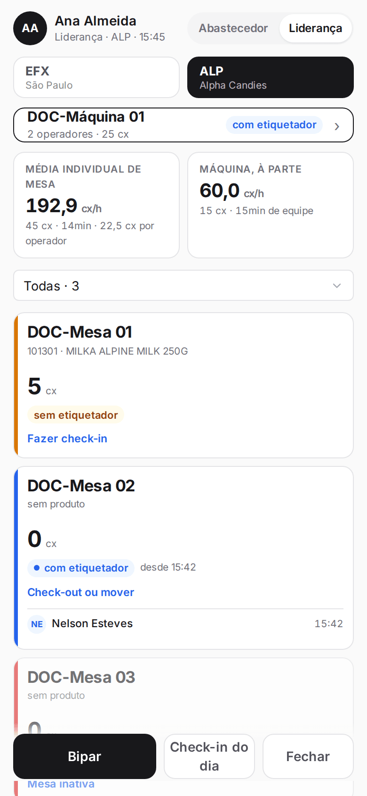
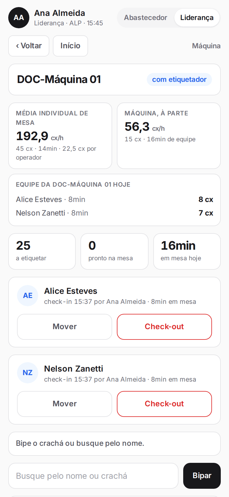

**Menu:** 1702 - Aplicativo de mesa, painel inicial e cartão da máquina  
**Perfis:** Abastecedor, Liderança

A máquina etiqueta em volume e tem várias pessoas na equipe. Por isso a produtividade dela é medida à parte da das mesas. Os indicadores aparecem no painel inicial e dentro da tela da máquina.

## Ler os indicadores de produção do dia

<Steps>
  <Step title="Painel inicial">
    No alto do painel, o cartão **Média individual de mesa** mostra as caixas por hora das mesas (total de caixas, tempo e caixas por operador). O cartão **Máquina, à parte** mostra as caixas por hora da máquina e o tempo da equipe.
  </Step>
  <Step title="Dentro da máquina">
    Toque no cartão da máquina. Além dos dois indicadores, a tela mostra a **Equipe da máquina hoje**: cada operador, o tempo dele e as caixas que ficaram creditadas a ele.

    
  </Step>
</Steps>

<Note>
Os indicadores se atualizam a cada retirada e a cada check-in ou check-out. Quando ainda não houve produção, aparece um traço no lugar do valor. As caixas de cada operador vêm do rateio feito na retirada da máquina, proporcional ao tempo de cada um, com o almoço descontado. O tempo de equipe vem dos check-ins feitos pela liderança.
</Note>
