**Menu:** 1702 - Aplicativo de mesa, Abastecedor, mesa, Retirar etiquetado  
**Perfis:** Abastecedor

Retirar é tirar da mesa as caixas que já foram etiquetadas. É aqui que a produção é registrada: as caixas retiradas viram "etiquetado" para quem estava na mesa. O abastecedor confere tudo por bip em passos: mesa, crachá e produto, e depois informa a quantidade.

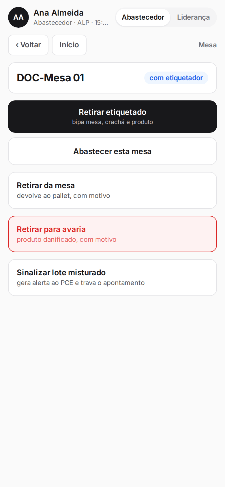

## Retirar o etiquetado de uma mesa

<Steps>
  <Step title="Abrir a retirada">
    Abra a mesa e toque em **Retirar etiquetado**. A tela mostra "Passo 1 de 4" e quantas caixas há na mesa.

    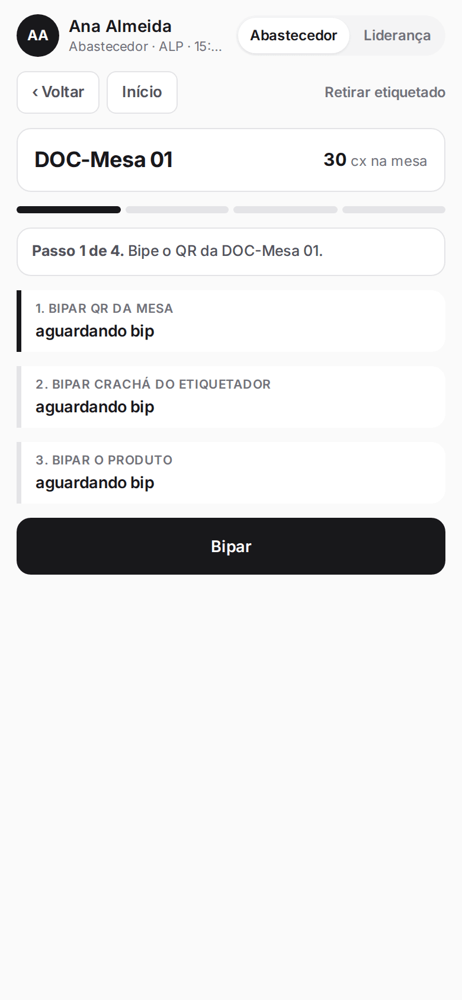
  </Step>
  <Step title="Bipar a mesa">
    Toque em **Bipar** e leia o QR da mesa (ou digite o nome dela) para conferir que está na mesa certa.

    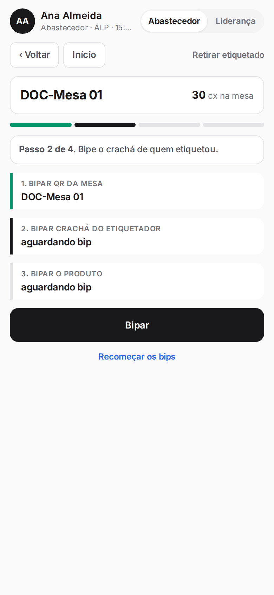
  </Step>
  <Step title="Bipar o crachá">
    Bipe o crachá de quem etiquetou. Ele precisa ser de quem está amarrado à mesa.

    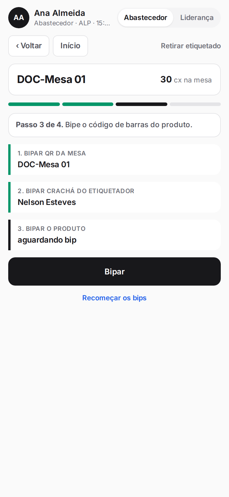
  </Step>
  <Step title="Bipar o produto">
    Bipe o código de barras do produto. Ele precisa ser o que está na mesa.

    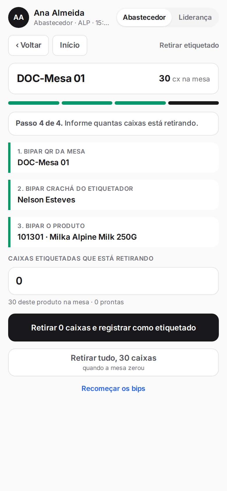
  </Step>
  <Step title="Informar a quantidade e revisar">
    Digite as caixas etiquetadas que está retirando e toque em **Retirar (n) caixas e registrar como etiquetado**. Quando a mesa zerou, use **Retirar tudo**. O quadro "O que acontece ao confirmar" mostra a mesa, a produção do etiquetador e quanto falta para a necessidade.

    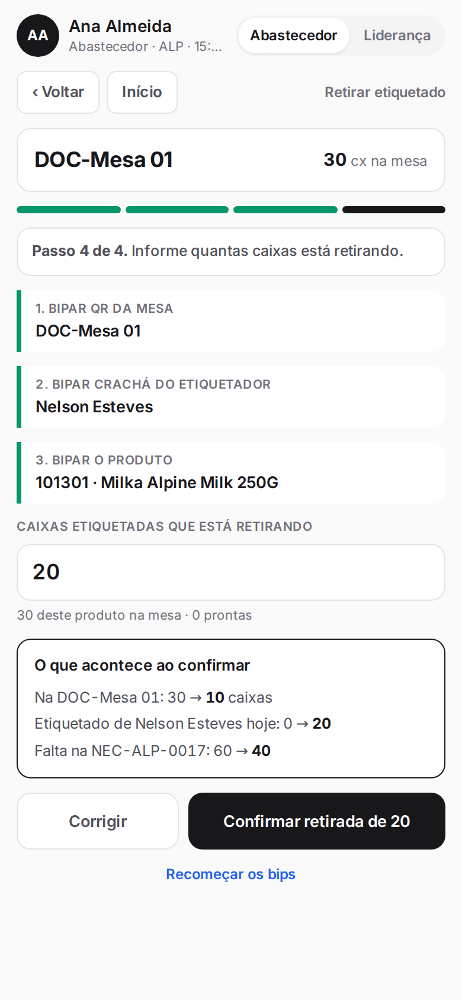
  </Step>
  <Step title="Confirmar">
    Toque em **Confirmar retirada de (n)**. O aplicativo mostra a mensagem "Retirada registrada" com o número da retirada e volta ao painel.

    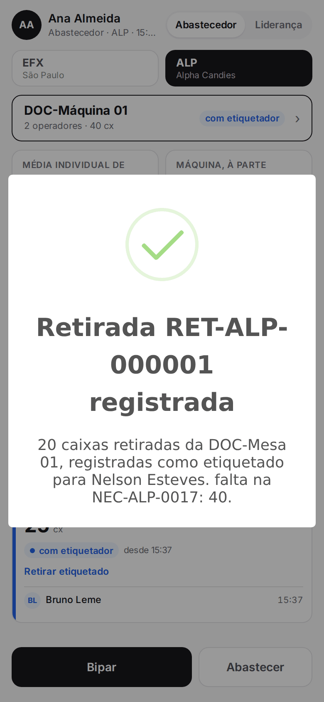

    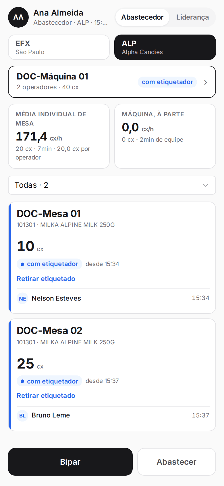
  </Step>
</Steps>

<Note>
Cada barra no topo mostra o passo em que você está. **Corrigir** volta para a quantidade e **Recomeçar os bips** zera os passos. Se bipar a coisa errada para o passo, o aplicativo avisa o que era esperado. Só o abastecedor que abriu a mesa retira dela. A retirada fica travada enquanto houver lote misturado sinalizado, até o PCE resolver. Não existe botão para desfazer a retirada: correções são da supervisão (estorno).
</Note>

## Retirar tudo o que está na mesa

<Steps>
  <Step title="Chegar ao passo da quantidade">
    Faça os bips da mesa, do crachá e do produto, como na retirada normal.
  </Step>
  <Step title="Tocar em Retirar tudo">
    Toque em **Retirar tudo** (o botão mostra quantas caixas). A tela de revisão já vem com a quantidade total; confirme com **Confirmar retirada de (n)**.

    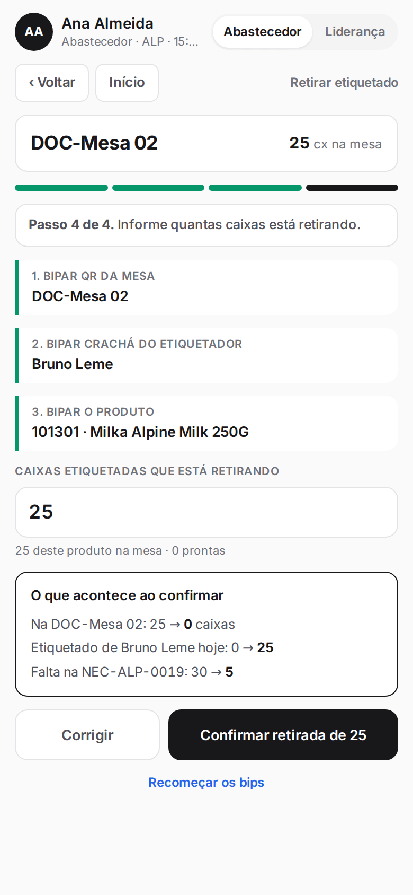
  </Step>
</Steps>

## Retirar de uma mesa cujo etiquetador já saiu

<Steps>
  <Step title="Ver o aviso">
    Se não há mais etiquetador na mesa, o passo do crachá mostra quem fez o check-out e a hora. A produção será atribuída a essa última pessoa registrada.

    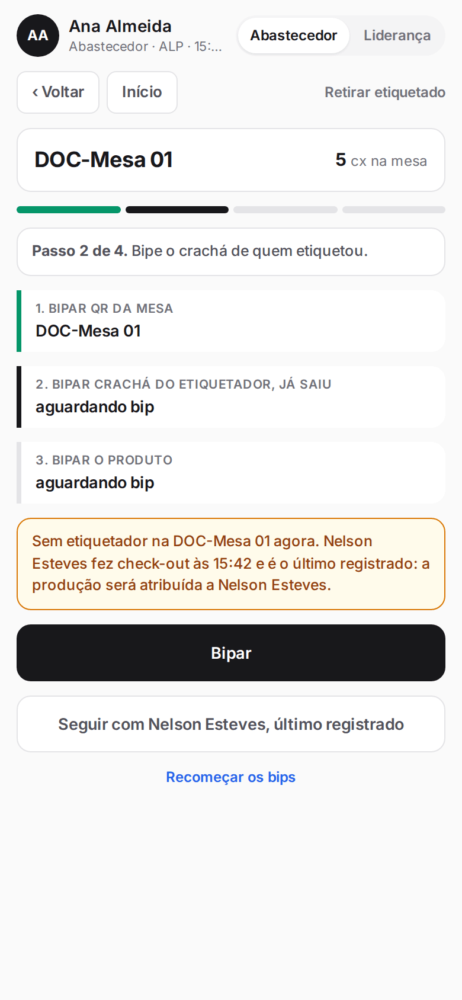
  </Step>
  <Step title="Seguir com ele">
    Toque em **Seguir com (nome), último registrado**, ou bipe o crachá dele. Continue para o produto e a quantidade.
  </Step>
</Steps>

<Note>
Se o bip não for do tipo esperado no passo (por exemplo, produto no lugar do crachá), o aplicativo mostra a mensagem em vermelho e nada é gravado.
</Note>

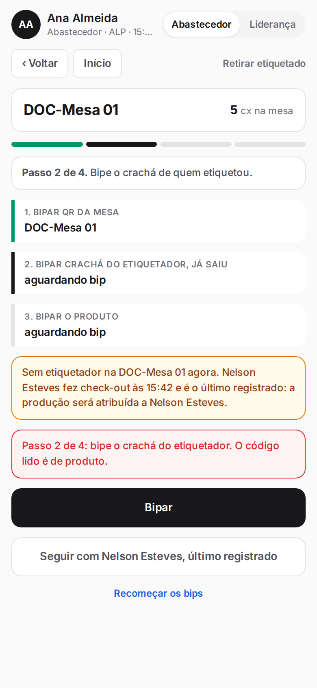

## Retirar o etiquetado da máquina

<Steps>
  <Step title="Abrir a retirada da máquina">
    Abra a máquina e toque em **Retirar etiquetado** ("por produto, admite parcial, rateio pelo tempo da equipe").

    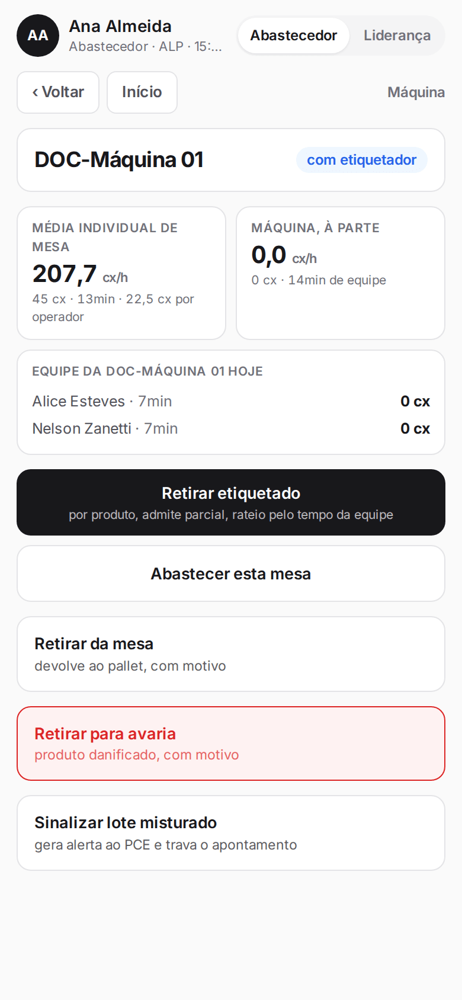

    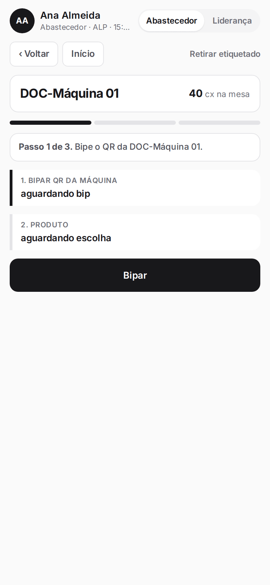
  </Step>
  <Step title="Bipar a máquina e escolher o produto">
    Bipe o QR da máquina. No passo 2, escolha o produto na lista (ou bipe a caixa).

    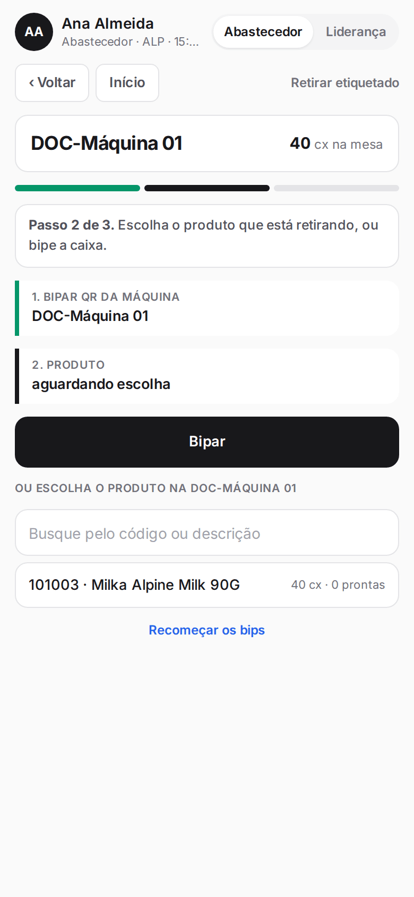
  </Step>
  <Step title="Quantidade e revisão">
    Digite quantas caixas retira (pode ser parcial) e toque em **Retirar (n) caixas e registrar como etiquetado**. A revisão mostra o rateio entre os operadores pelo tempo na máquina no dia, com o almoço descontado.

    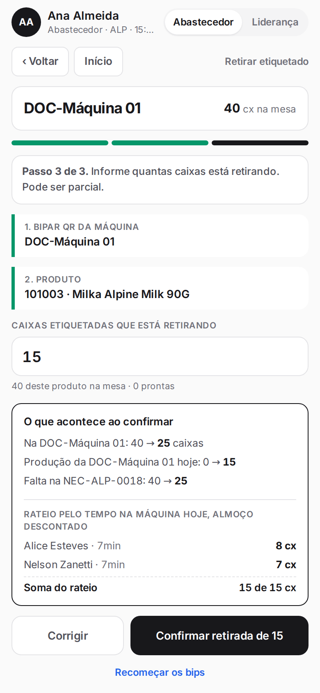
  </Step>
  <Step title="Confirmar">
    Toque em **Confirmar retirada de (n)**. A produção é dividida entre os operadores e a soma do rateio sempre fecha com o total retirado.
  </Step>
</Steps>

<Note>
Na máquina não há bip de crachá: a produção é rateada entre quem esteve na equipe. Há um parâmetro da gestão que pode exigir também o bip do produto na retirada da máquina.
</Note>
