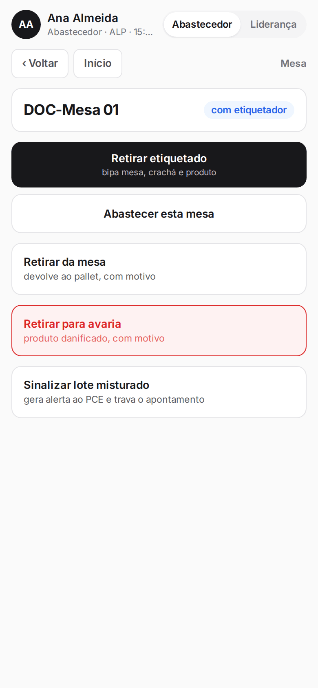
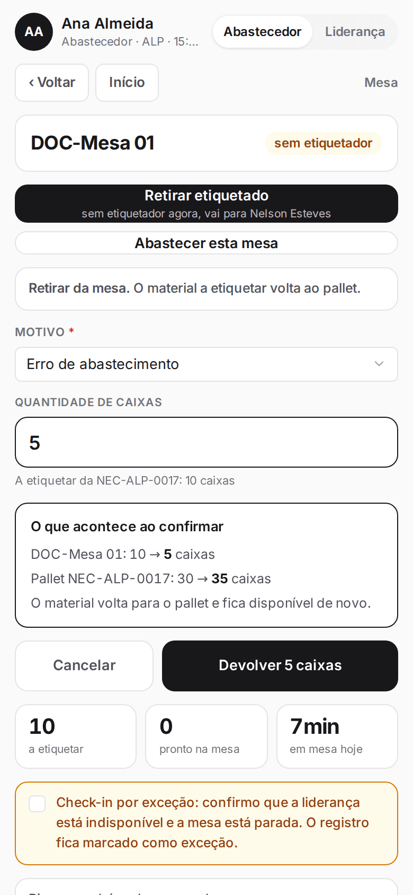
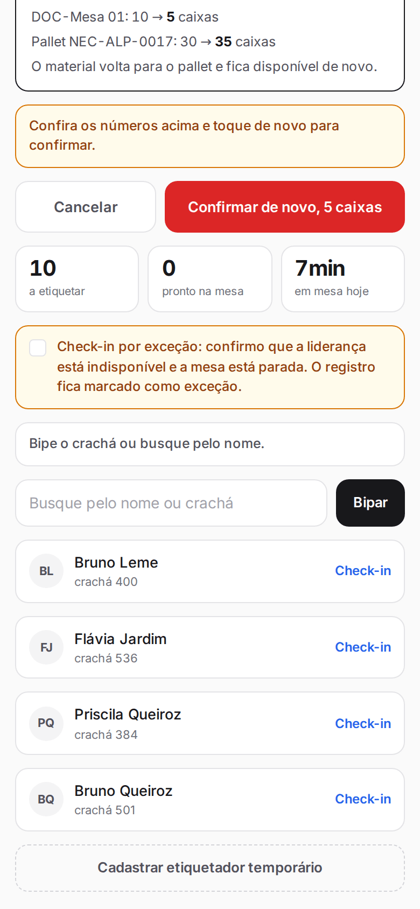
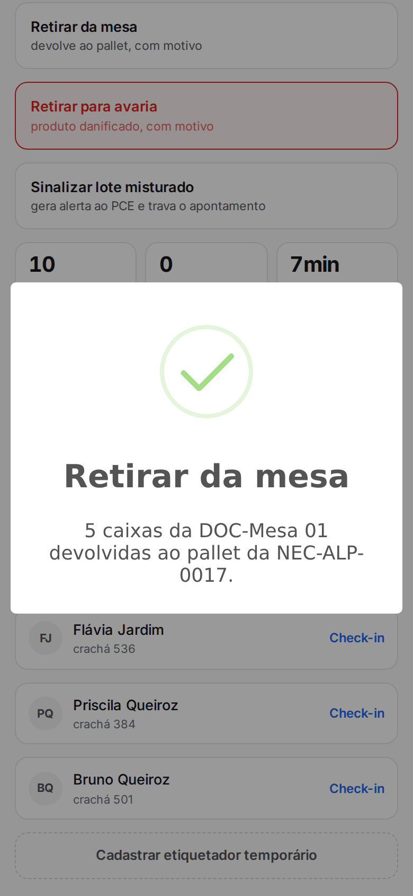
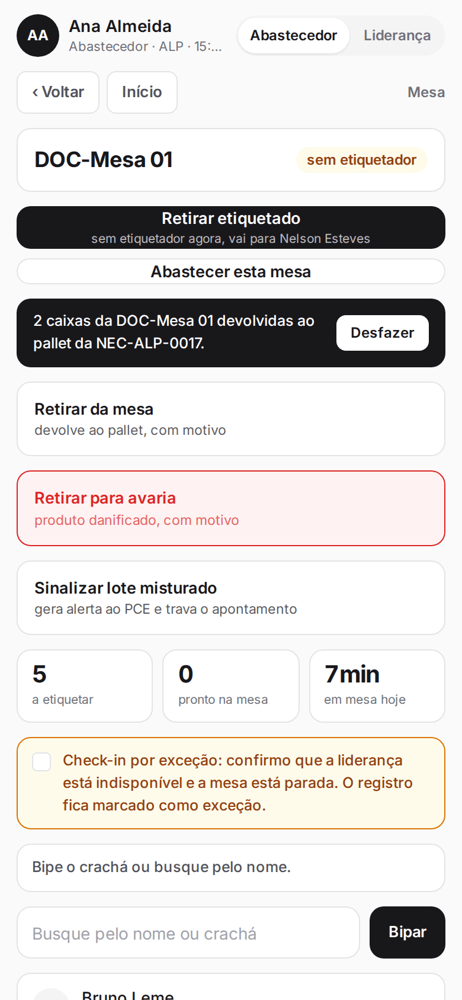
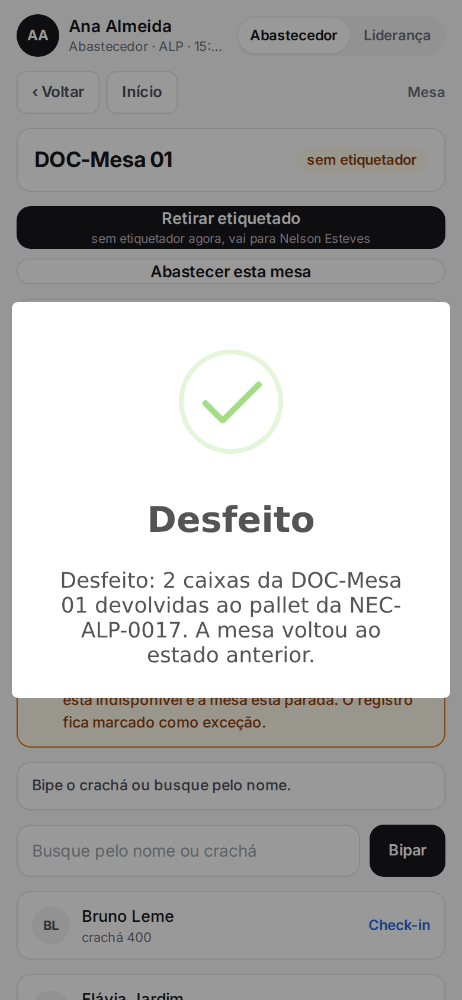
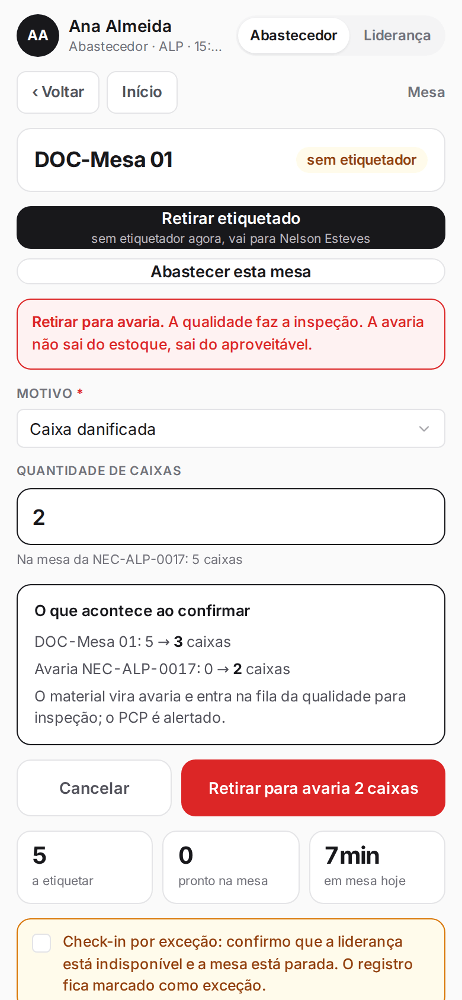
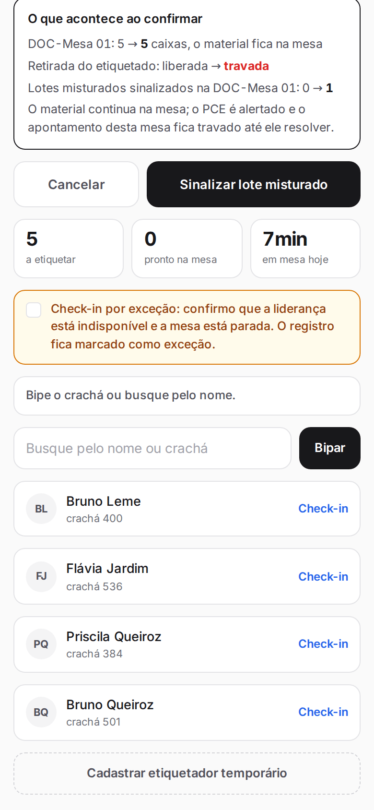

**Menu:** 1702 - Aplicativo de mesa, Abastecedor, mesa  
**Perfis:** Abastecedor

Saídas são as formas de tirar material da mesa sem ser a retirada do etiquetado: devolver ao pallet, retirar para avaria ou sinalizar lote misturado. As três ações aparecem na tela da mesa quando ela tem caixas, e são do perfil Abastecedor.

## Devolver material ao pallet

<Steps>
  <Step title="Abrir a ação">
    Na mesa, toque em **Retirar da mesa** ("devolve ao pallet, com motivo"). A opção só aparece se há caixas a etiquetar.
  </Step>
  <Step title="Motivo e quantidade">
    Escolha o **Motivo** (por exemplo, **Pedido urgente de outro produto**, **Erro de abastecimento**, **Necessidade cancelada** ou **Outro**) e digite a **Quantidade de caixas**. Se a mesa tem material de mais de uma necessidade, escolha antes de qual delas é.

    
  </Step>
  <Step title="Revisar">
    Toque em **Devolver (n) caixas**. O quadro "O que acontece ao confirmar" mostra a mesa e o pallet antes e depois.

    
  </Step>
  <Step title="Confirmar">
    Toque em **Confirmar de novo, (n) caixas**. As caixas voltam ao pallet e ficam disponíveis de novo.

    
  </Step>
</Steps>

<Note>
Só se devolve material a etiquetar. Caixa já etiquetada (pronta) não volta ao pallet.
</Note>

## Desfazer uma saída

<Steps>
  <Step title="Tocar em Desfazer">
    Logo depois da saída, o aviso preto no topo da tela mostra o que foi feito. Toque em **Desfazer**.

    
  </Step>
  <Step title="Conferir">
    A mesa volta ao estado anterior.

    
  </Step>
</Steps>

<Note>
Só quem registrou a saída pode desfazê-la, e não dá mais se a mesa teve outra movimentação depois, se o material já foi usado ou se a qualidade já inspecionou a avaria.
</Note>

## Retirar para avaria

<Steps>
  <Step title="Abrir a ação">
    Na mesa, toque em **Retirar para avaria** ("produto danificado, com motivo").
  </Step>
  <Step title="Motivo e quantidade">
    Escolha o **Motivo** (**Caixa danificada**, **Sem selagem**, **Produto rasgado**, **Lote divergente** ou **Outro**) e digite a quantidade.

    
  </Step>
  <Step title="Revisar e confirmar">
    Toque em **Retirar para avaria (n) caixas** para ver a revisão e depois em **Confirmar de novo, (n) caixas**.
  </Step>
</Steps>

<Warning>
As caixas viram avaria e entram na fila da qualidade para inspeção; o PCP é alertado por e-mail. A avaria sai do aproveitável, não do estoque. Pode ser retirada de caixas prontas ou a etiquetar.
</Warning>

## Sinalizar lote misturado

<Steps>
  <Step title="Abrir a ação">
    Na mesa, toque em **Sinalizar lote misturado** ("gera alerta ao PCE e trava o apontamento").
  </Step>
  <Step title="Revisar">
    O quadro mostra que o material continua na mesa e que a retirada do etiquetado ficará travada.

    
  </Step>
  <Step title="Confirmar">
    Toque em **Sinalizar lote misturado** e depois em **Confirmar de novo e sinalizar**.
  </Step>
</Steps>

<Warning>
O PCE recebe um alerta por e-mail e a retirada do etiquetado desta mesa fica travada até ele resolver. Só quem sinalizou pode desfazer a sinalização, e apenas antes de o PCE resolver. Esta ação não foi confirmada nas capturas deste manual para não disparar e-mails.
</Warning>
