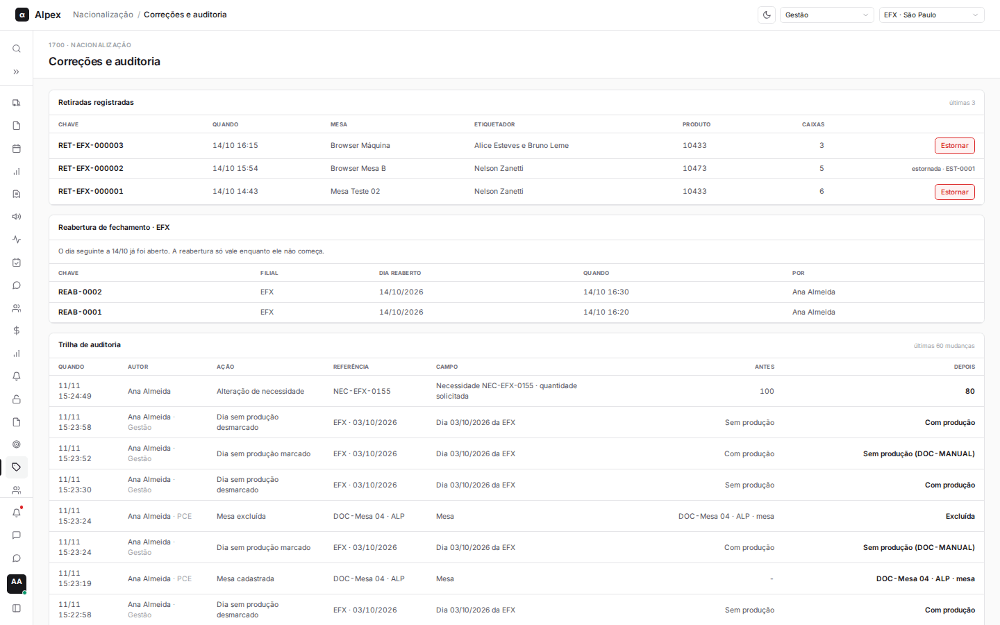
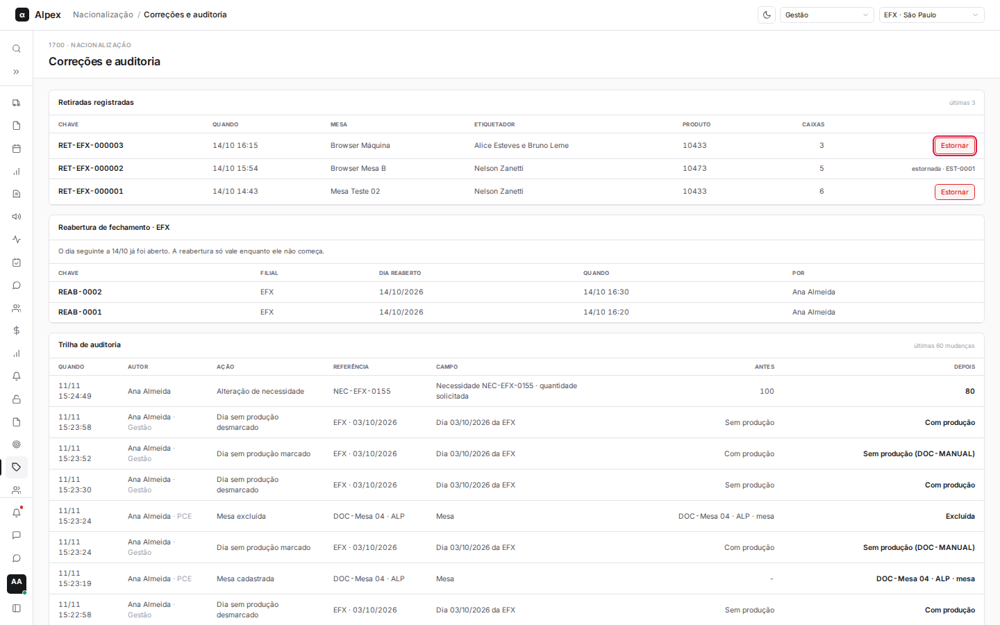
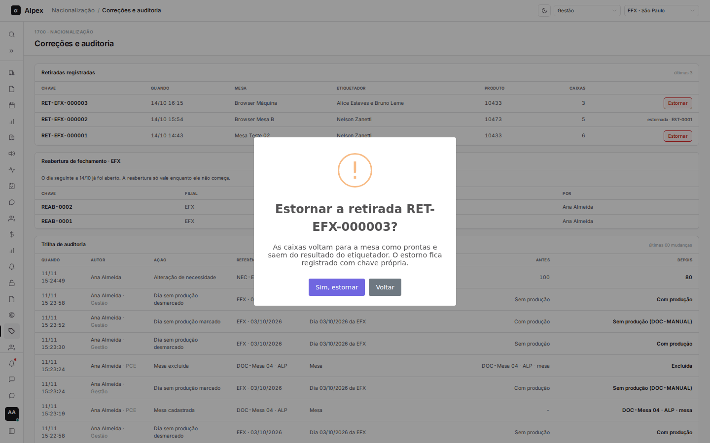
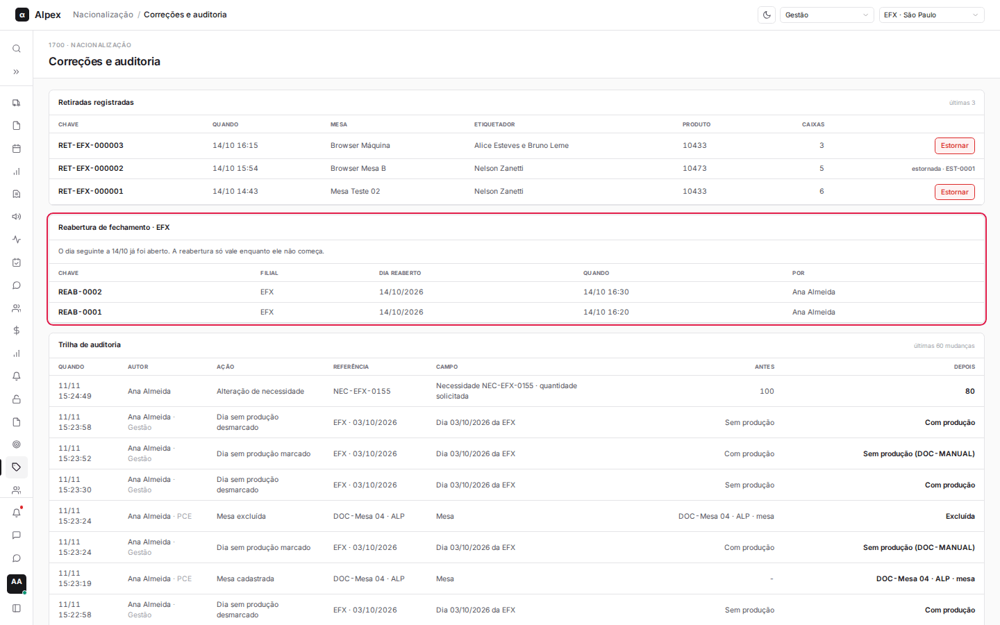
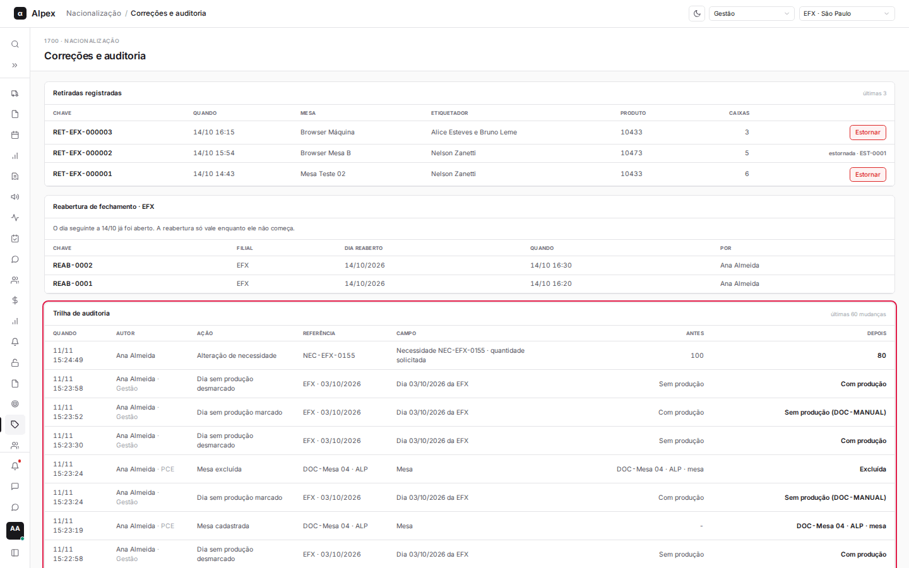

**Menu:** 1704 - Correções e auditoria  
**Perfis:** Supervisão, Gestão, TI

Tela de supervisão e gestão para corrigir lançamentos do aplicativo de mesa (estornar uma retirada, reabrir um fechamento) e consultar o histórico de tudo que mudou no módulo.

## Estornar uma retirada

*Perfis: Supervisão, Gestão*

<Steps>
  <Step title="Achar a retirada">
    Na seção **Retiradas registradas** ficam as últimas retiradas, com **Chave**, **Quando**, **Mesa**, **Etiquetador**, **Produto** e **Caixas**. Retiradas já estornadas mostram "estornada" e a chave do estorno no lugar do botão.
  </Step>
  <Step title="Clicar em Estornar">
    Na linha da retirada, clique em **Estornar**.

    
  </Step>
  <Step title="Confirmar">
    Aparece a pergunta "Estornar a retirada ...?", avisando que as caixas voltam para a mesa como prontas e saem do resultado do etiquetador. Clique em **Sim, estornar** para confirmar ou em **Voltar** para desistir.

    
  </Step>
  <Step title="Conferir o resultado">
    Uma mensagem confirma "Retirada estornada" com a chave do estorno. A linha passa a mostrar "estornada" e o estorno aparece na trilha de auditoria.
  </Step>
</Steps>

<Warning>
O estorno devolve as caixas à mesa e tira o crédito do etiquetador. Cada estorno recebe uma chave própria e não há botão para desfazê-lo. Uma retirada só pode ser estornada uma vez; se o sistema recusar, a mensagem explica o motivo.
</Warning>

## Reabrir um fechamento enviado

*Perfis: Supervisão, Gestão*

<Steps>
  <Step title="Escolher a filial">
    No canto superior direito, escolha a filial. A seção **Reabertura de fechamento** mostra a situação dela. Quem tem mais de um perfil nesta tela também escolhe o perfil no campo ao lado.
  </Step>
  <Step title="Ler a situação">
    Quando há fechamento que pode ser reaberto, a seção informa a data, quantas mesas foram enviadas e que ele pode ser reaberto até o dia seguinte começar. Quando não pode, o texto explica o motivo (por exemplo, o dia seguinte já ter sido aberto).

    
  </Step>
  <Step title="Reabrir">
    Quando disponível, clique em **Reabrir o fechamento de** (com a data). Confirme em **Sim, reabrir**, ou desista em **Voltar**.
  </Step>
  <Step title="Conferir o resultado">
    Uma mensagem mostra "Fechamento reaberto" com a chave da reabertura, que entra na lista de reaberturas com **Chave**, **Filial**, **Dia reaberto**, **Quando** e **Por**.
  </Step>
</Steps>

<Note>
Depois da reabertura, a liderança pode corrigir as quantidades e enviar o fechamento de novo. A reabertura só vale enquanto a abertura do dia seguinte não começou.
</Note>

## Consultar a trilha de auditoria

<Steps>
  <Step title="Ir até a trilha">
    Role até **Trilha de auditoria**. Ela lista as últimas mudanças do módulo, da mais recente para a mais antiga.

    
  </Step>
  <Step title="Ler cada linha">
    Cada linha mostra **Quando**, **Autor** (com o perfil), **Ação**, **Referência**, **Campo**, **Antes** e **Depois**. É a forma de descobrir quem mudou o quê, e quando.
  </Step>
</Steps>

<Note>
A tela só carrega as últimas retiradas e as últimas mudanças. Perfis sem acesso veem a mensagem "Perfil sem acesso".
</Note>
