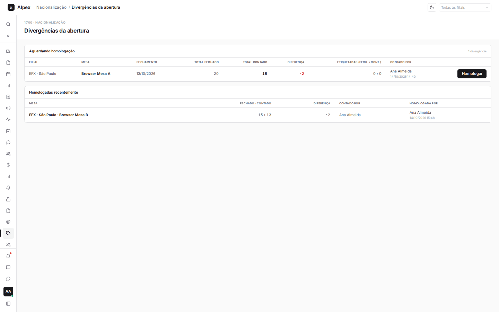
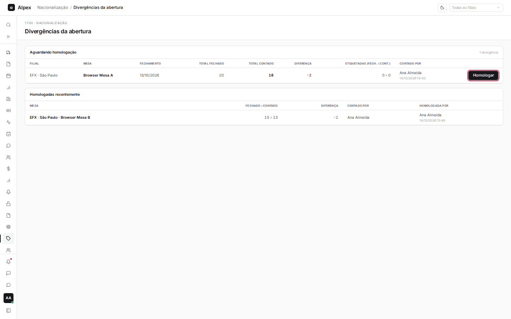
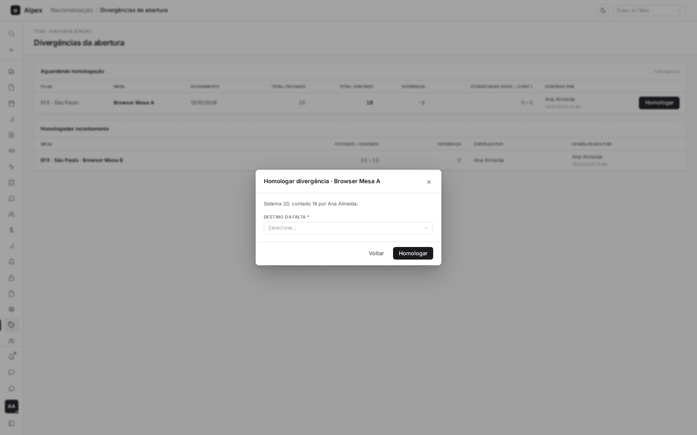
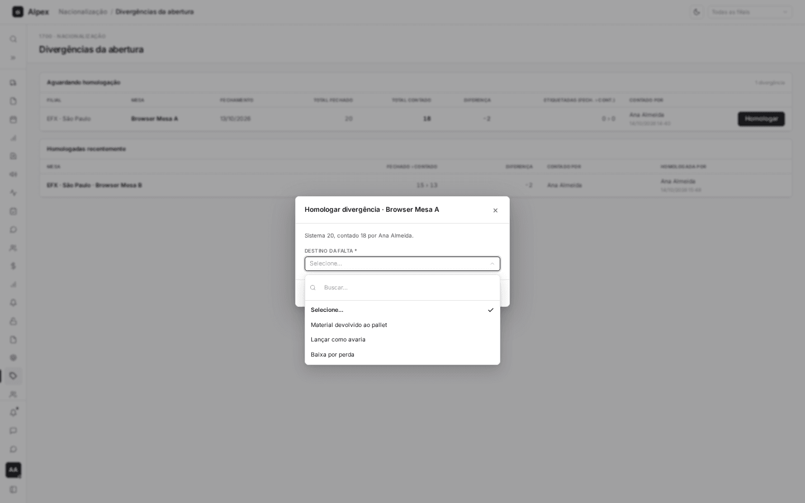
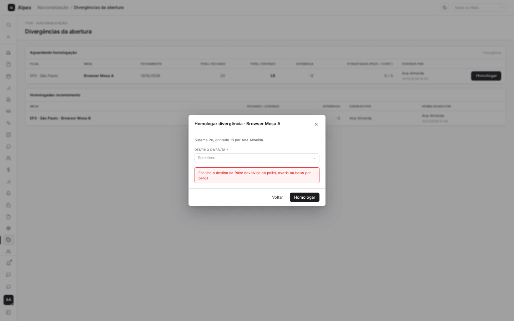

**Menu:** 1705 - Divergências da abertura  
**Perfis:** Gestão, TI

Quando a liderança abre o dia e conta o material de uma mesa, o total contado pode ser diferente do que o sistema mostrava no fechamento do dia anterior. Essa diferença é a divergência, e a gestão decide aqui para onde ela vai (homologação).

## Consultar e filtrar as divergências

<Steps>
  <Step title="Filtrar por filial">
    No canto superior direito, escolha uma filial para ver só as divergências dela. Com **Todas as filiais**, aparecem todas.
  </Step>
  <Step title="Ler a lista Aguardando homologação">
    Cada linha traz **Filial**, **Mesa**, **Fechamento** (a data do fechamento contado), **Total fechado** (o que o sistema esperava), **Total contado** (o que a liderança encontrou), **Diferença** (vermelha quando falta, verde quando sobra), **Etiquetadas (fech. › cont.)** e **Contado por**, com data e hora da contagem.
  </Step>
  <Step title="Ler a lista Homologadas recentemente">
    Mais abaixo, a lista mostra o que já foi resolvido: o valor **Fechado › contado**, a **Diferença**, quem contou e quem homologou, com data e hora.
  </Step>
</Steps>

<Note>
Quando não há divergência pendente, a tela mostra "Nenhuma divergência aguardando". Perfis sem permissão veem a mensagem "Perfil sem acesso".
</Note>

## Homologar uma divergência

<Steps>
  <Step title="Abrir a homologação">
    Na linha da divergência, clique em **Homologar**.

    
  </Step>
  <Step title="Conferir os números">
    A janela **Homologar divergência** mostra a mesa e a frase com o total do sistema e o total contado, e por quem.

    
  </Step>
  <Step title="Escolher o destino">
    Quando a divergência tem material em apuração, o campo é obrigatório. Para falta, **Destino da falta**: **Material devolvido ao pallet**, **Lançar como avaria** ou **Baixa por perda**. Para sobra, **Origem da sobra**: **Material vindo do pallet** ou **Entrada por ajuste**.

    
  </Step>
  <Step title="Confirmar">
    Clique em **Homologar**. A janela fecha, a divergência sai da lista de pendentes, aparece em **Homologadas recentemente** e uma mensagem confirma a homologação. Se você clicar sem escolher o destino, a janela avisa o que falta e nada é gravado.

    
  </Step>
</Steps>

<Warning>
A homologação não pode ser desfeita por esta tela. O destino escolhido movimenta o saldo de material: devolver ao pallet, lançar avaria, baixar como perda ou dar entrada por ajuste. Faltas baixadas como perda e sobras por ajuste entram nos Indicadores de Qualidade (**Perda homologada** e **Sobra apurada**). Se outra pessoa já tiver homologado a mesma divergência, o sistema avisa e não repete.
</Warning>
