**Menu:** 1703 - Gestão de mesas  
**Perfis:** PCE, Gestão, TI

Tela de escritório onde o PCE e a gestão cadastram as mesas e as máquinas de etiquetagem de cada filial. Só o que estiver cadastrado aqui aparece no aplicativo de mesa usado no chão de fábrica.

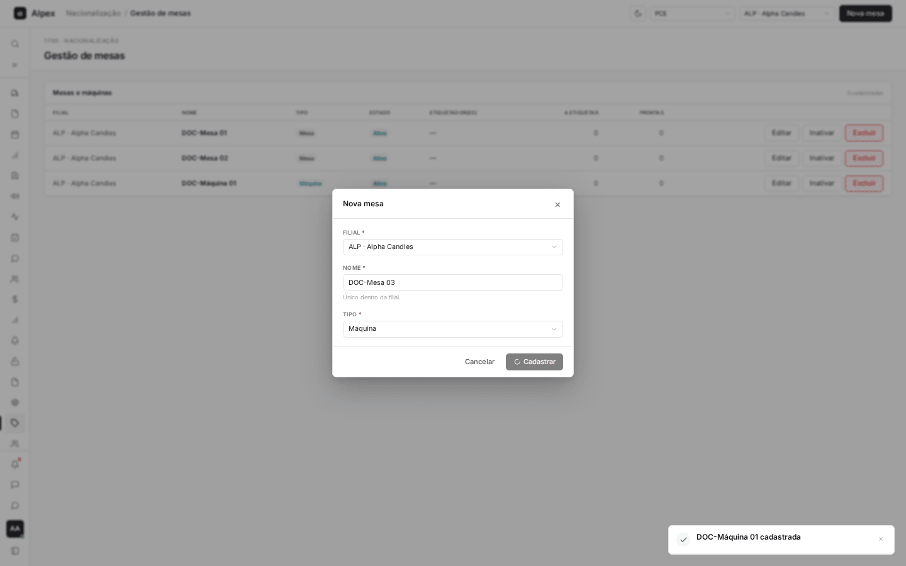

A tabela mostra, para cada mesa: **Filial**, **Nome**, **Tipo** (Mesa ou Máquina), **Estado** (Ativa ou Inativa, com o motivo), **Etiquetador(es)** que estão nela agora, **A etiquetar** (caixas aguardando etiqueta) e **Prontas** (caixas já etiquetadas esperando retirada).

## Ver só as mesas de uma filial

<Steps>
  <Step title="Escolher a filial">
    No alto da tela, abra o campo **Todas as filiais** e escolha a filial (por exemplo, **ALP · Alpha Candies**). A lista mostra só as mesas dela.

    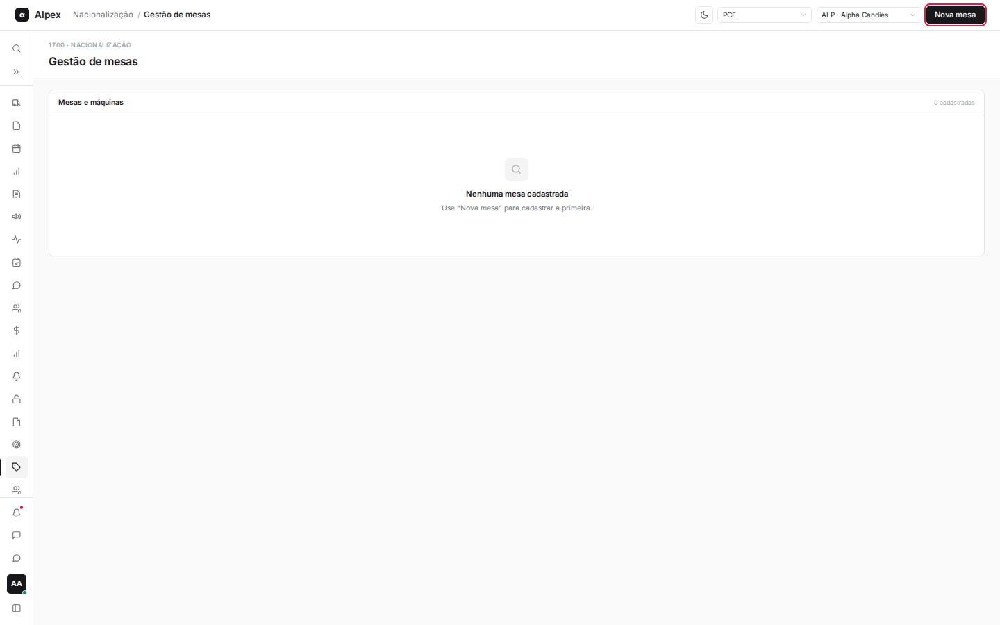
  </Step>
</Steps>

<Note>
Se o seu usuário tiver mais de um perfil de acesso, aparece também um campo de perfil ao lado do filtro de filial. Para cadastrar mesas é preciso estar com o perfil PCE, Gestão ou TI.
</Note>

## Cadastrar uma mesa ou máquina

<Steps>
  <Step title="Abrir o formulário">
    Clique em **Nova mesa**.

    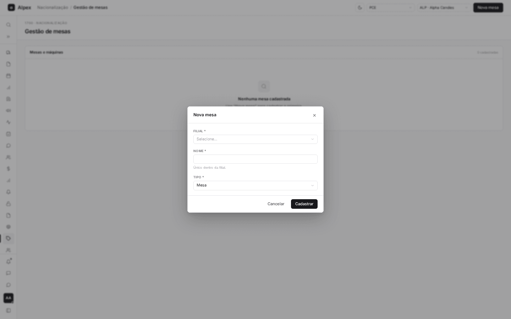
  </Step>
  <Step title="Preencher os dados">
    Escolha a **Filial**, digite o **Nome** (até 60 caracteres) e escolha o **Tipo**: **Mesa** ou **Máquina**.

    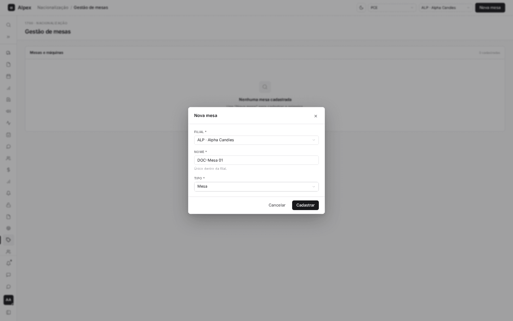

    Para uma máquina, escolha o tipo **Máquina**.

    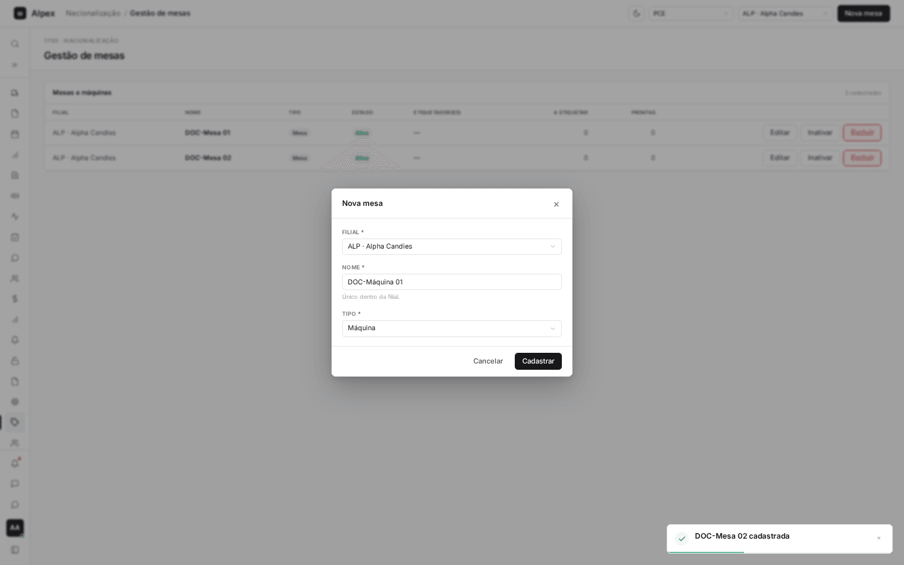
  </Step>
  <Step title="Cadastrar">
    Clique em **Cadastrar**. Uma mensagem confirma e a mesa entra na lista como **Ativa**.

    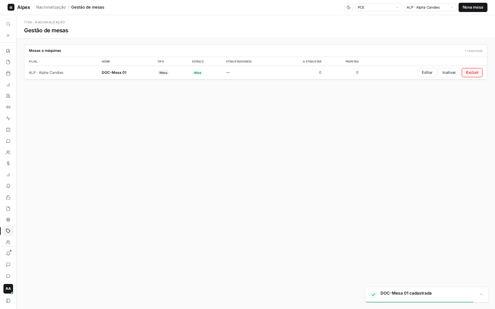
  </Step>
</Steps>

<Note>
O nome é único dentro da filial (maiúsculas e minúsculas contam como o mesmo nome). Se já existir, o formulário avisa e nada é gravado. A máquina funciona diferente da mesa no aplicativo: pode ter vários operadores ao mesmo tempo, não tem limite de caixas e a produção é rateada pelo tempo da equipe.
</Note>

## Editar o nome ou o tipo de uma mesa

<Steps>
  <Step title="Abrir a edição">
    Na linha da mesa, clique em **Editar**.

    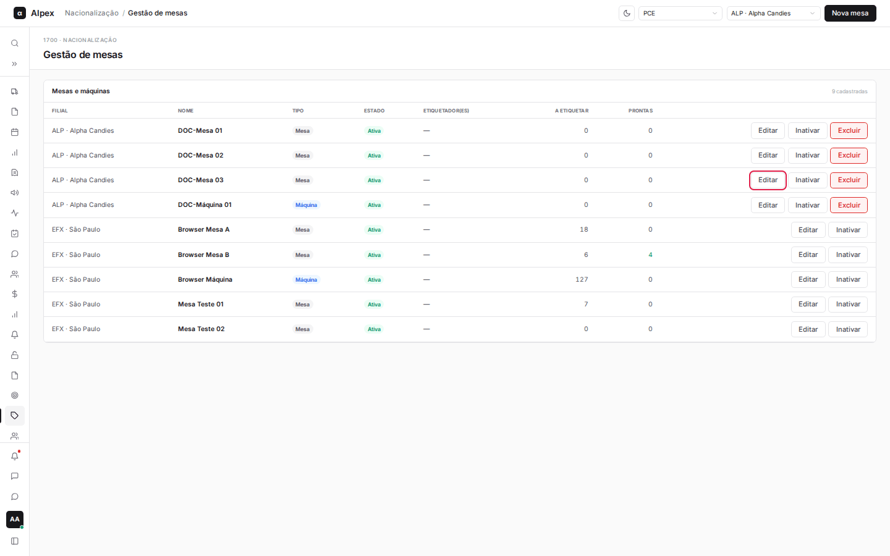
  </Step>
  <Step title="Alterar e salvar">
    Mude o **Nome** ou o **Tipo** e clique em **Salvar**. A filial não pode ser trocada.

    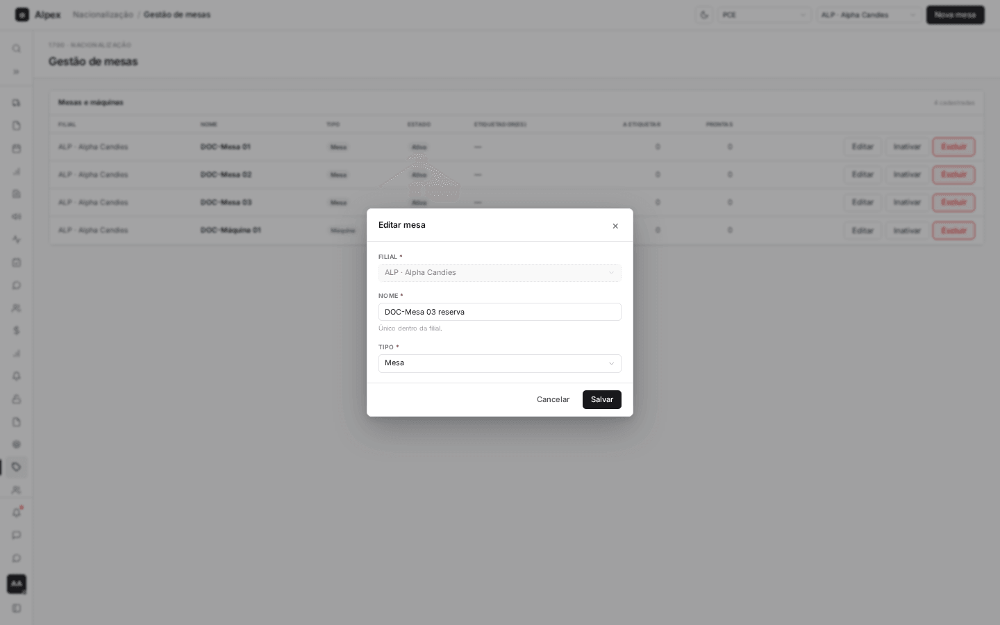

    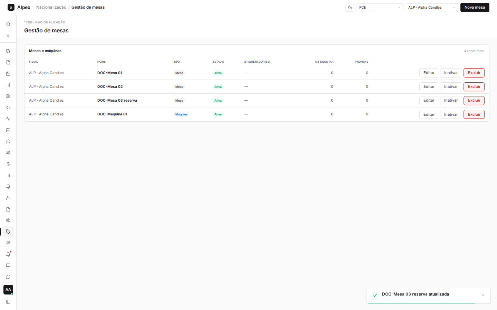
  </Step>
</Steps>

<Note>
O tipo (mesa ou máquina) só pode ser trocado quando a mesa está vazia: sem etiquetador e sem caixas. Caso contrário o sistema recusa e explica o motivo.
</Note>

## Inativar e reativar uma mesa

<Steps>
  <Step title="Inativar">
    Na linha da mesa, clique em **Inativar**. Escolha o **Motivo da inativação** (**Manutenção**, **Quebra**, **Reforma** ou **Sem uso no turno**) e clique em **Inativar**.

    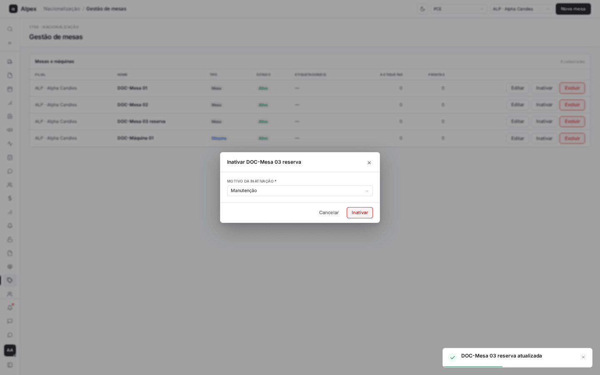
  </Step>
  <Step title="Conferir">
    A mesa passa para **Inativa**, com o motivo, quem inativou e quando. Ela deixa de aparecer para abastecimento e check-in no aplicativo.

    
  </Step>
  <Step title="Reativar">
    Para devolver a mesa à operação, clique em **Reativar**.

    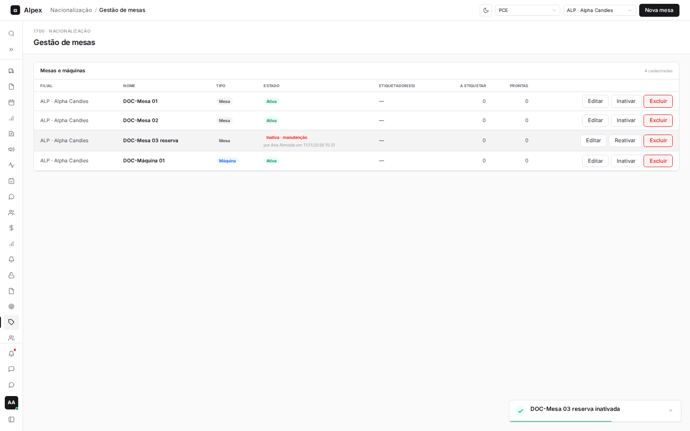
  </Step>
</Steps>

<Note>
Só dá para inativar mesa sem etiquetador e sem caixas (nem a etiquetar, nem prontas). Se houver, o sistema avisa o que falta fazer: fazer o check-out, retirar o etiquetado ou devolver o material ao pallet. A liderança também pode inativar e reativar pelo aplicativo de mesa.
</Note>

## Excluir uma mesa

<Steps>
  <Step title="Pedir a exclusão">
    Na linha da mesa, clique em **Excluir**. O botão só aparece para mesas que nunca tiveram movimento.

    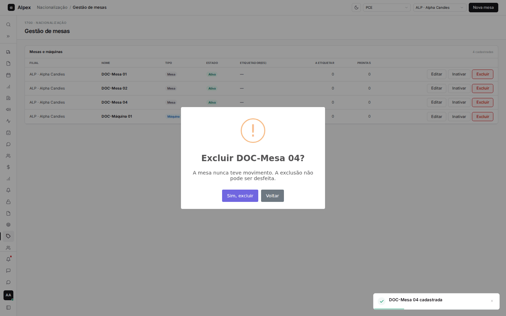
  </Step>
  <Step title="Confirmar">
    Clique em **Sim, excluir**. A mesa some da lista.

    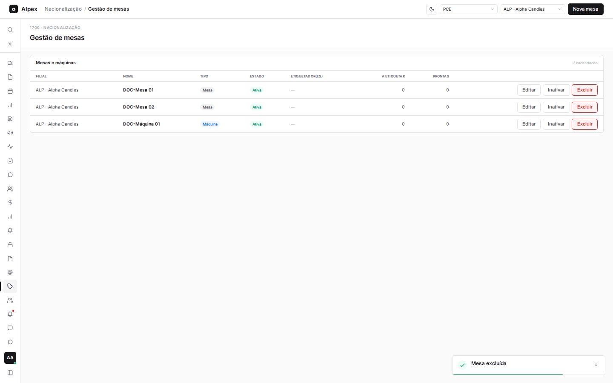
  </Step>
</Steps>

<Warning>
A exclusão não pode ser desfeita. Mesa que já teve abastecimento, etiquetador ou qualquer outro movimento não pode ser excluída: inative-a.
</Warning>
