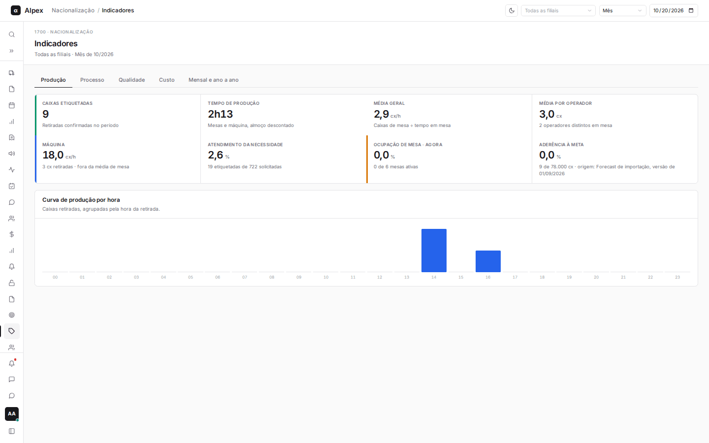
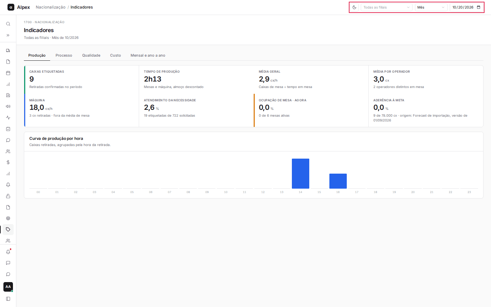
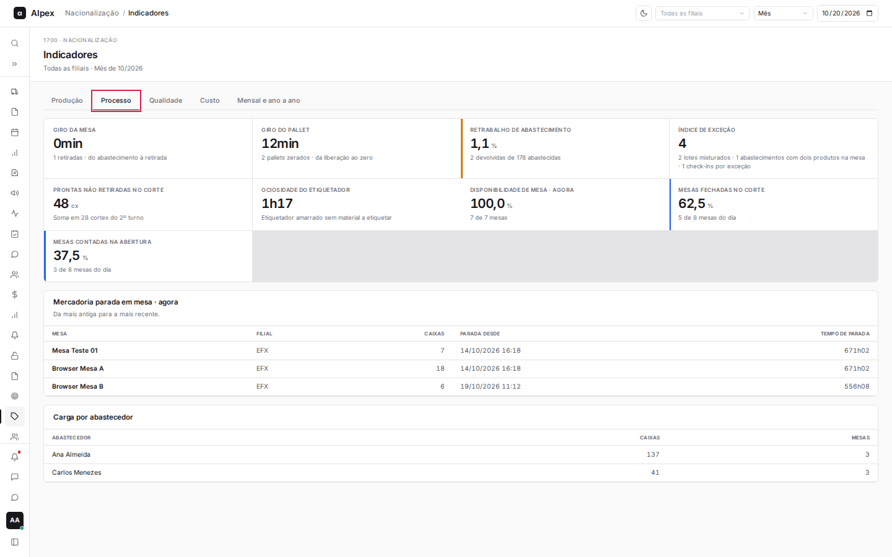
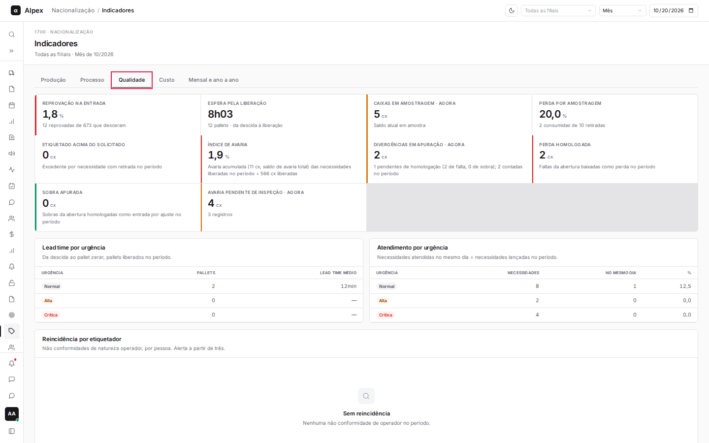
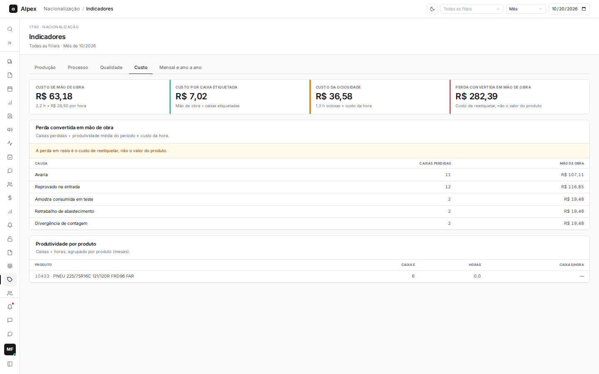
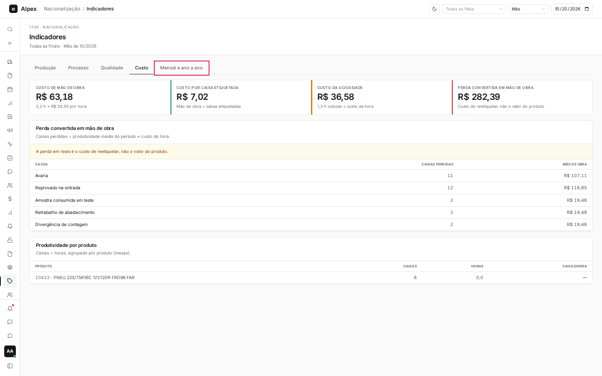

**Menu:** 1707 - Indicadores  
**Perfis:** Liderança, Supervisão, Gestão, TI

Painel de acompanhamento da etiquetagem: produção, processo, qualidade, custo e comparação mensal. É usado por liderança, supervisão e gestão para ver como a operação está indo e onde há perda.

## Escolher filial, corte e data

<Steps>
  <Step title="Escolher a filial">
    No canto superior direito, abra o primeiro campo (começa em **Todas as filiais**) e escolha a filial. Os números passam a considerar só ela. O título da tela mostra o escopo e o período em análise.

    
  </Step>
  <Step title="Escolher o corte">
    No segundo campo, escolha **Dia**, **Semana** ou **Mês**. O corte define o tamanho do período somado.
  </Step>
  <Step title="Escolher a data de referência">
    No terceiro campo, informe uma data (não pode ser futura). O período é o dia, a semana ou o mês que contém essa data. Sem data, vale o dia operacional de hoje.
  </Step>
</Steps>

<Note>
Na aba **Mensal e ano a ano** os campos de corte e data não aparecem, porque a comparação sempre usa os meses do ano. O filtro de filial continua valendo. Indicadores marcados com "agora" mostram a situação neste momento e não mudam com a data escolhida.
</Note>

## Ler a aba Produção

<Steps>
  <Step title="Abrir a aba">
    Clique em **Produção**. Ela é a primeira aba e abre por padrão.

    
  </Step>
  <Step title="Ler os cartões">
    - **Caixas etiquetadas**: total de caixas das retiradas confirmadas no período.
    - **Tempo de produção**: tempo somado de mesas e máquina, já descontado o almoço. Se houver etiquetador ainda em mesa, o cartão informa quanto desse tempo está em andamento.
    - **Média geral** (cx/h): caixas de mesa divididas pelo tempo em mesa.
    - **Média por operador**: caixas por pessoa, e quantos operadores distintos trabalharam em mesa.
    - **Máquina** (cx/h): produtividade da máquina. Ela não entra na média de mesa.
    - **Atendimento da necessidade**: percentual de caixas etiquetadas em relação às solicitadas nas necessidades do período.
    - **Ocupação de mesa · agora**: quantas mesas ativas estão ocupadas neste momento.
    - **Aderência à meta**: caixas do mês divididas pela meta do mês. Só tem valor no corte **Mês**; nos outros cortes aparece um traço.
  </Step>
  <Step title="Ler a curva de produção por hora">
    O gráfico de barras **Curva de produção por hora** mostra as caixas retiradas em cada hora do dia (00 a 23), pela hora da retirada. Passe o mouse sobre uma barra para ver o valor exato. Em cortes de semana ou mês, as horas de todos os dias são somadas.
  </Step>
</Steps>

## Ler a aba Processo

<Steps>
  <Step title="Abrir a aba">
    Clique em **Processo**.

    
  </Step>
  <Step title="Ler os cartões">
    - **Giro da mesa**: tempo médio do abastecimento até a retirada.
    - **Giro do pallet**: tempo médio da liberação do pallet até ele zerar.
    - **Retrabalho de abastecimento**: percentual de caixas devolvidas em relação às abastecidas.
    - **Índice de exceção**: soma de lotes misturados, abastecimentos com dois produtos na mesa e check-ins feitos por exceção. O detalhe de cada parte aparece embaixo do número.
    - **Prontas não retiradas no corte**: caixas etiquetadas que ficaram na mesa no corte do segundo turno, somadas no período.
    - **Ociosidade do etiquetador**: tempo em que o etiquetador ficou amarrado a uma mesa sem material para etiquetar.
    - **Disponibilidade de mesa · agora**: mesas ativas em relação às instaladas.
    - **Mesas fechadas no corte**: percentual de mesas do dia que tiveram fechamento.
    - **Mesas contadas na abertura**: percentual de mesas do dia que tiveram contagem de abertura.
  </Step>
  <Step title="Ler as tabelas">
    - **Mercadoria parada em mesa · agora**: mesas ativas com material e sem etiquetador, da mais antiga para a mais recente, com a hora desde quando estão paradas e o tempo de parada. Quando não há nada parado, a tabela mostra "Nada parado".
    - **Carga por abastecedor**: caixas e mesas atendidas por cada abastecedor no período.
  </Step>
</Steps>

## Ler a aba Qualidade

<Steps>
  <Step title="Abrir a aba">
    Clique em **Qualidade**.

    
  </Step>
  <Step title="Ler os cartões">
    - **Reprovação na entrada**: pallets reprovados em relação aos que desceram para a conferência.
    - **Espera pela liberação**: tempo médio da descida do pallet até a liberação.
    - **Caixas em amostragem · agora**: saldo de caixas que estão em amostra neste momento.
    - **Perda por amostragem**: caixas de amostra consumidas em relação às retiradas para amostra.
    - **Etiquetado acima do solicitado**: excedente de caixas, por necessidade, nas que tiveram retirada no período.
    - **Índice de avaria**: avaria acumulada das necessidades liberadas no período dividida pelas caixas liberadas.
    - **Divergências em apuração · agora**: caixas de divergências da abertura que ainda aguardam homologação, separadas em faltas e sobras.
    - **Perda homologada**: faltas da abertura baixadas como perda no período.
    - **Sobra apurada**: sobras da abertura homologadas como entrada por ajuste no período.
    - **Avaria pendente de inspeção · agora**: caixas e registros de avaria ainda sem inspeção.
  </Step>
  <Step title="Ler as tabelas por urgência">
    - **Lead time por urgência**: para cada urgência (Normal, Alta, Crítica), quantos pallets foram liberados no período e o tempo médio da descida até o pallet zerar.
    - **Atendimento por urgência**: necessidades lançadas no período, quantas foram atendidas no mesmo dia e o percentual.
  </Step>
  <Step title="Ler a reincidência por etiquetador">
    A tabela **Reincidência por etiquetador** conta as não conformidades de natureza operador por pessoa. A partir de três ocorrências aparece a marca **Alerta** na linha.
  </Step>
</Steps>

## Ler a aba Custo

<Steps>
  <Step title="Abrir a aba">
    Clique em **Custo**.

    
  </Step>
  <Step title="Ler os cartões">
    - **Custo de mão de obra**: horas de produção multiplicadas pelo **Custo da hora de etiquetagem** definido em Parâmetros e metas.
    - **Custo por caixa etiquetada**: mão de obra dividida pelas caixas etiquetadas.
    - **Custo da ociosidade**: horas ociosas multiplicadas pelo custo da hora.
    - **Perda convertida em mão de obra**: total, em reais, do que a perda custou em retrabalho.
  </Step>
  <Step title="Ler as tabelas">
    - **Perda convertida em mão de obra**: para cada causa (por exemplo avaria, reprovado na entrada, amostra consumida, retrabalho de abastecimento e divergência de contagem), as caixas perdidas e o custo de reetiquetá-las. Conta: caixas perdidas divididas pela produtividade média do período e multiplicadas pelo custo da hora.
    - **Produtividade por produto**: caixas, horas e caixas por hora de cada produto etiquetado em mesa.
  </Step>
</Steps>

<Note>
A perda em reais é o custo de reetiquetar, não o valor do produto. Se o custo da hora estiver zerado em Parâmetros e metas, os valores em reais também ficam zerados.
</Note>

## Ler a aba Mensal e ano a ano

<Steps>
  <Step title="Abrir a aba">
    Clique em **Mensal e ano a ano**.

    
  </Step>
  <Step title="Ler a tabela">
    Cada linha é um mês do ano. As colunas mostram as caixas do ano atual e do ano anterior, a variação de volume (**Δ volume**), a produtividade em caixas por hora dos dois anos e a variação de produtividade (**Δ produtividade**). O mês corrente fica destacado e é comparado só até o mesmo dia do mês do ano anterior. A última linha, **Acumulado do ano (mesmo corte)**, soma o ano até esse dia.
  </Step>
</Steps>
