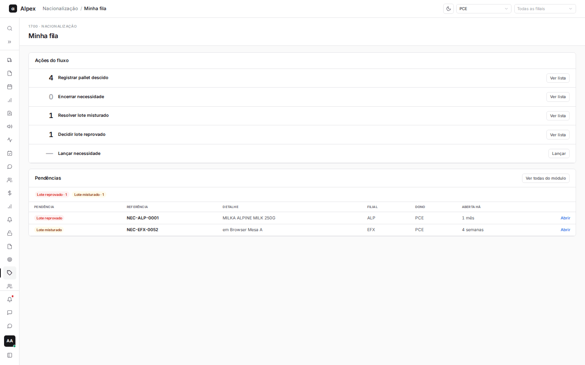
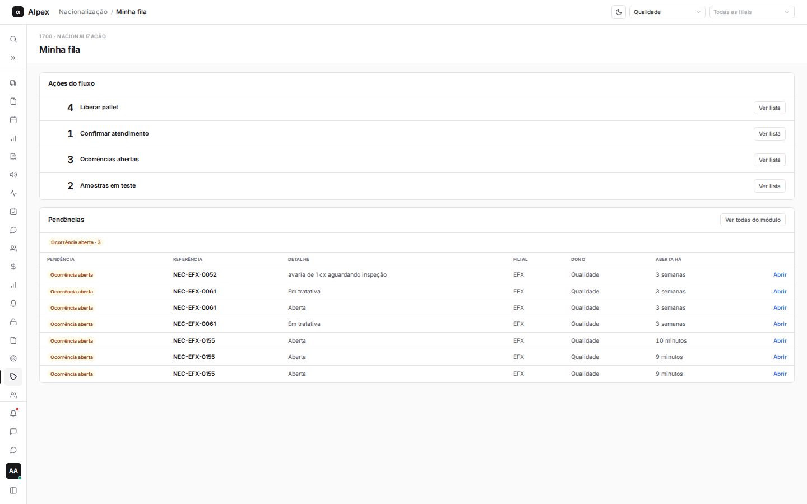
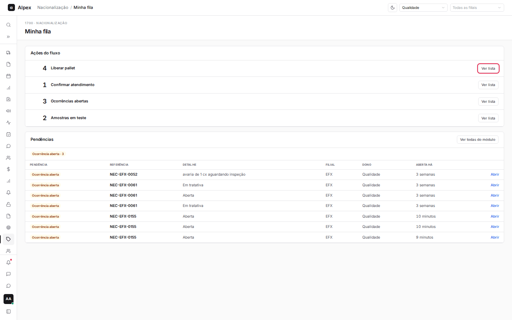
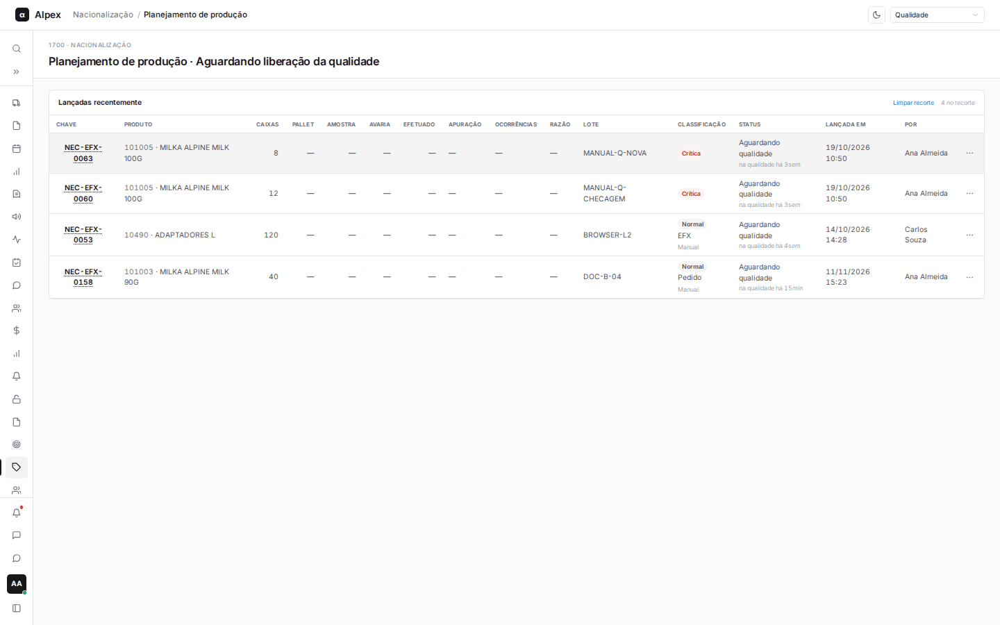
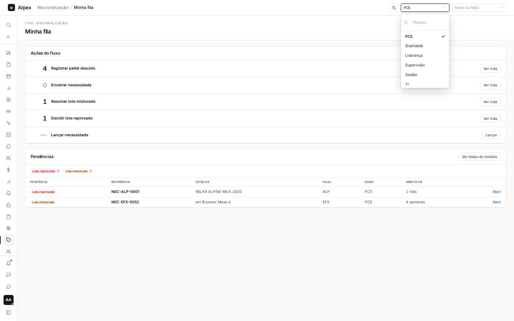
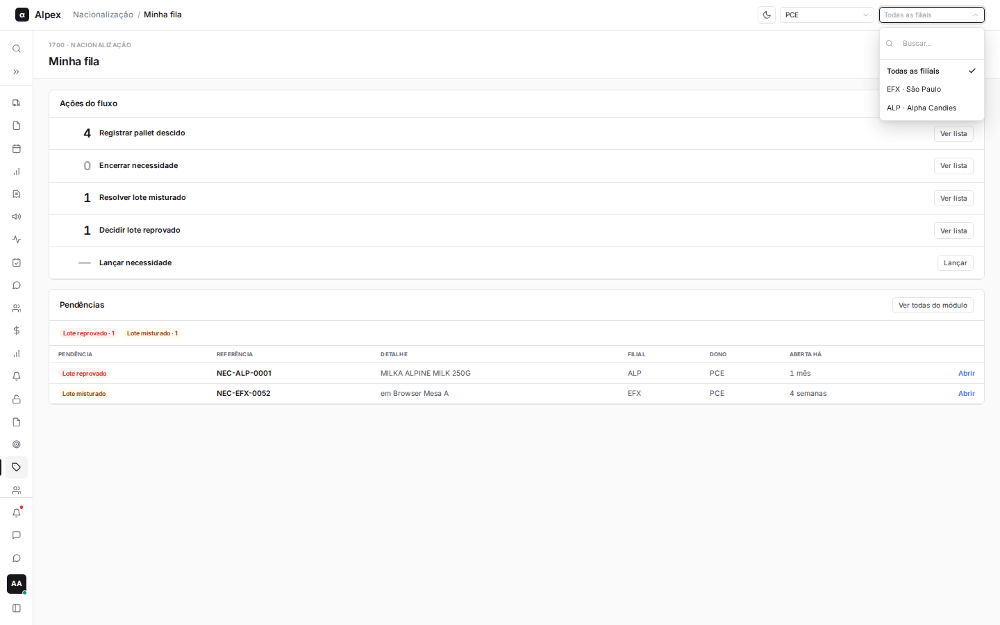
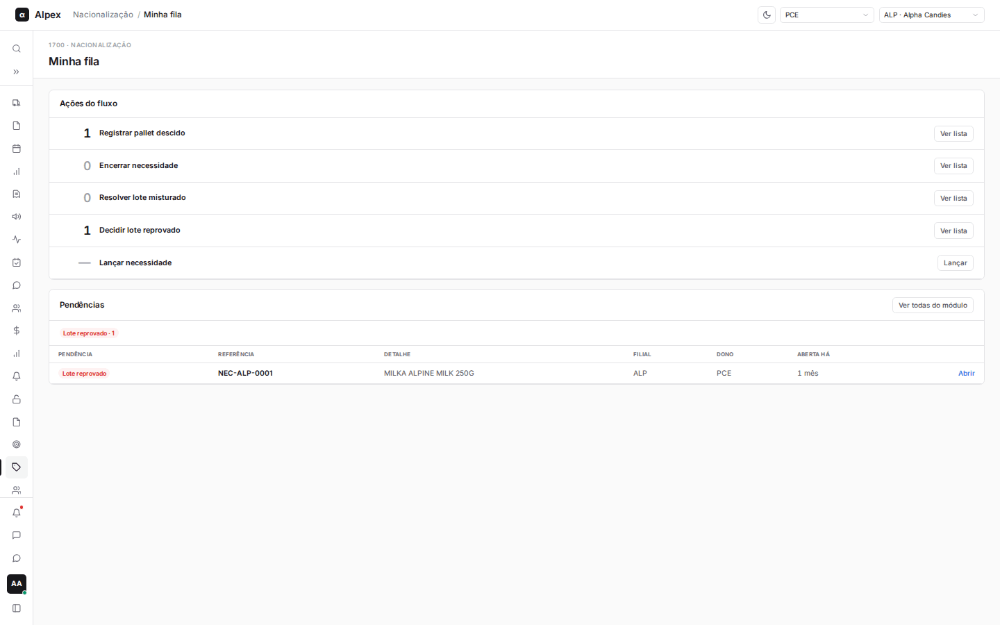
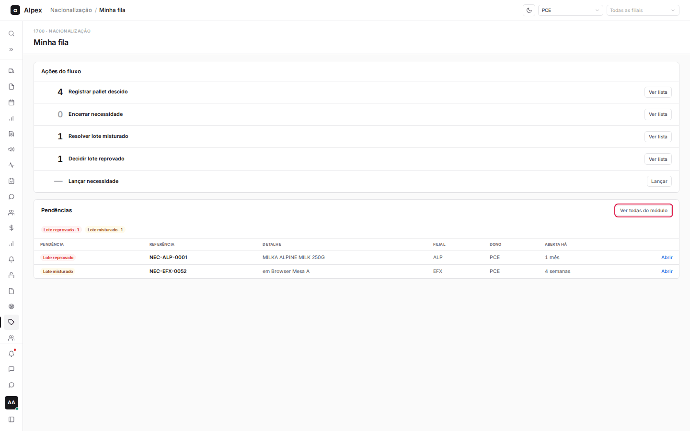
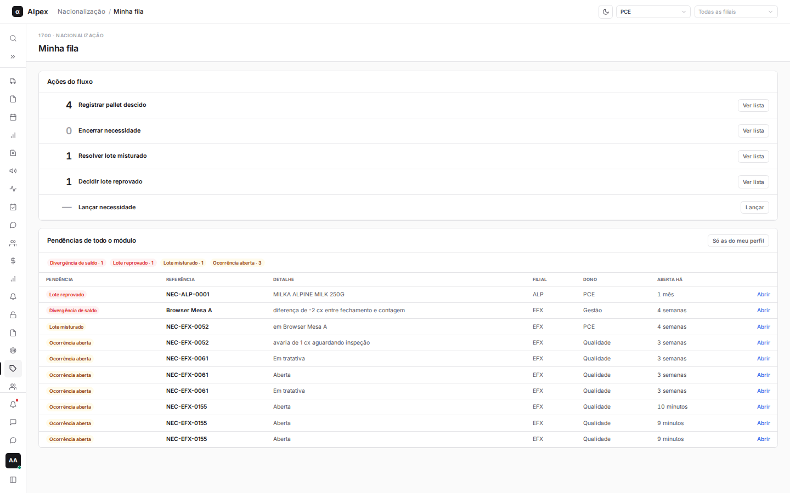
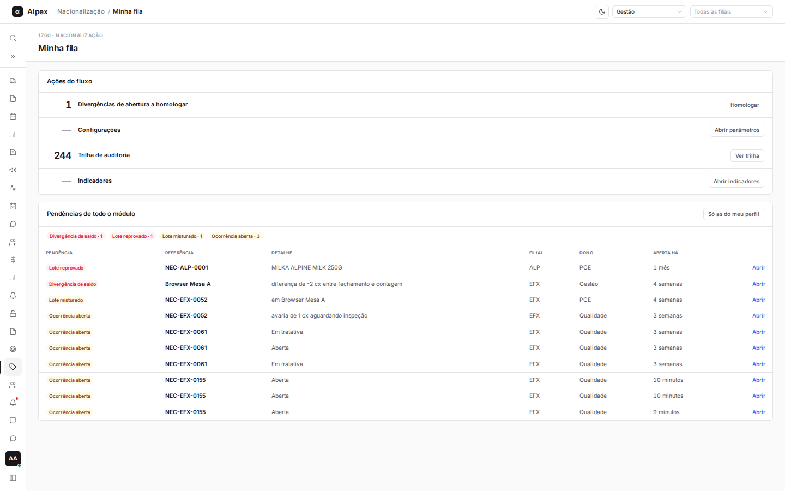

**Menu:** 1706 - Minha fila  
**Perfis:** PCE, Qualidade, Liderança, Supervisão, Gestão, TI

Resume o que está esperando por você: um painel com as ações do seu perfil e quanto há em cada uma, e uma lista de pendências abertas, da mais antiga para a mais nova. Serve de ponto de partida do dia para PCE, qualidade, liderança, supervisão e gestão. O abastecedor não usa esta tela: as ações dele ficam no aplicativo de mesa.

## Usar as ações do fluxo

<Steps>
  <Step title="Ler os contadores">
    O quadro **Ações do fluxo** lista as ações do seu perfil. O número à esquerda diz quantos itens esperam por você (cinza e "0" ou "—" quando não há nada). As ações variam por perfil:

    - **PCE**: **Registrar pallet descido**, **Encerrar necessidade**, **Resolver lote misturado**, **Decidir lote reprovado** e **Lançar necessidade**.
    - **Qualidade**: **Liberar pallet**, **Confirmar atendimento**, **Ocorrências abertas** e **Amostras em teste**.
    - **Liderança**: **Check-in do dia**, **Fechamento do dia** e **Indicadores**.
    - **Gestão e TI**: **Divergências de abertura a homologar**, **Configurações**, **Trilha de auditoria** e **Indicadores**.
    - **Supervisão**: **Indicadores**.

    
  </Step>
  <Step title="Abrir a lista">
    Clique no botão da ação (**Ver lista**, **Lançar**, **Homologar**, **Abrir parâmetros**, **Ver trilha**, **Abrir indicadores** ou **Abrir app de mesa**). Nas ações que contam necessidades, abre o **Planejamento de produção** já recortado naquele grupo (com o link **Limpar recorte**). As demais abrem a tela correspondente do módulo.

    

    
  </Step>
</Steps>

## Trocar de perfil e filtrar por filial

<Steps>
  <Step title="Trocar o perfil">
    Quem tem mais de um perfil vê a caixa do perfil no alto da tela. Abra e escolha outro: as ações e as pendências mudam.

    
  </Step>
  <Step title="Escolher a filial">
    Na caixa de filial, que começa em **Todas as filiais**, escolha **EFX · São Paulo** ou **ALP · Alpha Candies**.

    
  </Step>
  <Step title="Conferir o resultado">
    Os contadores e a lista passam a mostrar só a filial escolhida.

    
  </Step>
</Steps>

<Note>
Para voltar a ver todas as filiais, escolha **Todas as filiais** na mesma caixa.
</Note>

## Acompanhar as pendências

<Steps>
  <Step title="Ler o resumo">
    A parte **Pendências** mostra etiquetas com o total de cada tipo: **Lote reprovado**, **Lote misturado**, **Ocorrência aberta**, **Retido para análise**, **Falta sinalizada**, **Etiquetado acima do solicitado**, **Divergência de saldo** e **Mesa inativa**. Por padrão, mostra só as pendências que são do seu perfil (PCE, qualidade, liderança ou gestão); gestão e TI começam vendo todas.
  </Step>
  <Step title="Ler a tabela">
    Cada linha traz a **Pendência**, a **Referência** (chave da necessidade ou nome da mesa), o **Detalhe**, a **Filial**, o **Dono** (perfil responsável) e há quanto tempo está **Aberta há**. As mais antigas ficam no alto. Clique em **Abrir** para ir à tela onde se resolve.

    
  </Step>
  <Step title="Ver as pendências de todo o módulo">
    Clique em **Ver todas do módulo** para incluir as pendências dos outros perfis. O título passa a **Pendências de todo o módulo** e o botão vira **Só as do meu perfil**.

    

    
  </Step>
  <Step title="Visão da gestão">
    A gestão começa vendo as pendências de todo o módulo, inclusive divergências de saldo de mesa.

    
  </Step>
</Steps>

<Note>
Cada lista mostra até 50 pendências por tipo. Quando não há nenhuma, a tela mostra "Nenhuma pendência".
</Note>
