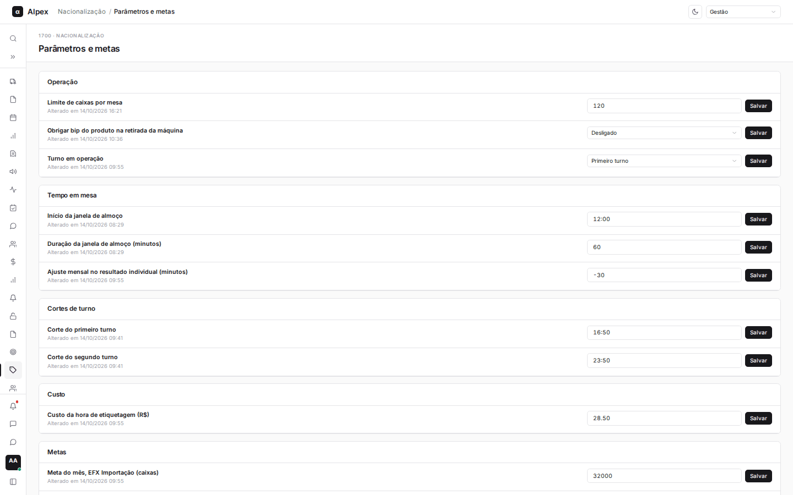
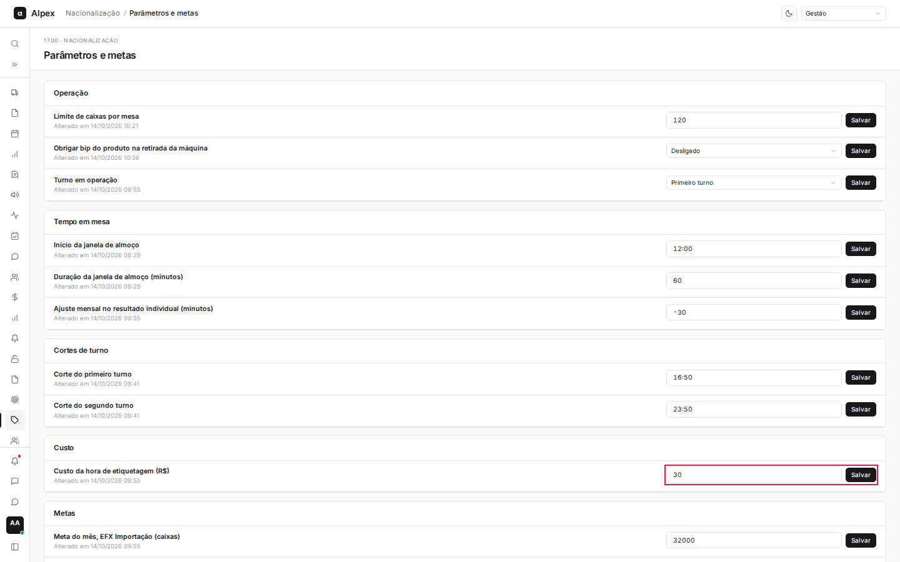
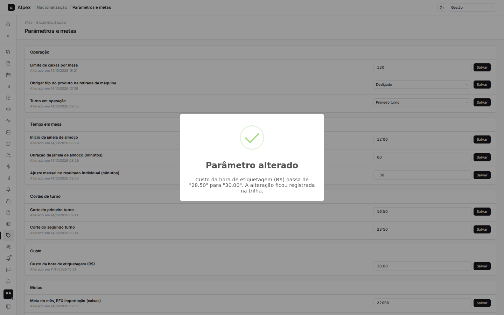
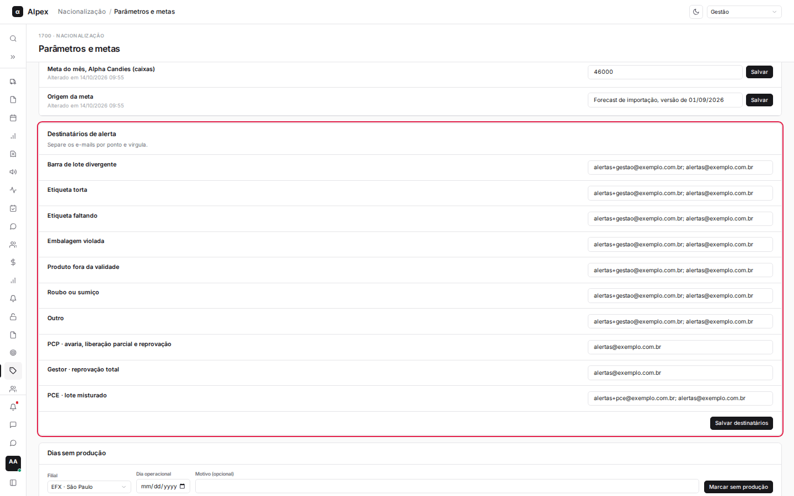
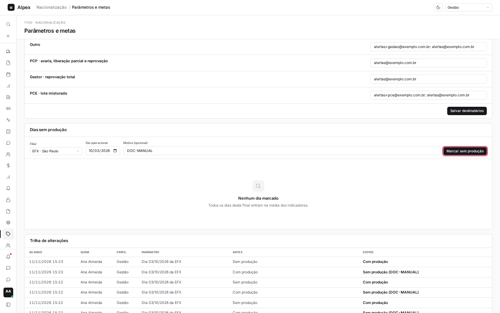
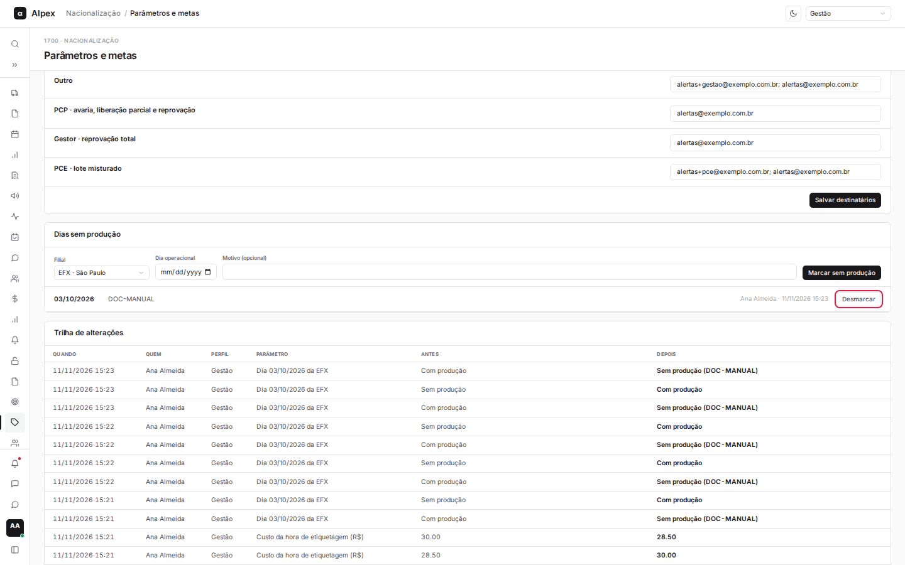
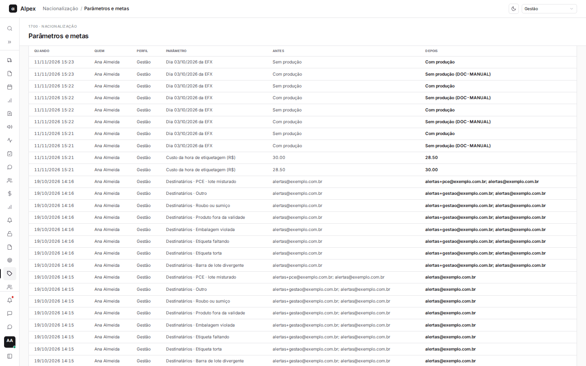

**Menu:** 1708 - Parâmetros e metas  
**Perfis:** Liderança, Gestão, TI

Tela onde se ajustam as regras de operação, os horários de corte, o custo da hora, as metas do mês, os destinatários dos alertas e os dias sem produção. Cada alteração fica registrada na trilha no fim da página. Quem altera é a gestão (e a TI); a liderança vê tudo em modo leitura e só marca dias sem produção.

## Alterar um parâmetro ou meta

*Perfis: Gestão, TI*

<Steps>
  <Step title="Localizar o parâmetro">
    Os parâmetros estão separados em grupos: **Operação**, **Tempo em mesa**, **Cortes de turno**, **Custo** e **Metas**. Abaixo do nome aparece a data da última alteração.
  </Step>
  <Step title="Digitar o novo valor">
    Digite o valor no campo ou, nos parâmetros de escolha (**Obrigar bip do produto na retirada da máquina** e **Turno em operação**), selecione a opção.

    
  </Step>
  <Step title="Salvar">
    Clique em **Salvar** na mesma linha (ou tecle Enter nos campos de texto). Cada linha é salva sozinha. Aparece a mensagem **Parâmetro alterado** com o valor de antes e o de depois.

    
  </Step>
</Steps>

<Note>
Se o valor for inválido (por exemplo, o limite de caixas por mesa precisa ser pelo menos 1), a tela mostra o erro em vermelho abaixo do campo e volta ao valor anterior. Salvar sem mudar o valor não gera registro na trilha. Quem tem perfil sem permissão vê a tela em somente leitura, sem os botões **Salvar**.
</Note>

O efeito de cada parâmetro no restante do módulo:

- **Limite de caixas por mesa**: máximo de caixas que uma mesa pode receber no abastecimento.
- **Obrigar bip do produto na retirada da máquina**: quando **Ligado**, quem registra a retirada da máquina precisa bipar o produto.
- **Turno em operação**: indica se o turno em operação é o **Primeiro turno** ou o **Segundo turno**.
- **Início da janela de almoço** e **Duração da janela de almoço (minutos)**: o intervalo de almoço é descontado do tempo em mesa e na máquina, o que afeta o **Tempo de produção**, as médias de caixas por hora e o custo.
- **Ajuste mensal no resultado individual (minutos)**: ajuste, em minutos (aceita valor negativo), aplicado ao resultado individual do etiquetador no mês.
- **Corte do primeiro turno** e **Corte do segundo turno**: horários em que cada turno é cortado. Depois do corte, o check-in daquele turno só volta no próximo dia operacional. O corte do segundo turno também define quando o dia operacional vira.
- **Custo da hora de etiquetagem (R$)**: base de todos os valores em reais da aba **Custo** dos Indicadores.
- **Meta do mês, EFX Importação (caixas)** e **Meta do mês, Alpha Candies (caixas)**: base do cartão **Aderência à meta** dos Indicadores, uma meta por filial.
- **Origem da meta**: texto livre que aparece nos Indicadores para dizer de onde veio a meta (por exemplo, a versão do forecast).

## Definir os destinatários dos alertas

*Perfis: Gestão, TI*

<Steps>
  <Step title="Ir até a seção">
    Role até **Destinatários de alerta**. Há uma linha para cada tipo de não conformidade (como **Etiqueta torta** e **Etiqueta faltando**) e para os avisos de **PCP**, **Gestor** e **PCE**.

    
  </Step>
  <Step title="Editar os e-mails">
    Em cada linha, digite os e-mails separados por ponto e vírgula.
  </Step>
  <Step title="Salvar">
    Clique em **Salvar destinatários**. Aparece a mensagem **Destinatários de alerta salvos**. Se algum e-mail for inválido, a tela mostra o erro e nada é salvo.
  </Step>
</Steps>

<Note>
Todas as linhas são salvas de uma vez só. Quando uma não conformidade de alerta imediato é registrada, os e-mails da linha correspondente recebem o aviso.
</Note>

## Marcar e desmarcar dia sem produção

*Perfis: Liderança, Gestão*

<Steps>
  <Step title="Escolher a filial">
    Na seção **Dias sem produção**, escolha a filial no campo **Filial**. A lista abaixo mostra os dias já marcados dessa filial.
  </Step>
  <Step title="Informar o dia e o motivo">
    Preencha **Dia operacional** (hoje ou um dia passado) e, se quiser, o **Motivo (opcional)**, com até 160 caracteres.

    
  </Step>
  <Step title="Marcar">
    Clique em **Marcar sem produção**. O dia entra na lista com a data, o motivo, quem marcou e quando.

    
  </Step>
  <Step title="Desmarcar, se preciso">
    Para desfazer, clique em **Desmarcar** na linha do dia. Ele volta a entrar na média dos indicadores.
  </Step>
</Steps>

<Note>
Um dia marcado sai da média dos indicadores da filial (feriado, parada de máquina, falta de material e situações parecidas). Não é possível marcar uma data futura nem marcar duas vezes o mesmo dia da mesma filial. Marcar e desmarcar são da liderança e da gestão; os demais perfis só leem.
</Note>

## Consultar a trilha de alterações

<Steps>
  <Step title="Ir até o fim da página">
    Role até **Trilha de alterações**.

    
  </Step>
  <Step title="Ler as linhas">
    Cada linha mostra **Quando**, **Quem**, **Perfil**, **Parâmetro**, **Antes** e **Depois**. As mais recentes ficam no topo. Entram na trilha as mudanças de parâmetros, metas, destinatários e dias sem produção.
  </Step>
</Steps>
