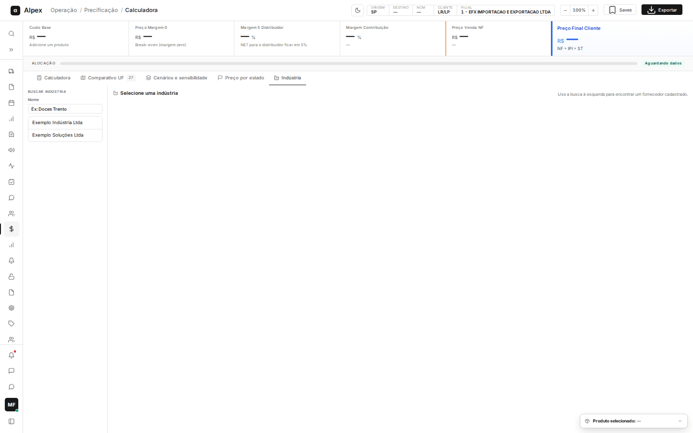
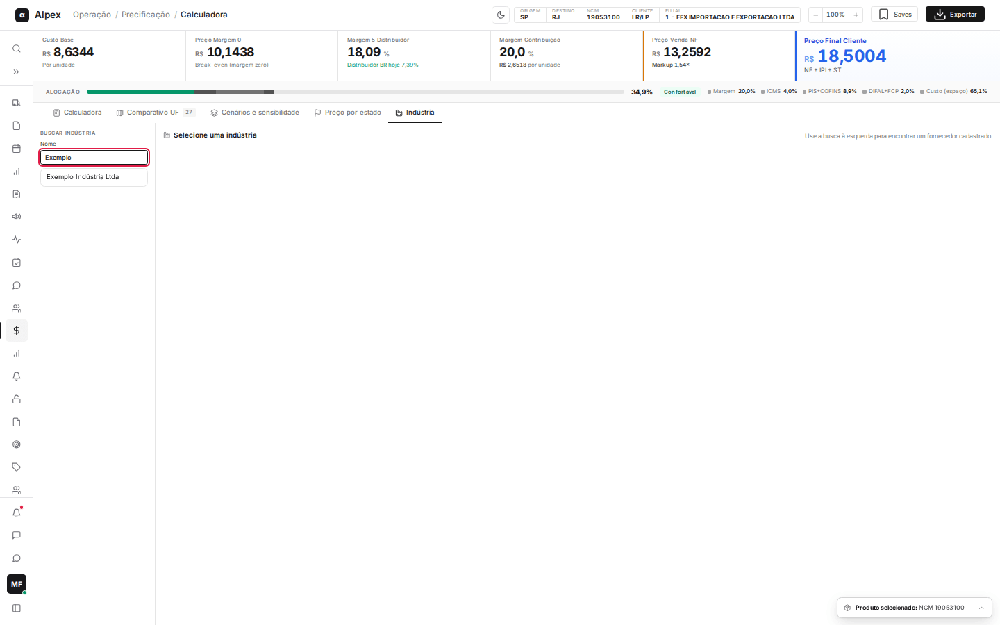
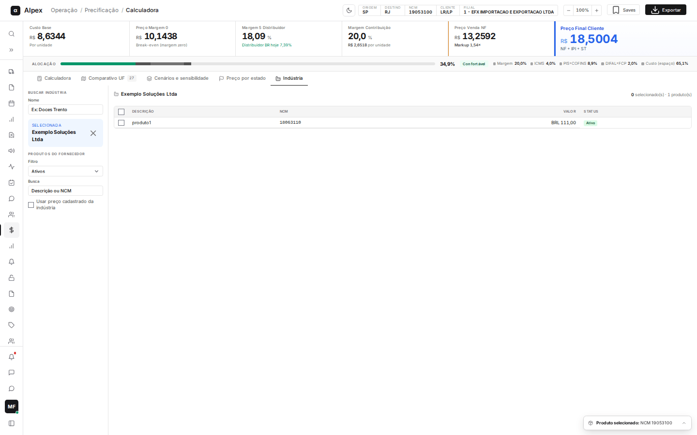
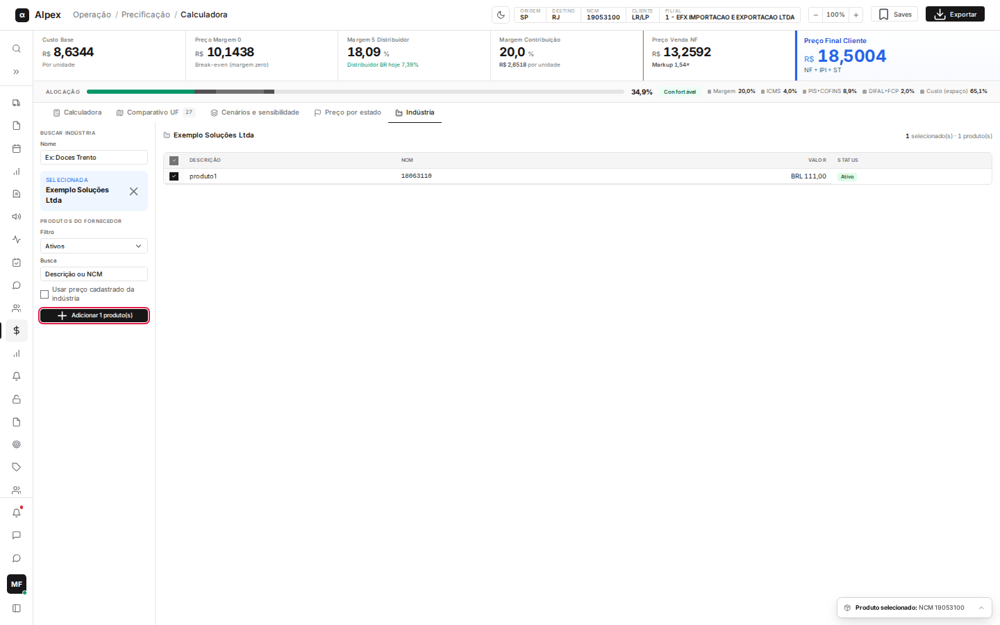

**Menu:** 1101 - Calculadora V2, aba Indústria

A aba **Indústria** permite buscar um fornecedor cadastrado e trazer os produtos dele para dentro da Calculadora, com o preço cadastrado da indústria como custo de compra. Quem precifica produtos de fornecedores sem custo no Winthor costuma usar esta aba.

Ela aparece quando a origem do custo na Calculadora é **Manual**. Com **WinThor** ligado, a aba some, porque o custo vem do Winthor e o preço da indústria não se aplica.

## Buscar e escolher uma indústria

<Steps>
  <Step title="Digitar o nome">
    Na coluna **Buscar indústria**, escreva parte do nome no campo **Nome** (exemplo do campo: **Ex: Doces Trento**). A lista mostra até 20 indústrias ativas.

    
  </Step>
  <Step title="Escolher">
    Clique no nome desejado. O quadro azul **Selecionada** mostra a indústria e a tabela **Produtos do fornecedor** aparece à direita, com **Descrição**, **NCM**, **Valor** (na moeda do cadastro) e **Status** (**Ativo** ou **Inativo**).

    
  </Step>
  <Step title="Trocar de indústria">
    Clique no **X** do quadro azul para limpar a seleção e buscar outra.
  </Step>
</Steps>

<Note>
Só entram na busca indústrias ativas. O texto no canto da tabela informa quantos produtos estão selecionados e quantos foram encontrados (máximo de 100).
</Note>

## Filtrar os produtos do fornecedor

<Steps>
  <Step title="Escolher o status">
    Em **Filtro**, escolha **Ativos** (padrão), **Inativos** ou **Todos**.
  </Step>
  <Step title="Buscar por texto">
    No campo **Busca**, digite parte da descrição ou do NCM (**Descrição ou NCM**). A tabela se atualiza sozinha.
  </Step>
</Steps>

## Adicionar produtos da indústria à Calculadora

<Steps>
  <Step title="Selecionar os produtos">
    Marque a caixa dos produtos desejados. A caixa do cabeçalho seleciona (ou limpa) todos os produtos ativos da lista; produtos inativos não podem ser marcados.
  </Step>
  <Step title="Definir se usa o preço cadastrado">
    Marque **Usar preço cadastrado da indústria** se quiser que o valor de compra dos produtos já venha preenchido com o preço do fornecedor. Sem marcar, o valor de compra entra vazio para você digitar.
  </Step>
  <Step title="Adicionar">
    Clique em **Adicionar N produto(s)**. Os produtos entram na lista da aba **Calculadora**, prontos para informar margem e calcular.

    
  </Step>
</Steps>

<Note>
Produtos sem NCM cadastrado não são adicionados e o sistema avisa quais foram. Produto que já estava na lista é ignorado (aviso **Já na lista**). Se o NCM não tem impostos de compra cadastrados, o produto entra com o aviso **NCM sem cadastro de impostos**, e o preço só é calculado depois de regularizar o cadastro. Adicionar produtos não grava nada no cadastro.
</Note>
